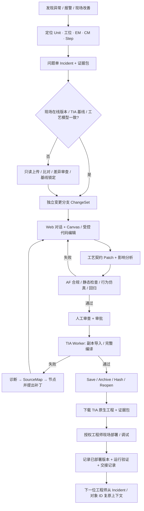

# aiCoPlc · 现场变更与跨工程师交接闭环（开发补充 PLAN）

> 版本：1.0 · 设计建议稿 · 2026-11-15  
> 实现状态：**已交付并验证（2026-11-15）**，见 [aiCoPlc_FieldChange_Handover_STATUS.md](./aiCoPlc_FieldChange_Handover_STATUS.md)（后端 373/373、前端 513/515、V19_real 真机凭证）。  
> 范围：现场调试、工程变更、AF 一致性、TIA Openness 原生工程交付、工程师交接及诊断追踪。  
> 目标：无论现场由谁接手，都能从一个报警、组件或问题单，定位其工位、控制逻辑、原生 PLC 块、修改历史与验证证据。  
> 边界：**下载 TIA 工程 ≠ 将程序下载到现场 PLC**。在线部署必须经过独立授权、现场安全检查与人工控制。

## 0. 先修正产品假设

1. **现场 PLC 是运行事实，Web 工艺模型是设计事实，TIA 归档是交付事实。** 三者可能分叉，不能假定任何一份永远代表现场最新版；每次修改必须执行基线对比。
2. **一个工位不必严格等于一个 AF EM。** 物理设备结构与 AF 逻辑组织关联但独立，允许一个物理工位映射多个 EM，反之须经架构规则约束。
3. **标准化的是 CM 的外部控制与诊断契约，不是所有驱动的内部算法。** 不更改官方 AF/LBC 块本体；特殊设备用经验证的适配层。
4. **编译通过不等于可以上线。** 工艺功能、模式/状态、异常路径、设备兼容、保留数据风险、HMI/报警、现场安全步骤均需单独验收。
5. **报警定位不是根因证明。** 所有诊断区分观测事实、来源关联、候选原因和已验证的真实根因。
6. **现场直接在 TIA 中修改的代码不能被默默覆盖。** 检测漂移、冻结变更、比对并人工合并；不可可靠反向解析的代码应作为受控黑盒保留。

## 1. 全链路总图



### 三条不可混淆的链路

| 链路 | 目的 | 完成状态 | 权限 |
|---|---|---|---|
| Design → Build | 工艺编辑、AF 编译、生成并下载 `.zapXX` | BUILD_VERIFIED | 开发 + 审查 |
| Build → Commission | 在实际设备上下载/调试/确认运行 | COMMISSIONED | 现场授权人员；独立安全审批 |
| Runtime → Incident | 报警、事件、状态证据、责任与交接 | INCIDENT_RESOLVED / OPEN | 工程师和维护人员 |

**原则：** 只有第二条链路有真实设备接触；不能因为第一条链路成功而声称现场已经更新。

## 2. 统一对象身份与四张关联图

### 2.1 分开建模，统一引用

| 图 | 主要对象 | 解决问题 |
|---|---|---|
| PhysicalGraph | Site / Machine / Station / Cabinet / Assembly / Component | 设备实际位置是什么 |
| AfGraph | Unit / EM / CM / Job / ControlNodes / Sequence / Library Ref | PLC 软件如何组织 |
| BehaviorGraph | Step / Transition / Guard / Action / Interlock / Timeout / Recovery | 何时做什么、谁在等待谁 |
| EvidenceGraph | Incident / Alarm / ChangeSet / Test / Build / Deployment / SourceMap | 为什么修改、改了什么、谁批准、有何证据 |

**不得用路径字符串作为永久身份**。所有对象分配不可复用的 `object_id`。中文名称、工位顺序、画布坐标、TIA 块名和设备位置都允许变化，变更保留历史路径和别名。示例：`cmp_01HZ...`（非真实 ID）。

### 2.2 关联索引

```text
Physical Component ID ──maps_to──> AF CM ID
AF CM ID ──participates_in──> Behavior Step IDs
Behavior Step ID ──compiles_to──> TIA Block / Network / SCL Span
Alarm Definition ID ──originates_from──> AF CM ID / EM ID
Runtime Alarm Event ──raised_at──> Deployed Build ID + Timestamp
ChangeSet ID ──modifies──> Semantic IDs + SourceMap IDs
```

迁移、重命名或生成块编号变化时，只更新映射版本；历史报警仍以**发生时的部署版本**解析，不用当前版本错误回溯。

### 2.3 最小对象数据契约

```json
{
  "object_id": "cm_clamp_a_001",
  "display_name": "夹紧气缸 A",
  "physical_parent_id": "station_battery_change",
  "af_role": "CM",
  "af_owner_em_id": "em_battery_clamp",
  "driver_contract_id": "two_way_cylinder/v1",
  "io_bindings": {"extend_feedback": "symbolic_only"},
  "behavior_refs": ["step_clamp_extend"],
  "source_map_refs": ["src_0009"],
  "alarm_definition_refs": ["alarm_clamp_timeout"],
  "status": "DESIGNED"
}
```

## 3. Web：现场问题驱动的工作台

建议工作台不再只有“工程列表”，而是包含三个入口：**按工位找设备**、**按报警找逻辑**、**按变更单找工程**。操作员扫描设备二维码或输入报警代码可直接进入该对象（二维码只是入口，不是授权凭证）。

### 3.1 主要页面

| 页面 | 必须支持 | 禁止行为 |
|---|---|---|
| 整机 Canvas | 工位、依赖、资源、状态汇总、位置跳转 | 直接操作下层任意物理输出 |
| 工位 Canvas | CM、逻辑步骤、互锁、状态、报警、测试 | 任意连线生成不确定控制流 |
| 组件详情 | 类型、驱动契约、命令/反馈、逻辑引用、源码位置、历史报警 | 修改官方库块内部实现 |
| 问题单 / 调试 | 复现条件、事实快照、时间线、修改提案、验收结果 | 把 AI 推测直接标为已确认根因 |
| Diff / 审核 | 语义差异、代码差异、影响对象、风险、审批 | 无审核静默覆盖工程 |
| Build / 发布 | TIA 编译诊断、证据、工程文件下载、部署前检查 | 用 Build 成功冒充现场部署成功 |
| 交接视图 | 最新基线、未结问题、当前已部署版本、风险与回退 | 依赖聊天历史作为唯一资料 |

### 3.2 现场修改的两种模式

**A. 首选：语义修改。** 工程师说“伸出超时由 3s 改为 5s”，系统定位 `cm` / `step`，显示当前值、依据、受影响的步骤和测试，生成 **结构化 Patch**；审核后经 AF 生成器修改工程副本。

**B. 专家模式：受控 SCL 修改。** 允许工程师提出代码变更，但必须保留精确 diff、原生块身份、变更原因和人工审核。能解析为语义契约的代码变更回写 IR；不能解析或不允许 AI 重生成的部分以 `MANAGED_NATIVE_OVERRIDE` 隔离，**由显式所有权规则保护**，不得称其已被 Canvas 语义理解。官方库 / F-Safety / 保护块禁止这种自动写入。

### 3.3 每次变更必须生成 Impact Report

包含受影响 Unit/EM/CM/Step、关联调用者、报警定义、I/O/DB 接口、HMI 消息、状态保持/复位风险、在线加载影响、回归测试与部署注意事项。未知项显示 `UNKNOWN` 并阻断相应高风险交付。

## 4. 变更管理：三份基线 + 两次比对

**B1 Design Baseline：** 审核冻结的工艺 IR，含 AF Profile、节点稳定 ID、契约、测试。

**B2 Native Baseline：** 从 B1 构建的 TIA 工程归档、原生块/标签/DB 源码清单及 SHA256。

**B3 Deployed Baseline：** 现场 PLC 实际程序的已确认标识/校验和、下载记录、设备身份、验收结果，以及可以获取时的只读在线比较结果。

B3 不能仅凭 `Build ID` 自报，必须有现场验证；无法连接 PLC 时标记 `UNVERIFIED_ONLINE`。

**第一次比对（开工前）：** B2 ↔ B3。若现场漂移，停止修改、从现场只读采集/上传可用信息、生成三方差异（工艺模型、工程副本、设备实际运行软件）。

**第二次比对（交付前/部署前）：** 审核时的项目 hash ↔ Build 输入；部署前 B3 ↔ 目标 PLC。任何变化使旧审批失效或进入再审批。

**并发与锁：** 每个项目/PLC 目标有受控写锁，带租约与故障恢复；多个工程师可并行阅读，但同一语义对象的并发修改要求显示冲突并合并，不接受最后写入者覆盖。

## 5. TIA Openness：真实原生工程构建

```text
[Approved ChangeSet + locked design hash]
         ↓
[Isolated Windows TIA Worker + pinned TIA/AF library]
         ↓
[Open known project COPY / baseline skeleton]
         ↓
[AF semantic lowering -> valid FB/DB/OB/XML / library instances]
         ↓
[Import and bind instances, type-check, compile full software]
         ↓
[Parse diagnostics -> SourceMap -> semantic objects]
         ↓
[Save -> Archive -> SHA256 -> Retrieve/Reopen]
         ↓
[Artifact manifest + signed-off release candidate]
```

**工艺模型不是直接执行代码。** LLM 只生成候选 Patch；AF 编译器依据经过批准的行为语义与锁定库接口确定性地产生工程元素。任何不能映射的动作阻断 Build，不能仅输出注释桩。

### 5.1 Build 状态机

`DRAFT → VALIDATING → REVIEW_REQUIRED → APPROVED → BUILDING → COMPILE_PASSED → ARCHIVED → REOPEN_VERIFIED → BUILD_VERIFIED`

失败进入 `FAILED`，保留日志。`COMPILE_PASSED` 不代表 `BUILD_VERIFIED`；后者要求完整归档/重开/工件关联通过。真实在线部署不属于该状态机。

### 5.2 自动修复边界

允许自动提议：块/实例 DB 名称冲突、缺少显式调用、库接口不匹配、类型不一致、合法 XML 等确定性编译问题。所有修复都以**候选变更**回到审查/验证链路。

禁止自动：删除互锁、绕过安全许可、将超时变大以消除故障、改变动作优先级、忽略故障位、静默重置 DB、修改 F-Safety 逻辑。编译失败时不得只屏蔽报错而宣称修好。

### 5.3 下载与现场部署必须分开

1. `ExportNativeProject`：浏览器下载 `.zapXX`、变更报告、完整证据包。
2. `CommissioningRecord`：工程师使用 TIA 现场下载/调试后登记设备、程序校验结果、时间、操作员、现场测试。
3. 将来可扩展独立 `SiteDeploymentGateway`，使用 TIA Openness `DownloadProvider`，但必须具备现场授权、生产停机窗口、在线比较、关键配置审查、数据保持评估、双人复核、人工明确确认、回退可行性与结果核验。不得设计网页上的普通“一键自动上线”按钮。

Siemens 官方参考：
- 在线 PLC 程序比较：<https://docs.tia.siemens.cloud/r/en-us/v21/tia-portal-openness-api-for-automation-of-engineering-workflows/tia-portal-openness-api/functions-for-accessing-the-data-of-a-plc-device/functions-for-downloading-data-to-plc-device/comparing-plc-software>
- 设备上传：<https://docs.tia.siemens.cloud/r/en-us/v20/tia-portal-openness-api-for-automation-of-engineering-workflows/tia-portal-openness-api/functions-for-accessing-the-data-of-a-plc-device/functions-for-downloading-data-to-plc-device/uploading-plc-device>
- 下载至 PLC：<https://docs.tia.siemens.cloud/r/en-us/v20/tia-portal-openness-api-for-automation-of-engineering-workflows/tia-portal-openness-api/functions-for-accessing-the-data-of-a-plc-device/functions-for-downloading-data-to-plc-device/downloading-to-plc-devices>
- 原生归档：<https://docs.tia.siemens.cloud/r/en-us/v20/tia-portal-openness-api-for-automation-of-engineering-workflows/tia-portal-openness-api/functions-for-projects-and-project-data/archiving-and-retrieving-a-project>

## 6. 工程师交接：从报警到定位逻辑的证据链

必须由系统自动维护五份资料：**设备身份证、工艺契约、原生源码映射、现场事件快照、变更/发布历史**。

### 6.1 标准 Incident（问题单）模型

```json
{
  "incident_id": "INC-2026-0042",
  "asset_id": "machine_001",
  "physical_path_at_event": "设备1/电池更换站/夹紧机构/气缸A",
  "object_id": "cm_clamp_a_001",
  "af_refs": {"unit_id": "unit_main", "em_id": "em_battery_clamp", "cm_id": "cm_clamp_a_001"},
  "alarm": {"definition_id": "alarm_clamp_timeout", "event_time": "2026-11-15T09:17:08+08:00", "sequence": 876, "quality": "OBSERVED"},
  "behavior": {"step_id": "step_clamp_extend", "expected": "extended=true within 3000ms", "observed": "extended=false at 3000ms"},
  "software": {"deployed_build_id": "build_219", "native_archive_sha256": "sha256:<recorded-at-release>"},
  "references": {"source_map_id": "src_0009", "change_set_ids": ["chg_019"]},
  "triage": {"fact": "伸出反馈未按时出现", "hypotheses": ["气压不足", "线圈未动作", "传感器故障"], "root_cause": null},
  "handover": {"owner": "engineer_on_duty", "status": "INVESTIGATING", "next_action": "检查线圈输出及现场传感器"}
}
```

上述字段是设计示例而非现场实测；若没有实际反馈、时间戳、在线构建 ID 或部署映射，须显式 `UNKNOWN`，不能伪造。

### 6.2 SourceMap 结构

`{semantic_object_id, behavior_step_id, release_build_id, tia_project_id, tia_plc_id, block_name, block_kind, instance_db, network_id?, scl_line_range?, symbol_refs[], alarm_refs[], compiler_mapping_version, ownership}`。

注意：某些 XML/块或实际编译诊断不提供精确行号。遇到这种情况最低保证块级定位，不应虚构行号。

### 6.3 新工程师的排查路径

**输入**：报警代码 `CM_MOTION_TIMEOUT` 或现场扫描该组件二维码。

**平台自动展示（按发生时的版本）：**

`位置：电池更换站 → 夹紧机构 → 气缸A`

`AF：Unit_Main → EM_BatteryClamp → CM_ClampA`

`行为：STEP_030 → ExtendCmd → ExtendedFb`

`源码：FB_ClampSequence / CM_ClampA 实例 / 关联符号`

`诊断：实际超时、最近动作序列、信号快照（若采集）`

`历史：最近 3 次相关变更、已验证测试、已部署版本`

`行动：待执行检查、责任人、风险、下一步、最终复测记录`

**解释层约束：** “延迟 3 秒无到位”是观测；“传感器损坏”只是候选原因，直到人工/仪器验证后才升级为确认根因。

### 6.4 现场数据采集要求

提供轻量 `TelemetryAdapter`：可在获批条件下通过现有现场 OT 数据通道或工程站读取诊断，不强制在控制 PLC 上增加复杂通信栈。优先事件驱动、限量采集、只读、带时间戳/质量位/采样源；故障时可选保存最后 N 次步骤转换/信号变化，N 由设备资源与现场策略决定。高频数据另存外部时序库。无实时连接时提供人工上传报警截图、TIA 诊断、日志和人工描述，标记证据等级。

## 7. 多角色管理与工程交接协议

角色：`Viewer` 阅读；`FieldEngineer` 建单/提交变更；`Reviewer` 复核工艺与影响；`Builder` 触发受控原生构建；`ReleaseApprover` 批准交付；`CommissioningEngineer` 现场下载与验收；`Admin` 管理模板与权限。审批者与修改者应在高风险修改时分离。

交接完成条件：当前已部署版本明确；未关闭故障和未完成变更有负责人；已知现场偏差、临时旁路与风险标明；回退工程与现场前置条件已归档；最新调试结论可追溯到对象和时间。任何手动强制/旁路的现场情况必须由受控现场记录处理，不能由浏览器默认允许远程强制。

工程师离职或更换不影响稳定对象 ID、审查记录和问题单访问；版本和事件归项目，不归个人聊天窗口。

## 8. API 与模块建议（从零设计）

```text
Web Workbench
  ├─ Asset/Station Canvas
  ├─ Behavior/Sequence Canvas
  ├─ Incident Console + Diagnostic Timeline
  ├─ Change/Impact Review
  ├─ Build & Artifact Center
  └─ Deployment/Handover Ledger

Gateway (auth/RBAC/audit)
  ├─ ObjectRegistry + RelationshipGraph
  ├─ ProcessContractService
  ├─ IncidentService + EvidenceStore
  ├─ ChangeSetService + SemanticDiff + LockManager
  ├─ AFComplianceService + BehavioralVerifier
  ├─ NativeBuildOrchestrator -> Isolated Windows TIA Worker
  ├─ SourceMapRegistry + BuildArtifactStore
  ├─ BaselineCompareService + DriftGate
  └─ ReadOnlyTelemetryAdapter / SiteDeploymentGateway (future)
```

| 端点建议 | 作用 |
|---|---|
| `POST /incidents`、`GET /incidents/{id}` | 保存结构化问题和调查证据 |
| `GET /objects/{id}/context?build_id=...` | 聚合物理 / AF / 行为 / 源码 / 报警上下文 |
| `POST /projects/{id}/baselines/compare` | 项目/在线版本差异；无连接则明确未知 |
| `POST /projects/{id}/changesets` | 建立与基线绑定的变更事务 |
| `POST /changesets/{id}/preview` | 返回语义 diff、影响面、测试计划 |
| `POST /changesets/{id}/approve` | 审核，强制 base hash / role 检查 |
| `POST /changesets/{id}/builds` | 异步请求隔离 Worker 编译（非在线部署） |
| `GET /builds/{id}` | 阶段、编译诊断、检查证据 |
| `GET /builds/{id}/artifacts/{artifact_id}` | 精确绑定 project/build/sha256 的下载 |
| `POST /deployments/records` | 登记授权工程师现场部署及复测结果 |
| `GET /incidents/{id}/handover` | 构造可转交的新工程师上下文包 |

接口均需幂等键、乐观并发版本、鉴权、服务器端审计日志。对于 TIA Worker，按可用许可/会话和项目隔离排队，禁止两个任务同时修改同一个工程副本。

## 9. P0→P3 分阶段实施

| 阶段 | 任务包 | 可交付物 | 强制验收 |
|---|---|---|---|
| P0 · 身份与追溯 | FC-00 注册四张图、稳定 ID；FC-01 SourceMap；FC-02 Incident/AlarmMap | 从任一 CM/报警追溯至工位、EM、步骤、原生块 | 重命名/移动/跨版本报警仍定位正确；未知映射显示 UNKNOWN |
| P0 · 变更事务 | FC-03 Baseline/Drift；FC-04 语义 Patch 与审核；FC-05 影响分析 | 隔离修改、差异审查、变更单 | 基线漂移/并发冲突/非法权限全部 fail-closed |
| P0 · 工艺正确性 | FC-06 AF 合规；FC-07 状态机验证；FC-08 回归与错误映射 | 工艺仿真与可执行 AF 逻辑 | 停止、复位、超时、模式冲突、资源竞争测试均有结果 |
| P1 · 原生交付 | FC-09 隔离 TIA Worker；FC-10 archive/reopen；FC-11 Artifact/Evidence | 真实 `.zapXX` 工程下载 | 编译零错误、归档、哈希、重开及下载回执同一 Build ID |
| P1 · 调试交接 | FC-12 Incident Console；FC-13 Handover Context；FC-14 Commissioning Ledger | 换工程师仍可从问题单复原完整上下文 | 交接人员无需聊天历史，能定位并解释修改原因 |
| P2 · 现场增强 | FC-15 只读遥测；FC-16 在线差异采集；FC-17 现场 TIA 修改回收 | 更准确的运行时证据与现场漂移检测 | 无法采集时退化为手工证据；原件只读不覆盖 |
| P3 · 部署自动化 | FC-18 独立站点部署网关（可选） | 受控在线加载 | 工艺风险评估、权限、下载选项、在线比较、现场授权与复测齐全 |

## 10. 最小端到端验收：电池更换站夹紧气缸

**初始版本：** 伸出超时 3000 ms。PLC 现场曾记录“伸出到位信号未出现”。工程师建议改为 5000 ms。

**系统不得直接把 3000 改成 5000 并宣称修复。** 需先检查实际动作时间、气源/机械/传感器和工艺允许时间；修改超时属于运行行为变化，必须获得工艺依据并经审核。

验收演练分八个关卡：

1. 根据报警记录定位 `machine/station/CM/Step`，显示证据而不是猜测根因。
2. 确认告警所对应的实际部署版本；若版本未知，阻止自动变更部署。
3. 工程师明确提出变更理由和验收标准，AI 生成候选 Patch。
4. 自动识别状态/超时和跨工位等待影响，生成 Impact Report。
5. 模拟正常反馈、慢反馈、失反馈、停止、复位、断电重启等情形。
6. 经人工审核后在独立 TIA 工程副本编译，实际错误回到映射节点且不隐式修改行为。
7. Archive、hash、reopen，下载工程和证据包；此时只宣布 `BUILD_VERIFIED`。
8. 由现场人员在允许窗口部署，记录在线对比和功能复测；新工程师通过该报警直接看到前因后果、工程差异与最终结果。

## 11. 错误与安全边界（必须阻断）

- `DRIFT_DETECTED`：在线实际程序与批准工程不一致，冻结变更。
- `UNMAPPED_NATIVE_CODE`：某逻辑无法映射至工艺 IR；不得自动覆盖。
- `AF_PROFILE_MISMATCH`：标准库接口/版本不符合锁定 Profile。
- `BEHAVIOR_REGRESSION`：动作、互锁、模式、恢复逻辑回归失败。
- `UNKNOWN_PLC_STATE`：现场状态未知；禁止自动宣称可安全下载。
- `UNAPPROVED_NATIVE_EDIT`：未经审核直接修改源码。
- `SAFETY_SCOPE_BLOCKED`：F/Safety、保护块或安全相关范围需要独立流程，默认不可 AI 修改。
- `RETAIN_DATA_RISK`：DB 布局、重新初始化或保持值风险，阻断自动上线。
- `BUILD_ARTIFACT_MISMATCH`：工件 ID、校验和与审核记录不一致。
- `REOPEN_FAILED`：原生工程归档后重新打开失败，不能发布。

## 12. 对开发 Agent 的执行约束

> 你是 aiCoPlc 主 Agent。先锁定 AF 工程基线及对象身份模型，再实现单个真实闭环。你可以安排独立子 Agent 分工，但必须统一架构审查和验收。每次输出：改动文件、接口契约、测试结果、失败列表、工件与证据 ID、是否有实际 TIA 真机运行。不得将 mock 标作真实编译。严禁直接修改官方 AF/LBC 基线、静默覆盖现场 TIA 变更、跳过审批或自动加载现场 PLC。P0 不通过，不继续 P1。

### 必须提交的 PR 工件

`design_change.md`、`semantic_diff.json`、`impact_report.json`、`af_compliance.json`、`behavior_test_report.json`、`compile_receipt.json`、`source_map.json`、`native_artifact_manifest.json`、`handover_snapshot.json`。

以上均是计划中的**要求和建议结构**，不是当前已有可运行能力或真实验证结果。
