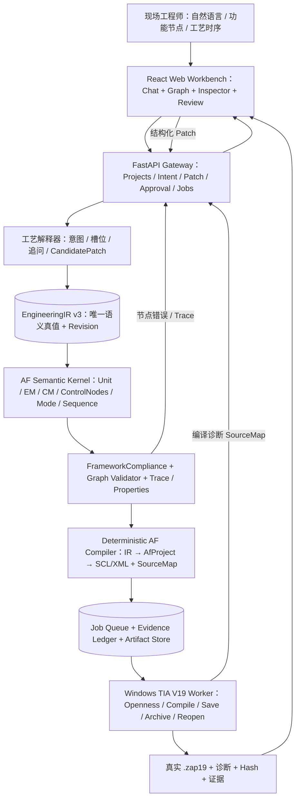
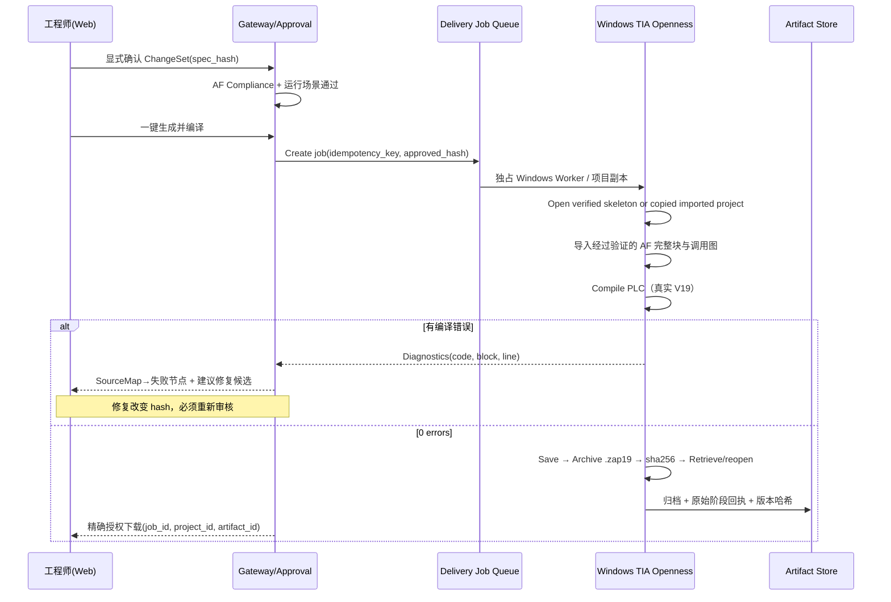

# aiCoPlc · AF-First 工艺驱动型 PLC 工程平台

**文档类型：** 重构总纲、系统架构、开发指导与验收手册（可直接用于 Agent 开发）  
**版本：** R3 / 2026-11-14  
**代码基线：** [`Roarpeng/PLC_chat@refactor/v2-full`](https://github.com/Roarpeng/PLC_chat/tree/refactor/v2-full)，基线 HEAD `bae8c59`（2026-11-12）  
**主线目标：** Siemens AF / 文件夹式、TIA Portal V19；Nexeed Control plus 预留独立后端但不伪装已支持  
**真实性说明：** 已通过 GitHub 读取仓库源码与保存的测试、真机回执；本报告未提交代码、未复跑 pytest/vitest/dotnet，也未在当前环境启动 TIA。以下“已实现/已验证”属于仓库记录；“待实现”是工作计划。

> **一条产品原则：** 工程师定义工艺，AI 生成符合指定 AF 契约的功能节点和可执行逻辑；工程师审核工艺，TIA Openness 提供原生编译、诊断与归档。禁止绕过 AF 生成自由 SCL，禁止把“编译零错误”描述为“现场功能正确”。

---

## 00. 冻结决策与边界

| ID | 必须遵守的决策 | 直接工程含义 |
|---|---|---|
| D-01 | **Framework First** | 工艺从解析开始受 AF Unit / EM / CM / ControlNodes / Sequence / Mode-State 契约约束，不是最后“放进 AF 文件夹”。 |
| D-02 | **当前只落地 Siemens AF** | V19 文件夹式实现；Nexeed Control plus 仅定义独立插件协议，不共用库块与代码模板。 |
| D-03 | **工程师只关心工艺** | 前端以对话、节点、动作、反馈、时序和异常为主界面；AF 归属可查看，底层 SCL 可审查但非主要交互。 |
| D-04 | **不管理硬件组态** | Web 不要求 CPU 订货号、机架、模块、网络拓扑；I/O 默认符号化 `unbound`。真实 TIA 编译使用后台经验证的工程骨架，不能假装无需 PLC 软件目标。 |
| D-05 | **人工确认才允许工程提交** | 每个节点可逐步确认；项目级 `ChangeSet` 必须经明确真人审批，AI 不得自动批准、写入真实项目或下装设备。 |
| D-06 | **支持新建 + 旧工程重构** | 旧工程只读导入，解析成节点、依赖与证据；**新逻辑重新生成，不沿旧屎山逐行打补丁**。工程副本保留必要硬件/数据契约，原文件永不改写。 |
| D-07 | **原生 TIA 交付** | 编译成功必须有 TIA 真实回执；`Save → Archive .zap19 → sha256 → Retrieve/reopen` 才放行下载。 |
| D-08 | **编译≠功能证明≠现场安全** | 先模型静态检查和 Trace；有条件加入 PLCSIM/HIL；现场安全回路、F-block 和硬件调试不得由普通 AI 自动修改。 |
| D-09 | **单一可写工程真值** | 只有服务器 `EngineeringIR` 可变；对话/画布产出受 Schema 约束的 Patch；Trace/SCL/图均只读派生。 |
| D-10 | **保留已验证的内核** | 不删除 `plc_engine/af`、`plc_engine/pcec.py`、`industrial/tia_openness_cli`；先适配、复用、校验，弃用重复 UI 分流而不是重造第三个网关。 |

### 硬件边界的准确表达

- **用户不选硬件，并不代表 TIA 真实编译可以完全脱离 PLC 目标。** `Projects.Create` 可以创建空工程；要对 PLC 程序做真实编译，需要工程中存在可用的 PLC 软件对象。因此后台必须管理**已验证、可复用、最小化的编译工程骨架**。骨架属于部署基础设施，不是用户填写的“货号表”。
- 新建工程：后台从固定、授权、真实验证的 V19 项目模板复制，保留必须的 PLC Software 对象、库和调用基线；不自动捏造新的 CPU 或 I/O 地址。用户以后可在 TIA 内完善拓扑，再重新编译。
- 导入工程：保留原项目的硬件配置到**只写副本**；将控制逻辑迁移为新的符合 AF 的软件层，不能在原工程混乱的控制代码上直接叠加新功能。
- 用户要求“不提供货号信息”是**产品界面与工艺输入约束**，不妨碍部署管理员离线维护真实有效的内部骨架资产和兼容性信息。

### AF 版本 G0 阻断项

仓库 V2 中 `AF_PROFILE_ID=SIEMENS_AF_BASIC_FOLDER_V19`、`AF_LIBRARY_VERSION=V19-BASIC-FOLDER-2.2`，但 `AF_TEMPLATE_SHA256=sha256:af_basic_folder_v19_template_unbound` 为占位符；`af_adapter_v2.py` 当前仅只读投影。Siemens 官方 AF Basic V2.2.2 项目归档是 **V20**，不能推断可直接在 V19 上使用。**严禁用常量命名或文件夹名称冒充官方兼容性验证。**

G0 正确做法：选定**实际可在本机 V19 打开、调用、编译**的正式 AF 工程/库基线（可能是经合法许可的较早档位）；记录来源、库版本、模板文件哈希、必须块与调用关系、V19 编译回执。若不能提供，则**锁住 `FRAMEWORK_NOT_VERIFIED`，禁止宣称 AF 官方实现合规及发布**。自举 `self_contained` 可作研发演示，但不得贴上“官方库等价认证”。

---

## 01. 当前分支真实能力审查

| 子系统 | 在 `refactor/v2-full` 中已发现 | 现存缺口 / 判定 |
|---|---|---|
| V2 工程 IR | `plc_engine/engineering_ir/` 有语义哈希、版本化快照、原子 Patch、409/422 | AF 语义没有贯穿全部节点、调用和编译；“功能节点”尚未成为独立一级实体。 |
| 驱动 | `components/catalog.py` 四种模板；`driver_fsm.py`；`driver_compiler.py` | 其 SCL lowering 是声明与注释，不等于完整 CM 逻辑；官方 LBC 依赖与实例化必须实证。 |
| 工艺 | `process/sequence_ir.py`、GuardAST、验证、离线 Trace、SourceMap | `scl_lowering.py` 的 Action、Guard、timeout 仍主要写成注释；不能证明 PLC 将按模拟动作执行。 |
| Web V2 | `workbench/WorkbenchShell.tsx` 六视图；`DeviceCanvas`、`SequenceEditor` | V2 主界面**没有统一 Chat**；`v2Api` 无 intent/审批/开始交付方法；步序画布仅编辑少数字段。 |
| 审批 | `changesets` + `ApprovalGate` + PCEC | V2 `DiffView` 审批按钮 `disabled`，未形成用户可点击的审核闭环。 |
| 真机交付 | `tia_delivery_v2.py`、`delivery_jobs_v2.py`、`ArtifactStore` | HTTP `/deliveries` 仅创建 Job、**不会自动运行真实 Openness**；需具备服务端队列/worker 调度与 UI 进度同步。 |
| V19 证据 | `evidence/v2/real/attempt_04/chain_receipt.json` | 真实 7 阶段成功、0 error/0 warning、`.zap19` reopen；但用**预制 PLC 骨架**且**排除 `OB_Main.scl`**；非完整产品 E2E。 |
| 源码下载 | `/artifacts/{id}/download` 和 `canShowNativeDownload` | 后端强制 `project_id`、`job_id`，前端 href 未提供，成功 Job 的下载也可能 422。 |
| 旧工程 | v1 `af_import.py`、TIA XML 解析、LAD→SCL 既有能力；V2 `changeplan/` | V2 Brownfield 合同明确 `mocked / offline`，没有旧工程→可靠 AF 节点→真正写副本→V19 编译的闭环。 |
| 回归基线 | 提交中保存 287 v2 pytest、413 vitest、110 dotnet 通过的收口台账 | 历史全量 pytest 有 3 个已知失败与一个挂起项；需独立复跑，不能抹去或冒充解决。 |

**P0 源码级阻断：** `scl_lowering.py::_build_fb_sequence()` 对动作和 Guard 生成 `// action` / `// guard` 注释，`_build_fb_drivers()` 未实现实时驱动状态机，`_build_ob_main()` 对 FB 的调用缺少正确实例语义。旧 V19 真机证据特意排除了 OB_Main。重构必须先解决“**生成的代码是否执行了 IR 表示的工艺**”，再扩大 UI 规模。

**证据冲突处理：** 仓库较早的 `README`、`04-交付报告` 仍记载 G5 pending；较新的 `06-主理人收口与遗留项.md`、`g0-g7-matrix.md` 及原始 `attempt_04` 回执更新为“有限范围下 G5 PASSED”。采用后者的**窄范围结论**，不把旧文档覆盖为“全产品通过”。

---

## 02. 目标分层架构与数据流



**架构规则：**

1. Web 只持有视图状态、选中节点、临时未提交编辑；每次内容编辑附 `project_id / base_revision / request_id` 发 Patch。
2. AI 不可以调用 `compile` / `approve` / `write_tia` 作为未授权的直接工具；其输出是 `CandidatePatch` + 问题队列 + 字段出处。
3. `EngineeringIR` 承载工艺意图与 AF 角色映射；AF Profile 锁定实际验证的框架资产，不使用一个放诸 V19/V20 皆准的“通用 SCL 模板”。
4. `Compiler` 不直接调用 LLM；仅对已验证 IR 和版本化模板进行确定性 lower，得到完整可执行的实现、调用环境、实例 DB、SourceMap。
5. `Windows Worker` 可通过 Openness 单机串行执行任务；所有操作在隔离副本进行，不写原件，不进行 PLC 在线下装。

### 架构目录建议（沿用唯一网关与现有技术栈）

```text
plc_project/
├─ frontend/src/workbench/
│  ├─ WorkbenchShell.tsx          # 替换当前六视图孤岛为对话-画布-审核一体
│  ├─ chat/                      # 工艺对话、候选 Patch、补问、采纳/撤销
│  ├─ graph/                     # Unit/EM/CM 树、FunctionNode、Sequence SFC
│  ├─ inspector/                 # 命令/反馈/状态/端口/故障/验收表单
│  ├─ review/                    # diff、验证、真人批准、证据签名
│  └─ delivery/                  # 真实 Job、编译诊断、源定位、归档下载
├─ frontend/src/state/workbench_v2.ts  # v2 facade 兼容扩展；不做平行状态源
├─ gateway/app/routers/projects_v2.py  # 保留路由前缀，增量接口
├─ gateway/app/services/plc/
│  ├─ framework_registry.py      # 新：真实 AF Profile / 模板验证
│  ├─ intent_service_v2.py       # 改：规则+LLM 受约束候选器
│  ├─ engineering_service_v2.py  # 改：AF-aware IR 和原子 Patch
│  ├─ approval_v2.py             # 复用 PCEC，绑定 spec_hash
│  ├─ delivery_jobs_v2.py        # 改：真实 Job 队列调度/恢复
│  ├─ brownfield_v2.py           # 改：解析、重构、替代计划与写副本
│  └─ workspace_v2.py            # 保留 WAL / 版本化 IR
├─ plc_engine/
│  ├─ af/                         # 保留既有 AF 生成器、模型和编号规则
│  ├─ frameworks/
│  │  ├─ contract.py              # 新：FrameworkProfile + Capability
│  │  ├─ af_semantics.py          # 新：AF 角色、端口、调用依赖、状态契约
│  │  ├─ af_compliance.py         # 新：无法绕过的框架静态门禁
│  │  └─ nexeed_adapter_future/   # 规划占位；实际实现需授权SDK，勿提交空壳能力
│  ├─ engineering_ir/            # 修改现有 IR，增加 FunctionNode/FrameworkBinding
│  ├─ components/                # 真实 CM/LBC 实例化与标准接口实现
│  ├─ process/                   # Sequence compiler / trace / SourceMap
│  └─ changeplan/                # Legacy fact→clean AF replacement/impact
├─ industrial/tia_openness_cli/  # 保留 C# CLI / net481 实际版本依赖与测试
├─ tests/af_e2e/                # 新：AF 固定模板、模拟、真实 Openness E2E
└─ docs/aicoplc/                # 决策记录、契约、开发指导、回执
```

注：以上 `nexeed_adapter_future/` 是文档标识，不是实际建议创建的目录；实施时只保留接口 `FrameworkBackend`，**不新增 Nexeed 未实现代码**。

---

## 03. AF 语义与函数节点契约

### 3.1 节点不是 PLC 块的截图

| Web 展示层 | AF 工程角色 | 必须生成/维护的语义 |
|---|---|---|
| 设备/工站 | **Unit** | 运行模式、状态、许可、报警聚合、EM 状态联动；不能擅自代写官方 Manager。 |
| 夹紧单元/送料单元 | **EM** | 工艺 Job、Sequence、调用顺序、ControlNodes、CM 组合。 |
| 气缸/电机/数字量 | **CM** | 统一命令/状态/故障接口；优先实例化经验证的 LBC；不允许 Step 直接写物理 `%Q`。 |
| S1 夹紧/S2 等待/S3 释放 | **EM 内 Sequence Step** | entry/cyclic/exit 动作、GuardAST、超时、异常路径，命令只作用于合法 ControlNodes。 |
| 连线/端口 | **框架受控数据流** | typed ports、命令归属、反馈取值、单写者、引用闭包。 |
| AI 功能节点卡片 | **FunctionNode**（用户友好聚合） | 绑定 Unit/EM/CM，声明“做什么、成功条件、异常、验收证据”；不可代替物理实例与调用。 |

### 3.2 建议新增最小对象（JSON 契约示例）

```json
{
  "id": "FN_CLAMP_01",
  "kind": "function_node",
  "framework": {"id": "siemens_af", "profile_id": "AF_V19_VERIFIED_PIN", "template_sha256": "sha256:<actual-template-hash>"},
  "af_binding": {"unit_id": "U_ASSEMBLY", "em_id": "EM_CLAMP", "cm_ids": ["CM_CLAMP_CYL"]},
  "intent": "夹紧气缸伸出到位后保持2秒，超时进入故障",
  "ports": {"commands": ["Start", "Reset"], "feedback": ["Extended", "Retracted"], "status": ["Busy", "Done", "Error"]},
  "sequence_refs": ["S_WAIT", "S_EXTEND", "S_HOLD", "S_RETRACT", "S_DONE", "S_FAULT"],
  "acceptance": ["extend_timeout_causes_fault", "no_simultaneous_extend_retract", "reset_requires_safe_condition"],
  "review": {"state": "draft", "confirmed_by": null, "confirmed_spec_hash": null},
  "source_refs": [],
  "io_bindings": null
}
```

> `AF_V19_VERIFIED_PIN` 是待 G0 提交的真实 Profile 标识；不可直接作为产品中的已验证版本。JSON 仅为**新契约提案**，不是当前仓库已接受的 Schema。`Reset` 行为由实际库契约决定，不可默认恢复自动动作。

### 3.3 必须满足的结构不变量

1. 每个 Step 必属于一个 EM；每个 CM 必归属于一个 EM 或明确批准的共享层；每个 EM 必属于一个 Unit。
2. Action 的目标必须是**框架合法命令**；输入/输出角色与数据类型必须匹配。
3. Feedback 必须有来源及解释规则；未知传感器、未绑定 I/O 保留 `unbound`，不得自行给 `%I0.0`。
4. 标准库的接口名、参数类型、实例化方式及调用时机由**实际模板反射/导出**得到，禁止 LLM 凭记忆编造。
5. 模式和状态由 AF 基线统一管理。`SafetyPermit` 只能作为软件工艺许可，不构成安全认证。
6. 必须有异常退出、超时、复位语义；故障复位不得绕过安全条件。
7. 禁止两个不同执行路径对同一可写输出无仲裁写入；禁止循环引用引起无界自触发。
8. 每次变更使 `spec_hash` 变化，旧审核自动失效；编译成功需要与同一个 hash 的 IR 和模板严格绑定。

### 3.4 AF ComplianceEngine 三段式检查

- **Shape**：Unit / EM / CM 隶属、命名空间、标识符、Profile、模板版本、库依赖及调用图。
- **Behavior**：模式/状态机、GuardAST 类型、故障与复位、状态可达性、反馈互斥、单写者、动作的端口合法性。
- **Implementation**：SCL 全部命令/Guard/超时在实代码中生效；有合法实例 DB / 调用顺序；SourceMap 无悬空；Openness 实编译并返回诊断。编译器不得把 Action 或 Guard 仅写成注释然后通过。

输出 `ComplianceReport {profile_hash, ir_hash, errors[], warnings[], coverage, evidence_level}`。**任何 error 阻止审核通过或交付；warning 分级处理，可能需要人工风险接受**。

---

## 04. 工艺解析与两种可编辑 Canvas

### 4.1 工艺解释步骤（NL → AF-aware CandidatePatch）

1. 从自然语言提取工艺意图：`对象、动作、命令、反馈、持续时间、互锁、异常、复位、模式`。
2. 在已有 IR 中查找节点和引用；复用相同类型、签名和框架依赖，避免重复建 CM。
3. 将每个动作映射到 AF 角色：站级意图→Unit、任务→EM/Job、执行器→CM/LBC、步骤→Sequence。
4. 对缺失的反馈、超时、动作冲突做定向追问；**不能无提示补充会改变设备安全/工艺的默认条件**。
5. 产出 `CandidatePatch`（`ops[]`、字段出处、问题队列、建议的 Node/Edge 变更、理由、影响范围）。
6. 用候选 IR 副本跑 AF 合规、静态图检查、模拟快照；显示对比并等待用户采纳。
7. 用户采纳后以 `base_revision` 做原子 Patch，增量派生 Trace/SCL；有 409 先重新读 IR 和重新评估候选。

**提示词约束（最小系统协议）：** 只允许返回 Schema 合法的 Patch 或问题；不得生成可立即执行的自由 SCL；不得自报已经调用 Openness；不得猜物理 I/O、官方库参数和安全语义；有多种合理解释时列出差异并要求人工选择。

### 4.2 两个 Canvas，不要强迫工艺工程师看代码块树

- **设备功能图**：Unit → EM → CM；折叠/展开 FunctionNode；显示命令、反馈、状态、故障；支持拖线、类型检测、节点重挂、设备复用。
- **工艺 SFC 图**：EM 内的 Job/Step/Transition；右侧编辑 Entry/Cyclic/Exit、GuardAST、保持时间、超时、异常路径；支持节点增加、删除、复制、连线、分支优先级。
- **统一状态**：画布、对话、检查器都只发送同一种语义 Patch；布局位置、缩放和折叠状态与业务语义哈希分离。
- **双向联动**：点 Step → 自动定位所用的 CM 与 ControlNodes；点 CM → 高亮引用它的 Steps；点编译错误 → 反向导航到 Node 和 SCL 行。
- **并行工艺**：当前代码仅支持串行步序+优先级分支。Fork/Join 没有可靠执行语义前保持 `UNSUPPORTED_PARALLEL_SEMANTICS` 阻断交付，不要画出来就算支持。

### 4.3 推荐 Web 页面布局

```text
┌─────────────────────────────────────────────────────────────────────────┐
│ aiCoPlc | 工程 | AF Profile [已验证/未验证] | 修订号 | 校验 | 交付       │
├──────────────┬─────────────────────────────┬────────────────────────────┤
│  工程目录    │       功能 / 工艺 Canvas     │ 节点 Inspector             │
│  Unit        │  [EM_Clamp]──[EM_Feed]      │ AF 角色与库绑定            │
│   ├ EM_Clamp │   └ S1→S2→S3→FAULT         │ 命令 / 反馈 / 超时          │
│   └ EM_Feed  │                             │ 交互来源 / 缺失约束         │
├──────────────┴─────────────────────────────┴────────────────────────────┤
│ AI 对话：描述工艺 / 修改节点 / 问题澄清 / 候选变更 [预览] [采纳]        │
├─────────────────────────────────────────────────────────────────────────┤
│ 校验 | Trace | SCL Diff | 人工确认 | Openness 编译/归档进度/诊断/下载 │
└─────────────────────────────────────────────────────────────────────────┘
```

### 4.4 用户闭环

**新建**：新建逻辑工程 → 选择**后台已验证的 AF Profile（或自动绑定唯一可用档位）** → 对话 → 节点 → 场景验证 → 节点确认 → 全局审核 → 编译归档 → `.zap19` 下载。

**旧工程**：上传 `.zap19/.ap19` 或授权的导出包 → Windows Worker 在隔离目录提取 → 展示 `可解析/部分可解析/不透明` 节点 → 建立工艺新模型 → 人工确认原行为/新行为差异 → 新 AF 逻辑替换计划 → 在工程副本上编译 → `.zap19` 下载。

---

## 05. Deterministic AF Compiler：从能编译变成能工作

### 5.1 可执行 lowering 必须保留的语义

```text
EngineeringIR
  └─ AF Binding Resolution
      ├─ Unit/EM/CM 借助已验证模板生成对象与调用依赖
      ├─ Action → 框架 ControlNodes 命令实际赋值（不是注释）
      ├─ GuardAST → BOOL/TIME/INT 表达式和真实分支赋值
      ├─ Timer → TIA 合法计时实现 + 扫描周期一致性
      ├─ Fault/Reset → 独立状态与有效复位条件
      ├─ CM → 库实例或经验证的 CM 实现体，输出单写者
      └─ CallGraph → 主周期调用、FB 实例 DB、依赖排序
          └─ SCL/XML、Manifest、SourceMap、CompileAssertions
```

- 用已验证的 AF 模板导出的**实际方法、库接口、数据结构与调用块**做代码生成契约，不重新“仿写”未知的官方控制块。
- 状态转换的优先级、超时使用、命令置位/清零和一个 PLC 扫描周期内的更新顺序必须明确定义，并由离线模拟与 PLC 实现共同遵守。
- `FB_Drivers` 中不可出现“全部控制输出永远为初始值、但接口编译成功”的情况。
- `FB_Sequence` 每一个 IR Action、Guard、Exception 必须对应**实际生成的可执行网络或语句**；SourceMap 追踪到范围，无法实现则构建失败。
- `OB_Main` 优先使用骨架中已经存在且可调用的主循环；正确建实例 DB 并生成调用。**不得为绕过冲突直接排除这一块，然后声称整个工艺闭环通过。**
- 生成器必须有“**语义覆盖率断言**”：实际实现的 Step/Action/Guard/Exception 数等于 IR 需要执行的数量；仅注释不计入。

### 5.2 编译验证的三个维度

| 级别 | 证明内容 | 失败处理 |
|---|---|---|
| V0 结构 | JSON Schema、AF 角色、库块接口、图可达性、单写者、异常路径 | 返回节点级错误，阻止批准 |
| V1 功能 | 以规则模型运行 Trace、驱动 FSM、5+ 场景属性检查；需要加入接口级负例 | IR/Compiler 实现不匹配则阻断 |
| V2 编译 | TIA V19 工程真实导入/Compile=Success 且 0 errors，Save、Archive、hash、reopen | 返回 TIA 原始诊断并映射节点；失败不发布产物 |
| V3 场景增强 | 有条件执行 PLCSIM 或可复现测试台验证真实生成代码的时序 | 未执行则标 `not_verified`，不能伪称设备功能已验证 |

**关键判断：** `compile_ok=true` 只证明编译条件，不代表现场调试已通过；`behavior_verified=true` 也不能推导为功能安全证明。验收回执分开记录。

### 5.3 必须覆盖的场景与属性

正常循环、伸出/缩回超时、单/双反馈异常、夹紧和松开命令冲突、启动时无反馈、人工停止、模式切换、运行许可丢失、故障保持及复位、边界时间值、连续运行重复触发。建议每个 FunctionNode 自带 scenario contract，可用属性测试批量验证，不靠一条固定 Trace 冒充全部场景。

---

## 06. 原生 TIA Openness 交付与诊断修复回路



**交付状态：** `DRAFT → SPEC_FROZEN → SOURCE_READY → TIA_IMPORTED → TIA_COMPILED → NATIVE_ARCHIVED`；失败 `FAILED/RECOVERY_REQUIRED`；`NATIVE_ARCHIVED` 只有经真实 Openness 回执、0 errors、静态门禁、精确归档哈希、reopen 成功才可达。

**落地改动：**

- `DeliveryCoordinator.start()` 目前仅接收并持久化 202 Job；加入**后台串行执行器**（Windows Service/独立受控 worker 进程，由服务器明确调度）来调用现有 `run_chain()`；不要在 HTTP 请求内同步阻塞 TIA 启动。
- `get_delivery_events()` 当前更像“历史事件一次性流出后结束”；增加可恢复的轮询或事件流，携带 `event_seq`、stage、diagnostics、evidence 等，支持断线恢复。
- 修复 `DeliveryView` download href，后端要求 `project_id` 和 `job_id`，最好还带 `sha256`，由授权下载服务验证四元组。下载 UI 仅在真实归档后出现。
- 编译诊断通过 `SourceMap` 追溯 `Unit/EM/CM/FunctionNode/Step`，定位责任范围。AI 可以生成**修复候选 Patch**，不得直接覆盖用户已批准版本；变更后重新走 Gate。
- Worker 持有 TIA 版本、许可证、模板哈希和文件权限；每次只编译可信工作目录中的**新副本**，锁、超时、重试、幂等、崩溃恢复与孤儿清理单独测试。
- **安全：** 不自动把程序下装到真实 PLC，不在线改写运行设备，不修改 Safety F-block，不让 LLM 自由传入任意文件路径、命令行或 Openness 操作。

---

## 07. 旧工程导入 → 新 AF 逻辑重构，而不是继续修屎山

### 7.1 两条职责明确分离的路径

**路径 A（当前优先）：Clean AF Rebuild。** 导入旧工程仅用作**行为证据与接口来源**，形成新的 AF 语义模型。对原有块的角色、调用依赖、变量和功能做可解释映射。将能证明的部分重构成新 Unit/EM/CM 和 Sequence；不能证明的标记 `opaque / pending_review`。输出新的受控 AF 软件层。

**路径 B（受控兼容）：Copy-on-write Integration。** 当工程必须保留现有 TIA 硬件组态、工艺标签、外部接口时，在**原工程隔离副本**内导入新 AF 逻辑。生成“旧块→新块”的**替代映射计划**，更新调用入口与引用闭包，确认旧执行路径已停用；不在旧块内部继续堆补丁。只有无双重输出、无悬空引用、无受保护块变更后才允许编译归档。

### 7.2 解析流程与保真等级

```text
只读导入 (.ap19/.zap19/XML/SCL)
  → Openness 提取软件树、类型、接口、调用、标签、数据结构
  → LAD/FBD/SCL 可读逻辑的保守解析与图/状态候选
  → SourceBinding(原块ID/hash/语义来源/可读性/引用者)
  → 分类：EXACT / PARTIAL / OPAQUE / PROTECTED
  → 新 AF FunctionNode + Unit/EM/CM + Sequence
  → 工程师比较：旧行为与新行为、遗漏条件、风险
  → 审批 ReplacementPlan（不是直接改旧块）
  → 工程副本导入新逻辑/关闭旧调用/静态验证/真实编译/归档
```

- **EXACT**：接口、条件、动作、调用链可重建，并有测试支撑；允许自动生成候选但仍需人审。
- **PARTIAL**：能够识别部分行为；明确列出未覆盖的分支、间接调用、动态索引或隐式状态，禁止称为等价。
- **OPAQUE**：加密、受保护、非支持语言、不完整 XML；仅提取合法可读元数据与引用，不能凭块名猜算法。
- **PROTECTED**：F-block、安全/技术对象等；强制只读，不生成修改操作。安全相关信号可作为外部约束但不能宣称重建安全功能。

### 7.3 导入必须提供给工程师的四张表

1. **节点清单：** 新 Unit/EM/CM/Step → 来源块与证据等级。
2. **行为差异表：** 原始条件 → 重构条件、原始命令 → 新命令、缺失与歧义。
3. **依赖/接口表：** FB/FC/DB/OB/UDT/标签的读写与调用关系，保留物理地址、DB 布局等接口约束（若需要在旧组态上运行）。
4. **替换安全表：** 新代码调用入口、旧代码失效入口、双重写入检测、未解析块处理、受保护块零修改、原件 SHA256 未变。

**第一阶段不要自动重构任意大型旧工程。** 先用一个真实且规模可控的 V19 工程：1 Unit + 1 EM + 2 CM + 1 Sequence，覆盖 LAD/SCL、标准 DB、主 OB；完成导入→节点→修改→副本编译→下载→原件不变 E2E。随后按语法覆盖率和保真分类逐步扩大。

---

## 08. API、状态模型与数据库合同（建议增量 `/api/v2`，不另建网关）

| HTTP | 接口（新增/扩展） | 核心条件 |
|---|---|---|
| GET | `/api/v2/frameworks` | 仅返回已登记框架档位、兼容性与 `verified/pending` 状态；默认只展示 AF 可用选项。 |
| POST | `/api/v2/projects` | 保持现有；新增 `framework_profile_id`，不接受不存在/不兼容的 Profile。 |
| POST | `/api/v2/projects/{id}/intent` | 现有规则服务扩展为受约束 LLM + AF 映射；只输出候选 Patch。 |
| POST | `/api/v2/projects/{id}/patches` | 现有原子写入加 `framework_compliance`、source provenance、revision 校验。 |
| GET | `/api/v2/projects/{id}/nodes` | AF-aware FunctionNode、Unit/EM/CM 的可视化投影；不可直接写本地副本。 |
| POST | `/api/v2/projects/{id}/validate` | 返回 AF/Behavior/Implementation 三类诊断及源节点定位。 |
| POST | `/api/v2/projects/{id}/simulate` | 场景 Trace + 属性检查 + scenario coverage + evidence。 |
| POST | `/api/v2/projects/{id}/changesets` | 冻结确切 `spec_hash` 和模板 hash 的差异包。 |
| POST | `/api/v2/changesets/{id}/approve` | 显式本人批准，必须包括审批主体、scope、不可变基线。 |
| POST | `/api/v2/projects/{id}/deliveries` | 现有 202 Job；新增受控后台调度触发真实链。 |
| GET | `/api/v2/delivery-jobs/{id}` | 真实状态、CompileReceipt、阶段回执；禁止 mock 冒充 real。 |
| GET | `/api/v2/artifacts/{id}/download?project_id=&job_id=&sha256=` | 修正前端，后端四元组授权；返回 `.zap19` + 独立 evidence bundle。 |
| POST | `/api/v2/imports` | 隔离接收旧工程、hash、病毒/zip bomb/路径验证、导入作业。 |
| GET | `/api/v2/imports/{id}/analysis` | 解析覆盖率、SourceBinding、AF 候选节点、opaque 列表。 |
| POST | `/api/v2/imports/{id}/rebuild` | 创建新的 AF 草稿模型，不写 TIA；所有歧义需人工处理。 |
| POST | `/api/v2/projects/{id}/replacement-plans` | 替代关系审核，原件与安全块不可变；仅审批后在副本上执行。 |

建议新增的数据模型：`FrameworkProfile`, `FrameworkBinding`, `FunctionNode`, `NodeAcceptance`, `ImportedProjectSnapshot`, `SemanticExtractionReport`, `ReplacementPlan`, `CompileAssertion`, `ComplianceReport`。全部加入迁移和 JSON Schema，不破坏旧 `v2` API、历史回执或 `revision` 唯一真值。

建议项目状态包含 `DRAFT / VALIDATED / REVIEWED / APPROVED / DELIVERY_QUEUED / COMPILED / ARCHIVED / FAILED`；不能把 `NODE_CONFIRMED` 当成整个 ChangeSet 已签名，也不能仅靠前端状态宣布发布成功。

---

## 09. 开发任务包（按可运行纵向闭环，不按文件堆功能）

> 每包均由工程 Agent 编码、单元测试、端到端测试、证据落盘；主 Agent 负责集成验收。**任何 WP 不能只交文档或 mock 就关闭真实验收条件**。任务完成顺序以依赖为准，不以人力估算日程。

| 包 | 优先 | 前置 | 任务与核心改动 | 可验收交付物 |
|---|---|---|---|---|
| **WP-00** 基线和 AF Profile | P0 | 无 | 锁 commit、复跑测试、核实 AF 库和 V19 模板，移除假的 `template_unbound` 可发布语义 | 实际模板 SHA256、库依赖清单、V19 回执、G0 PASS 或 BLOCKED |
| **WP-01** AF 强语义模型 | P0 | WP-00 | 在 IR 增加 FunctionNode/AF 归属、FrameworkBinding、版本锁；校验 Unit/EM/CM/ControlNodes | Schema、迁移、Patch、负例；非法结构无法提交 |
| **WP-02** 真正可执行 AF Compiler | P0 | WP-00/01 | 修 `driver_compiler` / `scl_lowering`；实例化真实库/DB/OB；实现 Action/Guard/Timer/Fault、调用与 SourceMap | Golden SCL + 真实 V19 **全逻辑**导入编译 0 error，不排除 OB 调用 |
| **WP-03** 语义验证与行为 Trace | P0 | WP-01/02 | AF ComplianceEngine、属性检查、仿真器与编译器的等价测试，错误回节点 | 正常/超时/许可丢失/冲突/复位多场景测试；注释占位会失败 |
| **WP-04** Web 对话+节点编辑一体 | P0 | WP-01/03 | 统一 Chat 与 V2 workbench；CandidatePatch 预览/采纳；设备图、SFC 图、节点全参数编辑；revision 409/422 | 浏览器端真实 HTTP E2E：对话→节点→编辑→Trace/SCL 同步 |
| **WP-05** 人工确认与 Job 交付 | P0 | WP-02/03/04 | 接通 ChangeSet/Approve/Deliver，Windows worker 队列、诊断定位、状态恢复、精确下载 URL | Web 一键审批→V19 完整编译→`.zap19`→reopen→下载，失败不发布 |
| **WP-06** 旧工程语义导入 | P1 | WP-01/03 | 复用 v1 TIA XML/LAD 导入，建立 `SourceBinding`、保真等级、调用/变量图；映射 AF 候选 | 真实旧工程只读解析和节点确认，无虚假等价结论 |
| **WP-07** Clean AF Rebuild + Integration | P1 | WP-05/06 | `ReplacementPlan`、新 AF 工程生成、可选复用旧工程组态的 copy-on-write，旧控制路径退出验证 | Brownfield E2E：原件 hash 不变、无双写、0 errors、可下载 |
| **WP-08** 质量、安全、恢复 | P1 | WP-04/05/07 | 故障注入、权限、审计、zip 攻击、并发、trace、备份与恢复、性能分析 | fail-closed 矩阵、全量基线、第三方 QA 复核 |
| **WP-09** Nexeed 适配研究（不宣称实现） | P2 | AF 稳定 | 授权工具/对象库/SDK/导出 API 可行性调查，定义 Backend Capability | 真实 SDK 证据 + 独立 RFC；否则明确 `unsupported` |

### WP-00：首先执行的门禁

- [ ] 固定分支 HEAD、`git diff` 清单和既有测试日志；在隔离工作树开展重构。
- [ ] 对真实 AF 模板建立 `framework.lock.json`，哈希必须来自实际文件内容；逐项核对库块、签名、调用顺序与版本。
- [ ] 用 Windows V19 Worker 打开实际骨架，至少导入官方示例或基线 EM、CM，真实编译，Save、Archive、reopen。
- [ ] 对官方 AF Basic V2.2.2/V20 与本机 V19 的冲突做显式兼容性声明；未找到可信 V19 资产则 `FRAMEWORK_NOT_VERIFIED`。

### WP-02：第一个必须打通的“垂直切片”

- **工艺：** 1 Unit / 1 EM / 1 双作用气缸 CM，`等待→伸出→保持→缩回→完成`，伸出/缩回各有 3s 超时和故障复位。
- **验收：** 工艺 Patch → AF 投影 → 完整 SCL/实例 → Python Trace → 生成代码检查 → 实际 V19 编译、归档、重开。不能通过注释 Action/Guard/Timer 来满足覆盖率。
- **结果：** 工程师在 Web 看得到状态、命令、反馈、超时；下载工程中的块真实按此逻辑执行（需由独立执行测试证明，与静态编译结论分离）。

### WP-04：前端交付验收示例

```gherkin
Given 工程绑定到已验证的 AF Profile
When 工程师说“新建夹紧单元，伸出到位后保持2秒，再缩回，3秒超时报警”
Then 页面产生 EM + CM + Sequence 候选节点，并显示命令、反馈、异常路径
And 未确定的传感器接线保持 unbound，不虚构物理地址
When 工程师把保持时间改为4秒并采纳 Patch
Then revision 加1，节点、Trace 和实际 SCL 语义同时改变
When 工程师确认所有节点，批准 ChangeSet
Then 后台允许创建交付 Job，但 AI 本身没有审批权限
```

### WP-07：旧工程端到端验收示例

```gherkin
Given 一份可在 V19 打开的真实旧工程，包含1个 EM、两个控制功能和主周期调用
When 工程师上传原生归档并执行分析
Then 展示旧块引用、工艺候选、解析保真等级与无法解析的对象
When 工程师重新组织为新 AF 节点并改变一个明确的时序参数
Then 生成 ReplacementPlan，标出所有将失效的旧调用及保留的接口
When 工程师批准并要求交付
Then 仅改项目副本，检测无旧/新双重输出，真实 V19 编译0 error
And 原始归档 SHA256 不变，生成新 .zap19 与证据可下载
```

---

## 10. 质量门禁与验收矩阵（新的 G0–G10）

| Gate | 判据 | 证据级别 | 禁止误报 |
|---|---|---|---|
| **G0 Profile** | 真实 AF 模板/库/版本/文件 hash、V19 可用证明 | V19_real | 自编的版本字符串不等于官方库认证 |
| **G1 IR** | Schema、100 次随机 Patch、单一真值、revision/409/422 | offline | 前端改 DOM 不算持久变更 |
| **G2 AF Shape** | Unit/EM/CM/ControlNodes、命名/调用依赖/库签名 | offline + verified template | 只有文件夹树不算合规 |
| **G3 AF Behavior** | Step Action/Guard/Timer/Fault/模式、单写者、可达性 | offline | 用注释代替动作不算通过 |
| **G4 Code Coverage** | 每个语义 Action/Guard/Exception 有可执行映射及 SourceMap | compiler inspection | Golden 只比较文本快照不够 |
| **G5 Function Tests** | 正常+异常场景、边界、属性测试，有条件 PLC 仿真 | offline / simulation | Python 模拟成功≠PLC 代码运行成功 |
| **G6 Human Review** | 节点确认 + ChangeSet hash 签名 + 变更失效机制 | real user event | LLM 不可代签 |
| **G7 Native TIA** | 真 V19 编译0 errors，Save、archive SHA256、reopen；全路径无文件排除 | V19_real | 不得用预制骨架+排除失败代码声称全逻辑通过 |
| **G8 Artifact** | 精确四元组授权下载、证据和版本完整 | V19_real | mock 不能发原生下载链接 |
| **G9 Brownfield** | 原件未变、替代映射可审、无旧新双重调用、源引用闭包 | V19_real (WP-07) | v2 目前仅 mocked，不得标已完成 |
| **G10 Resilience** | 断线/超时/worker 退出/重复任务/旧工程攻击不误发布 | offline + real probes | 失败必须保留回执与草稿 |

**可视化统一标注：** `designed`（设计） / `offline_verified`（本地验证） / `simulated` / `V19_compiled` / `native_archived` / `field_verified`（现场独立确认）。没有证据不得跳级；`field_verified` 不能由 Openness 自动赋值。

建议自动阻断规则：`AF_G0_FAILURE`、`UNKNOWN_LBC_SIGNATURE`、`DIRECT_IO_WRITE_FROM_STEP`、`ACTION_NOT_LOWERED`、`GUARD_NOT_LOWERED`、`INSTANCE_DB_MISSING`、`DUPLICATE_OUTPUT_WRITER`、`OPAQUE_BLOCK_ASSUMED_EQUIVALENT`、`OLD_NEW_BOTH_ACTIVE`、`APPROVAL_SPEC_HASH_STALE`、`ARCHIVE_REOPEN_FAILED`。

---

## 11. 旧版兼容、迁移与回滚

1. **代码基线保留：** 不删已有 V1 `af_generator`、V1 旧工程解析和真实 Openness 工具；通过 adapter 引用而不是复制粘贴一份新实现。
2. **Schema 升级：** 在 `engineering_ir/` 引入 v3 schema/field migration，`v1_to_v2_map.json` 原样保留；旧快照读取先 migrate 到新的统一真值；迁移需要幂等与 roundtrip 测试。
3. **路由：** 默认新 Workbench 统一工艺工作流；旧 `#/legacy`、`#/classic` 暂留兼容，提供打开老项目的明确入口；迁移稳定后再按用户验收决定弃用。
4. **回滚：** 每次工作包单独 PR；所有真实工程操作使用隔离副本。失败保留原件、上一次批准 IR、阶段回执和未发布的产物。
5. **版本冻结：** TIA V19、选定 AF 库、真实模板哈希、SCL 生成器版本与 QA Golden/真机回执一一绑定；升级 V20 或 Nexeed 必须触发独立的兼容迁移，不默默切换。

---

## 12. 开发 Agent 分工与执行 SOP

### 多 Agent 不等于让 AI 绕过工程规则

| 角色 | 授权边界 | 主要任务 |
|---|---|---|
| **Main/Lead Agent** | 任务规划/接口冻结/分支集成/验收签发；不得伪造真机报告 | 管理 WP/Gate 与跨模块依赖、分配子任务、复跑真实 E2E |
| **AF Domain Agent** | 只改 FrameworkContract、IR 与 Schema | Unit/EM/CM、ControlNodes、Profile、合规规则与真实库比对 |
| **Compiler Agent** | 只改 deterministic compiler/测试 | Action/Guard/Timer/FB/DB/OB 的可执行 lowering 与可重复构建 |
| **UX Agent** | 只改 React workbench 与 UI 测试 | Chat+Graph+Inspector+Review 的统一工作流 |
| **Import Agent** | 只读旧工程解析和 `ReplacementPlan`；不改原件 | 依赖/语义证据、旧节点→新 AF 节点、原件 hash |
| **Openness Agent** | 仅隔离 Windows Worker 和副本；不进行在线下装 | 真机编译、归档、reopen、诊断与恢复 |
| **QA Agent** | 测试及 evidence 的独立验证；不可替工程师改算法掩盖失败 | 负例、回归、真机验收、指标与差异报告 |

### 每个任务的固定执行程序

1. **READ**：读目标源码和官方 Profile，确认当前行为、输入输出、已有证据与风险。
2. **DESIGN**：提交简明变更清单、Schema、测试设计、受影响文件；禁止先大规模重写。
3. **IMPLEMENT**：先改内核和契约，再改 API，最后改 UI；每次 Patch 具备可逆操作与版本保护。
4. **VERIFY**：跑目标单测、Golden、TS build、Python 基线，涉及原生工程则在有许可 Windows V19 环境执行真实链。
5. **EVIDENCE**：保留命令、exit code、日志、commit、版本号、模板 hash、artifact hash、阶段结果；区分 `offline`/`mocked`/`V19_real`。
6. **REVIEW**：QA 独立复核；Main Agent 合并，写清阻断项，不能用“基本完成”代替 Gate 通过。

### 可直接给主 Agent 的实施指令

```text
你是 aiCoPlc R3 重构主 Agent，代码仓库 Roarpeng/PLC_chat 分支 refactor/v2-full。
目标：实现 Siemens AF-first 的工业工艺工程工作台（Web 对话/功能节点/人工批准/真实 V19 Openness 编译归档/旧工程 Clean AF Rebuild）。
硬约束：
1. 先阅读本文档并检查当前 HEAD；不得把 README 声明当真实测试。
2. 不删除现有 plc_engine/af、plc_engine/pcec.py、industrial/tia_openness_cli。
3. 框架语义优先：Unit/EM/CM/ControlNodes/Mode/Sequence，实际 AF 库签名必须来自已验证的固定模板。
4. 不得猜 CPU 货号、I/O、受保护 Safety 逻辑、未知库接口；用户 Web 只输入工艺，模板与编译基础设施由系统维护。
5. 禁止仅生成注释版 Action/Guard/Timeout；必须有可执行 lowering、语义覆盖率和完整调用环境。
6. AI 仅可建议 CandidatePatch；所有改动通过 revision/IR 原子事务；人工批准无法由 AI 绕过。
7. 真实 TIA 交付限 Windows 隔离副本；0 errors + Save + Archive + sha256 + reopen 且阶段回执完整，才允许 .zap19 下载。
8. 旧工程为语义证据，不在旧屎山上堆补丁；必须实施解析保真等级、ReplacementPlan、旧/新双调用检查、原件只读。
9. 每个 WP 按本文件 Gate 提交：代码 + 测试 + 证据 + 修改的文件清单 + 真实未完成项。禁止 mock 冒充真机。
先完成 WP-00 的 G0 Profile 验证、代码基线复跑；再完成 WP-01/02 的“夹紧气缸”端到端可执行切片，后续按依赖推进。
```

### Agent 回执模板（每个 PR 填写）

```yaml
work_package: WP-02
commit: <git-sha>
baseline: bae8c59
framework_profile: <verified-id>
framework_template_sha256: <real-hash>
changed_files: []
acceptance_gates: [G2, G3, G4, G5, G7]
tests:
  pytest: {command: "...", passed: null, failed: null, exit_code: null}
  vitest: {command: "...", passed: null, failed: null, exit_code: null}
  dotnet: {command: "...", passed: null, failed: null, exit_code: null}
  tia_v19_real: {executed: false, error_count: null, reopen_ok: null}
artifacts:
  project_id: null
  job_id: null
  artifact_id: null
  sha256: null
known_gaps: []
qa_signed_by: null
```

---

## 13. 开发优先级的硬性排序

1. **先证实真实 AF Profile**（否则所有“遵循 AF”都是自定义命名口径）。
2. **修复可执行 SCL 语义**（否则编译成功的项目也可能没有按工艺动作）。
3. **用一个可复现气缸工艺打通真机闭环**（否则 UI 再漂亮也只是演示）。
4. **把旧分离的 Chat / Canvas / Review / Delivery 统一成工程师能用的 Web 产品**。
5. **再攻旧工程 Clean AF Rebuild**（这是高价值但更难证明正确性的能力，不应抢在新项目闭环之前）。
6. **最后评估 Nexeed**，先获取授权对象库与 Studio 工程契约；没有 SDK/工具链就只保持能力接口，不宣称可生成原生 Nexeed 工程。

**第一里程碑的最终验收定义：** 工程师描述夹紧过程 → AI 建立真实 AF 合规的 Unit/EM/CM/Step → 节点可编辑 → 静态与场景验证 → 真人批准 → Windows V19 编译完整实现 0 errors、没有排除失败块 → 真实 `.zap19` 归档、reopen → 在 Web 成功下载。若有任一环节失败，必须显式显示未完成及可复现诊断。

---

## 14. 来源与证据清单

**仓库源码（2026-11-12，commit `bae8c59`）：**

- [EngineeringIR v2 / Profile 常量](https://github.com/Roarpeng/PLC_chat/blob/refactor/v2-full/plc_project/plc_engine/engineering_ir/contracts.py)
- [AF 老版本领域模型](https://github.com/Roarpeng/PLC_chat/blob/refactor/v2-full/plc_project/plc_engine/af/af_model.py)
- [AF 生成器](https://github.com/Roarpeng/PLC_chat/blob/refactor/v2-full/plc_project/plc_engine/af/af_generator.py)
- [AF v2 适配器](https://github.com/Roarpeng/PLC_chat/blob/refactor/v2-full/plc_project/plc_engine/process/af_adapter_v2.py)
- [当前 SCL Lowering](https://github.com/Roarpeng/PLC_chat/blob/refactor/v2-full/plc_project/plc_engine/process/scl_lowering.py)
- [V2 Web 工作台](https://github.com/Roarpeng/PLC_chat/blob/refactor/v2-full/plc_project/frontend/src/workbench/WorkbenchShell.tsx)
- [V2 交付 Job](https://github.com/Roarpeng/PLC_chat/blob/refactor/v2-full/plc_project/gateway/app/services/plc/delivery_jobs_v2.py)
- [V2 Brownfield 范围](https://github.com/Roarpeng/PLC_chat/blob/refactor/v2-full/plc_project/docs/v2/brownfield-interface-contract.md)
- [2026-11-12 真机收口与范围限制](https://github.com/Roarpeng/PLC_chat/blob/refactor/v2-full/plc_project/docs/v2/06-%E4%B8%BB%E7%90%86%E4%BA%BA%E6%94%B6%E5%8F%A3%E4%B8%8E%E9%81%97%E7%95%99%E9%A1%B9.md)
- [V19 原始 chain receipt](https://github.com/Roarpeng/PLC_chat/blob/refactor/v2-full/plc_project/evidence/v2/real/attempt_04/chain_receipt.json)

**厂商框架资料：**

- [Siemens AF Basic V2.2 / Scope of Delivery](https://docs.tia.siemens.cloud/r/en-us/v2.2/automation-framework-basic/automation-framework-basic-v2.2/2.-introduction/2.2.-scope-of-delivery) — 官方 V2.2.2 项目为 V20。
- [Siemens AF Basic / Unit 结构](https://docs.tia.siemens.cloud/r/en-us/v2.2/automation-framework-basic/automation-framework-basic-v2.2/9.-units/9.1.-general-structure) — Unit 模式/状态、EM 数据反馈。
- [Siemens AF Basic / EM 结构](https://docs.tia.siemens.cloud/r/en-us/v2.2/automation-framework-basic/automation-framework-basic-v2.2/10.-equipment-modules/10.1.-general-structure) — CM/EM 主要职责及处理时序。
- [Siemens AF Basic / Main program](https://docs.tia.siemens.cloud/r/en-us/v2.2/automation-framework-basic/automation-framework-basic-v2.2/6.-plc-software-architecture/6.4.-program-structure) — 数据块与模块连接。
- [Bosch Nexeed Control plus 官方工程体系](https://www.boschmanufacturingsolutions.com/portfolio/nexeed-automation/engineering/basicsystem-1.html) — Control plus Studio/Object Library/PLC Framework/Code Checker。

**声明：** 本文件为架构与可执行开发计划，不是已经完成的重构或本次真机编译回执。涉及 Siemens/Bosch 的产品和库资产应遵守授权与许可证条件，不应将厂商闭源库打包上传公开仓库。
