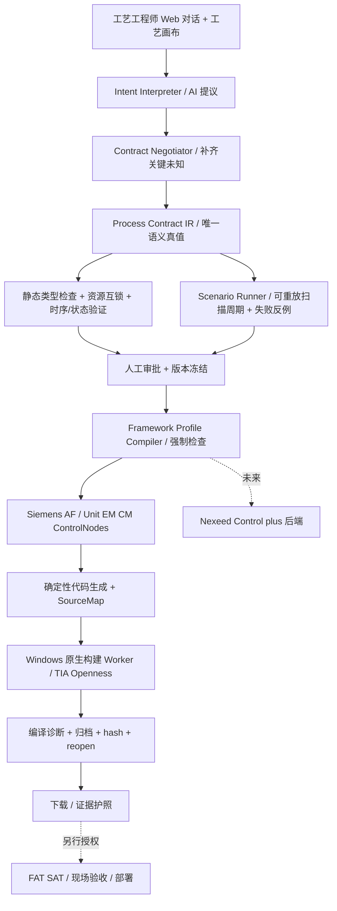

# aiCoPlc ProcessOS：从零设计的架构决策与开发指导

> 版本：概念设计 v1.0 · 日期：2026-11-14  
> 设计前提：**完全不受现有 PLC_chat 代码结构约束**。以下内容是建议方案，不代表已有产品能力或实机测试结果。  
> 目标：让现场工程师描述和验证工艺，由软件负责按获准的工业框架构造并验证控制逻辑，交付可追溯的原生 PLC 工程。

## 0. 最高级设计决策

**aiCoPlc 不做另一个 TIA Portal。它做工艺编译平台。**

- 工程师定义 **What**：行为、动作、完成条件、异常、恢复、验收标准。
- ProcessOS 定义 **How**：工艺契约、状态、资源仲裁、框架映射、代码和诊断。
- TIA/Openness 或其他原生工具定义 **Where**：工程对象、真实软件/设备上下文、编译、归档。
- 工厂工程流程负责 **Can operate safely**：实际 I/O 绑定、安全功能验证、FAT、SAT、部署批准。

> 不允许从自然语言直接生成自由 SCL 并声称符合 AF；不允许仅创建 AF 命名目录就声称框架合规；不允许仅凭 TIA 0 编译错误就声称工艺正确。

## 1. 对五个前提的正式反驳

| 原假设 | 新结论 | 对架构的影响 |
|---|---|---|
| AF 或 Nexeed 必须作为内部所有概念的唯一结构 | **反对**：两者不能混成一个模型；AF/Nexeed 应是强约束的工程目标，但工艺需求应可独立版本化 | 建立通用 `ProcessContractIR`，在输入时选框架并提前做 Profile 检查，最终按独立后端编译 |
| 自然语言足够描述正确逻辑 | **反对**：缺失的互锁/上电动作/超时恢复/手自动语义不能靠 AI 猜 | 采用 `ContractNegotiator`，重要未知项冻结前必须问清楚 |
| 无硬件信息依然可以生成真实编译的 TIA PLC 工程 | **部分反对**：前端不输入货号可以，构建阶段仍需有效 PLC 软件/设备上下文 | 逻辑包与原生工程双产物；真实编译在模板或已导入工程副本中执行 |
| 旧工程必然可以还原为工艺节点 | **反对**：从实现不能唯一反演设计意图 | 提供带来源和置信等级的工艺重建；不确定/保护模块保持 opaque |
| 人工确认且编译 0 错误就完成 | **反对**：语法、逻辑、仿真、现场运行是不同验证等级 | 多级 Evidence Passport；FAT/SAT 与 safety 流程独立 |

**产品聚焦决策：先完成 Siemens AF 这一种框架的真实垂直闭环；Nexeed 仅预留插件契约，待合法库/SDK/工具链可验证后接入。**

## 2. 总架构



### 2.1 核心组件职责

1. **Process Workbench**：对话、功能节点图、工艺顺序图、参数表、测试报告、审查。仅允许结构化修改。
2. **Intent Interpreter**：LLM 只生成 `CandidatePatch`，不直接提交代码、不操作 TIA。
3. **Contract Negotiator**：建立 `OpenQuestion` 台账。关键未知条件未解决时禁止生成“可交付”状态。
4. **Process Contract IR**：设备/资源/动作/命令/反馈/联锁/超时/故障/恢复/测试/来源的稳定数据模型。
5. **Semantics Engine**：类型检查、状态合法性、资源独占、命令仲裁、时序边界、无死路径检测等。
6. **Scenario Runner**：模拟 PLC scan-cycle；给出场景输出、反例轨迹和实际测试覆盖边界。不是物理仿真，也不等同于 TIA 仿真。
7. **Framework Profiles**：批准的 AF 版本、真实模板、接口签名、调用契约、库哈希、TIA 版本依赖。
8. **Compiler Backends**：`ProcessIR -> AFIR -> SCL/SimaticML`；将来 `ProcessIR -> NexeedIR`，禁止互相假冒。
9. **Native Build Worker**：运行于隔离 Windows 环境，调度 TIA/Openness，与 UI/API 解耦；独占操作副本、保留诊断和 hash。
10. **Evidence Store**：按 `(project_revision, framework_profile, build_job_id, artifact_sha256)` 绑定所有审批和验证证据。

## 3. 工艺契约模型：最重要的抽象

### 3.1 主体对象

| 对象 | 必要字段 | 作用 |
|---|---|---|
| `Project` | ID、版本、目标框架 | 逻辑工程边界 |
| `Resource` | 类型、命令端口、反馈、独占性 | 表示抽象设备，不带物理 I/O 地址 |
| `Operation` | 入口条件、步骤、完成条件、异常策略 | 工艺功能，可映射到 EM 的 Job/Sequence |
| `Step` | action、guard、timeout、target | 有确定扫描周期语义的操作步骤 |
| `Invariant` | 条件、触发范围、严重度 | 永不可被违反的工艺属性 |
| `FailurePolicy` | 检测、锁存、恢复、复位资格 | 异常行为，不让 AI 省略 |
| `OpenQuestion` | 影响对象、风险等级、问题、结论 | 关键歧义和人工决定 |
| `Scenario` | 输入时序、期望输出/状态、结束条件 | 可回放工艺行为测试 |
| `SourceProvenance` | 用户确认、历史证据、推断来源 | 追溯需求与迁移解释 |

### 3.2 示例：夹紧 Operation

```json
{
  "schema": "process-contract/1.0",
  "id": "operation.clamp_cycle",
  "target": "siemens-af-basic@approved-profile",
  "resource_ids": ["clamp_cylinder"],
  "preconditions": ["unit.auto_permit", "air.ok", "guard.closed"],
  "steps": [
    {"id":"extend", "command":"clamp.extend", "until":"clamp.extended", "timeout_ms":3000},
    {"id":"hold", "duration_ms":2000},
    {"id":"retract", "command":"clamp.retract", "until":"clamp.retracted", "timeout_ms":3000}
  ],
  "invariants": ["!(clamp.extend_cmd && clamp.retract_cmd)"],
  "fault_policy": "latch_and_block_auto",
  "open_questions": [
    {"question":"全局安全许可撤销时气缸保持或退回？", "severity":"blocking"}
  ]
}
```

**重要：** 示例为语义草案，不代表自动选择了正确的安全停止方式。是否保持、退回或去能必须由工艺/机械/功能安全责任人确定。未定项会阻止正式放行。

### 3.3 保证“可编译”的语义细则

- 明确定义扫描周期顺序：冻结输入快照 → 判断 guard → 同周期冲突仲裁 → 原子状态迁移 → 输出命令形成 → CM 状态机执行 → 输出/报警提交。
- 明确 `entry`、`cyclic`、`exit` 动作的触发条件；同一步骤多次扫描不得重复产生非幂等命令。
- 计时基于单调时钟或约定的扫描时间来源，并在测试中定义精度边界。
- 对所有输出声明 **single-writer owner**；共享命令必须有受控仲裁器。
- 区分普通 interlock 与独立功能安全链。
- 对停止、取消、故障恢复、上电后状态、手自动切换设置显式行为契约。
- 不支持的并行语义应 fail-closed，而非静默退化为串行。

## 4. Siemens AF 强制实现规则

### 4.1 Unit/EM/CM 分工

- `Unit`：运行模式、状态、系统级许可、报警汇总和上层通信。
- `EM`：某个工艺功能的 Job、Sequence、CallEquipment 和报警。可被视为用户的“功能节点容器”。
- `CM`：经过框架批准的设备控制对象，负责驱动命令、反馈、故障及参数化管理。
- `ControlNodes`：Sequence 与 CM 间受框架约束的命令/状态枢纽。
- `Library Profile`：真实的 LUC/LAF/LBC、UDT、实例 DB、OB 调用和接口签名，由模板导出，不依赖大模型编造。

### 4.2 生成前禁止事项

1. Sequence 直接写 `%Q` 物理输出。
2. 将业务 `Action`、`Guard`、`Timeout` 以注释代替逻辑。
3. 多个生成块直接写同一个执行器命令。
4. 自由生成未知的官方 AF 库块签名。
5. 在运行模式、复位、联锁上自行创建与当前 AF 冲突的第二套状态管理。
6. 将未经官方库兼容验证的简化 SCL 自称“官方 AF 等价实现”。

### 4.3 目标版本选择

官方 **AF Basic V2.2.2** 配套 TIA **V20** 模板和 V20+ 要求。全新项目优先用实际取得且验证成功的官方 V20 工程基线。如果业务必须维持 V19，必须先锁定一个真正可用、合法来源且能在 V19 编译的 AF 兼容模板；不得靠改 profile 字符串假装完成迁移。

## 5. Web 工作台产品交互

三栏布局：

- **左：工艺对话**。提交自然语言、查看问题、追溯用户决定。
- **中：工艺拓扑/Sequence**。工站、EM、CM、动作、条件、异常分支可视化，统一数据源。
- **右：契约检查器**。当前节点行为、资源、联锁、超时、故障、测试场景与证据。
- **底：可展开的验证与 TIA 诊断**。提供可复现的反例和 `SourceMap` 对应关系。

编辑动作流程：`自然语言 -> 候选 Patch -> 差异预览 -> 框架预检 -> 模拟验证 -> 工程师签署 -> 原生构建任务`。

**最小交互创新**：失败时不只显示“逻辑有问题”，而是显示反例——例如第 31 个扫描周期伸出/缩回同时有效，指出冲突来源，并向工程师问清应有的优先级。

## 6. 原生 TIA 交付协议

### 6.1 双产物体系

**逻辑包（hardware-neutral）**：IR、AF 映射、来源及约束、生成源码、接口契约、测试结果；可以不包含任何 CPU 货号。**不得声称真实 TIA PLC 工程已编译。**

**原生 `.zapXX` 工程**：使用有效真实 PLC 工程上下文（受控 CPU 模板或用户原工程的**独立副本**），按目标 TIA 版本执行真实构建。UI 无需让工程师选择硬件货号，但服务内部必须明确目标模板、库、版本和兼容性。

### 6.2 严格状态机

`SPEC_APPROVED -> FRAMEWORK_PROFILE_LOCKED -> BEHAVIOR_VERIFIED -> SOURCE_GENERATED -> PROJECT_COPY_OPENED -> LIBRARIES_RESOLVED -> BLOCKS_IMPORTED -> NATIVE_COMPILE_SUCCESS -> SAVE_SUCCESS -> ARCHIVE_HASHED -> REOPEN_VERIFIED -> DOWNLOAD_READY`

任一失败时进入 `FAILED`，保留原始诊断和 stage receipt；不改原始工程，不发布成功标记。

### 6.3 工件证明

```json
{
  "revision_hash": "sha256:...",
  "profile_id": "SIEMENS_AF_APPROVED_...",
  "profile_template_sha256": "sha256:...",
  "approval": {"reviewer": "...", "timestamp": "..."},
  "behavior_test_report_sha256": "sha256:...",
  "compiler": {"tool":"TIA Portal", "version":"verified"},
  "compile": {"error_count":0, "warning_count":0},
  "archive": {"file":"project.zapXX", "sha256":"..."},
  "reopen_success": true,
  "commissioning_status": "NOT_CLAIMED"
}
```

以上 JSON 是交付清单的形状，不是一次真实构建结果。

## 7. Brownfield：工艺考古与清洁重构

### 7.1 五步重建法

1. **冻结原件**：只读打开 + hash + 不可变备份。
2. **还原可见结构**：块、接口、DB、调用图、标签、交叉引用、关键状态和报警；无法读取的保护块标记 `opaque`。
3. **推断候选工艺**：每个推断绑定源块与证据并附置信度；不能假装知道原意。
4. **人工确认新需求**：工程师确认要保留的工艺行为，而不是照搬屎山代码。
5. **清洁 AF 重编译**：新建工程副本或在受控工程中替换经批准的对象；行为对照场景通过后交付。

### 7.2 行为等价的诚实边界

- 只有输入序列/工况和可观测输出都可获得时，才能针对**所覆盖场景**比较新旧行为。
- 没有运行环境、受保护块或不可复现设备条件时，不保证全局等价。
- 旧程序中的危险或不合理行为，不应因“与旧系统相同”而默认保留。
- 现场修改需要单独的设备访问权限、备份、版本控制和运维审批，不属于默认 Web 构建动作。

## 8. 验证等级和安全边界

| 级别 | 证据 | 不能声称 |
|---|---|---|
| V0 | 静态类型/框架合规 | 工艺实际运行正确 |
| V1 | 扫描周期场景模拟与反例轨迹 | 真实 PLC 已编译 |
| V2 | 目标 TIA 原生编译、Save/Archive/hash/reopen | 现场设备可安全运行 |
| V3 | 目标 PLC 仿真（如 PLCSIM）与测试记录 | 实际物理机构已验证 |
| V4 | 工厂 FAT 签署 | 现场 SAT 已签署 |
| V5 | 现场 SAT 签署 | 超出测试计划的工况已完全证明 |

**Safety/F-PLC 专业责任独立**。急停、保护门、安全停止、F-block 等安全相关修改不能由普通 AI 工艺编译功能直接自动实现或认证。对于安全关键边界，系统保留信息与人工核验入口；不会通过伪装成普通 interlock 规避专业验证。

## 9. 开发实施顺序

| 阶段 | 必须完成 | 退出条件 |
|---|---|---|
| P0 · 工程事实验证 | 官方 AF 基线、真实 TIA 构建 Worker、已批准模板和库 | 最小 Unit/EM/CM/Sequence 实际导入/编译/归档/重开 |
| P1 · 工艺契约核心 | ProcessIR、结构化 Patch、类型/互锁/时间规则、Scenario Runner | “夹紧”正反例全部可回放，未知关键条件不能绕过 |
| P2 · AF 端到端 | 对话、合同预览、人工审核、AF 映射、SCL、Windows Worker | 一次完整可下载、可验收的夹紧工艺构建 |
| P3 · 工业节点扩展 | 多 EM、资源冲突、复用模板、并行语义、参数版本化 | 多功能协作满足扫描顺序和单写者要求 |
| P4 · 旧项目重建 | 导入解析、证据图、待确认工艺、受控替换、差分验证 | 至少一个真实旧工程完成清洁重建与编译 |
| P5 · 工程深化 | PLCSIM 测试适配、权限、FAT/SAT 证据接入 | 不同验证等级和责任独立展示 |
| P6 · 第二后端 | Nexeed SDK/对象库/正式工具链验证 | 可证实的 Nexeed 原生工程闭环，非换皮代码生成 |

### P0—P2 的第一个唯一验收场景

**夹紧工位**，需要明确：

- 单个 Unit + 夹紧 EM + 气缸 CM + 必要反馈 CM。
- 自动许可、手动许可、停止/恢复策略和工艺联锁。
- 伸出、保持、缩回、各步完成和超时分支。
- 起点、终点、矛盾反馈、断电后重启的行为定义。
- 工程师审批行为契约。
- 正反例场景测试回执。
- 真正符合所选 AF 模板的调用与对象结构。
- 真实 TIA 编译 0 错误，Save/Archive/hash/reopen，通过绑定任务的下载链接获取。
- 不声称已通过现场 FAT/SAT。

## 10. 开发组织和技术栈

**不建议从第一天开始做微服务和多 Agent 编排。**

```text
aicoplc/
  apps/web/                   # React + TypeScript，工艺画布和审查
  services/api/               # Python FastAPI，模块化单体
  services/native-worker/     # Windows C#，TIA Openness 版本适配
  core/process-contract/      # 领域模型与版本控制
  core/semantic-validator/    # 静态/时序/并发规则
  core/scenario-runner/       # 扫描周期模型与轨迹
  core/framework-profiles/    # AF/Nexeed 版本和正式模板契约
  core/backend-siemens-af/    # AFIR lowering 与接口映射
  core/backend-nexeed/        # 未来独立后端
  core/source-generator/      # 确定性代码生成
  adapters/tia-import/        # 原生工程与 XML 解析
  adapters/legacy/            # 旧工程证据图
  agents/process-interpreter/ # LLM -> CandidatePatch，不越权写 PLC
  packages/contracts/        # 共享 schema
  fixtures/golden-af-project/ # 真实编译验证过的 AF 工程
  fixtures/scenarios/         # 行为测试
  evidence/                   # 工件证明
```

- 存储：PostgreSQL 管理版本/审批/作业状态；文件或对象存储保存原生工程和证据。开发机可以用 SQLite 实现适配器。
- 原生 Worker 必须与外部 Web 服务隔离；不能允许任意用户上传的源码直接触达现场 PLC。
- 安全策略：RBAC、不可变工件哈希、项目级权限、审查日志、构建 Worker 的凭据隔离、项目副本和回滚。
- AI 成本：仅在语义解析和歧义解释时调用模型；其余由强类型规则/增量编译/可缓存测试处理。

## 11. 四项长期壁垒

1. **Process Contract Compiler**：工艺意图不是文字备注，而是可执行的约束模型。
2. **Counterexample-driven Interview**：用失败轨迹指导 AI 反问，减少需求遗漏。
3. **Legacy Behavior Archaeology**：旧工程到带证据的新工艺；分清事实、推断和未知。
4. **Build Evidence Passport**：把每次人审、行为测试、框架映射与真实工程产物锁在同一条审计链上。

## 12. 项目负责人应该做的三个决策

1. **先选哪一套已授权且可真实构建的 Siemens AF 工程基线？** 新项目建议优先评估官方 V20 AF Basic 2.2.2；V19 需单独证明兼容的模板来源和完整编译闭环。
2. **第一版只支持哪类设备行为？** 建议从双作用气缸夹紧一个完整 EM 起步，不要一次扩展运动控制、机器人、F-PLC 和多协议。
3. **行为验证是否真的作为正式交付的强制门禁？** 建议是。否则产品会退化为能编译但无法证明工艺正确的生成器。

## 13. 技术依据

- Siemens AF Basic EM / ControlNodes：<https://docs.tia.siemens.cloud/r/en-us/v2.2/automation-framework-basic/automation-framework-basic-v2.2/10.-equipment-modules/10.1.-general-structure?contentId=E7DS~eKC1XaNnD0NR2rq~w>
- Siemens AF Basic Unit：<https://docs.tia.siemens.cloud/r/en-us/v2.2/automation-framework-basic/automation-framework-basic-v2.2/9.-units/9.1.-general-structure>
- Siemens AF Basic V2.2.2 / V20 工程交付：<https://docs.tia.siemens.cloud/r/en-us/v2.2/automation-framework-basic/automation-framework-basic-v2.2/2.-introduction/2.2.-scope-of-delivery>
- Siemens TIA Openness 编译：<https://docs.tia.siemens.cloud/r/en-us/v21/tia-portal-openness-api-for-automation-of-engineering-workflows/tia-portal-openness-api/functions-for-projects-and-project-data/compiling-a-project?contentId=Lh19wmmzQOEBZSyi3sS~RQ>
- Nexeed Control plus 软件工程模型：<https://community.boschrexroth.com/ctrlx-os-store-apps-oc2pqqwn/post/bosch-manufacturing-solutions---nexeed-control-plus-X4VAgGQETfWgXdH>

**最终判断：先造一台“能证明夹紧工艺正确的工艺编译机”，不要先造一个“大而全的 AI TIA”。**
