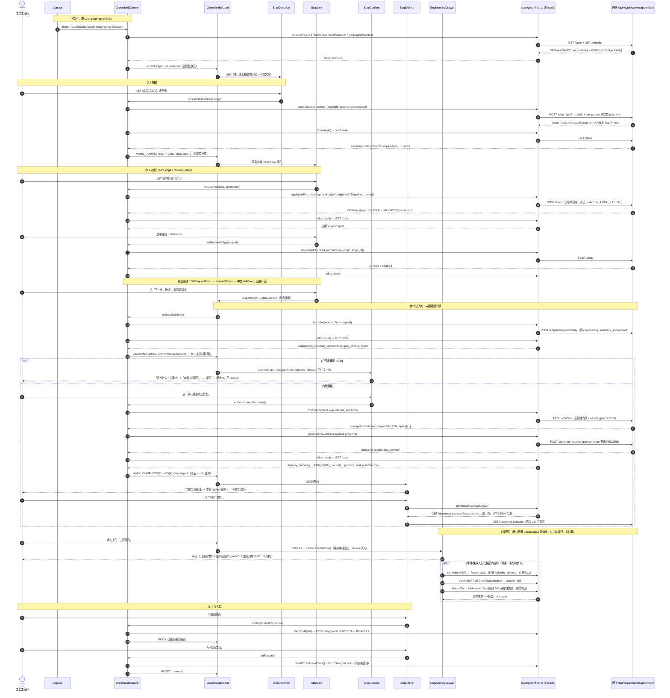
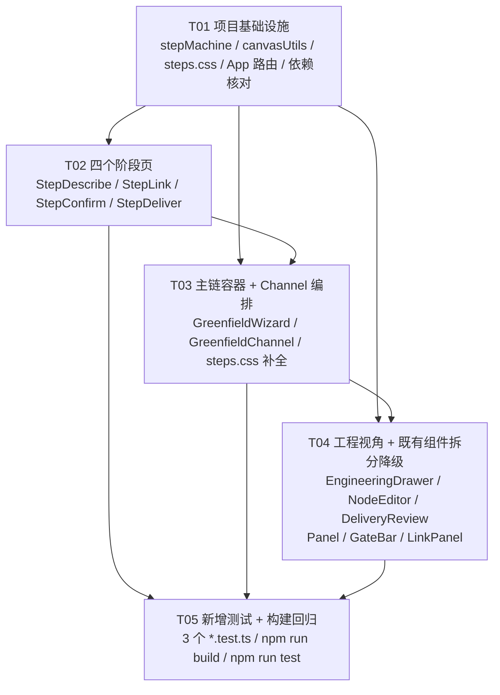

# PLC_chat 前端交互壳重构 · 增量架构设计与任务分解（02）

> 文档类型：增量架构设计 + 实施规格｜版本 v1.0｜产出：高见远（架构师）
> 唯一需求输入：`docs/frontend-redesign/01-prd.md`（已完整读取）
> 上游裁定：主理人对 Q1~Q6 全部代采用 PM 推荐默认值（见本文 §0.2）
> 本阶段**只做设计与文档**，`src` 下 `.tsx/.ts/.css` 零改动；**除本文档外不落盘任何其他文件**（Mermaid 类图/时序图内嵌本文，不另建 `.mermaid` 文件，遵循主理人指定路径）
> 工作根目录：`C:/Users/vboxuser/Desktop/Project/Code/PLC_chat/plc_project`

---

## 0. 结论摘要（先给主理人与工程师）

### 0.1 「体验完成态」可合法到达 —— 链路核实结论（最关键）

我用真实后端代码核实了第四节 4 个风险点，结论是：**在不改后端、不跳过 `/confirm`、不伪造 `frozen`/`delivery`、不使用任何 mock 的前提下，步 1→步 4 完全可合法走通**。合法 API 序列为：

```
fetchState → fetchWhitelist
→ [步1] sendChat（首版 IR，stage=DRAFT→LINKABLE）→ fetchState
→ [步2] applyLinkPatch(add_edge / remove_edge)（stage LINKABLE→VALIDATING）→ fetchState
→ [步3 进入时] fetchEngineeringSummary（★隐藏硬门禁：置 engineering_summary_shown=true）→ fetchState
→ [步3 主按钮] confirmSpec(explicit=true)（/confirm，五项硬门禁 → stage=FROZEN）
              → generateProjectPackage（/generate，要求 FROZEN）→ fetchState（得到 delivery_summary）
→ [步4] downloadPackageUrl(sessionId)（/download-package，要求 FROZEN）
```

**★ 最容易被漏掉的一环**：后端 `assert_gate("confirm")` 强制要求 `engineering_summary_shown === true`，而该标志**只能由 `POST /engineering-summary`（即 `fetchEngineeringSummary`）置位**（`greenfield_service.py:313-331`，第 330 行赋值）。现有 `GreenfieldGateBar` 是通过「确认弹窗 → `openSummary()` → `onShowSummary()`」隐式满足的。新的步 3 **必须在调用 `confirmSpec` 之前显式调用一次 `fetchEngineeringSummary`**，否则 `/confirm` 必返回 `GF_GATE_NOT_CONFIRMED`（「确认弹窗须先展示一次工程视角摘要」），四步主链会断在步 3。这是本设计对工程师的第一硬约束。

**★ 第二关键点**：`/generate` 的后端硬门禁**只有** `stage === FROZEN` + `session.specs` 非空；**没有** fidelity / 差异清单 / A·B·C / TIA 前置。旧 `GreenfieldChannel` 里 `onGenerateProject` 的 `writeBlockers` 判定（`diffWriteBlockers`，D11/D10/fidelity）是**前端为 TIA 写回附加的锁**，不是 `/generate` 的后端硬门禁。因此步 4「不依赖 A/B/C、不依赖差异清单、不依赖真机」是**合法**的，不构成绕过任何硬门禁：步 3 仍完整走 `/confirm` 五项门禁，未满足则停在主链中文引导，绝不跳过。

**★ 第三关键点**：`/state` 返回的 `fidelity` 恒为 `{ status: "pending_real_machine", fidelity_ok: null, note: ... }`（`greenfield_session.py:323-327`），`pending_real_machine` 恒为 `True`（`greenfield_service.py:551`）；`/generate` 的 `delivery` **不含** `fidelity` 字段（`greenfield_delivery.py:282-301`）。所以步 4 的「fidelity 报告」是对 `state.fidelity` + `delivery.verification` 的**中文业务化如实转述**（不伪装达标、不阻断完成、不出现 `fidelity_ok` 字样），原始明细放工程视角 ②。

### 0.2 已采用的裁定

Q1 默认落地页 = 4 步主链、存量工作台不隐藏、顶栏保留显式返回；Q2 `GreenfieldLinkPanel` 仅容器层最小化布局降级（props/绑定零改）；Q3 fidelity 未达标仍显示完成态、中文如实、原始明细入工程视角；Q4 `/confirm` 门禁未满足时主链只给一句中文 + 「查看工程视角」，逐项清单只在抽屉；Q5 新增 `steps/StepDescribe|StepLink|StepConfirm|StepDeliver.tsx` + `steps/steps.css`（不重写全局变量令牌）；Q6 新增纯逻辑/静态测试，不改既有 330 项断言。

### 0.3 回归基线实测

`npm run test -- --pool=threads` → **20 个测试文件 / 330 passed**（已实测确认）。默认 `forks` 池本次出现一次 `sessionSync.test.ts` worker 启动超时（325 passed + 1 unhandled error，exit 0），属环境偶发；QA 用 `--pool=threads` 或重跑即可稳定复现 330。`npm run build` = `tsc -b && vite build`。

---

## 1. 实现方案与框架选型

### 1.1 核心技术难点

| 难点 | 处理方式 |
|---|---|
| D1 后端五项硬门禁 + 隐藏的 `engineering_summary_shown` 前置，与「4 步可走完」的冲突 | 不绕过门禁；把满足门禁的动作**编排进主链本身**：步 2 连线使 `report.ok`/`stage=VALIDATING`；步 3 进入时调 `fetchEngineeringSummary`；步 3 主按钮调 `confirmSpec` + `generateProjectPackage`。门禁未满足时**停在主链**给中文引导 + 抽屉跳转（Q4） |
| D2 1393 行 `GreenfieldPanel.tsx` 巨石组件 | 物理拆分：`NodeEditor` / `DeliveryReview` / 画布纯函数迁出到新文件；`GreenfieldPanel.tsx` 瘦身为兼容重导出 + 工程视图薄壳；4 个阶段页 + 工程视角抽屉承载主链信息（AC-6） |
| D3 主链首屏零内部契约术语（AC-1） | 信息分层：主链 4 页只渲染业务语言字段；全部契约字段移到 `EngineeringDrawer` 6 组，默认 `collapsed`。**折叠态是纯前端 `WizardState` 视图位**，open/close 不触发任何请求 |
| D4 拖线为主操作且复用现有接线 | `StepLink` 直接挂 `@xyflow/react` 的 `<ReactFlow onConnect onEdgesChange onEdgeDoubleClick isValidConnection>`，复用 `toGfEdge` 与 `applyLinkPatch({op:"add_edge"|"remove_edge"})`；`whitelist.edge_kinds` 作类型选择，非法连线由后端 422 + `formatGfError` 中文提示 |
| D5 返回上一步不丢数据且不重放生成 | `step` 只是 `GreenfieldChannel` 内的 `useReducer` 视图状态；IR/连线真值在 `GFState`（Channel 的 `state`），返回**不发任何请求**；仅在「步 4 重新调整」时调 `beginEdit`（FROZEN→LINKABLE），因为 FROZEN 阶段 `link` 动作被后端禁止 |
| D6 步 4 完成态与项目终态验收口径分离 | 步 4 以「工程包已就绪 + 下载 + 中文 fidelity 摘要」为终点；TIA V19 编译零错误 / L1∧L2∧L3∧L4 / M4 / `pending_real_machine` 全部原样保留在工程视角 ⑥，不删除、不篡改、不伪装 |
| D7 不破坏 330 测试 | `state/greenfield.ts` 零 diff；既有 20 个 `*.test.ts(x)` 零改；无 jsdom / `@testing-library/react` 依赖 → 新测试用纯函数 + `?raw` 静态断言；`App.tsx` 最小改动必须保留 `refactorPipeline.test.ts` 的 4 个 `toContain` 字符串 |

### 1.2 框架与库选型：**沿用现状，零新增依赖**

| 能力 | 选型 | 依据 |
|---|---|---|
| UI 框架 | React 19 + TypeScript 5.7 + Vite 6 | `frontend/package.json` 现状；`npm run build` = `tsc -b && vite build` |
| 画布 | `@xyflow/react ^12.12.0` | 已安装、已在 `GreenfieldPanel.tsx:1256` 挂载；`Connection` / `Edge` / `Node` / `onConnect` / `onEdgesChange` 直接复用 |
| 图/布局 | `mermaid ^12.2.0` / `elkjs ^0.12.0` | 已安装；`mermaid` 工程视角内仍用；`elkjs` 仅 P1-2 自动布局备用，P0 不强制 |
| 字体 | `@fontsource/albert-sans`（自托管，400/500/600） | `--font-ui` 现状；**不引入** Inter / Roboto / Arial / system-ui / 新展示字体 |
| 设计系统 | `greenfield.css` 变量令牌（只读复用） | `--paper-1/2/3`、`--ink`、`--accent`、`--ok`、`--danger`、`--ground`、`--fs-head`、`--font-ui`、`.gf-block` 连接桩母题、`[data-stage]` 换底、`prefers-reduced-motion` 全局降级 |
| 动效 | **纯 CSS**（无 Motion 库） | `package.json` 无 `framer-motion`/`motion`；staggered reveal / 换底 620ms / 拖线脉冲 / 盖章 320ms 全部 `@keyframes` + `animation-delay` |
| 状态 | `useReducer` + props 透传（不引入状态库） | 步骤机是纯前端视图状态，真值在 `GFState`；避免新增依赖 |

**明确不新增**：MUI / Tailwind / framer-motion / 新字体包 / 新构建配置 / 新脚本入口 / 任何 mock 数据或离线假 IR。

### 1.3 架构模式与分层

采用 **容器-展示分层（Container / Presentational）+ 单向状态机 + 适配器（Facade）**：

```
App.tsx（路由层：仅 channel 默认值 + 挂载点）
  └─ GreenfieldChannel.tsx（容器层 / 唯一后端编排者）
       ├─ state/greenfield.ts（Facade：唯一后端出入口，零改动）
       ├─ GreenfieldWizard.tsx（主链容器：步序带 + 阶段工作区 + 抽屉入口 + step 路由）
       │    ├─ steps/StepDescribe.tsx   （展示层，零后端知识）
       │    ├─ steps/StepLink.tsx       （展示层，ReactFlow + 拖线）
       │    ├─ steps/StepConfirm.tsx    （展示层，业务摘要 + 唯一主按钮）
       │    ├─ steps/StepDeliver.tsx    （展示层，完成态 + 下载）
       │    └─ EngineeringDrawer.tsx    （工程视角 6 组；复用原 A/B/C、差异清单、SCL、门禁明细）
       ├─ steps/stepMachine.ts（纯函数状态机 / 文案映射 / 连线预校验）
       └─ steps/canvasUtils.ts（纯函数：buildNodes/buildEdges/toGfEdge）
```

- **唯一后端编排者**：`GreenfieldChannel` 持有 `state / whitelist / sessionId / projectId / busy / error / diff / actionResults` 等所有真实数据与 `run / runAction / refresh`；4 个阶段页与抽屉**不 import 任何 `state/greenfield.ts` 的请求函数**，只接收数据与回调 props（可独立测试）。
- **工程视角是"并行只读 + 局部可写"通道**：抽屉 open/close 零请求；抽屉内的 A/B/C、差异清单确认、真机交付等按钮仍调用既有 `runAction / confirmDiff / deliverTia`，**但都不是主链前置**。

### 1.4 美学方向落地映射（PRD 6.1~6.7 → 具体 CSS 类与换底机制）

| PRD 条款 | 落地映射（新增 `steps/steps.css`，复用 `greenfield.css` 令牌，不重写） |
|---|---|
| 6.1 工业蓝图 / SFC 步序块母题 | 左侧工位带 `.gf-wiz__rail` / `.gf-wiz__node`（`::before/::after` 直接复用 `.gf-block` 的 8px 左右连接桩）；当前步 `.gf-wiz__node--active` 用 `--accent`；完成态 `.gf-wiz__node--done` 用 `--ok` |
| 6.2 字体 | 全局继承 `.gf-root { font-family: var(--font-ui) }`；阶段大标题 `.gf-wiz__title`（600 / `-0.02em` / `--fs-head`）；水印序号 `.gf-wiz__watermark`（`clamp(48px,6vw,96px)`，绝对定位重叠、不占位）；等宽 `ui-monospace, Consolas, monospace` **仅**用于 `.gf-eng__code`（抽屉内 hash / 地址 / SCL） |
| 6.3 色彩 / 换底 | `.gf-root` 上同时保留 `data-stage={state.stage}`（原规则不动）并新增 `class="gf-wiz" data-step={wizard.step}`；`steps.css` 用**更高特异性** `.gf-root.gf-wiz[data-step="1"]{--ground:#c3cbe5}` … `[data-step="4"]{--ground:#bcc7e0}` 覆盖；步 4 `.gf-stamp` 用 `--ok` 盖章；`--danger` 仅出现在工程视角高危按钮；方角、无阴影、无渐变、纸色分层靠 `--paper-1/2/3` |
| 6.4 动效 | `@keyframes gf-wiz-reveal`（40–80ms `animation-delay` 阶梯，仅一次）；`background-color 620ms ease` 继承自 `.gf-root`（signature move）；`.gf-link-pulse` / `stroke-dashoffset` 行进 + 落点短脉冲（120–180ms）；`.gf-stamp` 一次性 `scale+opacity` 320ms；hover 复用 `.gf-block--ink` 反相；`@media (prefers-reduced-motion: reduce)` 对新类全量降级（`greenfield.css:65-70` 已有全局规则，此处补一份保险） |
| 6.5 空间构成 | `.gf-wiz` = `grid-template-columns: 220px 1fr`（左固定步序带 + 右主工作区，非对称、大留白）；`.gf-wiz__stage` 左对齐、限宽、右侧留白；`.gf-eng-drawer` 右侧抽屉 `width:420px`、`transform: translateX(100%)→0` 240ms，**覆盖而非挤压**（`position:absolute; right:0`） |
| 6.6 四屏布局 | 步 1 `.gf-step-desc__input` 超大输入 + `.gf-step-desc__sketch` 草图；步 2 `.gf-step-link__canvas` 全幅 ReactFlow + 右下 `.gf-step-link__more`（默认折叠「更多输入方式」，注入既有 `GreenfieldLinkPanel`）；步 3 `.gf-step-confirm__card ×3` 三段摘要；步 4 `.gf-step-deliver__stamp` + `.gf-step-deliver__report` + 主按钮 `.gf-btn--primary` |
| 6.7 工程视角 6 组 | `.gf-eng-drawer` / `.gf-eng__entry`（右上角单一入口）/ `.gf-eng-group` + `.gf-eng-group__head`（可再折叠）/ 6 个 `data-group="contract|fidelity|actions|diff|scl|machine"`；默认 `collapsed`（`engineeringOpen=false`，DOM 可存在但 `transform` 移出 + `visibility:hidden`），**首屏零术语泄露** |

---

## 2. 文件列表及相对路径

> 全部路径相对 `frontend/`。「新增 / 修改 / 只读不改」逐项标注；行数预算用于工程师排期，**不是硬限制**。

### 2.1 新增文件（11 个）

| # | 路径 | 职责 | 行数预算 | 为什么必须新增 |
|---|---|---|---|---|
| N1 | `src/shell/steps/stepMachine.ts` | 4 步状态机类型 + `wizardReducer` + `STEP_META` + `canAdvance` + 中文文案映射 `formatFidelityBusiness/formatDeliveryBusiness` + 连线预校验 `validateConnection` + `resetWizardLocalState` | ~230 | 步骤状态必须可纯函数单测（Q6，无 jsdom）；中文文案映射必须收口一处，防止 `fidelity_ok`/`blocker.code` 泄露到主链 |
| N2 | `src/shell/steps/canvasUtils.ts` | 从 `GreenfieldPanel` 迁出 `buildNodes` / `buildEdges` / `BUSINESS_TAG` / `toGfEdge`；新增 `validateConnection` | ~150 | 步 2 与工程视角都要用同一套画布投影；`GreenfieldLinkPanel` 通过重导出继续可用 |
| N3 | `src/shell/steps/steps.css` | 新增 `.gf-wiz-*` / `.gf-step-*` / `.gf-eng-*` / `.gf-stamp`；`data-step` 四步换底；入场/拖线/盖章动效；reduced-motion 降级 | ~340 | Q5 指定新样式文件；**不重写** `greenfield.css` 全局变量令牌，只追加覆盖规则 |
| N4 | `src/shell/steps/StepDescribe.tsx` | 步 1：全流程唯一「工艺描述」输入框 + 2~3 条示例文案（P1-4，仅占位仍走真实 `/chat`）+ 解析草图 + 唯一主按钮「下一步：连线」 | ~150 | P0-1 / P0-3 / AC-8 |
| N5 | `src/shell/steps/StepLink.tsx` | 步 2：全幅 ReactFlow 画布、连接桩拖出新增、选中/Delete/× 删除、非法连线中文提示、右下角默认折叠「更多输入方式」插槽 | ~250 | P0-4 / AC-3 / 批准项 4 |
| N6 | `src/shell/steps/StepConfirm.tsx` | 步 3：三段业务摘要 + 唯一主按钮「确认并生成工程包」；门禁未满足只给一句中文 + 「查看工程视角」 | ~160 | P0-5 / Q4 / AC-9（无 JSON 弹窗、无 code、无锁定清单） |
| N7 | `src/shell/steps/StepDeliver.tsx` | 步 4：完成态「工程包已就绪」+ `--ok` 盖章 + 中文 fidelity 报告 + 「下载工程包」+ 次入口「重新调整」「开始新工程」 | ~180 | P0-6 / AC-4 / Q3 |
| N8 | `src/shell/GreenfieldWizard.tsx` | 主链容器：左 4 工位步序带 + 右阶段工作区 + 右上角单一「工程视角」入口 + step 路由 + 前进/后退（纯前端、不重放请求）+ 抽屉挂载 | ~280 | 4 步编排的唯一骨架；`data-step` 换底驱动点 |
| N9 | `src/shell/EngineeringDrawer.tsx` | 默认折叠右侧抽屉；6 组（①契约与门禁 ②还原度与编译 ③三动作 A·B·C ④差异清单逐项勾选 ⑤SCL 只读预览 ⑥真机状态）；组内再折叠；字段值与 `/state` 一致 | ~450 | P0-2 / P0-7 / AC-5 / US-5 |
| N10 | `src/shell/engineering/NodeEditor.tsx` | 从 `GreenfieldPanel.tsx:199-474` 迁出 `NodeRow` + `NodeEditor`（props 零改） | ~280 | AC-6 物理拆分；工程视角「结构节点」能力不丢 |
| N11 | `src/shell/engineering/DeliveryReview.tsx` | 从 `GreenfieldPanel.tsx:480-880` 迁出 `DeliveryReview` + `sourceBlockLabel`；新增可选 `visibleSections` 以便 6 组分别渲染（默认值 = 全部，行为不变） | ~420 | AC-6 物理拆分；三动作 / 差异清单 / 编译诊断 / fidelity / SCL 原能力不丢 |

**新增测试文件（3 个，归入 T05）**：`src/shell/steps/stepMachine.test.ts`（~130）、`src/shell/steps/flow.test.ts`（~140）、`src/shell/steps/steps.contract.test.ts`（~100）。

### 2.2 修改文件（5 个）

| # | 路径 | 改动内容 | 行数预算 | 为什么必须动 |
|---|---|---|---|---|
| M1 | `src/App.tsx` | **仅 2 处最小改动**：① `useState<...>("workbench")` → `("greenfield")`（第 294 行）；② `channel === "greenfield"` 分支（2684-2690）挂载不变、保留 `initialPrompt={greenfieldPrompt}` 与 `onBack={() => setChannel("workbench")}`。其余 3350+ 行零改 | +2 / 净 ~0 | Q1 默认落地页；存量工作台可达性由 `onBack` 与顶栏「+ 新建工程」（2715）保证。详见 §9 |
| M2 | `src/shell/GreenfieldChannel.tsx` | 保留全部 state 字段与 `run / runAction / refresh / loadDiff / onConnect / onRemoveEdge / onPatchNodes / onConfirmDiff / onToggleDiffItem` 等既有回调；**替换 render tree** 为 `<GreenfieldWizard/>`；移除 init effect 中「有 seedPrompt 就自动 `sendChat`」的静默生成（改为把 seed 交给步 1 输入框）；新增 `useReducer(wizardReducer)`、`onSubmitDescribe` / `onEnterConfirm` / `onConfirmAndGenerate` / `onBeginEditAndGoLink` / `onRestart` | 695 → ~620 | 唯一后端编排者，必须承载 §4.2 的 API 序列；P0-3 消除自动重复输入 |
| M3 | `src/shell/GreenfieldPanel.tsx` | **瘦身为兼容薄壳**（1393 → ~80）：`export { toGfEdge } from "./steps/canvasUtils"`、`export { NodeEditor } from "./engineering/NodeEditor"`、`export { DeliveryReview } from "./engineering/DeliveryReview"`；保留一个可选的「工程视图」薄组件（hw 卡片 + Mermaid 切换，供工程视角按需挂载）；**删除 1153-1177 的重复工艺描述输入条**（改为只读展示当前描述） | 1393 → ~80 | AC-6「不再作为 1393 行单组件承载全部信息」；AC-8 消除重复输入；让 `GreenfieldLinkPanel.tsx` 的 `NodeEditor` import 继续有效 |
| M4 | `src/shell/GreenfieldGateBar.tsx` | 主链**不再常驻**；改由 `EngineeringDrawer` 在组 ①/⑥ 内按需挂载。保留 `canConfirm / confirmBlockers / gateReason / mapConfirmError / downloadPackageUrl / pendingRealMachineLabel / shortHash` 全部接线与导出/导入/生成/真机/继续调整能力；**删除 `JSON.stringify(summary, null, 2)` 弹窗**（AC-9），改为中文结构化摘要列表；顶栏 `pending_real_machine` 徽标、A·B·C 状态条、8 格梯级带只在抽屉内出现 | 346 → ~280 | P0-2（主链首屏零术语）+ AC-9（无 JSON 弹窗）+ 不删信息 |
| M5 | `src/shell/GreenfieldLinkPanel.tsx` | **最小化布局降级**：仅在组件最外层包一个默认折叠的 `<details>`/按钮「更多输入方式」，并由 `GreenfieldWizard` 容器层把它放到步 2 画布右下角；`GreenfieldLinkPanelProps` 与全部数据绑定 / `onBindVar` / `onValidate` / `onPatchNodes` 等**零改动** | 575 → ~590 | Q2 / P0-4 |

### 2.3 只读不改 · 边界清单

**后端零 diff（硬边界）**：
`gateway/app/routers/greenfield.py`、`gateway/app/services/plc/greenfield_service.py`、`greenfield_session.py`、`greenfield_chat.py`、`greenfield_draft_llm.py`、`greenfield_upload.py`、`plc_engine/af/greenfield_*.py`（含 `greenfield_ports.py` / `greenfield_ir.py` / `greenfield_validator.py` / `greenfield_delivery.py` / `greenfield_edges.py` / `greenfield_spec.py` / `greenfield_views.py`）、`tests/unit/test_greenfield_*.py`、`tools/greenfield_acceptance.py` —— **全部零 diff**。

**前端只读不改**：
- `src/state/greenfield.ts`（**零 diff**，允许但本设计选择完全不改；所有辅助函数放 `stepMachine.ts`）
- `src/shell/greenfield.css`（**零 diff**，40KB 设计系统只读复用；新样式全放 `steps.css`）
- `package.json` / `vite.config.ts` / `tsconfig*.json` / `index.html`（零 diff，无新增依赖与构建配置）
- `src/App.tsx` 除 §9 列出的 2 处外零改
- `src/shell/ProjectLaunchScreen.tsx` / `NewProjectWizard.tsx` / `OnboardingScreen.tsx` / `GreenfieldChatFeed.tsx` / `src/canvas/*` / `src/state/*.ts`（零改）
- **既有 20 个 `*.test.ts(x)` 全部零改、零新增 skip**（尤其 `src/state/refactorPipeline.test.ts` 的 `?raw` 静态断言，见 §9.3）

### 2.4 `state/greenfield.ts` 不可变导出清单（工程师：以下签名一个都不许改/删）

请求层：`gfRequest`、`fetchState`、`fetchWhitelist`、`createDraft`、`sendChat`、`applyLinkPatch`、`revalidate`、`fetchViews`、`fetchEngineeringSummary`、`confirmSpec`、`beginEdit`、`exportMermaid`、`exportDraft`、`importDraft`、`updateHardware`、`uploadFiles`、`confirmReceipt`、`loadReferenceFixture`、`generateProjectPackage`、`deliverTia`、`downloadPackageUrl`、`applyCanvasPatch`、`fetchSpecDiff`、`confirmDiff`、`fetchSpec`、`runActionA`、`runActionB`、`runActionC`。

会话/项目：`loadSessionId`、`saveSessionId`、`createProjectId`、`loadProjectId`、`saveProjectId`、`ensureProjectId`、`saveLaunchContext`、`loadLaunchContext`、`GF_SESSION_KEY`、`GF_PROJECT_KEY`、`GF_LAUNCH_CONTEXT_KEY`、`GF_BASE`、`GF_API`。

错误/守卫：`GFRequestError`、`GF_ERROR_TEXT`、`mapApiError`、`mapConfirmError`、`formatGfError`、`hasSideEffects`、`assertNoSideEffects`、`confirmBlockers`、`canConfirm`、`gateReason`、`diffWriteBlockers`、`canWriteAfterDiff`、`collectOpenQuestions`、`inferredInterlockQuestions`、`buildTopologyConstraints`、`formatFidelityLabel`、`formatCompileVerdict`、`pendingRealMachineLabel`、`shortHash`、`compileStepStatus`、`actionStepStatus`、`diffItemKey`、`diffChecklistKeys`、`diffChecklistComplete`、`diffExplicitlyConfirmed`、`actionAvailability`、`isSafeGreenfieldPath`、`bytesToBase64`、`fileToUploadItem`、`isDeterministicTiaFailure`。

类型：`GFState`、`GFStage`、`GFWhitelist`、`GFSpecDiff`、`GFActionResult`、`GFActionKind`、`GFActionMachine`、`GFActionAvailability`、`GFActionCompileDiagnostics`、`GFCompileDiagnostics`、`GFDeliverySummary`、`GFFidelityStatus`、`GFReverseProtection`、`GFGateChecks`、`GFBlocker`、`GFEdge`、`GFViews`、`GFViews.step_flow`、`GFHardwareTopology`、`GFLaunchContext`、`GFChatOptions`、`GFTopologyConstraints`、`GFViolation`、`GFReport`、`GFReceipt`、`GFChatMessage`、`GFSourceBlock`、`GFCanvasOp`、`GFCanvasPatchResult`、`GFDraftPayload`、`GFNodeKind`、`GFCompilePhase`、`GFDiffGroup`、`GFCompileVerdict`、`GFActionStep`、`GFActionARequest/B/CRequest`。常量：`GF_COMPILE_STEPS`、`GF_ACTION_B_STEPS`、`GF_ACTION_C_STEPS`、`FORBIDDEN_ENDPOINTS`、`GF_MAX_RETRIES`、`GF_NO_RETRY_CODES`。

---

## 3. 数据结构和接口

### 3.1 四步状态机（`src/shell/steps/stepMachine.ts`，完整 TS 定义）

```ts
import type { Connection } from "@xyflow/react";
import type {
  GFBlocker, GFDeliverySummary, GFFidelityStatus, GFState, GFWhitelist,
} from "../../state/greenfield";

export type WizardStep = 1 | 2 | 3 | 4;
export type EngGroupKey = "contract" | "fidelity" | "actions" | "diff" | "scl" | "machine";

/** 每步的数据；全部为主链可见的业务语言字段，零内部契约术语 */
export interface WizardData {
  prompt: string;            // 步 1 唯一输入框的值（全流程唯一「工艺描述」输入）
  submittedPrompt: string;   // 已成功生成草图的描述原文（步 3「你要做的事」）
  selectedEdgeKind: string;  // 步 2 当前连线类型，取自 whitelist.edge_kinds[0]
  linkError: string;         // 步 2 非法连线的中文提示（formatGfError 结果）
  confirmNote: string;       // 步 3 门禁未满足时的中文「还差什么 / 去哪补」
  deliveryReady: boolean;    // /generate 成功且 /state 返回 delivery_summary 后置 true
}

export interface WizardState {
  step: WizardStep;                                   // 当前步（唯一驱动 data-step / 换底）
  data: WizardData;
  completed: Record<WizardStep, boolean>;            // 步序带点亮态
  engineeringOpen: boolean;                          // 工程视角折叠态（默认 false，纯前端）
  engineeringGroups: Record<EngGroupKey, boolean>;   // 6 组组内再折叠（默认全 false）
  busy: boolean;
  error: string;                                     // 中文（formatGfError）
}

export type WizardAction =
  | { type: "SET_PROMPT"; value: string }
  | { type: "SET_EDGE_KIND"; value: string }
  | { type: "SET_LINK_ERROR"; value: string }
  | { type: "SET_CONFIRM_NOTE"; value: string }
  | { type: "SET_BUSY"; value: boolean }
  | { type: "SET_ERROR"; value: string }
  | { type: "MARK_COMPLETE"; step: WizardStep }
  | { type: "GO"; step: WizardStep }                 // 任意步前进/后退，纯前端，不重放请求
  | { type: "NEXT" } | { type: "BACK" }
  | { type: "TOGGLE_ENGINEERING"; value?: boolean }
  | { type: "TOGGLE_GROUP"; key: EngGroupKey }
  | { type: "RESET" };

export const INITIAL_WIZARD_STATE: WizardState;      // step:1, engineeringOpen:false, 全组折叠
export function wizardReducer(s: WizardState, a: WizardAction): WizardState;

export const STEP_META: ReadonlyArray<{
  step: WizardStep; title: string; kicker: string;
  primaryLabel: string; ground: string;            // ground: #c3cbe5 / #cfd3cb / #e6dccd / #bcc7e0
}>;

/** 前进合法性（纯函数，ctx 由 Channel 从 GFState 派生，不自行请求） */
export interface AdvanceContext {
  hasIr: boolean; edges: number; reportOk: boolean;
  canConfirm: boolean; stage: string; hasDelivery: boolean;
}
export function canAdvance(step: WizardStep, c: AdvanceContext): { ok: boolean; reason: string };
// step1: hasIr === true（草图已出现）
// step2: edges > 0 && reportOk === true
// step3: canConfirm === true 且 stage 为 LINKABLE/VALIDATING；未满足返回中文 reason
// step4: 终态，不允许 NEXT；只允许 RESET / 重新调整

/** 中文业务措辞，主链零术语（绝不出现 fidelity_ok / spec_hash / code / 已锁定） */
export type FidelityView =
  | (Partial<GFFidelityStatus> & { status?: string; note?: string; fidelity_ok?: boolean | null })
  | null | undefined;
export function formatFidelityBusiness(f: FidelityView): { title: string; detail: string; ok: boolean | null };
// true  → "还原一致性校验：达标"
// false → "还原一致性校验：尚未达标（不影响本轮工程包导出）"
// null  → "还原一致性校验：待真机核验，本轮不判定（不影响本轮工程包导出）"
export function formatDeliveryBusiness(d: GFDeliverySummary | null): { title: string; detail: string; ok: boolean };
// 例："工程包已生成 · 24 个程序块 · 自检 0 项错误"（取 block_count / verification.linter_error_count）

/** 纯前端连线预校验（后端仍是唯一裁定；仅用于即时中文反馈） */
export function validateConnection(
  c: Connection, whitelist: GFWhitelist | null, ir: Record<string, unknown> | null,
): { ok: boolean; reason: string };
// 自环 / 缺 source|target / kind 不在 edge_kinds / src_kinds·dst_kinds 不匹配 → 中文 reason

/** 「开始新工程」：清本地会话键（不伪造任何后端数据，随后 fetchState() 取新会话） */
export function resetWizardLocalState(): void; // removeItem(GF_SESSION_KEY / GF_PROJECT_KEY / GF_LAUNCH_CONTEXT_KEY)
```

**4 步状态机迁移表**

| 当前步 | 唯一主按钮 | 触发的后端调用 | 完成态 | 前进条件 | 后退 |
|---|---|---|---|---|---|
| 1 描述 | 「生成草图并进入连线」（无 IR 时）/「下一步：连线」（已有 IR） | `sendChat(sid, prompt, {projectId, topologyConstraints})` → `refresh()` | 草图（工站/执行单元/执行件/步序）出现 + 节点 1 点亮 | `hasIr===true` | 无（首步） |
| 2 连线 | 「下一步：确认」 | `applyLinkPatch(add_edge/remove_edge)` → `refresh()` | 连线数 > 0 且 `report.ok` → 节点 2 点亮 | `edges>0 && reportOk` | → 步 1，**零请求**，`prompt` 与连线保留 |
| 3 确认 | 「确认并生成工程包」 | 进入时 `fetchEngineeringSummary`；点击时 `confirmSpec(explicit=true)` → `generateProjectPackage` → `refresh()` | `/confirm` FROZEN + `delivery_summary` 出现 → 节点 3 点亮并自动进步 4 | `canConfirm(state)` 且 `/confirm` 成功 | → 步 2，零请求 |
| 4 完成 | 「下载工程包」 | `downloadPackageUrl(sid)` 生成 `<a href>`（GET `/download-package`） | 「工程包已就绪」+ 盖章 + 中文 fidelity 摘要 | 终态 | 「重新调整」→ `beginEdit` + GO(2)；「开始新工程」→ RESET |

### 3.2 props 表（字段名 / 类型 / 来源 / 是否可选）

**通用基座 `StepBaseProps`**（4 个阶段页都继承）

| 字段 | 类型 | 来源 | 可选 |
|---|---|---|---|
| `step` | `WizardStep` | `WizardState.step` | 否 |
| `busy` | `boolean` | Channel `busy` | 否 |
| `error` | `string` | Channel `error`（已 `formatGfError` 中文） | 否 |
| `completed` | `boolean` | `WizardState.completed[step]` | 否 |
| `onBackStep` | `() => void` | `dispatch({type:"BACK"})`，纯前端 | 是（步 1 不传） |
| `onNext` | `() => void` | `dispatch({type:"NEXT"})` | 是（步 4 不传） |
| `onOpenEngineering` | `() => void` | `dispatch({type:"TOGGLE_ENGINEERING", value:true})` | 否 |
| `onClearError` | `() => void` | Channel `setError("")` | 是 |

**`StepDescribeProps`**

| 字段 | 类型 | 来源 | 可选 |
|---|---|---|---|
| `prompt` / `onPromptChange` | `string` / `(v:string)=>void` | `WizardData.prompt` / `SET_PROMPT` | 否 |
| `sketch` | `{units:number;ems:number;cms:number;steps:number;edges:number} \| null` | `state.summary`（`/state` 真实） | 否 |
| `hasIr` | `boolean` | `state.has_ir` | 否 |
| `onSubmit` | `() => void` | Channel `onSubmitDescribe`（仅 `!hasIr` 时发 `sendChat`） | 否 |
| `examples` | `readonly string[]` | 常量（2~3 条 ≥30 字真实工艺描述，点击仅填入输入框，仍走真实 `/chat`，**非 mock**） | 是（P1-4） |
| `canNext` | `boolean` | `hasIr` | 否 |

**`StepLinkProps`**

| 字段 | 类型 | 来源 | 可选 |
|---|---|---|---|
| `ir` / `views` | `Record<string,unknown>\|null` / `GFViews\|null` | `state.ir` / `state.views` | 否 |
| `whitelist` | `GFWhitelist \| null` | `fetchWhitelist()` | 否 |
| `edgeKind` / `onEdgeKindChange` | `string` / `(k:string)=>void` | `WizardData.selectedEdgeKind` / `SET_EDGE_KIND` | 否 |
| `onConnect` | `(kind:string, c:Connection)=>void` | Channel → `applyLinkPatch({op:"add_edge", edge: toGfEdge(kind,c)})` | 否 |
| `onRemoveEdge` | `(edgeId:string)=>void` | Channel → `applyLinkPatch({op:"remove_edge", edge_id})` | 否 |
| `linkError` | `string` | `WizardData.linkError`（中文） | 否 |
| `edgesCount` / `reportOk` | `number` / `boolean` | `state.summary.edges` / `state.report?.ok === true` | 否 |
| `moreInputs` | `React.ReactNode` | 容器层把既有 `GreenfieldLinkPanel` 包成默认折叠「更多输入方式」后注入（**props/绑定零改**） | 是 |

**`StepConfirmProps`**

| 字段 | 类型 | 来源 | 可选 |
|---|---|---|---|
| `submittedPrompt` | `string` | `WizardData.submittedPrompt` | 否 |
| `nodesCount` / `edgesCount` | `number` | `state.summary.units+ems+cms` / `state.summary.edges` | 否 |
| `canConfirm` | `boolean` | `canConfirm(state)`（与 `/confirm` 同口径） | 否 |
| `confirmNote` | `string` | `mapConfirmError(confirmErrorCode, confirmErrorMessage)` 或 `gateReason(state)` 的中文改写 | 否 |
| `onConfirmAndGenerate` | `() => void` | Channel：`confirmSpec` → `generateProjectPackage` → `refresh` → GO(4) | 否 |
| `willGet` | `{ title:string; detail:string }` | 常量「工程包 + 还原度报告」 | 否 |

**`StepDeliverProps`**

| 字段 | 类型 | 来源 | 可选 |
|---|---|---|---|
| `delivery` | `GFDeliverySummary \| null` | `state.delivery_summary` | 否 |
| `fidelity` | `FidelityView` | `state.fidelity ?? state.delivery_summary?.fidelity` | 否 |
| `onDownloadUrl` | `() => string` | `downloadPackageUrl(state.session_id)` | 否 |
| `onReAdjust` | `() => void` | Channel `beginEdit(sid)` → GO(2) | 否 |
| `onRestart` | `() => void` | `resetWizardLocalState()` + `fetchState()` 新会话 + RESET | 否 |

**`EngineeringDrawerProps`**

| 字段 | 类型 | 来源 | 可选 |
|---|---|---|---|
| `open` / `groups` | `boolean` / `Record<EngGroupKey, boolean>` | `WizardState` | 否 |
| `onToggle` / `onToggleGroup` | `() => void` / `(k:EngGroupKey)=>void` | `dispatch` 纯前端 | 否 |
| `data` | `EngineeringViewData` | Channel 打包 | 否 |
| `actions` | `EngineeringActions` | Channel 打包 | 否 |

`EngineeringViewData`（避免抽屉 30+ props）：`state: GFState`、`whitelist`、`diff: GFSpecDiff|null`、`fidelity`、`compileDiagnostics`、`reverseProtection`、`sclSources`、`pendingRealMachine`、`actionResults`、`actionLoading`、`actionError`、`actionErrorCode`、`actionAvailability`、`actionCompileDiagnostics`、`diffChecked`、`checklistComplete`、`explicitConfirmed`、`writeBlockers: GFBlocker[]`、`blockers: GFBlocker[]`（`confirmBlockers(state)`）、`summary: Record<string,unknown>|null`（`fetchEngineeringSummary` 结果，**抽屉内**结构化展示，非 JSON 弹窗）、`confirmErrorCode`、`confirmErrorMessage`。
`EngineeringActions`：`onRunActionA/B/C`、`onToggleDiffItem`、`onConfirmDiff`、`onRefreshDiff`、`onDeliverTia`、`onGenerateDraft`、`onValidate`、`onShowSummary`、`onConfirm`、`onGenerateProject`、`onBeginEdit`、`onExportMermaid`、`onExportDraft`、`onImportDraft`、`onConfirmReceipt`、`onUploadFiles`、`onBindVar`、`onUnbindVar`、`onPatchNodes` —— 全部沿用 `GreenfieldChannel` 现有回调，**仅抽屉内触发**。

**`GreenfieldWizardProps`**

| 字段 | 类型 | 来源 | 可选 |
|---|---|---|---|
| `wizard` / `dispatch` | `WizardState` / `Dispatch<WizardAction>` | Channel `useReducer` | 否 |
| `state` / `whitelist` | `GFState` / `GFWhitelist\|null` | `/state` / `/whitelist` | 否 |
| `busy` / `loading` / `error` | `boolean`/`boolean`/`string` | Channel | 否 |
| `sessionId` / `projectId` | `string` | Channel | 否 |
| `engineeringData` / `engineeringActions` | 同上 | Channel 打包 | 否 |
| `onBack` | `() => void` | `App.setChannel("workbench")` | 否 |
| `onSubmitDescribe` / `onConnect` / `onRemoveEdge` / `onEnterConfirm` / `onConfirmAndGenerate` / `onBeginEditAndGoLink` / `onRestart` / `onDownloadUrl` | 见 §4.2 | Channel | 否 |
| `moreInputs` | `React.ReactNode` | 容器层包装的 `GreenfieldLinkPanel` | 是 |

### 3.3 Mermaid classDiagram（数据结构与接口关系）

```mermaid
classDiagram
    direction LR
    class App {
        +channel: "workbench"|"greenfield"
        +greenfieldPrompt: string
        +setChannel(v): void
        +render(): ReactNode
    }
    class GreenfieldChannel {
        +state: GFState
        +whitelist: GFWhitelist
        +sessionId: string
        +projectId: string
        +busy: boolean
        +error: string
        +wizard: WizardState
        +run(action, onCaught): Promise
        +runAction(kind, call): Promise
        +refresh(sid): Promise
        +loadDiff(pid, state): Promise
        +onConnect(kind, conn): void
        +onRemoveEdge(edgeId): void
        +onSubmitDescribe(prompt): void
        +onEnterConfirm(): void
        +onConfirmAndGenerate(): void
        +onBeginEditAndGoLink(): void
        +onRestart(): void
    }
    class WizardState {
        +step: WizardStep
        +data: WizardData
        +completed: Record~WizardStep,boolean~
        +engineeringOpen: boolean
        +engineeringGroups: Record~EngGroupKey,boolean~
        +busy: boolean
        +error: string
    }
    class WizardData {
        +prompt: string
        +submittedPrompt: string
        +selectedEdgeKind: string
        +linkError: string
        +confirmNote: string
        +deliveryReady: boolean
    }
    class GreenfieldWizard {
        +props: GreenfieldWizardProps
        +renderStage(step): ReactNode
        +renderRail(): ReactNode
        +renderEngineeringEntry(): ReactNode
    }
    class StepPage {
        <<interface>>
        +step: WizardStep
        +busy: boolean
        +error: string
        +onBackStep(): void
        +onNext(): void
        +onOpenEngineering(): void
    }
    class StepDescribe {
        +prompt: string
        +sketch: Sketch
        +hasIr: boolean
        +examples: string[]
        +onSubmit(): void
    }
    class StepLink {
        +ir: object
        +whitelist: GFWhitelist
        +edgeKind: string
        +onConnect(kind, conn): void
        +onRemoveEdge(id): void
        +moreInputs: ReactNode
    }
    class StepConfirm {
        +submittedPrompt: string
        +canConfirm: boolean
        +confirmNote: string
        +onConfirmAndGenerate(): void
    }
    class StepDeliver {
        +delivery: GFDeliverySummary
        +fidelity: FidelityView
        +onDownloadUrl(): string
        +onReAdjust(): void
        +onRestart(): void
    }
    class EngineeringDrawer {
        +open: boolean
        +groups: Record~EngGroupKey,boolean~
        +data: EngineeringViewData
        +actions: EngineeringActions
        +renderGroup(key): ReactNode
    }
    class GFApi {
        <<facade 零改动>>
        +fetchState(sid, pid): Promise~GFState~
        +fetchWhitelist(): Promise~GFWhitelist~
        +sendChat(sid, msg, opts): Promise
        +applyLinkPatch(sid, patch): Promise~GFState~
        +fetchEngineeringSummary(sid): Promise
        +confirmSpec(sid, explicit, pid): Promise
        +generateProjectPackage(sid, pid): Promise
        +beginEdit(sid): Promise~GFState~
        +downloadPackageUrl(sid): string
        +deliverTia(sid, mode, pid): Promise
        +runActionA_B_C(req): Promise~GFActionResult~
        +confirmDiff(pid, diffId, ok): Promise
        +canConfirm(state): boolean
        +confirmBlockers(state): GFBlocker[]
        +mapConfirmError(code, fb): string
        +formatGfError(e): string
    }
    class GFState {
        +session_id: string
        +stage: GFStage
        +has_ir: boolean
        +report: GFReport
        +engineering_summary_shown: boolean
        +gate_checks: GFGateChecks
        +delivery_summary: GFDeliverySummary
        +fidelity: object
        +pending_real_machine: boolean
        +summary: object
        +ir: object
        +views: GFViews
    }
    class GFDeliverySummary {
        +ok: boolean
        +block_count: number
        +zip_filename: string
        +verification: object
        +compile_diagnostics: object
        +scl_sources: object
        +fidelity: object
    }
    class stepMachine {
        <<pure module>>
        +wizardReducer(s, a): WizardState
        +canAdvance(step, ctx): Verdict
        +formatFidelityBusiness(f): Verdict
        +formatDeliveryBusiness(d): Verdict
        +validateConnection(c, wl, ir): Verdict
        +resetWizardLocalState(): void
    }
    class canvasUtils {
        <<pure module>>
        +buildNodes(ir, eng): Node[]
        +buildEdges(ir): Edge[]
        +toGfEdge(kind, conn): GFEdge
    }

    App "1" --> "1" GreenfieldChannel : channel==greenfield 挂载
    GreenfieldChannel "1" --> "1" GFApi : 唯一后端出入口
    GFApi ..> GFState : 返回
    GFState "1" *-- "0..1" GFDeliverySummary : delivery_summary
    GreenfieldChannel "1" --> "1" WizardState : useReducer
    WizardState "1" *-- "1" WizardData : data
    GreenfieldChannel "1" --> "1" GreenfieldWizard : 渲染
    GreenfieldWizard "1" --> "1" WizardState : 读 step / 换底
    GreenfieldWizard "1" --> "1" EngineeringDrawer : 右上角单一入口
    GreenfieldWizard "1" --> "4" StepPage : step 路由
    StepPage <|.. StepDescribe
    StepPage <|.. StepLink
    StepPage <|.. StepConfirm
    StepPage <|.. StepDeliver
    StepLink "1" --> "1" canvasUtils : toGfEdge / buildNodes
    GreenfieldWizard "1" --> "1" stepMachine : reducer / 文案 / 预校验
    EngineeringDrawer "1" --> "1" GFApi : 仅抽屉内 A/B/C / diff / TIA
    GreenfieldChannel "1" --> "1" GreenfieldLinkPanel : 降级为 moreInputs
    GreenfieldChannel "1" --> "1" GreenfieldGateBar : 仅工程视角内挂载
```



---

## 4. 程序调用流程

### 4.1 链路风险核实结论（第四节 4 问，逐条附真实代码）

#### 结论 1 · `confirmSpec` / `/confirm` 的 5 项前置 + 隐藏第 6 项

- 路由：`gateway/app/routers/greenfield.py:243-254` → `svc.confirm_and_freeze`（`greenfield_service.py:413-486`）。
- **服务端五项前置**：`check_confirm_prerequisites`（`greenfield_service.py:345-410`）
  1. `topology_finalized` —— `session.topology_finalized`，默认 `True`（`greenfield_session.py:62`）
  2. `open_questions_cleared` —— `report.open_questions + ir.spec_meta.open_questions` 为空
  3. `nodes_links_valid` —— `validate_ir(ir).ok`（对应 `/state` 的 `gate_checks.nodes_edges_valid`）
  4. `equivalence_precheck` —— IR 往返哈希可复现且 `report.ir_sha256 == ir.ir_sha256()`
  5. `baseline_locked` —— `ir.baseline_version` 非空（默认 `"GF-BASELINE-1.0"`，`greenfield_ir.py:864`）
  失败码映射 `_CONFIRM_CHECK_CODES`（336-342），由 `/confirm` 抛 `GateLockedError` 的 `code` 透传给 `mapConfirmError`。
- **`assert_gate("confirm", explicit=true)`**（`greenfield_session.py:143-178`）额外要求：阶段为 `VALIDATING`（`STAGE_ALLOWED_ACTIONS`，`greenfield_ports.py:58-60`；若 `LINKABLE` 则 `confirm_and_freeze:427-428` 先自动 `revalidate` 推进）、`explicit===true`、`report.ok`、回执已确认（若有 `receipt`）、**`engineering_summary_shown === true`**（173-178）。`FORBIDDEN_PREGATE_ACTIONS`（`greenfield_ports.py:71-84`）不含 confirm。
- `assert_no_side_effects()`（442 / `greenfield_session.py:180-197`）：确认前三计数为 0。
- 成功后 `transition_stage(FROZEN)`（471）、写 `specs/vN.json`、`count("disk_writes")`。
- **前端镜像**：`confirmBlockers`（`greenfield.ts:1219-1299`）从 `/state` 检查 `stage / has_ir / report.ok / receipt.user_confirmed / engineering_summary_shown / hasSideEffects / collectOpenQuestions / gate_checks.*`；`canConfirm = blockers.length===0`（1301-1303）；`gateReason` 取首条 reason（1305-1309）。既有 `greenfield.test.ts:80` 的 `fakeState()` 必须带 `engineering_summary_shown: true` 才能 `canConfirm===true`，反向印证此依赖。
- **★ 隐藏前置**：`engineering_summary_shown` 只由 `POST /engineering-summary` 置位（`greenfield_service.py:313-331`，第 330 行 `session.engineering_summary_shown = True`；路由 `greenfield.py:238-240`），前端封装为 `fetchEngineeringSummary`（`greenfield.ts:929-934`）。**新步 3 必须在 `confirmSpec` 之前调用它**。
- **合法满足顺序**：步 1 `sendChat` 产出 IR（`DRAFT→LINKABLE`，`greenfield_chat.py:338-363` / `greenfield_service.py:164-200`）→ 步 2 `applyLinkPatch(add_edge)` 使 `report` 重校验、`stage LINKABLE→VALIDATING`（`greenfield_validator.py:1096-1097`；`link` 在 LINKABLE/VALIDATING 均允许）→ 步 3 进入时 `fetchEngineeringSummary` 置位 → `canConfirm(state)` 为真 → `confirmSpec(explicit=true)`。**未满足时**：主链停步 3，`mapConfirmError` 中文一句 + 「查看工程视角」，逐项清单在抽屉 ①（Q4），**不跳过、不伪造**。
- 补充：确定性兜底 `build_sample_ir()`（`greenfield_ir.py:1543-1546`）明确「不含 inferred 联锁，可直接通过校验并冻结」，故默认路径五项门禁可全绿；若 LLM 解析产生 inferred 联锁/开放问题，则 `/confirm` 会被后端拒绝，主链按 Q4 停步 3 引导补齐（工程视角保留逐条答复原能力），**不是死锁**。

#### 结论 2 · `/generate` 是否要求 `FROZEN` 或其他前置

- 路由 `greenfield.py:328-333` → `generate_project_package`（`greenfield_service.py:631-660`）：
  - `session.assert_gate("generate")`（633）→ `FORBIDDEN_PREGATE_ACTIONS` 含 `generate`/`generate_project` → **必须 `stage === FROZEN`**（`greenfield_ports.py:61-63,71-84`）；
  - `if not session.specs: raise GF_GATE_LOCKED`（634-635）；
  - `AfGreenfieldDelivery().deliver(...)`（637）产出真实 zip 包（`greenfield_delivery.py:282-301`），`session.last_delivery = delivery`（645），`count("generations")`。
- **没有** fidelity_ok / diff_confirmed / A·B·C / TIA / `pending_real_machine` 前置。旧 `GreenfieldChannel.tsx:456-459` 的 `writeBlockers`（来自 `diffWriteBlockers`，`greenfield.ts:1312-1344`）是**前端为 TIA 写回附加的锁**，不是 `/generate` 后端硬门禁。
- 因此「步 3 确认 → 步 4 完成态不依赖 A/B/C、差异清单、真机」合法；但**必须**先 `/confirm`（FROZEN）。严禁跳过 `/confirm` 直调 `/generate`（会被后端 4xx 拒绝）。

#### 结论 3 · `downloadPackageUrl` 是否仅在 `frozen && delivery` 可用 / `delivery` 由谁产生

- `downloadPackageUrl(sessionId)`（`greenfield.ts:1032-1034`）**只是 URL 字符串拼接**，无运行时门禁。
- 后端 `GET /download-package`（`greenfield.py:359-369`）→ `get_project_package_zip`（`greenfield_service.py:663-669`）：`assert_gate("generate")`（要求 FROZEN）+ **若 `last_delivery is None` 会现场调 `generate_project_package`**。所以 FROZEN 之后该 URL 即合法可用。
- `delivery` 由 `POST /generate` 产生（`session.last_delivery`），经 `state_payload`（`greenfield_service.py:526-535`）以 `data["delivery_summary"]` 回到 `/state`（剔除了 `zip_bytes`，并补 `compile_diagnostics`/`scl_sources` 默认 null）。
- UI 显示条件 `frozen && delivery` 沿用现有 `GreenfieldGateBar.tsx:254-262`；步 4 用同一条件显示「下载工程包」，`download={delivery.zip_filename}`。**不依赖 TIA**。

#### 结论 4 · `GreenfieldGateBar`「生成标准 AF 博途工程」→「下载工程包」真实链路

1. 「确认设备逻辑并锁定还原契约」（`GreenfieldGateBar.tsx:245-253`）→ `openSummary()`（101-112）→ `assertNoSideEffects(state)` + `onShowSummary()` = `fetchEngineeringSummary(sessionId)`（`GreenfieldChannel.tsx:439`）→ 置 `engineering_summary_shown=true` → 弹 `.gf-modal`（302-341）内含 `JSON.stringify(summary, null, 2)`（322）→ 确认按钮（327-338）→ `onConfirm()` → `GreenfieldChannel.tsx:440-453` → `confirmSpec(sid, true, projectId)` → FROZEN + `downloadText(spec md)` + `refresh()`。
2. 「生成标准 AF 博途工程」（215-229）：`generateDisabled = !frozen || !onGenerateProject || writeBlockers.length>0`（99）→ `onGenerateProject` → `GreenfieldChannel.tsx:454-462` → `generateProjectPackage(sid, projectId)` → `refresh()` → `/state` 带 `delivery_summary`。
3. 「下载工程包」（254-262）：仅 `frozen && delivery` 时渲染 `<a href={downloadPackageUrl(state.session_id)} download={delivery.zip_filename}>`。
4. **结论**：现有真实链路 = `/engineering-summary → /confirm → /generate → /state → /download-package`。本设计 4 步主链**完整复刻这一合法序列**（去掉 JSON 弹窗、把契约信息移入抽屉），步 4 即用户可见终点，无「待真机」横幅。

### 4.2 步 1 → 步 4 的 state API 序列与数据流转（工程师照此实现）

| 步 | 触发 | 调用顺序（`state/greenfield.ts`） | 后端 | 关键数据流转 |
|---|---|---|---|---|
| 初始化 | Channel mount | `ensureProjectId()` → `fetchState(loadSessionId(), pid)` → `fetchWhitelist()` → `loadLaunchContext()`（只取 `prompt` 作步 1 预填，**不再自动 sendChat**） | `GET /state`、`GET /whitelist` | `state(DRAFT, has_ir=false)`、`whitelist.edge_kinds` → `wizard.step=1` |
| 1 描述 | 点主按钮 | `sendChat(sid, prompt, {projectId, topologyConstraints: buildTopologyConstraints(null)})` → `refresh(sid)` | `POST /chat` → `GET /state` | IR 生成、`stage=LINKABLE`、`has_ir=true`、`summary.{units,ems,cms,steps,edges}` → 草图；`submittedPrompt=prompt`；MARK_COMPLETE(1) → GO(2) |
| 2 连线（新增） | 从连接桩拖出 | `applyLinkPatch(sid, {op:"add_edge", edge: toGfEdge(kind, conn)})` → `refresh(sid)` | `POST /links` → `GET /state` | `stage LINKABLE→VALIDATING`、`ir.edges` +1、`report` 重校验；非法 → `GFRequestError` → `formatGfError` → `linkError` 中文 |
| 2 连线（删除） | 选中 + Delete / × / 双击 | `applyLinkPatch(sid, {op:"remove_edge", edge_id})` → `refresh(sid)` | 同上 | `ir.edges` -1；**不本地改 edges**，永远以 `/state` 为准（AC-3 刷新一致） |
| 2 → 3 | 点「下一步：确认」 | **零请求**，仅 `dispatch(GO 3)` + `onEnterConfirm()`：`fetchEngineeringSummary(sid)` → `refresh(sid)` | `POST /engineering-summary` → `GET /state` | `engineering_summary_shown=true`；`canConfirm(state)` 可判；`confirmBlockers(state)` 供抽屉 ① |
| 3 → 4 | 点「确认并生成工程包」 | `confirmSpec(sid, true, projectId)` → `generateProjectPackage(sid, projectId)` → `refresh(sid)` → GO(4) | `POST /confirm` → `POST /generate` → `GET /state` | `stage=FROZEN`、`specs[v1]`、`delivery_summary{ok, block_count, zip_filename, verification, compile_diagnostics:null, scl_sources:null}`、`fidelity{fidelity_ok:null}`、`pending_real_machine:true` |
| 3 失败分支 | `/confirm` 4xx | `mapConfirmError(gfErr.code, gfErr.message)` → `confirmNote` | — | **停在步 3**，一句中文 + 「查看工程视角」；不 GO(4)、不重试绕过 |
| 4 完成 | 点「下载工程包」 | `downloadPackageUrl(sid)` → `<a href download>` | `GET /download-package` | 真实 zip 字节流 |
| 4 重新调整 | 点「重新调整」 | `beginEdit(sid)` → `refresh(sid)` → GO(2) | `POST /begin-edit` → `GET /state` | FROZEN→LINKABLE、`engineering_summary_shown=false`（回到步 3 时会重新 fetch summary） |
| 4 开始新工程 | 点「开始新工程」 | `resetWizardLocalState()` → `fetchState(null,null)`（新建真实会话）→ `saveSessionId` → RESET | `GET /state` | 全新 DRAFT 会话，零 mock |

**工程视角并行关系（非主链前置）**：抽屉 open/close **不发任何请求**；抽屉内 ③ A/B/C → `runActionA/B/C`（`/action-a|b|c`，B 需 A 的 `fidelity_ok=true`、C 需差异清单确认，均为服务端 fail-closed，UI 如实呈现）；④ 差异清单 → `confirmDiff`（`/confirm-diff`）+ `diffChecklistComplete`；⑤ SCL 只读预览来自 `delivery_summary.scl_sources`（无产物时诚实降级）；⑥ 真机状态 → `deliverTia`（`/deliver-tia`，TIA 不可用返回 503 确定性失败）。这些动作**可以在步 1/2/3/4 任意时刻进行，但都不是到达步 4 的前置**（P0-6 / 不做清单 #8）。

### 4.3 Mermaid sequenceDiagram（主链 + 工程视角并行）



### 4.4 分支时序要点

- **步 3 门禁失败**：`run` 的 `onCaught` 捕获 `GFRequestError` → `setConfirmErrorCode(gfErr.code)` / `setConfirmErrorMessage(gfErr.message)`（沿用 Channel 现有字段）→ `StepConfirm` 用 `mapConfirmError` 生成一句中文；**不调用 `/generate`、不 GO(4)、不重试、不绕过**。
- **步 2 非法连线**：`applyLinkPatch` 返回 422（如 `GF_EDGE_ILLEGAL` / 白名单拦截）→ `formatGfError` → `WizardData.linkError` 中文（「连线类型不在允许白名单内，变更已回滚。」等）→ 画布保持 `/state` 原样。
- **步 4 重新调整**：必须先 `beginEdit`（FROZEN 不允许 `link`），否则步 2 的 `applyLinkPatch` 会被 `assert_gate("link")` 拒绝。

---

## 5. 任务列表（有序、含依赖、按实现顺序；5 个任务，同 turn 可批量写完）

> 分组原则：按层次/功能模块分组，不按单文件拆分；每个任务 ≥3 个相关文件；T01 为「项目基础设施」；尽量让任务只依赖 T01 或前序一条链。

### T01 · 项目基础设施：状态机 / 入口路由 / 样式基座 / 依赖核对

- **依赖**：无（第一个任务）
- **优先级**：P0
- **文件**：
  1. `src/shell/steps/stepMachine.ts`（新增，N1）
  2. `src/shell/steps/canvasUtils.ts`（新增，N2）
  3. `src/shell/steps/steps.css`（新增，N3 初版：令牌复用 + `.gf-wiz` 骨架 + `data-step` 换底 + reduced-motion）
  4. `src/App.tsx`（修改，M1：仅 §9 的 2 处）
  5. `frontend/package.json` / `vite.config.ts` / `tsconfig*.json`（**只读核对**，确认零新增依赖、无新构建配置；不落盘改动）
  6. `src/state/greenfield.ts` / `src/shell/greenfield.css`（**只读核对**，导出清单与令牌清单抄入设计注释）
- **做什么**：定义 §3.1 全部类型与纯函数；迁入画布纯函数；写 `steps.css` 基类；`App.tsx` 默认 `channel="greenfield"`；确认无新增依赖。
- **完成判据**：`npx tsc -b` 通过；`stepMachine` 可被纯函数 import（无 DOM 依赖）；`App.tsx` 除 2 处外 `git diff` 为空；`package.json` 零 diff；`refactorPipeline.test.ts` 的 4 个 `toContain` 字符串仍在。

### T02 · 4 个阶段页（展示层，零后端知识）

- **依赖**：T01
- **优先级**：P0
- **文件**：`src/shell/steps/StepDescribe.tsx`、`StepLink.tsx`、`StepConfirm.tsx`、`StepDeliver.tsx`（N4~N7），可顺带补 `steps.css` 本节专用类
- **做什么**：按 §3.2 props 表实现 4 页；每页唯一主按钮 + 完成态；步 2 用 `@xyflow/react` 的 `onConnect / onEdgesChange / onEdgeDoubleClick / isValidConnection`，`toGfEdge` 从 `canvasUtils` 取；`whitelist.edge_kinds` 作类型选择；`moreInputs` 插槽；步 4 用 `formatFidelityBusiness` / `formatDeliveryBusiness` / `onDownloadUrl`。
- **完成判据**：4 页源码中**不出现** AC-1 的 16 类术语（用 `?raw` 静态断言，T05 写）；4 页不 `import` 任何 `state/greenfield.ts` 的请求函数；步 2 删除连线走 `onRemoveEdge(edge.id)` 而非本地 state；步 3 无 `JSON.stringify`。

### T03 · 主链容器 + Channel 编排（把 4 步接上真实后端）

- **依赖**：T01、T02
- **优先级**：P0
- **文件**：`src/shell/GreenfieldWizard.tsx`（新增 N8）、`src/shell/GreenfieldChannel.tsx`（修改 M2）、`src/shell/steps/steps.css`（补步序带/盖章/抽屉动效）
- **做什么**：Wizard 实现左 220px 步序带 + 右工作区 + 右上角单一入口 + `data-step` 换底 + `GO/BACK` 纯前端；Channel 保留全部既有 state/handler，替换 render tree，新增 `useReducer` 与 §4.2 的 6 个编排回调（`onSubmitDescribe` / `onEnterConfirm` / `onConfirmAndGenerate` / `onBeginEditAndGoLink` / `onRestart` / `onDownloadUrl`），移除 init effect 的自动 `sendChat`，把 `initialPrompt`/`loadLaunchContext().prompt` 作为步 1 预填。
- **完成判据**：`onConfirmAndGenerate` 严格按 `confirmSpec → generateProjectPackage → refresh → GO(4)`；步 3 进入时必调 `fetchEngineeringSummary`；`GO/BACK` 不发请求；`state` 与 `whitelist` 仍来自 `fetchState`/`fetchWhitelist`；`busy/error` 四态齐全；`npm run build` 通过。

### T04 · 工程视角抽屉 + 既有组件拆分/降级（信息不删、主链零术语）

- **依赖**：T01、T03（可与 T02 并行开发，集成时对齐）
- **优先级**：P0
- **文件**：`src/shell/EngineeringDrawer.tsx`（新增 N9）、`src/shell/engineering/NodeEditor.tsx`（新增 N10，迁移）、`src/shell/engineering/DeliveryReview.tsx`（新增 N11，迁移）、`src/shell/GreenfieldPanel.tsx`（修改 M3 瘦身）、`src/shell/GreenfieldGateBar.tsx`（修改 M4）、`src/shell/GreenfieldLinkPanel.tsx`（修改 M5 最小化）
- **做什么**：6 组抽屉（默认折叠、组内再折叠、右侧 420px 覆盖式滑入）；`GreenfieldPanel` 瘦身为兼容重导出 + 工程薄壳并删除重复输入条；`GateBar` 移入抽屉、删 JSON 弹窗、保留全部门禁函数接线；`LinkPanel` 仅外层包默认折叠「更多输入方式」，props/绑定零改。
- **完成判据**：抽屉 6 组字段值与 `/state` 一致（AC-5）；`GreenfieldLinkPanelProps` 零变化；`GreenfieldPanel.tsx` < 120 行且 `NodeEditor`/`toGfEdge` 仍可被 `GreenfieldLinkPanel` 引用；主链 4 页 DOM 不含契约术语；`state/greenfield.ts` 与后端目录 `git diff` 为空；AC-8 全流程仅 1 处工艺描述输入。

### T05 · 新增测试 + 构建/回归验证

- **依赖**：T01、T02、T03、T04
- **优先级**：P0
- **文件**：`src/shell/steps/stepMachine.test.ts`、`src/shell/steps/flow.test.ts`、`src/shell/steps/steps.contract.test.ts`（3 个新增），以及只读核对 `src/state/greenfield.test.ts` / `src/state/refactorPipeline.test.ts` / `src/shell/newProjectFlow.test.ts` / `src/shell/smartRoute.test.ts`
- **做什么**：纯函数测试覆盖 `wizardReducer`（NEXT/BACK/GO/RESET/TOGGLE 不丢数据）、`canAdvance`、`formatFidelityBusiness`（true/false/null 三态中文）、`formatDeliveryBusiness`、`validateConnection`（自环/白名单/缺端点）；`flow.test.ts` 用 `vi.stubGlobal("fetch")` 断言 `add_edge`/`remove_edge` 的 body 形状与 `toGfEdge` 输出；`steps.contract.test.ts` 用 `?raw` 静态断言 4 个阶段页零 AC-1 术语、无 `JSON.stringify`、无新增依赖字样、CSS 用 `var(--font-ui)` 与 `prefers-reduced-motion`。
- **完成判据**：`npm run build` 通过；`npm run test`（建议 `--pool=threads`）通过且 **≥ 330 passed**、无新增 skip；既有 20 个测试文件零改动；`git diff --stat` 确认后端目录零 diff。

### 5.1 任务依赖图



---

## 6. 依赖包列表（**无任何新增**）

| 包 | 版本 | 用途 | 状态 |
|---|---|---|---|
| `react` / `react-dom` | `^19.0.0` | UI 运行时 | 沿用 |
| `typescript` | `~5.7.2` | `tsc -b` | 沿用 |
| `vite` / `@vitejs/plugin-react` | `^6.0.0` / `^4.3.4` | 构建 | 沿用 |
| `vitest` | `^5.0.4` | `npm run test`（`vitest run`） | 沿用（新测试同款） |
| `@xyflow/react` | `^12.12.0` | 步 2 ReactFlow 画布 / `Connection` / `Edge` / `Node` | 沿用，已是依赖 |
| `elkjs` | `^0.12.0` | P1-2 自动布局备用（P0 不强制） | 沿用 |
| `mermaid` | `^12.2.0` | 工程视角内视图渲染 | 沿用 |
| `@fontsource/albert-sans` | `^5.3.0` | `--font-ui` 自托管主字体（400/500/600） | 沿用 |
| `react-markdown` | `^10.1.0` | 存量，本轮不新增使用 | 沿用 |

**不引入**：MUI / Tailwind / framer-motion / motion / Inter / Roboto / Arial / system-ui 字体包 / jsdom / `@testing-library/*` / 任何 mock 数据或假 IR。新测试因无 jsdom，采用纯函数 + `?raw` 静态断言（`vite` 内置 `?raw` 已被 `refactorPipeline.test.ts` 使用验证可行）。

---

## 7. 共享知识（跨文件约定，工程师必须逐条遵守）

1. **步骤状态唯一存放位置**：`GreenfieldChannel` 的 `useReducer(wizardReducer, INITIAL_WIZARD_STATE)`；`step / completed / engineeringOpen / engineeringGroups / data` 全部在此。**不写 localStorage**（P2-1 才考虑），刷新回到步 1 但 IR/连线真值仍在后端 `/state`（不丢数据）。4 个阶段页与抽屉都是受控展示组件，不得自建 `step` 副本。
2. **工程视角折叠态归属**：`WizardState.engineeringOpen` + `engineeringGroups`，纯前端视图位。`TOGGLE_ENGINEERING` / `TOGGLE_GROUP` **reducer 内不得发请求、不得改 `state`、不得跳过/替代任何写入门禁**。`fetchEngineeringSummary` 属于「步 3 进入」主链动作，**不属于抽屉 open**。
3. **错误文案中文映射规则**：通用异常一律 `formatGfError(err)`；`/confirm` 失败一律 `mapConfirmError(gfErr.code, gfErr.message)`；非法连线取 `formatGfError` 后写入 `WizardData.linkError`。**主链 4 页禁止出现** `blocker.code` / 原始英文 error code / `已锁定：…` / `JSON.stringify` / `fidelity_ok` / `spec_hash` / `pending_real_machine` / `step_order` / `PCEC` / `compile_diagnostics` / `D7|D10|D11|N9` / `A·B·C` / `project_id`。这些词只允许出现在 `EngineeringDrawer` 组标题与明细里（审计口径可用工程术语），且值必须与 `/state` 一致。
4. **CSS 类名前缀与命名**：延续 `gf-` 命名空间，新增前缀 `.gf-wiz-*`（主链容器/步序带）、`.gf-step-*` / `.gf-step-desc-*` / `.gf-step-link-*` / `.gf-step-confirm-*` / `.gf-step-deliver-*`（阶段页）、`.gf-eng-*`（抽屉）、`.gf-stamp`（盖章）。**复用**现有 `.gf-block`（连接桩母题）、`.gf-btn / .gf-btn--primary / .gf-btn--ghost / .gf-btn--danger`、`gf-muted / gf-chip / gf-ok / gf-bad`、`gf-review-section / gf-compile-step / gf-action-card / gf-diff-item / gf-scl-* / gf-modal`（抽屉内）。`greenfield.css` 只读，不改一个字符。
5. **`data-stage` / 换底如何由 step 驱动**：根节点保留 `data-stage={state.stage}`（存量规则不动），额外加 `class="gf-wiz" data-step={wizard.step}`；`steps.css` 用 `.gf-root.gf-wiz[data-step="1|2|3|4"]`（特异性 0,3,0 > 原 0,2,0）覆盖 `--ground`：`1 #c3cbe5` → `2 #cfd3cb` → `3 #e6dccd` → `4 #bcc7e0`；步 4 叠加 `.gf-stamp { color/background: var(--ok) }`。换底过渡沿用 `.gf-root` 的 `background-color 620ms ease`；`prefers-reduced-motion` 下新动效再写一份降级保险。
6. **拖线唯一真值在 `/state`**：`StepLink` 的 `edges` 由 `state.ir.edges` 投影（`buildEdges`），新增/删除后只靠 `refresh()` 回读，**禁止本地乐观增删**；`onConnect` 一律 `applyLinkPatch({op:"add_edge", edge: toGfEdge(kind, conn)})`，`onRemoveEdge` 一律 `{op:"remove_edge", edge_id}`；`isValidConnection` 只做即时中文反馈，后端是唯一裁定。
7. **工序阶段语义（防止越权调用）**：`link` 动作仅 `LINKABLE`/`VALIDATING` 允许；`confirm` 仅 `VALIDATING`；`generate`/`download` 仅 `FROZEN`；`draft` 仅 `DRAFT`/`LINKABLE`。因此：步 2 之后 stage 多为 `VALIDATING`，**返回步 1 不得重放 `createDraft`/`sendChat`**（主按钮变「下一步：连线」纯导航）；步 4「重新调整」必须先 `beginEdit`；「开始新工程」用 `fetchState(null,null)` 取真实新会话。
8. **唯一后端出入口**：只有 `GreenfieldChannel` 从 `state/greenfield.ts` import 请求函数；阶段页/抽屉只拿数据与回调 props。这样 `state/greenfield.ts` 零 diff 也能保证全部能力可达，且便于纯函数测试。
9. **如何避免破坏既有 330 测试**：① `state/greenfield.ts` 零 diff；② 既有 20 个 `*.test.ts(x)` 零改、零 skip；③ 新测试不 `render()`（无 jsdom），只用纯函数 + `?raw`；④ `App.tsx` 最小改动必须保留 `refactorPipeline.test.ts:559,575-577` 的 `gatewayBase()` / `当前作业暂无可下载交付包` / `probePlcJobExport` / `buildJobExportMessage` 四个 `toContain` 字符串，且不得引入 `:8000` / `window.location.protocol` / `download-package?package_type` / `0 Errors, 0 Warnings` / `64 块 SCL 源码` / `HR001_AF_V1_2` / `PLC_Openness_data` 等 `not.toContain` 字符串；⑤ `greenfield.test.ts:80` 的 `fakeState({engineering_summary_shown:true})` 断言反向印证隐藏门禁，禁止「顺手改断言」让它变绿。
10. **四态与可读性**：loading（`!state` 或 `loading`）/ busy（`run` 中禁用主按钮并中文「处理中…」）/ error（中文 `gf-eng__error`）/ empty（草图未生成、画布无节点、交付摘要未返回）齐全；所有主链提示为中文；`:focus-visible` 沿用 `.gf-root :focus-visible` 全局规则；画布删除支持键盘（Delete/Backspace）。

---

## 8. 待明确事项

### 8.1 第四节 4 个核实结论（已在 §4.1 详证，此处只给结论与约束）

| # | 问题 | 结论 | 对设计的硬约束 |
|---|---|---|---|
| 1 | `/confirm` 5 项前置是什么、4 步里何时合法满足 | 五项 = 拓扑定稿 / open_questions 清零 / 节点连线校验 / 等价性预检 / 基线锁定；**外加** `explicit=true`、`report.ok`、回执确认、`engineering_summary_shown=true`、零副作用。合法顺序 = 步 1 生成 IR → 步 2 连线推进 VALIDATING → 步 3 进入时 `fetchEngineeringSummary` → 步 3 主按钮 `confirmSpec` | **步 3 必调 `fetchEngineeringSummary` 且必调 `confirmSpec`；门禁未满足停步 3 中文引导，不绕过、不 GO(4)** |
| 2 | `/generate` 是否要求 FROZEN 或其他前置 | 是：后端 `assert_gate("generate")` 要求 `stage===FROZEN` + `specs` 非空；**无** fidelity / 差异 / A·B·C / TIA 前置。旧前端 `writeBlockers` 是附加锁非后端门禁 | **步 3 必须先 `/confirm` 再 `/generate`；严禁跳过 `/confirm` 直调 `/generate`；步 4 不把 `writeBlockers` 当完成前置** |
| 3 | `downloadPackageUrl` 是否仅 `frozen && delivery` 可用 / delivery 由谁产生 | URL 是纯拼接；后端 `/download-package` 要求 FROZEN 且无缓存时会现场 `/generate`。`delivery` 由 `/generate` 写入 `session.last_delivery`，经 `/state` 以 `delivery_summary` 回流 | **步 4 显示条件沿用 `frozen && delivery_summary`；先 `/generate` 再 `refresh` 才有 fidelity/zip_filename 可展示；无 TIA 依赖** |
| 4 | `GateBar` 生成/下载真实链路 | `/engineering-summary → /confirm → /generate → /state → /download-package`（详见 §4.1 结论 4） | **4 步主链完整复刻该合法序列，仅去掉 JSON 弹窗并把契约信息移入抽屉；无「待真机」横幅** |

### 8.2 其余待明确 / 已按假设处理（不阻塞实现）

1. **AC-8 的判定范围**：Q1 后默认落地页是 4 步主链，`ProjectLaunchScreen` / `NewProjectWizard`（存量工作台）只在用户点「返回工作台」后可见，属 legacy 入口，本轮不修改（不做清单 #7）。`NewProjectWizard` 内仍有一个「工艺描述」输入，其 `onEnterGreenfield(context)` 会把 `context.prompt` 透传为 `initialPrompt` → **预填**步 1 输入框（不再新增输入框）。本设计按「AC-8 以 4 步主链 + 工程视角为判定范围」处理；若验收把 legacy 向导路径也计入「全流程」，需 PM 澄清是否要把 `ProjectLaunchScreen` 的 wizard 入口也改为直达主链（属 `App.tsx` 之外的改动，需主理人授权）。
2. **fidelity 数据源**：`/state` 的 `fidelity` 恒为 `fidelity_ok:null`（pending），`/generate` 不返回 `fidelity`；只有 `runActionA` 才产出 `fidelity_report`。步 4 因此显示「待真机核验，本轮不判定」类如实中文，不伪装达标、不阻断完成（Q3）；若未来要求步 4 展示具体数值，只能由用户在工程视角 ③ 主动执行 Action A 后从 `state.fidelity` / `actionResults.A.fidelity_report` 读取，**不得 mock**。
3. **LLM 路径的开放问题**：若 `/chat` 走 LLM 解析产生 `inferred` 联锁，`open_questions` 未清零会导致 `/confirm` 被拒。此时主链按 Q4 停步 3 引导；确定性兜底 `build_sample_ir()` 路径可完整走通，不构成死锁。工程视角 ① 保留逐条答复/差异确认能力。本设计不为此新增任何后端绕过。
4. **`writeBlockers` 的处置**：新主链步 3/步 4 **不使用** `diffWriteBlockers` 作为完成前置（它不是 `/generate` 的后端门禁）；但该信息不删除，完整保留在 `EngineeringDrawer` 组 ①/④ 供审计，且 `onDeliverTia` / `runActionB/C` 仍受其原有前端锁定约束（服务端亦 fail-closed）。**没有任何后端硬门禁被绕过或降级**。
5. **`beginEdit` 之后**：`begin_edit` 会把 `engineering_summary_shown` 重置为 `false`（`greenfield_service.py:493`），因此「重新调整 → 步 2 → 再进步 3」时步 3 进入逻辑会再次调用 `fetchEngineeringSummary`，合法且幂等。
6. **测试池偶发**：默认 `vitest` forks 池曾出现一次 `sessionSync.test.ts` worker 超时（325 pass + 1 unhandled error，exit 0）；QA 用 `npm run test -- --pool=threads` 稳定得到 330。这不是产品缺陷，**不得**为消除该 flake 修改测试文件或新增 skip。
7. **P1/P2 项**：`elkjs` 自动布局、撤销/重做、fidelity Markdown 复制、localStorage 记住抽屉状态、MiniMap 均为 P1/P2，本设计留出 props/类名扩展位，**P0 不实现**，不占用任务额度。

---

## 9. `App.tsx` 最小改动专项

### 9.1 默认 channel 怎么切

- `src/App.tsx:294`：`const [channel, setChannel] = useState<"workbench" | "greenfield">("workbench");` → 仅把初始值改为 `"greenfield"`。**类型、`setChannel`、其余 3350+ 行零改**。
- `2684-2690` 的 `if (channel === "greenfield") return (<GreenfieldChannel initialPrompt={greenfieldPrompt} onBack={() => setChannel("workbench")} />);` **保持不变**（挂载点不改）。
- 顶栏「+ 新建工程」（`2713-2720`）、`ProjectSidebar.onNewProject`（`2881`）、`OnboardingScreen.onNewFromChat`（`2856-2860`）、`ProjectLaunchScreen.onNewProject`（`3041`）与 `onEnterGreenfield`（`3043-3048`）**全部零改**，仍可 `setChannel("greenfield")`。

### 9.2 `showLaunchScreen` / `ProjectLaunchScreen` 如何处理

- `showLaunchScreen = !activeSessionId && canvasEmpty`（`534`）**不改、不删**；`ProjectLaunchScreen`（`3036-3050`）**不改、不删、不隐藏**。
- 由于默认 `channel==="greenfield"`，首屏不再走 `return (<div className="app">…)` 分支，因此 `ProjectLaunchScreen` 在**全新会话首屏不再挂载**（这正是 Q1「默认落地页改为 4 步主链」）。
- 用户点主链顶栏「返回工作台」→ `onBack()` → `setChannel("workbench")` → 回到存量 `app` 分支；若此时 `showLaunchScreen===true`，`ProjectLaunchScreen` 照常出现（含历史会话卡片、导入、新建工程）。**存量工作台可达性由此 100% 保证**，符合「不隐藏 / 不删除 / 不改动存量工作台」。
- 主链顶栏（由 `GreenfieldWizard` 渲染）必须有一个显式「返回工作台」按钮，文案业务化，不显示 `project_id`（PRD 6.6 全局骨架）。

### 9.3 `greenfieldPrompt` 与向导 context 是否仍需透传

**需要，且保持现状零改**：
- `greenfieldPrompt`（`295`）由 `OnboardingScreen.onNewFromChat`（`2858`）与 `ProjectLaunchScreen.onEnterGreenfield`（`3046`）写入，作为 `<GreenfieldChannel initialPrompt>` 传入。
- 新 `GreenfieldChannel` 的 init effect 仍调用 `loadLaunchContext()`（`greenfield.ts:649-658`，`GFLaunchContext.prompt`）取种子；**但不再自动 `sendChat`**（原 `213-221` 的静默首版生成删除），改为把 `initialPrompt.trim() || ctx?.prompt?.trim() || ""` 作为 `WizardData.prompt` 的初始值预填步 1 唯一输入框，等用户显式点主按钮才发 `/chat`。
- 这样既保留 legacy 向导上下文透传能力，又满足 P0-3「全流程工艺描述输入框仅 1 处」、不产生「演示模式/假结果」。

### 9.4 可能受影响的既有测试文件（**一律不得修改其断言**）

| 测试文件 | 关联点 | 约束 |
|---|---|---|
| `src/state/refactorPipeline.test.ts` | `import appSource from "../App.tsx?raw"`；`553-578` 静态断言 `toContain("gatewayBase()")` / `toContain("当前作业暂无可下载交付包")` / `toContain("probePlcJobExport")` / `toContain("buildJobExportMessage")`；`not.toContain(":8000")` / `"window.location.protocol"` / `"download-package?package_type"` / 4 条写死结论 | **App.tsx 的 2 处改动必须保留 4 个 `toContain` 字符串；不得引入任何 `not.toContain` 字符串；不得改断言** |
| `src/state/greenfield.test.ts` | `fakeState()`（`68-88`）携带 `engineering_summary_shown: true`（`80`），`canConfirm(fakeState())===true`（`111`）；`182-187` 覆盖 `confirmSpec / generateProjectPackage / downloadPackageUrl`；`396-398` `mapConfirmError` | `state/greenfield.ts` 零 diff 即天然通过；**禁止为让主链变绿而改此文件断言** |
| `src/shell/newProjectFlow.test.ts` | 纯 reducer 测试，不渲染 App | 无影响（App 只改 channel 初始值） |
| `src/shell/smartRoute.test.ts` | 纯逻辑测试 | 无影响 |
| 其余 16 个 `src/state/*.test.ts` / `src/canvas/*.test.ts` | 纯状态/布局模块 | 无影响（零 import 变更） |

**新增测试全部为新增文件**（T05），既有 20 个文件 `git diff` 必须为空。

### 9.5 验收口径 → 文件/任务映射（快速自检）

| AC | 落点 |
|---|---|
| AC-1 主链首屏零术语 | N4~N7 + N8 + N9（信息分层）+ T05 `?raw` 断言 |
| AC-2 4 步完成态 + 可返回不丢数据 | N1 `wizardReducer` + N8 `GO/BACK` + M2 不发请求 |
| AC-3 拖线增删 | N5 `StepLink` + N2 `toGfEdge` + M2 `onConnect/onRemoveEdge` |
| AC-4 导出后可见完成页 | M2 `confirmSpec→generateProjectPackage→refresh` + N7 `StepDeliver` |
| AC-5 工程视角默认折叠、6 组、值同 `/state` | N1 `engineeringOpen` + N9 `EngineeringDrawer` |
| AC-6 拆分与范围 | N4~N7 + N9/N10/N11 + M3 瘦身 + M1 仅路由 + 后端零 diff |
| AC-7 build + test ≥330 | T05 |
| AC-8 消除重复输入 | M3 删 `GreenfieldPanel:1153-1177` 输入条 + M2 移除自动 `sendChat` |
| AC-9 中文文案、无 JSON 弹窗 | N1 文案映射 + M4 删 `JSON.stringify(summary)` + N6 |
| AC-10 设计规范 | N3 `steps.css`（Albert Sans / 无紫渐变 / 无新依赖 / reduced-motion）+ N9 抽屉 |

---

> **落盘路径**：`C:/Users/vboxuser/Desktop/Project/Code/PLC_chat/plc_project/docs/frontend-redesign/02-architecture.md`
> **本阶段产物仅此一个文件**；Mermaid 类图/时序图/依赖图均内嵌于本文，未另建 `docs/class-diagram.mermaid` / `docs/sequence-diagram.mermaid` / `docs/system_design.md`（遵循主理人「除该文档外不要写任何其他文件」的指令）。
