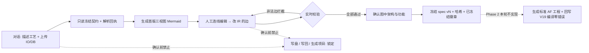

# 01 · Greenfield 增量 PRD — 西门子 AF 标准工程生成通道（Phase 1 需求基线）

> **文档定位**：增量 PRD，仅覆盖**产品需求分析**。不含架构设计、不含实现代码、不含竞品/市场分析。
> **阶段口径**：本轮（Phase 1）交付到「用户人工连线并确认 Mermaid」这道**硬门禁**为止。
> **依据**：`docs/17 / 18 / 19 / 22 / 23 / 24 / 26 / 08` 与 `plc_engine/af/`、`gateway/app/services/plc/` 现有模块（只读扫描，未改动）。

---

## 0. 项目信息

| 项 | 值 |
|---|---|
| Language | 中文 |
| Project Name | `plc_greenfield_channel` |
| 技术栈口径 | **复用现有资产**：Python 网关 + React 前端 + `plc_engine/` 引擎 + TIA Portal V19 Openness 回写；新增一条 Greenfield 通道，不新建平行技术栈、不推倒重写 |
| 文档阶段 | Phase 1（门禁前工作台）需求基线 |
| 终态唯一验收口径 | 回写 TIA Portal V19 **编译零错误** |

### 原始需求复述（用户已拍板，不可推翻）

1. 从零新建的是「生成的目标 PLC 工程」（Greenfield）；`plc_chat` 工具链**复用现有资产并新增一条 Greenfield 通道**，不推倒重写。
2. AF 档位 = **西门子 AF（SIOS 109817223）** 的 ISA-88 **Unit / EM / CM** 层级 + **PackML** 模式状态语义；物理落 **AF Basic 文件夹版 + 命名空间前缀**（适配现网 TIA V19、External Source 可生成）。**不采用** AF V3 软件单元（需 V20 且外部源无法创建）。
3. Mermaid 采用**多视图 + 强类型 IR 作为权威规格**：flowchart（层级与数据流）/ sequenceDiagram（步序、消息、异常分支）/ stateDiagram（PackML）。Mermaid 是可人工连线编辑的**规格面，不是最终编译器输入**；连线编辑的是背后 IR 的边，需**连线白名单 + 实时校验**。
4. 兼容 DB/IO 由用户在前端对话中上传提供（PLCTags.xlsx/csv 的 IO 表 + DB 的 SCL 文本/文件）；本轮不需要用户提供样本，但产品上**必须支持在对话里上传并解析成只读冻结契约**。
5. 验收口径：必须回写博途（TIA Portal V19）**编译零错误**；**HMI 明确列为下一步（P1），不在本轮范围**。
6. **存量重构链冻结保留、不再继续开发**：不改 `plc_engine/af/refactor.py`、`af_mapper.py`、存量导入 AF 化链、v3_0 存量重构相关能力；**一行不动，也不删除**。

### 主链与硬门禁（产品级）

```
自然语言描述 → 生成三视图 Mermaid → 用户手动连线 → 用户确认图中架构与功能 → 才据图生成标准 AF 工程
```

「确认」是**硬门禁**：确认前禁止任何写盘 / 写回 / 生成项目。旧项目退化为**只读输入**，只贡献「必须兼容的 DB 与 IO」，不再贡献业务逻辑。

### 本轮范围门禁

本轮（Phase 1）**只交付到「用户人工连线并确认 Mermaid」为止**：可上传 DB/IO 契约、能生成并可手动编辑三视图 Mermaid、能实时校验并冻结 spec（版本号 + 哈希）、产出供用户连线的首版 Mermaid。
「确认后生成标准项目 + 回写 TIA V19 零错误」是 **Phase 2 目标与验收口径，写进本 PRD 但不在本轮实现**。HMI 为 P1 / 下一步。

---

## 1. 产品目标

**一句话**：在现有 `plc_chat` 工具链上新增一条「从零生成标准西门子 AF PLC 工程」的 Greenfield 通道，并先把「用户人工连线并确认 Mermaid」这道硬门禁**之前**的能力做实、做可信、可追溯。

| # | 可度量目标 | 度量口径 |
|---|---|---|
| G1 · 契约可信 | 用户上传的 IO 表与 DB 100% 解析为**只读冻结契约**，并成为新工程不可逾越的物理边界 | 解析回执含条目清单/失败明细；任何后续编辑、连线、生成对 DB 布局/偏移/初值、`%I/%Q`、符号名、OB 编号与调用顺序、F/安全块的违规尝试**拦截率 100%**、零改动 |
| G2 · 规格可编辑 | 任一工艺自然语言描述可稳定产出**三视图对齐**的首版 Mermaid，用户可在画布上手动连线编辑 | 三视图共享同一强类型 IR、节点/边可对齐；连线全部落在 IR 的边上；非法边实时拦截并可定位到具体视图/节点；从描述到「可连线首版」≤ 1 次交互 |
| G3 · 门禁可冻结 | 用户确认图中架构与功能后，产出带**版本号 + 内容哈希**的不可变 spec，且确认前零副作用 | 确认前写盘/写回/生成项目动作数为 0（前后端双向断言）；冻结 spec 与确认动作一一对应、同哈希可复现同三视图、可追溯 |

---

## 2. 范围边界表

| 分类 | 内容 |
|---|---|
| **Phase 1 · 本轮做**（交付到确认门禁为止） | ① 对话式上传 IO 表（PLCTags.xlsx/csv）与 DB（SCL 文本/文件），解析成只读冻结契约 + 解析回执；② NL 工艺描述 → 首版三视图 Mermaid（flowchart / sequenceDiagram / stateDiagram）；③ 三视图手动连线编辑画布（编辑的是强类型 IR 的边，非 Mermaid 文本）；④ 连线白名单 + 实时校验（非法边拦截、跨视图一致性、层级唯一父、PackML 迁移合法性、冻结契约不可碰）；⑤ 用户「确认图中架构与功能」→ 冻结 spec（版本号 + 哈希 + 状态徽章）；⑥ 阶段锁定提示（确认前生成/写回类入口禁用并明示原因）；⑦ 首版 Mermaid 与冻结 spec 的导出/留痕，供架构师作为 Phase 2 输入 |
| **Phase 2 · 后续做**（写进 PRD 作为目标与验收口径，**本轮不实现**） | ① 据冻结 spec 生成标准 AF 工程（Unit/EM/CM 层级 + PackML 模式状态 + 接口 DB 族 + 命名空间前缀 + OB 编号与调用顺序）；② 交付物打包 = SCL 源包 + XML 补充包（OB/文件夹）+ 标签表；③ 经交付通道回写 TIA Portal V19 **编译零错误**（唯一验收口径）；④ 若复用 fast-writeback 极速回写栈，须先并线对话主链并过 **PCEC 门禁**；⑤ 编译错误结构化回传 / 自愈闭环（沿用既有资产） |
| **明确不做**（本轮及可见范围） | ① **HMI**：P1 / 下一步，不在本轮；② **存量重构链冻结保留**：`plc_engine/af/refactor.py`、`af_mapper.py`、存量导入 AF 化链、v3_0 存量重构能力，**一行不动、不删除、不再开发**；③ **AF V3 软件单元版**（需 V20、External Source 无法创建）不采用；④ 以 `plc_chat_v3_0.html`「博世 OpCon AF 六槽位」为规格源（教学示意、与仓库正统不同源）— v3_0 仅保留极速回写/门禁作为**交付通道**；⑤ 确认门禁**前**任何写盘 / 写回 / 生成项目（含「预览式生成」）；⑥ 官方 LAF/LPML/LUC/LBC 库对齐、软件单元/文件夹 XML 全面导入、HMI 仿真面板（P4 后置）；⑦ 业务逻辑采用 LAD/FBD 混编（违背全 SCL 口径）；⑧ 新建平行状态源 / 推倒重写既有链 |

---

## 3. 用户故事

| # | 用户故事（As a … I want … so that …） |
|---|---|
| US1 | 作为**工艺工程师**，我希望在对话里用自然语言描述产线/工位的工艺过程（单元、工序、设备、异常），以便系统据此生成可编辑的三视图规格，而不必手写块名或底层代码。 |
| US2 | 作为**PLC 电气工程师**，我希望在对话中直接上传 `PLCTags.xlsx/csv` 的 IO 表与 DB 的 SCL 文本/文件，以便把它们固化成「必须兼容」的**只读冻结契约**，作为新工程的物理边界。 |
| US3 | 作为**工艺工程师**，我希望一次描述即可拿到相互对齐的三视图 Mermaid——flowchart（Unit/EM/CM 层级与数据流）、sequenceDiagram（步序/消息/异常分支）、stateDiagram（PackML 模式状态），以便从三个角度核对同一份架构与功能。 |
| US4 | 作为**工程师**，我希望在画布上手动新增/删除/改向连线来补全或修正架构与功能关系，且编辑的是背后强类型 IR 的边、三视图同步联动，而不是让我手改 Mermaid 源码。 |
| US5 | 作为**工程师**，我希望连线时即时看到合法/非法反馈，非法边（跨层直连 CM、绕过接口 DB 族、非法 PackML 迁移、触碰冻结契约）被**当场拦截**并给出原因与定位，以便错误不累积到确认之后。 |
| US6 | 作为**工程师**，我希望在「确认图中架构与功能」后得到带**版本号 + 内容哈希**的冻结规格与状态徽章，以便后续生成严格以这一版为准、可复现、可追溯。 |
| US7 | 作为**工程师/审计方**，我希望在确认之前所有「生成项目 / 回写博途 / 写盘」入口明确锁定并提示原因，确保不会因误触在规格未定稿时改动工程或写盘。 |
| US8 | 作为**工程师**（Phase 2 目标），我希望确认后据冻结 spec 生成标准 AF 工程并回写 TIA Portal V19、编译零错误，作为唯一验收口径（**本轮不实现，产品目标写清**）。 |
| US9 | 作为**维护者**，我希望 Greenfield 通道是「复用现有资产 + 新增一条通道」而非重写，存量重构链保持冻结、一行不动，避免影响已真机验收的既有能力。 |

---

## 4. 需求池（P0 / P1 / P2，含验收标准）

### P0 · Must have（本轮 Phase 1 出口必备）

| 编号 | 需求 | 验收标准 |
|---|---|---|
| P0-1 | **Greenfield 通道入口**：复用现有资产、新增一条通道，不推倒重写、不建平行状态源 | 既有导入/新建/对话主链不回归；新通道与存量链可共存且互不触发；存量重构链文件 **零 diff**（逐文件比对） |
| P0-2 | **对话式上传与解析 IO 表** | 支持 `PLCTags.xlsx` / `.csv`；解析 Name / Path / Data Type / Logical Address（`%I/%Q`）/ Comment；解析回执含条目数与失败明细；解析结果即刻成为只读冻结契约 |
| P0-3 | **对话式上传与解析 DB** | 支持 SCL 文本粘贴与文件上传；解析 STRUCT 嵌套、Array 上下界、初值、注释；多个 DB 可多次上传；解析结果即刻成为只读冻结契约 |
| P0-4 | **只读冻结契约 + 物理冻结铁律** | 契约一经生成不可编辑；DB 布局/偏移/初值、`%I/%Q` 绝对地址、符号名、OB 编号与调用顺序、F/安全块**零改动**；新逻辑只经 IO-Mapping / DB-Adapter 访问，EM/Unit 只见接口 DB 族；违规尝试 100% 拦截并留痕 |
| P0-5 | **三视图 Mermaid 生成** | NL → flowchart（U/EM/CM 层级与数据流）/ sequenceDiagram（步序、消息、alt/opt 异常分支）/ stateDiagram（PackML 状态与迁移）；三视图共享同一强类型 IR、节点/边可对齐；产出可编辑的首版 Mermaid |
| P0-6 | **强类型 IR 作为唯一权威规格** | Mermaid 是规格面、不是编译器输入；所有视图与连线是 IR 的投影；IR ↔ Mermaid 双向一致，冲突以 IR 裁定；Mermaid 文本不被当作规格真值 |
| P0-7 | **手动连线编辑画布** | 可新增/删除/改向连线；编辑作用于 IR 的边并三视图联动刷新；连线白名单定义合法边类型；白名单外边不可建立 |
| P0-8 | **实时校验与非法边拦截** | 连线时即时校验：层级唯一父、数据流单向、序列↔CM 只经 ControlNodes、PackML 迁移合法、CM PLCOpen 五信号、命名空间前缀、冻结契约不可碰；非法边拦截 + 原因 + 定位到视图/节点；**校验未通过不得进入确认** |
| P0-9 | **确认硬门禁** | 用户须显式「确认图中架构与功能」；确认前禁止任何写盘 / 写回 / 生成项目（前后端双向禁用 + 阶段锁定提示）；确认不可由系统代劳、不可超时自动推进 |
| P0-10 | **冻结 spec（版本号 + 哈希）** | 确认后生成不可变 spec：版本号、内容哈希、三视图快照、冻结契约引用、时间戳；状态徽章可见；同哈希可复现；冻结后编辑生成新版本草稿、旧版不可变 |
| P0-11 | **阶段锁定提示与状态可见** | 界面常驻当前阶段（草稿 / 可连线 / 校验中 / 已冻结 / 已锁定）、冻结版本号与哈希短码；越阶段操作给出解释性提示，而非静默失败 |

### P1 · Should have / 下一步

| 编号 | 需求 | 验收标准 |
|---|---|---|
| P1-1 | **HMI**（明确后置，下一步） | 本轮不实现；PRD 中登记为下一步，不占用 Phase 1 / Phase 2 出口 |
| P1-2 | 冻结 spec 与首版 Mermaid 的导出 / 留痕列表 | 可下载 `.md` / 规格快照；留痕可检索、可关联确认动作 |
| P1-3 | 三视图差异对比（首版 vs 当前编辑版） | 能列出新增/删除/改向的边与节点，标注是否已通过校验 |
| P1-4 | 连线操作撤销 / 重做与操作历史 | 编辑历史可回放，撤销后 IR 与三视图一致、校验状态同步 |

### P2 · Nice to have（远期体验，不触碰被否决项）

| 编号 | 需求 | 验收标准 |
|---|---|---|
| P2-1 | 典型机型起手模板库（Unit/EM/CM 组合） | 选定模板可预填首版三视图，仍需用户连线与确认 |
| P2-2 | 批量工艺描述导入 | 一次导入多段描述生成多组规格草稿，各自独立冻结 |
| P2-3 | AF 术语显隐可见性开关 | 默认隐形（BR-6），工程/审计视角可切换显示层级与角色；不改变冻结 spec 内容 |
| P2-4 | 校验提示文案可配置 | 非法边原因文案可维护，规则本身不可绕过 |

---

## 5. UI 设计稿（文字 + ASCII / Mermaid）

> 说明：本节 Mermaid 仅用于**描述界面/阶段流转**，不是产品规格的三视图本身。

### 5.1 整体布局（ASCII）

```
┌───────────────────────────────────────────────────────────────────────────────────┐
│ 顶栏  项目名 · 阶段徽章[草稿|可连线|校验中|已冻结] · spec vN · sha256:xxxx · 🔒锁定 │
├─────────────────┬────────────────────────────────────────────┬────────────────────┤
│ 左：对话区       │ 中：三视图 Mermaid 编辑画布                  │ 右：连线与校验面板  │
│                 │  [ 层级/数据流 ][ 步序/异常 ][ PackML 状态 ] │                    │
│ · 工艺描述输入   │  ┌────────────────────────────────────────┐ │ · 连线白名单(可拖) │
│ · 📎 上传 IO     │  │ flowchart / sequenceDiagram / stateDiagram│ │ · 选中节点/边属性  │
│   .xlsx / .csv  │  │   可拖拽连线 · 节点高亮 · 三视图联动      │ │ · 实时校验结果     │
│ · 📎 上传 DB     │  │   首版 / 当前版 切换对比                  │ │   ✔ 合法 / ✘ 拦截  │
│   SCL 文本/文件  │  └────────────────────────────────────────┘ │     + 原因 + 定位  │
│ · 解析回执       │  Tab 切换 · 缩放/复位 · 导出                 │ · 只读冻结契约清单  │
│   (只读冻结)     │                                            │   (DB/IO/OB/F 灰锁)│
│                 │                                            │ · 待确认问题提示   │
├─────────────────┴────────────────────────────────────────────┴────────────────────┤
│ 底栏（确认门禁）  [ 确认图中架构与功能 ]  ← 仅「校验全部通过」后可点               │
│   未确认：「生成标准项目 / 回写博途 / 写盘」全部置灰 + 锁定提示「确认前禁止生成」    │
│   确认后：生成 spec vN + sha256:xxxx + 徽章「已冻结」+ 导出留痕（供 Phase 2）       │
└───────────────────────────────────────────────────────────────────────────────────┘
```

### 5.2 界面阶段流转（Mermaid，UI 状态示意）



### 5.3 关键界面逐项说明

- **① 对话上传区（左）**：自由文本工艺描述 + 两个上传入口（IO 表 `.xlsx/.csv`；DB `SCL 文本/文件`）。上传后即时给出**解析回执**（条目数、失败明细、字段映射预览、编码/格式提示），回执确认后契约进入**只读冻结**态（灰锁、不可编辑、可展开查看）。解析失败按 R2 口径处理。
- **② 三视图 Mermaid 编辑画布（中）**：三个 Tab 共享同一 IR；flowchart 展示 Unit/EM/CM 层级与数据流方向，sequenceDiagram 展示步序/消息/`alt/opt` 异常分支，stateDiagram 展示 PackML 模式状态与迁移。支持拖拽连线、节点高亮联动、首版/当前版对比、缩放复位、导出。用户**不需要**接触 Mermaid 源码。
- **③ 连线面板与校验反馈（右）**：连线白名单以可拖拽项呈现；选中节点/边显示属性；每次连线即时反馈 ✔ 合法 / ✘ 拦截（原因 + 定位到具体视图与节点）；常驻**只读冻结契约清单**（DB、IO、OB、F 块灰锁不可选）；待确认问题集中提示。
- **④ 确认冻结与状态徽章（顶栏 + 底栏）**：顶栏常驻阶段、spec 版本、哈希短码、锁定态；底栏主按钮「确认图中架构与功能」在校验全通过前禁用；确认后按钮变为「已冻结 vN」并展示哈希、时间戳、导出留痕入口。
- **⑤ 阶段锁定提示**：确认前，所有「生成标准项目 / 回写博途 / 写盘」入口置灰，hover 给出解释性提示「规格尚未确认，确认前禁止任何生成或写回」；越阶段调用（含前端误触与后端直调）一律被拦截并提示，而非静默失败。

---

## 6. 关键业务规则与铁律

| 编号 | 规则 | 口径 |
|---|---|---|
| **BR-1** | **确认硬门禁** | 主链 = NL → Mermaid → 人工连线 → **确认图中架构与功能** → 才允许生成。确认前禁止任何写盘 / 写回 / 生成项目（含预览式生成），前后端双向拦截；确认必须是用户显式动作，不可由系统代劳、不可超时自动推进。 |
| **BR-2** | **只读冻结契约 + 物理冻结铁律** | 旧项目退化为**只读输入**，只贡献「必须兼容的 DB 与 IO」，不贡献业务逻辑。DB 布局/偏移/初值、绝对 IO 地址 `%I/%Q`、符号名、OB 编号与调用顺序、F/安全块**一律不可变**；新逻辑只经 **IO-Mapping / DB-Adapter** 访问，EM/Unit 只见**接口 DB 族**；无法证明等价的内容保留原样并标注，绝不静默近似。 |
| **BR-3** | **全 SCL 与显式例外** | 业务逻辑 **100% SCL**；但 OB、软件单元/文件夹、F 安全块、工艺对象 TO **不能由 SCL 外部源生成**，OB/文件夹走 **SimaticML XML 导入**。交付物 = **SCL 源包 + XML 补充包 + 标签表**（Phase 2 产出口径）。 |
| **BR-4** | **强类型 IR 权威规格 / Mermaid 规格面** | flowchart / sequenceDiagram / stateDiagram 是同一 IR 的投影；连线编辑的是 **IR 的边**；冲突以 IR 为准；**Mermaid 不是最终编译器输入**；连线白名单 + 实时校验为强制，校验未通过不得冻结。 |
| **BR-5** | **AF 档位与称谓统一** | 唯一规格源 = **西门子 AF（SIOS 109817223）**，ISA-88 Unit/EM/CM + PackML 模式状态语义；物理落 **AF Basic 文件夹版 + 命名空间前缀**（适配现网 TIA V19、External Source 可生成）；**不采用 AF V3 软件单元**（需 V20 且外部源无法创建）。全仓库与文案统一称谓「西门子 AF（SIOS 109817223）」；`plc_chat_v3_0.html`「博世 OpCon AF 六槽位」为教学示意、与仓库正统不同源，**不作规格依据**，v3_0 仅保留极速回写/门禁作为交付通道；新范式以 `docs/17 / 18 / 23 / 24` + 实际代码为准。 |
| **BR-6** | **AF 对用户可见文案可隐形（可选策略）** | 沿用 `docs/23`「AF 对用户隐形」：用户可见文案零「AF / 架构 / 软件单元」术语（模块名/代码标识保留）；本 PRD 与工程内部文档保留 AF 称谓以便工程对齐。**折中策略（待 R7 确认）**：默认用业务化同义文案（工位 / 工序 / 设备、自动 / 手动 / 生产模式），工程/审计视角可切换显示 AF 层级与角色。 |
| **BR-7** | **复用优先 + 存量冻结** | Greenfield = 复用现有资产 + 新增一条通道，不推倒重写、不建平行状态源；存量重构链（`plc_engine/af/refactor.py`、`af_mapper.py`、存量导入 AF 化链、v3_0 存量重构能力）**冻结保留、一行不动、不删除**。 |
| **BR-8** | **验收口径单一** | 终态以**回写 TIA Portal V19 编译零错误**为唯一验收口径（Phase 2 出口）；确认门禁与冻结 spec 是它的前置条件，不以「生成成功 / lint 通过」替代。 |
| **BR-9** | **变更留痕** | 本轮 spec 冻结动作须留痕（版本 + 哈希 + 时间戳 + 操作者 + 冻结契约引用），可追溯可复现；Phase 2 任何生成/写回动作须经既有 **PCEC 账本门禁**（事务 / 基线 / V0–V3），不得绕过。 |

---

## 7. 风险与待确认问题

| 编号 | 风险 / 待确认问题 | 明细与建议 |
|---|---|---|
| **R1** | **fast-writeback 未并线 + 未挂 PCEC（docs/26 关键遗留）** | 极速回写栈已真机验收（1.88×）但网关**零引用、未接对话主链**，且为纯库**未挂 PCEC 账本**。若 Greenfield Phase 2 复用它作交付通道，**必须先并线并过 PCEC 门禁**（事务 / 基线 / V0–V3），否则违反「变更审查必须调用既有守卫」红线。**待确认**：Phase 2 交付通道是否复用 fast-writeback？并线 + PCEC 的工作量与归属？本轮是否需要预留通道接口位（不实现）？ |
| **R2** | **上传文件格式边界** | IO 表：列名变体、编码、xlsx 多 sheet / 合并单元格、`%I/%Q` 写法差异；DB SCL：STRUCT 嵌套深度、Array 上下界、初值类型、中文注释编码、`S7_Optimized_Access` 与非优化 DB、多 DB 重名。**待确认**：支持的格式白名单、单次上传大小/条目上限、解析失败是「整批拒绝」还是「逐条标注」、是否必须用户确认解析回执后才冻结。 |
| **R3** | **Mermaid 语义损失** | 三种 Mermaid 语法表达力有限（PackML 17 态与迁移许可、ControlNode 中枢、接口 DB 族读写方向、异常分支与 SC 汇总、命名空间前缀 / OB 号），IR→图与图→IR 均可能语义损失或歧义。**待确认**：哪些信息允许只在 IR 存在不上图、图上不可表达的信息如何对用户可见/可编辑、IR ↔ Mermaid 双向一致性的裁定与回归方式。 |
| **R4** | **TIA V19 编译验收环境** | 验收口径是「回写 V19 编译零错误」，依赖真机 / 项目副本、Openness 白名单、`ExclusiveAccess`、**OB XML 导入通道在 V19 对 OB 类型是否已验证**（`docs/18` 列为 P1 第一周通道探针）、know-how protected 块排除、IDB 接口变更传播标记。**待确认**：验收环境由谁提供、是否允许在 `_sandbox` 项目副本验收、编译零错误的判定范围（全工程 vs 新增块）、失败后自愈/人工介入边界。 |
| **R5** | **连线白名单与实时校验口径** | 合法边类型集合、跨视图一致性规则、校验时机（连线即时 vs 保存时）、校验未通过是否允许导出首版 Mermaid。**待确认**：白名单由谁裁定（建议架构师）、规则是否允许可配置（P2-4）。 |
| **R6** | **冻结 spec 版本 / 哈希口径** | 哈希覆盖范围（IR + 三视图快照 + 冻结契约 + 解析回执？）、版本号规则、冻结后是否允许「重新编辑生成新版本」（**建议**：冻结版不可变，编辑生成 v+1 新草稿）。**待确认**口径并写入 spec 定义。 |
| **R7** | **AF 隐形策略边界** | 用户仍需「确认图中架构与功能」；若完全不出现 Unit/EM/CM/模式状态术语，确认界面如何表达？**待确认**：是否采用 BR-6 折中（业务化同义文案 + 工程视角可切换）。 |
| **R8** | **存量冻结的回归风险** | 新通道与存量链共存，须保证存量重构链零 diff、且不被新入口意外触发。**待确认**：回归验证范围与断言口径（建议纳入 Phase 1 出口 AC-6）。 |

---

## 8. 验收标准

### Phase 1 出口（本轮，交付到确认门禁为止）

| # | 验收标准 |
|---|---|
| AC-1 · 上传 | 给定 IO 表（`.xlsx/.csv`）与 DB（SCL 文本/文件），对话中上传成功并产出**只读冻结契约回执**（条目清单、失败明细、冻结标记）；解析后契约在任何后续编辑/连线/生成中**零改动**。 |
| AC-2 · 生成 | 任一口语化工艺描述产出三视图首版 Mermaid；三视图共享同一 IR、节点/边可对齐；flowchart 含 U/EM/CM 层级与数据流，sequenceDiagram 含步序/消息/`alt` 异常分支，stateDiagram 含 PackML 状态与迁移。 |
| AC-3 · 连线与校验 | 画布新增/删除/改向连线作用于 **IR 的边**并三视图联动；白名单外边不可建立；非法边（跨层直连 CM、绕过接口 DB 族、非法 PackML 迁移、触碰冻结契约）**100% 拦截**且给出原因与定位；校验未通过不得进入确认。 |
| AC-4 · 确认门禁 | 未确认时所有「生成项目 / 回写博途 / 写盘」入口不可达且有阶段锁定提示；前后端双向断言「确认前零 ops、零写盘、零回写」（可 mock 断言）；确认不可由系统代劳或超时自动推进。 |
| AC-5 · 冻结 spec | 确认后产出**版本号 + 内容哈希 + 三视图快照 + 冻结契约引用 + 时间戳**的不可变 spec，状态徽章可见；同哈希可复现；冻结后编辑生成新版本草稿、旧版不可变。 |
| AC-6 · 不回归 | 既有全量测试绿；**存量重构链文件零 diff**；现有对话 / 导入 / 新建主链不回归；界面文案通过「AF 隐形」检查（或按 R7 折中口径）。 |
| AC-7 · 可交付 | 首版 Mermaid 与冻结 spec 可导出留痕，作为架构师 Phase 2 的明确输入；Phase 2 目标与验收口径已写入本 PRD。 |

### Phase 2 出口（写进 PRD，本轮**不实现**）

| # | 验收标准 |
|---|---|
| AC-P2-1 | 据冻结 spec 生成标准**西门子 AF** 工程：Unit/EM/CM 层级、PackML 模式状态语义、接口 DB 族、命名空间前缀、OB 编号与调用顺序；CM PLCOpen 五信号；序列↔CM 只经 ControlNodes；数据流单向。 |
| AC-P2-2 | 交付物 = **SCL 源包**（业务逻辑 100% SCL）+ **XML 补充包**（OB / 文件夹）+ **标签表**；全 SCL 显式例外按 BR-3 处理。 |
| AC-P2-3 | 回写 **TIA Portal V19**（项目副本 / 沙盒）**编译零错误 = 唯一验收口径**；编译错误结构化回传。 |
| AC-P2-4 | 若复用 fast-writeback 交付通道：已并线对话主链且**挂 PCEC 账本**（事务 + 基线 + V0–V3），变更可审计、基线变化 fail-closed（对应 R1）。 |
| AC-P2-5 | **HMI 不在本出口范围内**（P1 / 下一步）。 |

---

> 本 PRD 为产品需求基线，供架构师据此产出增量架构设计与首版三视图 Mermaid；不含架构方案与实现细节。所有「待确认」项（R1–R8）需在架构设计阶段收敛或回传主理人裁定。

---

## 9. 当前实现现状与批次执行状态（P0-C / F14，2026-11-06 追加）

> 本节为**现状描述**，与 `gateway/app/routers/greenfield.py` 实际注册端点对齐。
> §0–§8 为 Phase 1 需求基线（历史口径，保留不改）；本节不改变任何需求基线语义，
> 只把「文档口径」校准到代码实况与 Greenfield 并行批次 1 的执行状态。

### 9.1 能力清单（现状）

当前 Greenfield 通道统一前缀 `/api/v1/plc/canvas/greenfield`、统一 `ApiResponse` 信封。
`gateway/app/routers/greenfield.py` **现已注册**的端点：

| 类别 | 方法与路径 | 说明 |
|---|---|---|
| 状态 / 会话 | `GET /state`、`GET /whitelist`、`GET /views` | 阶段、白名单、三视图 |
| 上传 / 草稿 | `POST /upload`、`POST /receipt/confirm`、`POST /draft`、`POST /draft/export`、`POST /draft/import`、`POST /load-reference` | 只读冻结契约、首版草稿、留痕 |
| 编辑 / 校验 | `POST /links`、`POST /validate`、`POST /hardware`、`POST /chat`、`POST /begin-edit` | 连线、校验、硬件、对话、重新编辑 |
| 冻结 / 规格 | `POST /confirm`、`GET /specs/{version}` | 硬门禁确认、冻结 spec 快照 |
| 导出 / 交付 | `GET /export/mermaid`、`POST /generate`、`POST /engineering-summary`、`POST /deliver-tia`、`GET /download-package` | Mermaid 导出、工程包、TIA 交付链 |

- `POST /deliver-tia` 为 Phase 2 最后一公里：XML 补充包 + 四层静态门禁 + PCEC 账本 +（可选）Openness 自动导入编译。其回执 `tia_delivery.json` 本批次新增 `compile_diagnostics` 结构化编译报告（error 数 / warning 单列清单 / 块清单 / 耗时 / TIA 版本 / 项目路径 / 静态门禁结论 / `compile_ok`），判定式 `compile_ok = (error_count == 0 and static_gate_passed)`，warning 单列、禁止并入成功。
- 契约 `04-parallel-wp-contract.md` §3 约定的 `POST /patch` / `POST /diff` / `POST /confirm-diff` 属 Agent A 本批次并行开发范围；集成收口前以路由实际注册为准，本文档**不预先宣称**其已上线。

### 9.2 「真机全绿」归属与状态

- 「真机全绿」= 四层验收 `L1 ∧ L2 ∧ L3 ∧ L4` 同时通过（逻辑等价 / 可编译 / 可复现 / 增量可迭代），归属 **WP-10 全量验收与 M4 发布门禁**（产品开发 Plan §2.2、§3、§6.2）。
- **当前状态：尚未达成**。本批次不含真机验收，禁止以离线单测、「生成成功」或「lint 通过」宣称 `L1` / `L2` / `L4` 通过（`N9`：`fidelity_ok` 与 `compile_ok` 是两个独立层，禁止互相替代）。
- `L2` 的权威判据是结构化编译报告 `error_count == 0` + 四层静态门禁通过 + `tia_unavailable` 显式失败；`L4` 需同一会话连续 ≥3 次增量回写全绿。二者均需 V19 真机，本批次无。

### 9.3 本批次口径（离线可推进部分）

- 本批次为**离线可推进部分**（WP-01 的 P0-A 编译判定口径 + P0-C 文档口径；Plan §6.3）。P0-B（K1 探针 / 自产 OB XML 与 folders.json 的 V19 真机导入验证）、P0-G 三次增量、D10 负例等真机项**不在本批次**。
- 所有涉真机验收项（L2 / L4 相关）统一标记 `pending_real_machine`；**M4 发布门禁在这些 pending 清零前保持未通过**。
- `tia_unavailable`（TIA / Openness 不可用，显式失败 `GF_TIA_UNAVAILABLE` / `GF_TIA_EXEC_ERROR`，`ok=false` + 非 HTTP 200）与「真机未跑」（`pending_real_machine`，`package` 模式 / 离线批次）在报告中**显式区分**，禁止混同、禁止静默降级为 200 成功。
- `xml_package_unverified` 保持 `true`：本批次无真机导入验证，禁止擅自改为 `false` 或删除标注；报告与 manifest 统一标 `pending_real_machine`。

### 9.4 AF 档位（P0-D）与待拍板项

- AF 档位（P0-D）结论**待 G0 真机实测后拍板**（Plan §3 M0 / §9.3）；结论前映射层维持「**档位无关**」设计，禁止据推断定型映射层。
- 结论未出前不进入任何档位相关的映射层定型；本批次仅推进离线可工作包。

### 9.5 证据路径（P0-A / P0-B）

| 项 | 证据路径 | 状态 |
|---|---|---|
| P0-A 编译判定口径 | `tests/unit/test_greenfield_tia_delivery.py`（UC-02 / UC-03 / 静态门禁负例）；`POST /deliver-tia` 回执 `tia_delivery.json` → `compile_diagnostics` | 离线口径已落地；真机结论 `pending_real_machine` |
| P0-B K1 探针 | `xml_supplement/manifest.json` 的 `xml_package_unverified: true` + `pending_real_machine: true`；V19 真机导入日志 + `.zap19` | **`pending_real_machine`**（本批次不做） |
| L2 / L4 真机全绿 | WP-10 全量验收报告、结构化编译报告、增量 fidelity 报告、PCEC 账本 | **尚未达成**，M4 门禁未通过 |
