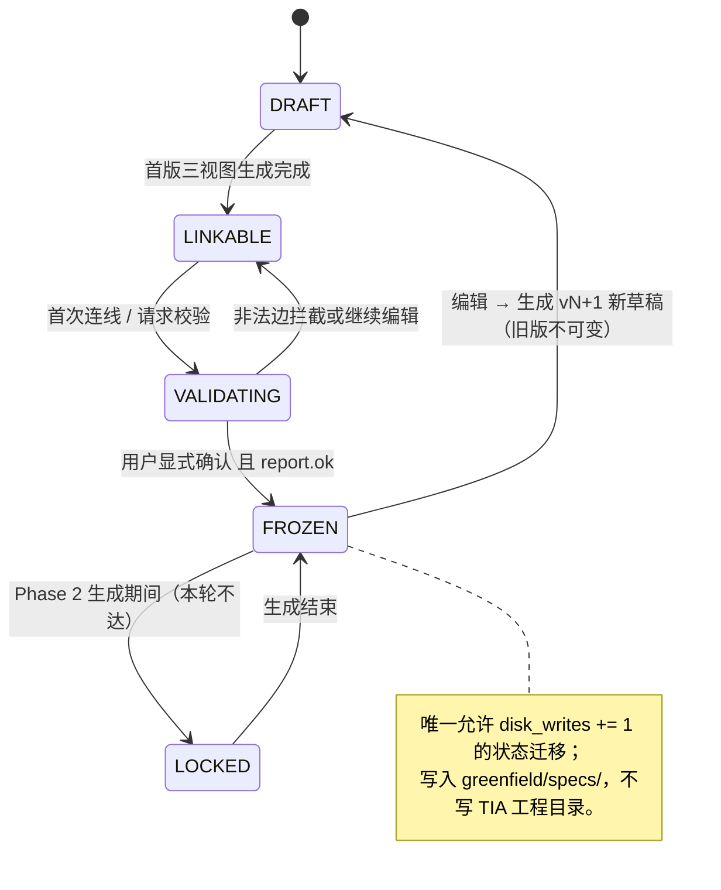
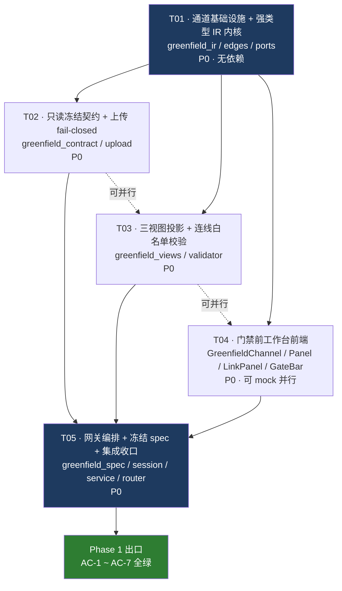

# 02 · Greenfield 增量系统架构设计与任务分解（Phase 1 · 门禁前工作台）

> **文档定位**：增量系统架构设计 + 任务分解。承接 `01-greenfield-prd.md`（229 行增量 PRD），只做设计与分解，**不含实现代码**。
> **阶段口径**：本轮（Phase 1）交付到「用户人工连线并确认图中架构与功能」这道**硬门禁**为止；「确认后生成标准 AF 工程 + 回写 TIA Portal V19 编译零错误」是 Phase 2 目标，**只设计、不实现**。
> **依据**：`docs/17 / 18 / 19 / 22 / 23 / 24 / 26 / 08` 与 `plc_engine/af/`、`gateway/app/services/plc/`、`gateway/app/routers/plc.py`、`frontend/src/` 现有模块（只读扫描，未改动）。
> **唯一规格源**：西门子 AF（SIOS 109817223）· ISA-88 Unit/EM/CM + PackML · 物理落 **AF Basic 文件夹版 + 命名空间前缀**（TIA V19 外部源可生成）。`plc_chat_v3_0.html`「博世 OpCon 六槽位」为教学示意，**不作规格源**。
> **配套交付**：`docs/greenfield/03-first-mermaid.md`（首版三视图 Mermaid 全文，供用户手动连线）、`docs/greenfield/class-diagram.mermaid`、`docs/greenfield/sequence-diagram.mermaid`。

---

## 0. 设计基线与约束对齐

### 0.1 不可推翻的用户决策（继承 PRD §0）

| # | 决策 | 架构落点 |
|---|---|---|
| A | 从零新建的是**生成的目标 PLC 工程**；工具链复用现有资产 + 新增 Greenfield 通道，不推倒重写、不建平行状态源 | §1.3 通道隔离；§3.2 单一真相源 |
| B | 西门子 AF Basic 文件夹版（U/EM/CM + PackML），**不采用** AF V3 软件单元 | §3.1 `af_profile` 常量；§10 Phase 2 `self_contained=True` |
| C | 多视图 Mermaid + **强类型 IR 为唯一权威规格**；手动连线编辑的是 IR 的边 | §3.1 / §3.6 / §3.7 |
| D | DB 编号与 IO 表由用户在前端对话上传提供 | §3.4 只读冻结契约 |
| E | 验收 = 回写 TIA Portal V19 编译零错误；HMI 下一步；存量重构链冻结保留、不再开发 | §10；§2.3 禁止修改清单 |

### 0.2 主理人对 R1–R8 的边界裁定 → 架构收敛表

| 风险 | 主理人裁定 | 本架构的收敛结果（**本轮实现**） | 本轮**不做** |
|---|---|---|---|
| **R1** | Phase 2 复用 fast-writeback 须先并线对话主链并挂 PCEC；本轮不并线、不触碰回写链 | §10.2 给出并线方案；§3.1 / §1.3 预留 `DeliveryPort` **接口位**与门禁说明（`greenfield_ports.py`，只有 Protocol 与常量，零实现） | 不改 `writeback_pipeline.py` / `pcec.py` / `compile_jobs.py` / `refactor_pipeline.py` / C# 回写栈 |
| **R2** | 上传解析一律 **fail-closed**（整批拒绝 + 明细回执），格式白名单与上限由架构定 | §3.4.2 定义白名单、编码、条目/大小/嵌套上限；§3.4.3 `ParseReceipt` 明细结构 | 不静默跳行、不静默近似、不修改 `io_import.py` / `db_import.py` |
| **R3** | IR 唯一真相；三视图共享同一节点/边 ID 命名空间；图上不可表达的信息必须留在 IR 且在校验面板可见可编辑；冲突以 IR 裁定 | §3.6 提出「**单向真相 + 结构化 IR Patch + 确定性投影 + 结构层 roundtrip 回归**」四机制；§3.6.4 给出 `ir_only` 字段清单与面板可见性 | 不做「Mermaid 文本反向 parse 覆盖 IR」 |
| **R4** | 验收环境待定 | §10.3 列为风险探针；§5 列为待明确事项 | 本轮不接 TIA |
| **R5** | 合法边集合由架构师定义 | §3.7 完整合法边表（12 类）+ 非法边表（10 类）+ 错误码 + PackML 迁移许可表 | — |
| **R6** | 哈希至少覆盖 IR + 三视图快照 + 冻结契约引用 + 版本号 | §3.5.2 定义 `canonical_json` + 分层 sha256 拼接口径 | — |
| **R7** | 业务化同义文案 + 工程视角可切换；用户仍须显式确认图中架构与功能 | §8 文案口径；§4.2 确认门禁文案；切换开关是纯 UI 态，**不进 IR、不进哈希** | 不出现「AF / 软件单元 / Unit / EM / CM」于默认用户可见文案 |
| **R8** | 存量链零 diff 必须由测试断言保证，新入口不得触发存量链 | §2.3 禁止修改清单；T05 验收点含 `test_greenfield_legacy_guard.py`（哈希断言 + AST import 依赖断言 + 端点触发断言） | 新通道零 import 存量重构模块 |

### 0.3 P0 / AC 逐条对齐矩阵（设计自检）

| P0 | 架构承载章节 | AC | 验收落点 |
|---|---|---|---|
| P0-1 通道入口、存量零 diff | §1.3 / §2.3 / T05 | AC-1 | T02 上传、T05 回归 |
| P0-2 上传解析 IO 表 | §3.4 / T02 | AC-1 | `test_greenfield_upload.py` |
| P0-3 上传解析 DB | §3.4 / T02 | AC-1 | 同上 |
| P0-4 只读冻结契约 + 物理冻结铁律 | §3.4 / §3.7 边白名单 | AC-1 / AC-3 | `assert_immutable()` + 非法边 `GF_EDGE_CONTRACT_*` |
| P0-5 三视图 Mermaid 生成 | §3.6 / T03 / `03-first-mermaid.md` | AC-2 | `test_greenfield_views.py` |
| P0-6 强类型 IR 唯一权威 | §3.1 / §3.2 / §3.6 | AC-2 / AC-3 | `test_greenfield_ir.py` |
| P0-7 手动连线编辑画布 | §3.1 `edges[]` / §4 / T04 | AC-3 | 前端 mock + 后端 patch 测试 |
| P0-8 实时校验与非法边拦截 | §3.7 / T03 | AC-3 | `test_greenfield_edges.py` |
| P0-9 确认硬门禁 | §4.2 / §4.3 / T04+T05 | AC-4 | `test_greenfield_gate.py` |
| P0-10 冻结 spec（版本号+哈希） | §3.5 / T05 | AC-5 | `test_greenfield_gate.py` |
| P0-11 阶段锁定提示与状态可见 | §4.2 / §8 / T04 | AC-4 / AC-6 | 前端组件测试 |
| — 可交付 | §3.5.4 导出 / `03-first-mermaid.md` | AC-7 | T04/T05 导出留痕 |

---

## 1. 实现方案与框架选型

### 1.1 核心技术难点分析

| # | 难点 | 本质矛盾 | 架构对策 |
|---|---|---|---|
| D1 | **三视图与 IR 的语义不对称** | flowchart / sequenceDiagram / stateDiagram 表达力有限；PackML 17 态迁移许可、ControlNodes 中枢、接口 DB 族读写方向、命名空间前缀、OB 号、PLCOpen 五信号、冻结契约偏移/初值/绝对地址，图上无法无歧义表达 | 不追求「图 = 规格」。IR 为唯一持久化真相；三视图是**确定性只读投影**；`ir_only` 字段在右侧结构化属性/校验面板可见可编辑并参与哈希（§3.6） |
| D2 | **人工连线必须改 IR 的边且三视图联动** | 若把 Mermaid 文本当编辑对象，反向 parse 必然语义损失、且会与 IR 冲突 | 画布操作 → 结构化 `IRPatch{op,edge}` → `EdgeValidator` 白名单校验 → 写 `IR.edges[]` → `ViewProjector` 重投影三视图（§3.6.2）。**不存在「图→IR」的文本回写通道** |
| D3 | **物理冻结铁律不可被连线绕过** | 用户可能连一条边直接指向 `%Q0.0` / DB 成员 / OB 号 / F 块，或跨层直连 CM | 冻结契约条目只以 `compat_refs[]`（`immutable=true`）存在；白名单规定任何业务节点只能经 `IO-Mapping` / `DB-Adapter` 适配节点以 `E_IO_READ` 只读边接触；`validate_edge()` 前置拒绝（§3.7） |
| D4 | **确认前零副作用** | 后端直调、前端误触、预览式生成都可能偷偷写盘 / 生成块 | 单一 `GreenfieldSession` 持有阶段状态机；所有写类动作统一经 `assert_gate(stage)`；草稿 IR **只驻留内存**，不落盘；确认动作是唯一合法副作用（写 spec 到 `greenfield/specs/`）（§4.3） |
| D5 | **复用优先 vs 存量链零 diff** | 想复用 `io_import` / `db_import` / `planner` / `mermaid_parser` / `af_generator`，但一行都不能改 `refactor.py` / `af_mapper.py` 等冻结文件 | 采用**包装层（wrapper）模式**：新增 `greenfield_*` 文件调用既有模块的公开函数，不改其源码；新 router 独立文件 + `main.py` 仅增 1 行 `include_router`；新前端独立面板 + `App.tsx` 仅增通道入口（§1.3 / §2.2） |
| D6 | **同哈希可复现 / 旧版不可变** | 序列化不确定（dict 顺序、时间戳、浮点、布局坐标）会破坏复现 | `canonical_json`（sort_keys / 紧凑分隔 / ensure_ascii=False / 剔除易变字段）+ 分层 sha256；spec 文件 immutable、版本号单调递增（§3.5.2） |
| D7 | **零新增依赖下实现可拖拽连线** | 引入新图编辑库会带来构建/体积/回归风险 | 前端**已装** `mermaid@^12.2.0`（渲染三视图快照）与 `@xyflow/react@^12.12.0`（React Flow，拖拽连线画布）；后端已有 `fastapi / pydantic v2 / openpyxl`。**本轮零新增第三方包**（§6） |

### 1.2 框架与库选型（复用优先，最小侵入）

| 层 | 选型 | 状态 | 理由 |
|---|---|---|---|
| 后端 Web | **FastAPI ≥0.115 + pydantic v2**（`gateway/app`） | 复用 | 现有 `APIRouter(prefix="/api/v1/plc")` + `ApiResponse[T]` 统一信封；新增独立 router 不改主链 |
| 数据模型 | **Python `@dataclass` + `to_dict/from_dict`** | 复用 | 与 `plc_engine/af/af_model.py` (`AfProject` 等) 同构，零新序列化框架；`GreenfieldIR` 独立 dataclass，**不继承也不修改** `AfProject` |
| IO 表解析 | `gateway/app/services/plc/io_import.py`：`parse_plctags_xlsx` / `parse_plctags_csv` / `io_entries_to_canvas_tags` | 复用（只读调用） | 已实现表头别名、多 sheet、编码回退；Greenfield 在其上包 `strict_validate` 实现 fail-closed |
| DB SCL 解析 | `gateway/app/services/plc/db_import.py`：`parse_db_scl_all` / `read_db_text` | 复用（只读调用） | 已实现 STRUCT 嵌套点路径、Array 上下界、初值、注释、编码回退 |
| NL → 首版 IR | `plc_engine/af/planner.py::plan_af_project_from_spec` | 复用（只读调用） | 纯确定性、零 LLM 依赖、可复现；输出 `AfProject` 后由 `GreenfieldIR.from_af_project()` 提升为强类型 IR |
| Mermaid 解析（备用） | `plc_engine/af/mermaid_parser.py::parse_mermaid_sequence` | 复用（仅用于外部草稿建议输入的结构校验） | 不作为图→IR 真值通道（D2） |
| 三视图渲染 | **mermaid@^12.2.0**（已装，懒加载 chunk 模式沿用 `ChatDock.tsx`） | 复用 | 快照渲染 / 导出 `.md`；不引入 CDN |
| 手动连线画布 | **@xyflow/react@^12.12.0**（已装） | 复用 | 节点/边拖拽、连线热键、自定义 edge 样式；编辑结果映射为 `IRPatch` |
| 阶段状态 / API | `frontend/src/lib/plcGateway.ts::requestPlc` + `frontend/src/state/*.ts` 风格 | 复用 | 统一 base URL / `GatewayError` / `data` 解包 |
| 规格哈希 | Python 标准库 `hashlib.sha256` + `json` | 复用 | 零依赖 |
| Phase 2 生成器 | `af_generator.generate_af_project_blocks(self_contained=True)` / `af_linter.lint_af_canvas` / `scl_precheck` / `writeback_linter` / `mega_source` / `pcec` | **本轮只设计不调用** | §10 |

**架构模式**：后端分层 `Router → Service → Session/IR（领域层） → 既有引擎适配器`；前端 `Channel（模式切换） → Panel（@xyflow 画布） → State（requestPlc）`。领域层采用「**注册表 + 全局 ID 引用 + 边列表**」的图模型（不是深嵌套树），使「连线 = 追加/删除一条 `GFEdge`」成为 O(1) 原子操作，三视图共享同一 ID 命名空间。

### 1.3 新增通道与既有主链的隔离方式（P0-1 / BR-7 / R8）

```
┌──────────────────────────── 既有主链（本轮零 diff） ────────────────────────────┐
│ /api/v1/plc/canvas/{import,import/upload,db/import,io/import,mermaid/generate, │
│   generate-from-mermaid,generate-from-requirement,requirements/*,confirm-writeback,│
│   compile-jobs/*,refactor*,chat-ops,...}                                        │
│ frontend: App.tsx 既有分支 / WorkspacePanel(7 tab) / ChatDock / smartRoute      │
│ plc_engine/af/{af_model,planner,mermaid_parser,af_generator,af_linter,          │
│   af_numbering,refactor,af_mapper,...}   ← 全部只读或冻结                       │
└───────────────────────────────────────────────────────────────────────────────┘
                    ▲ 仅「函数调用」依赖（单向、无反向引用）
                    │  greenfield_upload → io_import / db_import（只调用公开函数）
                    │  greenfield_service → planner（只调用公开函数）
                    │  GreenfieldIR.to_af_project() → af_model（只构造对象）
                    │
┌──────────────────────────── 新增 Greenfield 通道 ──────────────────────────────┐
│ 独立 router: /api/v1/plc/canvas/greenfield/*   （gateway/app/routers/greenfield.py）
│ 独立领域层: plc_engine/af/greenfield_{ir,edges,views,validator,contract,spec,ports}.py
│ 独立会话层: gateway/app/services/plc/greenfield_{session,service,upload}.py
│ 独立前端:   GreenfieldChannel（App.tsx 一个模式开关）+ GreenfieldPanel/LinkPanel/GateBar
│ 隔离规则:
│   I1 新通道**前缀隔离**：所有端点在 /canvas/greenfield/ 下，不覆盖、不别名任何既有端点
│   I2 新通道**零 import** 存量重构模块：refactor / af_mapper / af_import / refactor_pipeline /
│      canvas_import / generate-from-requirement / confirm-writeback / compile_jobs
│   I3 新通道**不注册**到 smartRoute 的既有 tab 集合（默认七 tab 不动），由顶层模式切换
│   I4 新通道**不产生** canvas ops / 不触碰 CanvasState / 不写 TIA 工程 / 不建 PCEC 事务（本轮）
│   I5 main.py 只增 1 行 include_router；App.tsx 只增一个通道入口与条件渲染分支
│   I6 Phase 2 交付通道经 DeliveryPort 接口位接入，本轮该接口无任何实现体
└───────────────────────────────────────────────────────────────────────────────┘
```

> **诚实边界**：`GreenfieldIR` 与 `AfProject` 不是平行状态源——`AfProject` 是 IR 的**瞬时派生只读投影**，只在 Phase 2 生成时由 `to_af_project()` 现场构造，不落盘、不被前端持有、不被编辑、不参与 spec 哈希（详见 §3.2）。

---

## 2. 文件清单

### 2.1 新增文件（相对 `plc_project/`）

| 路径 | 职责 | 任务 |
|---|---|---|
| `plc_engine/af/greenfield_ir.py` | **强类型 IR 唯一权威规格**：`GreenfieldIR` 及 13 类实体 dataclass；`to_dict/from_dict`、`canonical_json()`、`ir_sha256()`、`to_af_project()`（瞬时派生）、`node_index()`、`ir_only_fields()` | T01 |
| `plc_engine/af/greenfield_edges.py` | **边类型枚举与规则常量表**：`EdgeKind`（12 类合法边）、`NodeKind`、`ALLOWED_EDGES` 矩阵、`PACKML_TRANSITIONS` 许可表、`PLCOPEN_SIGNALS` 五信号、`NAMESPACE_RULES`、`ILLEGAL_EDGE_CATALOG`（非法边 → 错误码 + 拦截理由） | T01 |
| `plc_engine/af/greenfield_ports.py` | **Phase 2 接口位（本轮只定义不实现）**：`DeliveryPort` (Protocol)、`GreenfieldStage` 枚举、`GateLockedError` / `ContractViolationError` / `EdgeRejectedError`、`PHASE2_PIPELINE_DOC` 门禁说明常量 | T01 |
| `plc_engine/af/greenfield_contract.py` | **只读冻结契约**：`IoEntry` / `DbMember` / `DbStruct` / `ObEntry` / `SafetyEntry` / `SymbolEntry` / `CompatContract` / `ParseReceipt`；`contract_sha256()`、`assert_immutable()`、`ref(kind, raw)` | T02 |
| `plc_engine/af/greenfield_views.py` | **三视图确定性投影**：`project_views(ir) -> GFViews`，产出 flowchart / sequenceDiagram / stateDiagram-v2 文本；`assert_roundtrip(ir, views)` 结构层一致性回归；`render_export_md()` | T03 |
| `plc_engine/af/greenfield_validator.py` | **连线白名单执行器**：`validate_edge(edge, ir) -> list[EdgeViolation]`、`validate_ir(ir) -> ValidationReport`、`apply_patch(ir, patch)`；覆盖层级唯一父 / 数据流单向 / 序列↔CM 只经 CN / PackML 迁移 / 五信号 / 命名空间 / 冻结契约 | T03 |
| `plc_engine/af/greenfield_spec.py` | **冻结 spec**：`FrozenSpec`、`spec_hash()`（分层 sha256 口径）、`freeze(ir, views, contract, session)`、`next_version()`、`load_spec()`、`export_md()`；旧版 immutable | T05 |
| `gateway/app/services/plc/greenfield_upload.py` | **上传解析编排 + fail-closed 严格校验**：白名单/上限常量；`strict_validate_io()` / `strict_validate_db()`；复用 `io_import` / `db_import` 公开函数；`parse_upload_batch()` 整批原子拒绝 + `ParseReceipt` 明细；`freeze_contract()` | T02 |
| `gateway/app/services/plc/greenfield_session.py` | **会话态（纯内存）**：草稿 IR、冻结契约、阶段状态机、校验报告、副作用计数器；`assert_gate()`、`assert_no_side_effects()`、`transition_stage()`；**确认前不落盘** | T05 |
| `gateway/app/services/plc/greenfield_service.py` | **业务编排**：`nl_to_ir()`（复用 planner）、`apply_link_patch()`、`revalidate()`、`get_views()`、`confirm_and_freeze()`、`export_first_mermaid()`；所有写类入口过 `assert_gate` | T05 |
| `gateway/app/routers/greenfield.py` | **独立 APIRouter**（prefix `/api/v1/plc/canvas/greenfield`）：§3.9 端点清单；统一 `ApiResponse[T]` 信封；错误码映射 400/409/422 | T05 |
| `frontend/src/state/greenfield.ts` | 前端类型（IR / Edge / Receipt / Spec / Stage / Violation）+ `requestPlc` 封装的 API 函数 + 阶段守卫 | T04 |
| `frontend/src/shell/GreenfieldChannel.tsx` | Greenfield 通道容器：三栏布局（对话上传 / 三视图编辑画布 / 连线校验面板）+ 顶栏徽章 + 底栏门禁 | T04 |
| `frontend/src/shell/GreenfieldPanel.tsx` | 三视图 Tab：@xyflow/react 连线画布（编辑 `IR.edges`）+ mermaid 快照渲染；首版/当前版对比；缩放复位；导出 | T04 |
| `frontend/src/shell/GreenfieldLinkPanel.tsx` | 右栏：可拖拽连线白名单、选中节点/边属性（**含 `ir_only` 字段表单**）、实时校验结果（✔/✘ + 原因 + 定位）、只读冻结契约清单（灰锁）、待确认问题 | T04 |
| `frontend/src/shell/GreenfieldGateBar.tsx` | 顶栏阶段徽章/版本/哈希短码/锁定态 + 底栏「确认图中架构与功能」按钮 + 越阶段解释性提示 | T04 |
| `frontend/src/shell/greenfield.css` | 通道样式（沿用现有设计令牌：冷灰 + 钴蓝） | T04 |
| `frontend/src/state/greenfield.test.ts` | 前端状态/API/门禁单测（vitest） | T04 |
| `tests/unit/test_greenfield_ir.py` | IR 往返、派生、哈希稳定性、ID 命名空间、零 import 存量重构链 | T01 |
| `tests/unit/test_greenfield_upload.py` | fail-closed 整批拒绝、明细回执、白名单/上限、契约不可变 | T02 |
| `tests/unit/test_greenfield_views.py` | 三视图 Mermaid 可渲染、共享 ID、roundtrip 结构一致 | T03 |
| `tests/unit/test_greenfield_edges.py` | 12 类合法边放行 / 10 类非法边 100% 拦截 + 错误码 + 定位 | T03 |
| `tests/unit/test_greenfield_gate.py` | AC-4/AC-5：确认前零 ops/零写盘/零回写、确认不可代劳、同哈希可复现、旧版不可变 | T05 |
| `tests/unit/test_greenfield_legacy_guard.py` | **R8 / AC-6**：冻结文件哈希断言 + AST import 依赖断言 + 新端点不触发存量链断言 | T05 |
| `tests/fixtures/greenfield/PLCTags_sample.xlsx` | IO 表夹具（正常） | T02 |
| `tests/fixtures/greenfield/PLCTags_sample.csv` | IO 表夹具（列名变体 / GBK） | T02 |
| `tests/fixtures/greenfield/DB_sample.scl` | DB SCL 夹具（嵌套 STRUCT + Array + 初值） | T02 |
| `tests/fixtures/greenfield/PLCTags_bad.csv` | 坏夹具（非法地址 / 重复名）用于整批拒绝 | T02 |
| `docs/greenfield/03-first-mermaid.md` | 首版三视图 Mermaid 全文 + 建议边/留白/IR-only 标注 | T04 |
| `docs/greenfield/class-diagram.mermaid` | 类图提取（§3.3） | T01 |
| `docs/greenfield/sequence-diagram.mermaid` | 时序图提取（§4.1） | T05 |

### 2.2 修改文件（**最小侵入**，逐文件说明改动力度）

| 路径 | 改动 | 力度 | 任务 |
|---|---|---|---|
| `gateway/app/main.py` | 增 1 行 `from gateway.app.routers import greenfield` + 1 行 `app.include_router(greenfield.router)` | **2 行**，不动既有 `plc.router` 注册 | T05 |
| `frontend/src/App.tsx` | 增一个顶层通道状态 `channel: "workbench" \| "greenfield"` + 条件渲染 `<GreenfieldChannel/>`；既有分支不动 | 1 状态 + 1 条件分支 | T05 |
| `frontend/src/shell/ProjectLaunchScreen.tsx` | 增 1 个入口按钮「从零生成标准工程」+ 1 个 `onEnterGreenfield` 回调 prop | 1 按钮 + 1 prop | T05 |

> **零修改**：`smartRoute.ts`（七 tab 集合不动）、`WorkspacePanel.tsx`、`ChatDock.tsx`、`gateway/app/routers/plc.py`、`io_import.py`、`db_import.py`、`mermaid_gen.py`、`planner.py`、`mermaid_parser.py`、`af_model.py`、`af_generator.py`、`af_linter.py`、`af_numbering.py`。

### 2.3 「存量重构链零 diff」边界 —— **明确禁止修改 / 触碰的文件清单**

> 以下文件**一行不动、不删除、不再开发**（BR-7 / P0-1 / AC-6 / R8）。`test_greenfield_legacy_guard.py` 对清单逐文件做内容 sha256 基线断言；任何 diff 直接 FAIL。

| 类别 | 禁止文件（相对 `plc_project/`） |
|---|---|
| 存量重构核心 | `plc_engine/af/refactor.py`、`plc_engine/af/af_mapper.py`、`plc_engine/af/baseline.py`、`plc_engine/af/bit_chain_miner.py`、`plc_engine/af/cnf_splitter.py`、`plc_engine/af/smt_verifier.py` |
| 存量导入 AF 化链 | `gateway/app/services/plc/af_import.py`、`gateway/app/services/plc/canvas_import.py`、`gateway/app/services/plc/refactor_pipeline.py`、`gateway/app/services/plc/af_generate.py` |
| v3_0 存量重构能力 | `plc_engine/contracts.py`、`plc_engine/slot_context_slicer.py`、`plc_engine/contract_adapters.py`、`agents/plc/tia/importer.py`、`agents/plc/tia/decouple.py`、`agents/plc/tia/flgnet_fold.py`；`docs/plc_chat_v3_0.html` 及 `docs/08 / 09 / 26` 的既有结论 |
| 回写链（本轮 R1 裁定不触碰） | `plc_engine/pcec.py`、`plc_engine/writeback_pipeline.py`、`plc_engine/writeback_linter.py`、`plc_engine/writeback_heal.py`、`plc_engine/writeback_contract.py`、`plc_engine/mega_source.py`、`plc_engine/dependency_closure.py`、`plc_engine/scl_precheck.py`、`gateway/app/services/plc/compile_jobs.py`、`gateway/app/services/plc/changesets.py`、`agents/plc/tia/writeback_batch.py`、`industrial/tia_openness_cli/src/TiaOpenness.Server/FastWriteback.cs` |
| **确认前禁止调用** 的既有端点 | `POST /canvas/confirm-writeback`、`POST /canvas/compile-jobs`、`POST /canvas/generate-from-requirement`、`POST /canvas/generate-from-mermaid`、`POST /canvas/refactor*`、`POST /canvas/chat-ops`（含任何产生 canvas ops 的动作） |

**零 diff 断言口径（T05 验收）**：
1. 逐文件 sha256 与 `tests/fixtures/greenfield/legacy_baseline.json`（本轮新建的基线清单）一致；
2. AST 扫描 `gateway/app/routers/greenfield.py` 与全部 `greenfield_*.py` / `Greenfield*.tsx` 的 import 闭包，**不得出现**上表任何模块；
3. 调用任一 `/canvas/greenfield/*` 端点后，断言 `confirm-writeback` / `compile-jobs` / `refactor-pipeline` 的调用计数为 0（mock 计数）；
4. 既有全量测试绿（后端 957+ / 前端 219+，沿用 `docs/26` 口径）。

### 2.4 目录树（新增部分）

```
plc_project/
├── plc_engine/af/
│   ├── greenfield_ir.py           # T01 权威规格
│   ├── greenfield_edges.py        # T01 边类型/白名单常量
│   ├── greenfield_ports.py        # T01 Phase2 接口位（空实现）
│   ├── greenfield_contract.py     # T02 只读冻结契约
│   ├── greenfield_views.py        # T03 三视图投影
│   ├── greenfield_validator.py    # T03 实时校验
│   └── greenfield_spec.py         # T05 冻结 spec
├── gateway/app/
│   ├── main.py                    # T05 +2 行
│   ├── routers/greenfield.py      # T05 独立 router
│   └── services/plc/
│       ├── greenfield_upload.py   # T02
│       ├── greenfield_session.py  # T05
│       └── greenfield_service.py  # T05
├── frontend/src/
│   ├── App.tsx                    # T05 通道开关
│   ├── shell/ProjectLaunchScreen.tsx  # T05 +1 入口
│   ├── shell/GreenfieldChannel.tsx / GreenfieldPanel.tsx /
│   │         GreenfieldLinkPanel.tsx / GreenfieldGateBar.tsx / greenfield.css  # T04
│   └── state/greenfield.ts / greenfield.test.ts                              # T04
├── tests/unit/test_greenfield_{ir,upload,views,edges,gate,legacy_guard}.py
├── tests/fixtures/greenfield/…（含 legacy_baseline.json）
└── docs/greenfield/
    ├── 01-greenfield-prd.md       # 已有（上游产出）
    ├── 02-architecture.md         # 本文档
    ├── 03-first-mermaid.md        # 首版三视图（交付用户连线）
    ├── class-diagram.mermaid
    └── sequence-diagram.mermaid
```

---

## 3. 数据结构与接口

### 3.1 强类型 IR —— 字段级 Schema

**设计原则**：**扁平注册表 + 全局 ID 引用 + `edges[]` 边列表**。不用深嵌套树，使「连线」成为对 `edges[]` 的原子增删；所有实体共享同一 ID 命名空间，三视图引用同一 `id`。

#### 3.1.1 顶层 `GreenfieldIR`

```jsonc
{
  "ir_version": "gf-ir-1.0",                       // 规格 schema 版本，进哈希
  "project": {
    "name": "AssemblyCell",                        // 合法 SCL 标识符
    "business_label": "装配工位",                   // R7 业务化文案
    "af_profile": "SIEMENS_AF_BASIC_FOLDER_V19",   // 常量，锁定档位
    "namespace_prefix": "GF",                      // 全局命名空间前缀根
    "tia_version": "V19"
  },
  "units":  [ /* GFUnit  */ ],
  "ems":    [ /* GFEm    */ ],
  "cms":    [ /* GFCm    */ ],
  "control_nodes": [ /* GFControlNode */ ],
  "jobs":   [ /* GFJob   */ ],
  "steps":  [ /* GFStep  */ ],
  "modes":  [ /* GFMode  */ ],
  "interlocks":   [ /* GFInterlock  */ ],
  "io_bindings":  [ /* GFIoBinding  */ ],
  "compat_refs":  [ /* GFCompatRef  */ ],
  "edges":        [ /* GFEdge       */ ],
  "views":        { /* GFViews      */ },
  "spec_meta":    { /* GFSpecMeta   */ }
}
```

#### 3.1.2 实体字段定义（字段级）

| 实体 | 字段（类型） | 说明 | 可见性 |
|---|---|---|---|
| **GFUnit** | `id: str`（`U{n}`）、`unit_idx: int`(1..9)、`name: str`、`business_label: str`、`namespace_prefix: str`（`U{n}_`）、`parent_id: null`、`ob_numbers: {startup,main,prodiag}`（`af_numbering` 派生） | ISA-88 Unit，层级唯一根 | `ob_numbers` = `ir_only` |
| **GFEm** | `id: str`（`U{u}EM{e}`）、`em_idx: int`(1..99)、`unit_id: str`（**唯一父**）、`name`、`business_label`、`namespace_prefix`（`U{u}EM{e}_`）、`control_node_id: str`、`job_ids: list[str]`、`initial_step_id: int`、`ob_numbers: dict`、`sc_policy: str` | Equipment Module；`unit_id` 强制唯一父（白名单 V1） | `ob_numbers` / `sc_policy` = `ir_only` |
| **GFCm** | `id: str`（`U{u}EM{e}CM{c}`）、`em_id: str`（**唯一父**）、`cm_type: AfCmType`（`LBC_*` 枚举，复用 `af_model.AfCmType`）、`business_label`、`plcopen: {enable:bool, valid:bool, busy:bool, error:bool, status:bool}`、`io_binding_ids: list[str]`、`parameters: {timeout_ms:int, releaseWork:str, releaseHome:str}` | Control Module；**必须五信号齐备**才允许建 `E_CN_TO_CM` | `plcopen` 逐字段 / `parameters` = `ir_only` |
| **GFControlNode** | `id: str`（`U{u}EM{e}CN`）、`em_id: str`、`namespace_prefix`、`commands: list[str]`、`status: list[str]`、`sequence_ref: str` | 序列↔CM 的**唯一中枢**（AF 铁律） | 全 `ir_only`（图上只画节点，字段在面板编辑） |
| **GFJob** | `id: str`、`em_id: str`、`job_id: int`、`name`、`initial_step_id: int`、`start_condition: str`、`interlock_id: str \| null`、`single_cycle_job: bool` | `LAF_SelectJob` 语义 | `start_condition` / `single_cycle_job` = `ir_only` |
| **GFStep** | `id: str`（`U{u}EM{e}S{step_id}`）、`em_id`、`job_id`、`step_id: int`（10/20/…；异常分支 900/910…；999 错误步）、`name`、`actions: list[str]`（严格 `#controlNodes.<cm>.commands.*`）、`transition_condition: str`、`next_step_id: int`、`error_step_id: int`、`timeout_ms: int`、`branch: {kind: "alt"\|"opt"\|"else"\|null, condition: str}` | 与 `AfSequenceStep` 字段对齐，`to_af_project()` 近零转换 | 除 `name`/`step_id`/`branch` 外全 `ir_only` |
| **GFMode** | `id: str`（`MODE_AUTO` / `MODE_MANUAL`）、`name`、`business_label`、`packml_mode: str`（`Production` / `Manual` / `Maintenance`）、`enabled_states: list[str]`、`enabled_transitions: list[str]`、`enable_hold: bool`、`enable_complete: bool` | PackML 模式与迁移许可位集 | 全 `ir_only`（stateDiagram 仅画模式节点与切换边） |
| **GFInterlock** | `id: str`、`target_id: str`（step/em/cm）、`expression: str`、`source: "user"\|"contract"\|"inferred"`、`applies_to: list[str]` | 联锁/放行条件；来源为 `inferred` 时必须进「待确认问题」 | 全 `ir_only` |
| **GFIoBinding** | `id: str`、`cm_id: str`、`direction: "IO_READ"\|"IO_WRITE"`、`channel: "IO-Mapping"\|"DB-Adapter"`、`compat_ref_id: str`、`field_path: str` | **物理冻结铁律唯一通道**：业务节点只能经此适配节点只读接触契约 | 全 `ir_only` |
| **GFCompatRef** | `id: str`、`kind: "IO_TAG"\|"DB_MEMBER"\|"OB"\|"SAFETY_BLOCK"\|"SYMBOL"`、`contract_id: str`、`raw_ref: str`、`immutable: true`（常量，不可覆写）、`contract_sha: str` | 指向冻结契约条目的只读引用；**任何 `E_*_WRITE` 边指向它即拒绝** | 全 `ir_only`（面板灰锁只读） |
| **GFEdge** | `id: str`（`E_{kind}_{src}__{dst}`）、`kind: EdgeKind`、`src_id: str`、`dst_id: str`、`view_mask: list["flow"\|"seq"\|"state"]`、`origin: "suggested"\|"user"\|"system"`、`label: str`、`immutable: bool`（系统骨架边 true）、`created_at: str` | **手动连线的唯一编辑对象** | `view_mask` / `immutable` = `ir_only` |
| **GFViews** | `flow: {mermaid: str, node_ids: list[str], edge_ids: list[str]}`、`seq: {…}`、`state: {…}`、`shared_id_namespace: true`、`projection_version: str`、`layout: dict`（纯 UI 坐标） | 三视图**确定性投影快照** | `layout` **不进 spec_hash** |
| **GFSpecMeta** | `spec_version: str`（`v1`,`v2`…）、`spec_hash: str`、`prev_spec_hash: str \| null`、`stage: GreenfieldStage`、`frozen_at: str \| null`（ISO 8601 UTC）、`frozen_by: str \| null`、`contract_hashes: list[str]`、`receipt_id: str`、`open_questions: list[str]` | 冻结元数据 | 全 `ir_only` |

> **`view_mask` 机制**：一条 IR 边可同时投影到多个视图（如 `E_SEQ_TO_CN` 同时出现在 flowchart 与 sequenceDiagram），从结构上保证「三视图共享同一边 ID、联动刷新」，杜绝三份独立图各自漂移。

#### 3.1.3 最小示例 IR（与 `03-first-mermaid.md` 示例机型一致）

```jsonc
{
  "ir_version": "gf-ir-1.0",
  "project": {"name": "AssemblyCell", "business_label": "装配工位",
              "af_profile": "SIEMENS_AF_BASIC_FOLDER_V19", "namespace_prefix": "GF", "tia_version": "V19"},
  "units": [{"id": "U1", "unit_idx": 1, "name": "AssemblyCell", "business_label": "装配工位",
             "namespace_prefix": "U1_", "parent_id": null,
             "ob_numbers": {"startup": 1000, "main": 1001, "prodiag": 1002}}],
  "ems": [
    {"id": "U1EM1", "em_idx": 1, "unit_id": "U1", "name": "Feeding", "business_label": "上料工序",
     "namespace_prefix": "U1EM1_", "control_node_id": "U1EM1_CN", "job_ids": ["U1EM1_J1"],
     "initial_step_id": 10, "ob_numbers": {"startup": 1010, "main": 1011, "prodiag": 1012}},
    {"id": "U1EM2", "em_idx": 2, "unit_id": "U1", "name": "Pressing", "business_label": "压装工序",
     "namespace_prefix": "U1EM2_", "control_node_id": "U1EM2_CN", "job_ids": ["U1EM2_J1"],
     "initial_step_id": 10, "ob_numbers": {"startup": 1020, "main": 1021, "prodiag": 1022}}
  ],
  "cms": [
    {"id": "U1EM1_CM1", "em_id": "U1EM1", "cm_type": "LBC_MotorStarter", "business_label": "上料输送带",
     "plcopen": {"enable": true, "valid": true, "busy": true, "error": true, "status": true},
     "io_binding_ids": ["IOB_1"], "parameters": {"timeout_ms": 5000}},
    {"id": "U1EM1_CM2", "em_id": "U1EM1", "cm_type": "LBC_DigitalSignal", "business_label": "到位传感器",
     "plcopen": {"enable": true, "valid": true, "busy": true, "error": true, "status": true},
     "io_binding_ids": ["IOB_2"], "parameters": {}},
    {"id": "U1EM2_CM3", "em_id": "U1EM2", "cm_type": "LBC_TwoWayActuator", "business_label": "压装气缸",
     "plcopen": {"enable": true, "valid": true, "busy": true, "error": true, "status": true},
     "io_binding_ids": ["IOB_3"], "parameters": {"timeout_ms": 3000,
       "releaseWork": "U1EM1_CM2.status.signal", "releaseHome": "TRUE"}}
  ],
  "control_nodes": [
    {"id": "U1EM1_CN", "em_id": "U1EM1", "namespace_prefix": "U1EM1_", "sequence_ref": "U1EM1_SEQ",
     "commands": ["start", "stop", "reset"], "status": ["stepCurrent", "busy", "error", "stateComplete"]},
    {"id": "U1EM2_CN", "em_id": "U1EM2", "namespace_prefix": "U1EM2_", "sequence_ref": "U1EM2_SEQ",
     "commands": ["start", "stop", "reset"], "status": ["stepCurrent", "busy", "error", "stateComplete"]}
  ],
  "modes": [
    {"id": "MODE_AUTO", "name": "Auto", "business_label": "自动模式", "packml_mode": "Production",
     "enabled_states": ["Stopped","Resetting","Idle","Starting","Execute","Completing","Completed",
                        "Holding","Held","Unholding","Stopping","Aborting","Aborted","Clearing"],
     "enabled_transitions": ["PACKML_TRANSITIONS"], "enable_hold": true, "enable_complete": true},
    {"id": "MODE_MANUAL", "name": "Manual", "business_label": "手动模式", "packml_mode": "Manual",
     "enabled_states": ["Stopped","Idle","Execute"], "enabled_transitions": [],
     "enable_hold": false, "enable_complete": false}
  ],
  "compat_refs": [
    {"id": "CR_IO_1", "kind": "IO_TAG", "contract_id": "CC_1", "raw_ref": "%I0.0", "immutable": true, "contract_sha": "sha256:…"},
    {"id": "CR_IO_2", "kind": "IO_TAG", "contract_id": "CC_1", "raw_ref": "%Q0.1", "immutable": true, "contract_sha": "sha256:…"}
  ],
  "io_bindings": [
    {"id": "IOB_1", "cm_id": "U1EM1_CM1", "direction": "IO_READ", "channel": "IO-Mapping",
     "compat_ref_id": "CR_IO_2", "field_path": "status.running"},
    {"id": "IOB_2", "cm_id": "U1EM1_CM2", "direction": "IO_READ", "channel": "IO-Mapping",
     "compat_ref_id": "CR_IO_1", "field_path": "status.signal"},
    {"id": "IOB_3", "cm_id": "U1EM2_CM3", "direction": "IO_READ", "channel": "DB-Adapter",
     "compat_ref_id": "CR_IO_2", "field_path": "commands.workPosition"}
  ],
  "edges": [
    {"id": "E_HIER_UNIT_EM_U1__U1EM1", "kind": "E_HIER_UNIT_EM", "src_id": "U1", "dst_id": "U1EM1",
     "view_mask": ["flow"], "origin": "system", "label": "层级", "immutable": true},
    {"id": "E_SEQ_TO_CN_U1EM2__U1EM2_CN", "kind": "E_SEQ_TO_CN", "src_id": "U1EM2", "dst_id": "U1EM2_CN",
     "view_mask": ["flow","seq"], "origin": "suggested", "label": "步序经控制节点", "immutable": false}
  ],
  "views": {"flow": {}, "seq": {}, "state": {}, "shared_id_namespace": true,
            "projection_version": "gf-view-1.0", "layout": {}},
  "spec_meta": {"spec_version": "v0", "spec_hash": "", "prev_spec_hash": null, "stage": "DRAFT",
                "frozen_at": null, "frozen_by": null, "contract_hashes": [], "receipt_id": "", "open_questions": []}
}
```

### 3.2 IR ↔ AfProject：**避免平行状态源**的机制（BR-4 / P0-6）

```
                    ┌────────────────────────────────────────────┐
                    │  GreenfieldIR  —— 唯一持久化权威规格        │
                    │  · 落盘：仅确认后的 FrozenSpec 内嵌副本     │
                    │  · 编辑：只改 edges[] / ir_only 字段表单    │
                    │  · 哈希：canonical_json → ir_sha256         │
                    └───────────────┬────────────────────────────┘
                                    │ 纯函数、确定性、无副作用
              ┌─────────────────────┼──────────────────────────┐
              ▼                     ▼                          ▼
   project_views(ir)      to_af_project(ir)          export_md(ir)
   三视图 Mermaid 文本      AfProject（瞬时对象）       .md 导出留痕
   （派生，不落盘为真值）   （派生，不落盘、不被编辑、   （用户下载，不写工程）
                             不参与 spec_hash）
                                    │ 仅 Phase 2
                                    ▼
                     af_generator.generate_af_project_blocks(
                         project, self_contained=True)
```

| 防平行状态源规则 | 说明 |
|---|---|
| **S1 单一持久化** | 只有 `GreenfieldIR` 被序列化/哈希/版本化；`AfProject` 与三视图文本均为**函数返回值**，禁止缓存为会话状态 |
| **S2 单向派生** | `to_af_project()` / `project_views()` 是 `IR → X` 的纯函数；**禁止** 任何 `X → IR` 的覆盖式回写 |
| **S3 结构化回写** | 用户编辑只能走 `IRPatch`（`add_edge` / `remove_edge` / `redirect_edge` / `set_ir_only_field`），经校验后写 IR，再重投影 |
| **S4 外部 Mermaid 只作建议** | 若用户粘贴外部 Mermaid 文本，仅作为**草稿建议输入**：经 `mermaid_parser.parse_mermaid_sequence` 做结构校验 → 提取候选节点/边 → 逐条过白名单 → 不可表达字段标 `unresolved` 进「待确认问题」，**补齐前不得冻结**；绝不整段反向覆盖 IR |
| **S5 冲突以 IR 裁定** | 任何视图文本与 IR 不一致，一律 `project_views(ir)` 重渲染覆盖文本，并在 UI 提示「已按规格重置视图」 |
| **S6 兼容而非复制** | `to_af_project()` 逐字段映射到既有 `AfProject/AfUnit/AfEm/AfJob/AfSequence/AfSequenceStep/AfCm`（复用 `af_model` 的 `to_dict/from_dict`），**不新增第二套 AF 领域模型** |

### 3.3 数据结构与接口类图（Mermaid classDiagram）

> 同步落盘 `docs/greenfield/class-diagram.mermaid`。

```mermaid
classDiagram
    direction TB

    class GreenfieldIR {
        +str ir_version
        +GFProject project
        +list~GFUnit~ units
        +list~GFEm~ ems
        +list~GFCm~ cms
        +list~GFControlNode~ control_nodes
        +list~GFJob~ jobs
        +list~GFStep~ steps
        +list~GFMode~ modes
        +list~GFInterlock~ interlocks
        +list~GFIoBinding~ io_bindings
        +list~GFCompatRef~ compat_refs
        +list~GFEdge~ edges
        +GFViews views
        +GFSpecMeta spec_meta
        +__init__(project: GFProject)
        +to_dict() dict
        +from_dict(data: dict) GreenfieldIR
        +canonical_json() str
        +ir_sha256() str
        +to_af_project() AfProject
        +node_index() dict
        +ir_only_fields() list~str~
        +apply_patch(patch: IRPatch) None
    }

    class GFProject {
        +str name
        +str business_label
        +str af_profile
        +str namespace_prefix
        +str tia_version
    }
    class GFUnit {
        +str id
        +int unit_idx
        +str name
        +str business_label
        +str namespace_prefix
        +str parent_id
        +dict ob_numbers
    }
    class GFEm {
        +str id
        +int em_idx
        +str unit_id
        +str name
        +str business_label
        +str namespace_prefix
        +str control_node_id
        +list~str~ job_ids
        +int initial_step_id
        +dict ob_numbers
        +str sc_policy
    }
    class GFCm {
        +str id
        +str em_id
        +str cm_type
        +str business_label
        +dict plcopen
        +list~str~ io_binding_ids
        +dict parameters
        +has_plcopen_five() bool
    }
    class GFControlNode {
        +str id
        +str em_id
        +str namespace_prefix
        +str sequence_ref
        +list~str~ commands
        +list~str~ status
    }
    class GFJob {
        +str id
        +str em_id
        +int job_id
        +str name
        +int initial_step_id
        +str start_condition
        +str interlock_id
        +bool single_cycle_job
    }
    class GFStep {
        +str id
        +str em_id
        +str job_id
        +int step_id
        +str name
        +list~str~ actions
        +str transition_condition
        +int next_step_id
        +int error_step_id
        +int timeout_ms
        +dict branch
    }
    class GFMode {
        +str id
        +str name
        +str business_label
        +str packml_mode
        +list~str~ enabled_states
        +list~str~ enabled_transitions
        +bool enable_hold
        +bool enable_complete
    }
    class GFInterlock {
        +str id
        +str target_id
        +str expression
        +str source
        +list~str~ applies_to
    }
    class GFIoBinding {
        +str id
        +str cm_id
        +str direction
        +str channel
        +str compat_ref_id
        +str field_path
    }
    class GFCompatRef {
        +str id
        +str kind
        +str contract_id
        +str raw_ref
        +bool immutable
        +str contract_sha
    }
    class GFEdge {
        +str id
        +EdgeKind kind
        +str src_id
        +str dst_id
        +list~str~ view_mask
        +str origin
        +str label
        +bool immutable
        +str created_at
    }
    class GFViews {
        +GFViewSnapshot flow
        +GFViewSnapshot seq
        +GFViewSnapshot state
        +bool shared_id_namespace
        +str projection_version
        +dict layout
    }
    class GFViewSnapshot {
        +str mermaid
        +list~str~ node_ids
        +list~str~ edge_ids
    }
    class GFSpecMeta {
        +str spec_version
        +str spec_hash
        +str prev_spec_hash
        +GreenfieldStage stage
        +str frozen_at
        +str frozen_by
        +list~str~ contract_hashes
        +str receipt_id
        +list~str~ open_questions
    }
    class IRPatch {
        +str op
        +GFEdge edge
        +str field_path
        +str value
    }

    class ParseReceipt {
        +str receipt_id
        +str status
        +int items_total
        +list~ReceiptError~ errors
        +str contract_draft_hash
        +bool user_confirmed
    }
    class ReceiptError {
        +str file
        +int row
        +str column
        +str code
        +str message
    }
    class CompatContract {
        +str contract_id
        +str contract_sha
        +list~IoEntry~ io_entries
        +list~DbStruct~ db_structs
        +list~ObEntry~ ob_entries
        +list~SafetyEntry~ safety_entries
        +list~SymbolEntry~ symbols
        +str frozen_at
        +__init__(receipt: ParseReceipt)
        +assert_immutable() None
        +ref(kind: str, raw: str) GFCompatRef
    }
    class IoEntry {
        +str name
        +str path
        +str data_type
        +str logical_address
        +str comment
    }
    class DbStruct {
        +str name
        +str optimized_access
        +list~DbMember~ members
        +dict initial_assignments
        +str scl_body
    }
    class DbMember {
        +str name
        +str data_type
        +str initial_value
        +str comment
        +int offset
    }
    class ObEntry {
        +int number
        +str ob_type
        +int call_order
    }
    class SafetyEntry {
        +str name
        +str reason
    }
    class SymbolEntry {
        +str name
        +str raw
    }
    class FrozenSpec {
        +str spec_version
        +str spec_hash
        +str prev_spec_hash
        +GreenfieldIR ir
        +GFViews views
        +list~str~ contract_refs
        +str frozen_at
        +str frozen_by
        +__init__(ir: GreenfieldIR, views: GFViews, contract: CompatContract)
        +spec_hash() str
        +export_md() str
    }
    class EdgeViolation {
        +str code
        +str view
        +str node_id
        +str edge_id
        +str message
    }
    class ValidationReport {
        +bool ok
        +list~EdgeViolation~ violations
        +list~str~ open_questions
        +str checked_at
    }

    class ViewProjector {
        +project_views(ir: GreenfieldIR) GFViews
        +render_flow(ir: GreenfieldIR) str
        +render_sequence(ir: GreenfieldIR) str
        +render_state(ir: GreenfieldIR) str
        +assert_roundtrip(ir: GreenfieldIR, views: GFViews) None
        +render_export_md(ir: GreenfieldIR) str
    }
    class EdgeValidator {
        +validate_edge(edge: GFEdge, ir: GreenfieldIR) list~EdgeViolation~
        +validate_ir(ir: GreenfieldIR) ValidationReport
        +apply_patch(ir: GreenfieldIR, patch: IRPatch) ValidationReport
    }
    class ContractFreezer {
        +parse_upload_batch(files: list) ParseReceipt
        +freeze_contract(receipt: ParseReceipt) CompatContract
    }
    class SpecFreezer {
        +freeze(ir: GreenfieldIR, views: GFViews, contract: CompatContract, by: str) FrozenSpec
        +next_version(prev: str) str
        +load_spec(version: str) FrozenSpec
    }
    class GreenfieldSession {
        +str session_id
        +GreenfieldIR ir
        +CompatContract contract
        +GreenfieldStage stage
        +ValidationReport report
        +int ops_count
        +int disk_writes
        +int writebacks
        +assert_gate(action: str) None
        +assert_no_side_effects() None
        +transition_stage(to: GreenfieldStage) None
    }
    class GreenfieldService {
        +nl_to_ir(prompt: str) GreenfieldIR
        +apply_link_patch(patch: IRPatch) ValidationReport
        +get_views() GFViews
        +confirm_and_freeze(by: str) FrozenSpec
        +export_first_mermaid() str
    }
    class GreenfieldUploadService {
        +parse_upload_batch(files: list) ParseReceipt
        +confirm_receipt(receipt_id: str) CompatContract
    }
    class GreenfieldRouter {
        +upload(session_id: str, files: list) ApiResponse
        +confirm_receipt(session_id: str) ApiResponse
        +draft(session_id: str, prompt: str) ApiResponse
        +link(session_id: str, patch: IRPatch) ApiResponse
        +validate(session_id: str) ApiResponse
        +views(session_id: str) ApiResponse
        +confirm(session_id: str) ApiResponse
        +export(session_id: str) ApiResponse
    }
    class DeliveryPort {
        <<interface>>
        +deliver(spec: FrozenSpec) DeliveryResult
        +assert_pcec_gate(spec: FrozenSpec) None
    }
    class GateLockedError {
        +str code
        +str message
    }

    GreenfieldIR "1" *-- "1" GFProject
    GreenfieldIR "1" *-- "0..*" GFUnit
    GreenfieldIR "1" *-- "0..*" GFEm
    GreenfieldIR "1" *-- "0..*" GFCm
    GreenfieldIR "1" *-- "0..*" GFControlNode
    GreenfieldIR "1" *-- "0..*" GFJob
    GreenfieldIR "1" *-- "0..*" GFStep
    GreenfieldIR "1" *-- "0..*" GFMode
    GreenfieldIR "1" *-- "0..*" GFInterlock
    GreenfieldIR "1" *-- "0..*" GFIoBinding
    GreenfieldIR "1" *-- "0..*" GFCompatRef
    GreenfieldIR "1" *-- "0..*" GFEdge
    GreenfieldIR "1" *-- "1" GFViews
    GreenfieldIR "1" *-- "1" GFSpecMeta
    GFViews "1" *-- "3" GFViewSnapshot
    GFUnit "1" o-- "0..*" GFEm : unit_id 唯一父
    GFEm "1" o-- "0..*" GFCm : em_id 唯一父
    GFEm "1" o-- "1" GFControlNode : control_node_id
    GFCm "1" o-- "0..*" GFIoBinding
    GFIoBinding "*" --> "1" GFCompatRef : 只读引用
    GFCompatRef "*" --> "1" CompatContract : contract_id
    CompatContract "1" *-- "0..*" IoEntry
    CompatContract "1" *-- "0..*" DbStruct
    CompatContract "1" *-- "0..*" ObEntry
    CompatContract "1" *-- "0..*" SafetyEntry
    CompatContract "1" *-- "0..*" SymbolEntry
    DbStruct "1" *-- "0..*" DbMember
    ParseReceipt "1" *-- "0..*" ReceiptError
    CompatContract ..> ParseReceipt : 由已确认回执冻结
    FrozenSpec "1" *-- "1" GreenfieldIR : 内嵌快照
    FrozenSpec "1" *-- "1" GFViews : 三视图快照
    FrozenSpec ..> CompatContract : contract_refs 引用

    ViewProjector ..> GreenfieldIR : 只读投影
    EdgeValidator ..> GreenfieldIR : 校验并写 edges
    EdgeValidator ..> GFEdge
    EdgeValidator ..> EdgeViolation : 产出
    ValidationReport "1" *-- "0..*" EdgeViolation
    EdgeValidator ..> IRPatch
    GreenfieldSession "1" *-- "1" GreenfieldIR
    GreenfieldSession "1" *-- "1" CompatContract
    GreenfieldSession "1" *-- "1" ValidationReport
    GreenfieldService ..> GreenfieldSession
    GreenfieldService ..> ViewProjector
    GreenfieldService ..> EdgeValidator
    GreenfieldService ..> SpecFreezer
    GreenfieldService ..> ContractFreezer
    GreenfieldRouter ..> GreenfieldService
    GreenfieldRouter ..> GreenfieldUploadService
    SpecFreezer ..> FrozenSpec
    ContractFreezer ..> CompatContract
    GreenfieldSession ..> GateLockedError : 越阶段抛出
    DeliveryPort ..> FrozenSpec : Phase 2 只读消费
    GreenfieldIR ..> AfProject : to_af_project() 瞬时派生
    class AfProject {
        <<existing dataclass>>
    }
```



### 3.4 只读冻结契约（CompatContract）

#### 3.4.1 结构（字段级）

```jsonc
{
  "contract_id": "CC_<sha12>",
  "contract_sha": "sha256:<64hex>",           // 覆盖下列全部条目的 canonical sha256
  "frozen_at": "2026-11-04T02:30:00Z",        // ISO 8601 UTC
  "receipt_id": "RCP_<hex12>",
  "io_entries": [
    {"name": "I0_0_PartPresent", "path": "PLC Tags/Default", "data_type": "Bool",
     "logical_address": "%I0.0", "comment": "工件到位"}
  ],
  "db_structs": [
    {"name": "DB1900_Communication_PC", "optimized_access": "FALSE",
     "members": [
       {"name": "Send.Heart", "data_type": "Bool", "initial_value": "TRUE",
        "comment": "心跳", "offset": 0},
       {"name": "Send.Spare", "data_type": "Array[0..21] of Byte",
        "initial_value": "", "comment": "", "offset": 1}
     ],
     "initial_assignments": {"Send.Heart": "TRUE"},
     "scl_body": "<原始 SCL 文本逐字保留>"}
  ],
  "ob_entries":  [{"number": 1, "ob_type": "Main", "call_order": 1}],
  "safety_entries": [{"name": "F_RuntimeGroup_1", "reason": "F/安全块物理不可变"}],
  "symbols":    [{"name": "I0_0_PartPresent", "raw": "%I0.0"}],
  "immutable": true                            // 常量，任何写入抛 ContractViolationError
}
```

> **物理冻结铁律六类不可变**（P0-4 / BR-2）：① DB 布局 / 偏移 / 初值（`db_structs[].members[].offset|initial_value|data_type` + `scl_body` 原样）；② 绝对 IO 地址 `%I/%Q`（`logical_address`）；③ 符号名（`name`）；④ OB 编号与调用顺序（`ob_entries`）；⑤ F/安全块（`safety_entries`）；⑥ `S7_Optimized_Access` 属性。**新逻辑只经 `GFIoBinding.channel ∈ {IO-Mapping, DB-Adapter}` 只读访问；EM/Unit 只见接口 DB 族**（`DB Data / Units / Hmi / Relations / Allocation` 由 Phase 2 生成，不得写回契约 DB）。**无法证明等价的内容保留原样并标注 `compat_note`，绝不静默近似。**

#### 3.4.2 上传格式白名单与上限（R2 裁定，架构定义）

| 项 | IO 表（`PLCTags`） | DB（SCL 文本 / 文件） |
|---|---|---|
| 扩展名 | `.xlsx` / `.xlsm` / `.csv` | `.scl` / `.txt` / `.db`，或直接粘贴文本 |
| 编码 | `utf-8-sig` → `gbk` → `latin-1`（回退到 latin-1 **视为失败**，非静默） | `utf-8-sig` → `utf-8` → `gb18030`（回退到 `errors="replace"` **视为失败**） |
| 表头 / 语法 | 必需 `Name` + (`Data Type` 或 `Logical Address`)；别名复用 `io_import._HEADER_ALIASES`（含中文表头）；**xlsx 仅取第一个命中表头的 sheet** | 必需 `DATA_BLOCK` 头 + `STRUCT … END_STRUCT`；`BEGIN … END_DATA_BLOCK` 可选 |
| 每行/成员校验 | `Name` 非空且匹配 `^[A-Za-z_\u4e00-\u9fff][A-Za-z0-9_\u4e00-\u9fff]{0,63}$`；`logical_address` 若非空必须匹配 `^%[IQ][BWD]?\d+(\.\d+)?$`；`Name` 全局唯一；地址全局唯一（不得两个符号占同一 `%I/%Q`） | 成员点路径唯一；`Array[a..b]` 上下界为整数且 `0 ≤ a ≤ b ≤ 65535`；`BEGIN` 初值仅允许字面量（`TRUE`/`FALSE`/整数/实数/字符串），**禁止表达式**；`STRUCT` 嵌套 ≤ 8 层 |
| 单文件上限 | ≤ 5 MB，≤ 5000 数据行 | ≤ 2 MB，≤ 50 个 `DATA_BLOCK`，单 DB ≤ 2000 成员 |
| 单批次上限 | ≤ 5 个文件，总 ≤ 10 MB，IO 条目合计 ≤ 5000，DB 成员合计 ≤ 20000 | 同左 |
| 多 DB | — | 允许一次上传多个 `DATA_BLOCK`（复用 `parse_db_scl_all`）；**重名 DB 整批拒绝** |

#### 3.4.3 fail-closed 解析回执（整批原子拒绝）

```jsonc
{
  "receipt_id": "RCP_9f3a1c2d4e5",
  "status": "parsed | rejected",            // rejected 时契约绝不生成
  "items_total": 42,
  "items_accepted": 0,                      // rejected 恒 0（整批，不逐条采纳）
  "errors": [
    {"file": "PLCTags_bad.csv", "row": 7, "column": "Logical Address",
     "code": "GF_UPLOAD_IO_ADDR_INVALID", "message": "%X9.9 不符合 %I/%Q 绝对地址格式"},
    {"file": "DB_sample.scl", "row": 0, "column": "encoding",
     "code": "GF_UPLOAD_ENCODING_FALLBACK", "message": "编码回退到 replace，拒绝静默近似"}
  ],
  "contract_draft_hash": "sha256:…",         // 仅 status=parsed 时有值
  "user_confirmed": false                    // 用户确认回执后才冻结契约
}
```

**关键裁定**：现有 `io_import` / `db_import` 会「丢弃空 Name 行 / 跳过无表头 sheet / 编码兜底」——这在 Greenfield 通道属于**静默近似**。`greenfield_upload.py` 的 `strict_validate_*` 包装层把这些行为**全部升级为整批拒绝 + 明细回执**：底层丢弃的每一行都计入 `errors`，编码兜底直接判失败，重复名/地址冲突判失败。**底层两文件零修改**（wrapper 模式）。

解析成功 → `status=parsed` → 用户点「确认解析回执」→ `freeze_contract()` 生成 `CompatContract`（`contract_sha` 固化、`immutable=true`）→ 之后任何编辑/连线/生成对契约条目的写入尝试一律 `GF_CONTRACT_IMMUTABLE` 拒绝并留痕。

### 3.5 冻结 spec（版本号 + 内容哈希）

#### 3.5.1 结构

```jsonc
{
  "spec_version": "v1",
  "spec_hash": "sha256:<64hex>",
  "prev_spec_hash": null,
  "ir": { /* GreenfieldIR 完整快照（含 edges / views / spec_meta） */ },
  "views": { /* 三视图 Mermaid 快照文本 + node_ids/edge_ids */ },
  "contract_refs": ["CC_9f3a…@sha256:…", "CC_…@sha256:…"],
  "receipt_refs": ["RCP_…@sha256:…"],
  "frozen_at": "2026-11-04T03:12:44Z",
  "frozen_by": "engineer",
  "stage": "FROZEN",
  "stage_note": "确认图中架构与功能（用户显式动作）"
}
```

#### 3.5.2 哈希口径（R6，架构定义）

```text
canonical(obj) = json.dumps(obj, sort_keys=True, ensure_ascii=False,
                            separators=(",", ":"))   # 剔除 spec_hash / frozen_at /
                                                     # frozen_by / views.layout / created_at
ir_sha       = sha256(canonical(ir_without_spec_meta_hash_and_layout))
view_*_sha   = sha256(views.<flow|seq|state>.mermaid.encode("utf-8"))
contract_sha = 各 CompatContract.contract_sha 按字典序排序后 join("\n") 再 sha256
receipt_sha  = 各 ParseReceipt 明细（含失败明细）canonical 后 sha256

spec_hash = sha256( "\n".join([
    "GF-SPEC-v1",                 # 域分隔前缀，防跨版本碰撞
    spec_version,                 # v1 / v2 …
    ir_sha,
    view_flow_sha, view_seq_sha, view_state_sha,
    contract_sha,
    ir_version,                   # gf-ir-1.0
    af_profile                    # SIEMENS_AF_BASIC_FOLDER_V19
]) )
```

- **至少覆盖**：IR + 三视图快照 + 冻结契约引用 + 版本号（满足 R6）。
- **额外纳入**：`ir_version` / `af_profile`（防 schema 或档位漂移）、`receipt_sha`（可追溯解析明细，列 `contract_refs` 同批）。
- **明确排除**：`frozen_at` / `frozen_by` / `views.layout`（纯 UI 坐标）/ `GFEdge.created_at` —— 否则同内容无法复现同哈希。
- **同哈希可复现**：`load_spec(v).spec_hash == freeze(project_views(ir), …).spec_hash`；T05 断言。
- **旧版不可变**：spec 文件写 `PLC_WORK_DIR/greenfield/<session_id>/specs/v{N}.json`（temp + rename，参照 `session_store` / `pcec.put_change` 模式），**只增不改不删**；冻结后任何编辑 → 生成 `v{N+1}` **草稿**（stage 回 `DRAFT`），旧版文件字节不变。
- **确认前零写盘**：草稿 IR 仅驻留 `GreenfieldSession` 内存；`disk_writes` 计数器在 `stage != FROZEN` 时恒为 0（唯一例外是确认动作本身写 spec 文件，且写入 `greenfield/specs/`，**不是 TIA 工程目录**）。

#### 3.5.3 状态徽章

| stage | 徽章文案（R7 业务化） | 允许动作 |
|---|---|---|
| `DRAFT` | 草稿 | 上传、描述、生成首版 |
| `LINKABLE` | 可连线 | 连线、编辑 `ir_only` 字段 |
| `VALIDATING` | 校验中 | 查看校验报告；校验未通过禁止确认 |
| `FROZEN` | 已冻结 `vN` · `sha256:xxxxxxxx` | 导出留痕；编辑 → 新 `vN+1` 草稿 |
| `LOCKED` | 🔒 已锁定 | 仅展示（Phase 2 生成期间，本轮不达此态） |

### 3.6 IR ↔ 三视图双向映射机制（R3 防语义损失）

#### 3.6.1 投影规则

| 视图 | 投影源 | 表达什么 | **不**表达什么（`ir_only`） |
|---|---|---|---|
| `flowchart TB` | `units/ems/cms/control_nodes/compat_refs` + `edges[kind ∈ HIER_* / DATA_* / SEQ_TO_CN / CN_TO_CM / CM_TO_CN / IO_READ]` | ISA-88 层级唯一父、数据流单向、ControlNodes 中枢、接口 DB 族、只读契约边界 | OB 号、命名空间全串、五信号逐字段、偏移/初值、`%I/%Q` 具体值、联锁表达式、超时、Job 参数 |
| `sequenceDiagram` | `jobs/steps/modes` + `edges[kind ∈ MSG_* / BRANCH_*]`，`GFStep.branch` → `alt/else/opt`，`GFInterlock` → `Note` | 步序、消息、异常分支（alt/else）、手动模式（opt）、SC 汇总 | `actions` 的 SCL 语句全文、transition 表达式、9xx 错误步号链细节、interlock 表达式 |
| `stateDiagram-v2` | `modes` + `edges[kind ∈ PACKML_TRANSITION / MODE_SWITCH]` | PackML 状态与合法迁移、模式切换 | 17 态完整迁移许可矩阵、每模式 `enableStates/enableModeTransitions/enableHold/enableComplete` 位集、状态时间统计 |

所有视图的**节点 ID 直接取 IR 实体 `id`**（`U1` / `U1EM1` / `U1EM1_CM1` / `U1EM1_CN` / `MODE_AUTO` / `Stopped` …），边 ID 直接取 `GFEdge.id`。`GFViews.<v>.node_ids / edge_ids` 记录该视图可见子集，用于 `assert_roundtrip`。

#### 3.6.2 四道防语义损失机制

| # | 机制 | 具体做法 |
|---|---|---|
| **M1 单向真相** | IR 是唯一持久化规格；三视图文本只是 `project_views(ir)` 的**返回值**，禁止把 Mermaid 文本存入会话作为真值 | 用户拖拽 → `IRPatch` → `apply_patch()` 写 `IR.edges[]` → 重投影；**根本不存在「图→IR 的文本反向解析」通道**，从机制上根除图→IR 语义损失 |
| **M2 结构化回写** | 编辑入口只有 4 种 `IRPatch.op`：`add_edge` / `remove_edge` / `redirect_edge` / `set_ir_only_field`；每种都带完整类型化负载，不做文本 diff | 白名单校验在 `apply_patch` 前置执行（§3.7），非法 patch 原子拒绝且不改 IR |
| **M3 `ir_only` 面板可见可编辑** | `GreenfieldIR.ir_only_fields()` 返回全部不上图字段清单；`GreenfieldLinkPanel` 以结构化表单逐项渲染（灰锁=契约类，可编辑=业务类），编辑即时写 IR 并参与 `spec_hash` | 清单见 §3.6.4；**`inferred` 来源的联锁/参数自动进「待确认问题」，未补齐不得冻结** |
| **M4 结构层 roundtrip 回归** | `assert_roundtrip(ir, views)`：把三视图文本用 `mermaid_parser.parse_mermaid_sequence`（+ flowchart/state 轻量结构提取）解出 **{node_id 集合, edge_id 集合}**，与 `GFViews.<v>.node_ids/edge_ids` 及 `IR.edges[view_mask]` 比对；差异抛 `ViewProjectionError` | **只比对 ID 结构，不用文本重建语义**（避免 S4 被绕过）；冲突一律以 IR 裁定并重渲染（S5） |

> 外部 Mermaid 文本按 **S4** 处理：只作建议输入，逐条过白名单，不可表达字段标 `unresolved` 进「待确认问题」，补齐前禁止冻结。**绝不整段反向覆盖 IR**。

#### 3.6.3 三视图联动

```
用户在任一视图连一条边
  → GreenfieldPanel 生成 IRPatch{op:"add_edge", edge:{id, kind, src_id, dst_id, view_mask}}
  → POST /canvas/greenfield/link
  → GreenfieldService.apply_link_patch()
      → EdgeValidator.validate_edge()  （白名单 + 冻结契约 + 五信号 + PackML + 命名空间）
      → 通过：ir.edges.append(edge)
      → ViewProjector.project_views(ir)  （三份文本全部重算）
      → assert_roundtrip()
      → 返回 {views, validation_report, stage}
  → 前端三个 Tab 同时刷新；被改动边在三个视图同步高亮
```

#### 3.6.4 「只在 IR、不上图」字段清单（必须在校验面板可见可编辑）

| # | 字段 | 面板位置 | 可编辑性 |
|---|---|---|---|
| 1 | 冻结契约：IO 绝对地址 `%I/%Q`、DB 结构/偏移/初值/`scl_body`、符号名、OB 编号与调用顺序、F/安全块 | 右栏「只读冻结契约清单」 | **灰锁只读**（`GF_CONTRACT_IMMUTABLE`） |
| 2 | 命名空间前缀全串、块号、`af_profile`、OB 号公式结果 | 「工程视角」属性面板 | 只读（由 `af_numbering` 派生） |
| 3 | PLCOpen 五信号逐字段方向与 UDT 结构（`enable/valid/busy/error/status`） | CM 节点属性表单 | 可编辑（勾选项，缺一不得建 CN 边） |
| 4 | `GFInterlock.expression`、`GFStep.actions` / `transition_condition` / `timeout_ms` / `error_step_id` | 步序/联锁属性表单 | 可编辑 |
| 5 | `GFJob.start_condition` / `single_cycle_job`、`GFCm.parameters`（`releaseWork`/`releaseHome`） | Job/CM 属性表单 | 可编辑 |
| 6 | PackML 完整 17 态迁移许可矩阵、`enabled_states` / `enabled_transitions` / `enable_hold` / `enable_complete` | 模式属性表单 | 可编辑（改动须同步 `PACKML_TRANSITIONS` 校验） |
| 7 | `GFControlNode.commands/status` 字段路径（`#controlNodes.<cm>.*`） | 控制节点属性表单 | 只读（结构约束） |
| 8 | `GFIoBinding` 映射条目（哪个 CM 字段绑哪个契约条目） | 「IO 映射」表单 | 可编辑（**`direction` 恒 `IO_READ` 只读契约**） |
| 9 | `compat_refs[].contract_sha`、`ParseReceipt` 明细、`spec_meta` | 冻结/回执面板 | 只读 |
| 10 | `views.layout`（纯 UI 坐标） | 不展示 | 不进 `spec_hash` |

### 3.7 连线白名单（R5 · 架构师裁定）

#### 3.7.1 `EdgeKind` 合法边类型表（12 类）

| # | `EdgeKind` | `src → dst` | 约束 | 投影视图 | 可编辑 |
|---|---|---|---|---|---|
| L1 | `E_HIER_UNIT_EM` | `GFUnit → GFEm` | 层级唯一父；`dst.unit_id == src.id` | flow | 系统骨架（`immutable=true`） |
| L2 | `E_HIER_EM_CM` | `GFEm → GFCm` | 层级唯一父；`dst.em_id == src.id` | flow | 系统骨架 |
| L3 | `E_MODE_STATE_DOWN` | `GFUnit → InterfaceDB(DB Units)` | 命令下行只经接口 DB 族 | flow / state | 建议边 |
| L4 | `E_CMD_UNIT_EM` | `InterfaceDB(DB Units) → GFEm` | 数据流单向（Unit → EM） | flow / seq | 建议边 |
| L5 | `E_SC_UP` | `GFEm → InterfaceDB(DB Units)` | 仅 SC(StateComplete) 反馈上行 | flow / seq | 建议边 |
| L6 | `E_SEQ_TO_CN` | `GFEm(序列) → GFControlNode` | **序列↔CM 只经 ControlNodes** | flow / seq | 建议边 |
| L7 | `E_CN_TO_CM` | `GFControlNode → GFCm` | 必须携带 `enable`（五信号出向）；`dst.has_plcopen_five() == true` | flow / seq | 建议边 |
| L8 | `E_CM_TO_CN` | `GFCm → GFControlNode` | 必须携带 `valid/busy/error/status`（五信号入向） | flow / seq | 建议边 |
| L9 | `E_IO_READ` | `GFCm → IO-Mapping / DB-Adapter` | **只读**；`GFIoBinding.direction` 必须 `IO_READ`；端点为 `GFCompatRef.immutable=true` | flow（虚线） | 建议边 |
| L10 | `E_MSG_STEP` | 白名单 participant 间消息 | `src/dst ∈ {Unit, EM, ControlNode, CM, Operator}`；序列步序 | seq | 建议边 |
| L11 | `E_BRANCH_ALT_OPT` | `GFStep.branch` 对应的异常臂 | `alt/opt` 首臂进主链、`else` 臂进 9xx 错误区并落 `Aborting/Aborted` 或 `Holding/Held` | seq / state | 建议边 |
| L12 | `E_PACKML_TRANSITION` / `E_MODE_SWITCH` | PackML 态→态 / 模式→模式 | 必须在 `PACKML_TRANSITIONS` 许可表内（§3.7.3）；模式切换仅 `MODE_AUTO ↔ MODE_MANUAL` | state | 建议边 |

#### 3.7.2 非法边与拦截理由表（10 类，100% 拦截）

| # | 非法边 | 错误码 | 拦截理由 |
|---|---|---|---|
| I1 | `GFUnit → GFCm`（跨层直连 CM） | `GF_EDGE_CROSS_LAYER_CM` | 违反 ISA-88 层级唯一父（U→EM→CM），必须经 EM |
| I2 | `GFCm → GFCm`（同/跨 EM 设备直连） | `GF_EDGE_CM_DIRECT` | 数据流必须经 ControlNodes / DB Relations，禁止设备间直连 |
| I3 | `GFEm → GFEm`（跨工序直连） | `GF_EDGE_CROSS_EM` | 跨 EM 交换只经 `DB Relations` 接口 DB 族 |
| I4 | `GFEm(序列) → GFCm`（绕过 ControlNodes） | `GF_EDGE_BYPASS_CN` | AF 铁律：序列只与 `DB ControlNodes` 交互，禁止直连 CM 引脚 |
| I5 | 任意节点 → `GFCompatRef` 的**写向**边 / 直接指向 `%I/%Q`、DB 成员、OB 号、F 块 | `GF_EDGE_CONTRACT_WRITE` | 物理冻结铁律六类不可变；只读契约不允许写入边 |
| I6 | 绕过 `IO-Mapping / DB-Adapter` 直接连契约条目 | `GF_EDGE_CONTRACT_BYPASS` | 新逻辑只经适配节点访问；EM/Unit 只见接口 DB 族 |
| I7 | 非法 PackML 迁移（如 `Execute → Idle` 直跳、`Aborted → Execute`） | `GF_EDGE_PACKML_ILLEGAL` | 不在 `PACKML_TRANSITIONS` 许可表；动作态/等待态迁移规则 |
| I8 | `E_CN_TO_CM` / `E_CM_TO_CN` 但 CM 五信号不齐 | `GF_EDGE_PLCOPEN_MISSING` | PLCOpen 必须 `enable/valid/busy/error/status` 齐备 |
| I9 | 节点 ID 缺命名空间前缀（`U#_` / `U#EM#_`）或与冻结契约符号名冲突 | `GF_EDGE_NAMESPACE_INVALID` | AF Basic 文件夹版命名空间前缀规则；防与契约符号重名 |
| I10 | `else` 异常臂未落到已定义异常态 / `alt` 与 `end` 不配对 | `GF_EDGE_BRANCH_UNBALANCED` | 异常分支必须收敛到 Aborting/Aborted/Holding/Held，且 Mermaid 结构合法 |

> **实时校验时机**：连线即时（前端乐观提示）+ 后端 `apply_patch` 强制校验（**后端为唯一裁定**）。每条 `EdgeViolation` 含 `{code, view, node_id, edge_id, message}`，前端定位到具体视图与节点并高亮。
> **校验未通过不得进入确认**（P0-8）：`GreenfieldSession.assert_gate("confirm")` 检查 `ValidationReport.ok == true` 且 `open_questions` 中无阻断项。
> **P2-4 可配置**：仅文案可维护，规则集合本身**不可绕过**（常量表在 `greenfield_edges.py`，非配置文件）。

#### 3.7.3 PackML 合法迁移许可表（`PACKML_TRANSITIONS`，17 态）

| 命令 / 条件 | 合法迁移 |
|---|---|
| `Reset` | `Stopped → Resetting`；`Completed → Resetting` |
| 复位完成 | `Resetting → Idle` |
| `Start` | `Idle → Starting` |
| 启动完成 | `Starting → Execute` |
| `Complete` | `Execute → Completing` |
| SC 汇总 | `Completing → Completed` |
| `Hold / Unhold` | `Execute → Holding → Held → Unholding → Execute` |
| `Suspend / Unsuspend` | `Execute → Suspending → Suspended → Unsuspending → Execute`（本示例不画，IR 保留） |
| `Stop` | `Execute → Stopping → Stopped` |
| 异常（超时 / 急停） | `Execute → Aborting`；`Completing → Aborting`；`Aborting → Aborted` |
| `Clear` | `Aborted → Clearing → Stopped` |

**禁止**：跨非邻接状态直跳（`Execute → Idle`、`Aborted → Execute`）、未定义态、`Clearing → Execute`、动作态自环、模式切换连到状态节点（模式与状态是两类节点，仅 `E_MODE_SWITCH` 互连）。

#### 3.7.4 命名空间与 PLCOpen 规则

- **命名空间**：`GFUnit.namespace_prefix = "U{n}_"`；`GFEm = "U{u}EM{e}_"`；`GFCm.id` 必须以其 EM 前缀开头；`GFControlNode.id = "U{u}EM{e}CN"`。任何新节点 ID 违反 → `GF_EDGE_NAMESPACE_INVALID`。块名全局唯一（真机教训：8 个 EM 各一个 `Sequence` 会重名冲突，Phase 2 用 `su` 前缀）。
- **PLCOpen 五信号**：`enable`（CN→CM 出向）；`valid` / `busy` / `error` / `status`（CM→CN 入向）。`E_CN_TO_CM` 必须带 `enable`；`E_CM_TO_CN` 必须带四出向信号；缺任一 → `GF_EDGE_PLCOPEN_MISSING`。
- **冻结契约不可碰**：`GFCompatRef.immutable` 为类级常量，任何写入抛 `ContractViolationError`；`validate_edge` 对 `dst.kind == compat_ref` 且 `edge.direction != READ` 直接拒绝。

### 3.8 API 接口清单

统一前缀 `/api/v1/plc/canvas/greenfield`，统一信封 `ApiResponse[T] = {ok, data, error:{code,message,details}, request_id}`，错误码 → HTTP：`GF_*` 参数/规则类 → 400，阶段/门禁类 `GF_GATE_*` → 409，校验未通过 → 422。

| # | 方法 & 路径 | 请求 | 响应 `data` | 门禁 |
|---|---|---|---|---|
| A1 | `POST /session` | `{project_name?}` | `{session_id, stage:"DRAFT"}` | — |
| A2 | `POST /upload` | `multipart: files[]` + `session_id` | `ParseReceipt` | `stage ∈ {DRAFT, LINKABLE}` |
| A3 | `POST /receipt/confirm` | `{session_id, receipt_id}` | `CompatContract`（只读） | 回执 `status=parsed` |
| A4 | `POST /draft` | `{session_id, prompt}` | `{ir, views, stage:"LINKABLE", open_questions}` | 契约已冻结 |
| A5 | `POST /link` | `{session_id, patch: IRPatch}` | `{ir, views, validation: ValidationReport, stage}` | `stage ∈ {LINKABLE, VALIDATING}` |
| A6 | `POST /validate` | `{session_id}` | `ValidationReport` | 任意非 FROZEN |
| A7 | `GET /views?session_id=` | — | `{views, ir_only_fields, contract_summary}` | — |
| A8 | `POST /confirm` | `{session_id, by, explicit:true}` | `FrozenSpec`（`vN` + `spec_hash`） | **`report.ok && stage==VALIDATING && explicit==true`** |
| A9 | `GET /spec?session_id=&version=` | — | `FrozenSpec` | — |
| A10 | `GET /export?session_id=&kind=md\|mermaid` | — | 文本 / `.md` 下载 | — |
| A11 | `GET /stage?session_id=` | — | `{stage, spec_version, spec_hash_short, locked_reason}` | — |

> **A8 防代劳**：`explicit` 必须由前端用户点击产生；后端不接受任何定时任务 / 超时 / 系统内部调用置真；`frozen_by` 记录操作者。确认动作是**唯一**允许 `disk_writes += 1` 的入口。
> **越阶段调用**（含前端误触与后端直调）一律 409 + `GF_GATE_LOCKED` + 解释性文案「规格尚未确认，确认前禁止任何生成或写回」，**不静默失败**。

---

## 4. 程序调用流程

### 4.1 主链时序图（Phase 2 以虚线 / `rect` 区块标出）

> 同步落盘 `docs/greenfield/sequence-diagram.mermaid`。

```mermaid
sequenceDiagram
    autonumber
    actor U as 工程师
    participant UI as 通道界面
    participant PANEL as 三视图画布
    participant LINK as 校验面板
    participant API as 网关路由
    participant UP as 上传解析服务
    participant IOP as 既有解析器
    participant CF as 契约冻结器
    participant SESS as 会话态
    participant SVC as 业务编排
    participant PLAN as 既有规划器
    participant PROJ as 视图投影器
    participant VAL as 连线校验器
    participant SPEC as 规格冻结器
    participant FS as 规格存储
    participant P2 as 第二期交付通道

    U->>UI: 进入「从零生成标准工程」通道
    UI->>API: POST /session
    API->>SESS: new session(stage=DRAFT, counters=0)
    SESS-->>API: session_id
    API-->>UI: ApiResponse{ok, data:{session_id, stage}}

    U->>UI: 对话上传 PLCTags.xlsx / .csv + DB .scl / 文本
    UI->>API: POST /upload (multipart, session_id)
    API->>SESS: assert_gate("upload")
    API->>UP: parse_upload_batch(files)
    UP->>IOP: parse_plctags_xlsx/csv / parse_db_scl_all / read_db_text
    IOP-->>UP: entries / units
    UP->>UP: strict_validate_* (白名单/上限/编码/重复/地址)
    alt 任一条目不合法 (fail-closed)
        UP-->>API: ParseReceipt{status=rejected, errors[明细]}
        API-->>UI: 400 GF_UPLOAD_* + 整批拒绝明细
        UI->>LINK: 展示失败明细（行/列/原因）
    else 全部合法
        UP-->>API: ParseReceipt{status=parsed, contract_draft_hash}
        API-->>UI: 解析回执（条目清单 + 冻结预览）
        U->>UI: 确认解析回执
        UI->>API: POST /receipt/confirm
        API->>CF: freeze_contract(receipt)
        CF->>CF: contract_sha256 + immutable=true
        CF-->>SESS: CompatContract (只读冻结)
        API-->>UI: 契约清单灰锁 + 六类物理不可变标记
    end

    U->>UI: 自然语言描述工艺
    UI->>API: POST /draft {prompt}
    API->>SESS: assert_gate("draft") + 校验契约已冻结
    API->>SVC: nl_to_ir(prompt)
    SVC->>PLAN: plan_af_project_from_spec(prompt)
    PLAN-->>SVC: AfProject (瞬时)
    SVC->>SVC: GreenfieldIR.from_af_project() + 注入 modes/interlocks/compat_refs
    SVC->>PROJ: project_views(ir)
    PROJ-->>SVC: GFViews (flow / seq / state, 共享 ID)
    SVC->>PROJ: assert_roundtrip(ir, views)
    SVC-->>SESS: 写入内存 ir / views, stage=LINKABLE
    API-->>UI: {ir, views, open_questions}
    UI->>PANEL: 渲染三视图首版（含建议边）
    UI->>LINK: 渲染白名单 + ir_only 字段表单 + 只读契约

    U->>PANEL: 手动新增 / 删除 / 改向连线
    PANEL->>API: POST /link {patch: IRPatch}
    API->>SESS: assert_gate("link")
    API->>VAL: validate_edge(edge, ir)
    VAL->>VAL: 层级唯一父 / 数据流单向 / 只经CN / PackML / 五信号 / 命名空间 / 契约
    alt 非法边
        VAL-->>API: EdgeViolation{code, view, node_id, message}
        API-->>PANEL: 422 + 拦截原因 + 定位高亮 (IR 不变)
    else 合法边
        VAL->>SVC: apply_patch(ir, patch) 写 edges[]
        SVC->>PROJ: project_views(ir) 三视图重投影
        PROJ->>PROJ: assert_roundtrip(ir, views)
        PROJ-->>SVC: 新三视图
        SVC-->>SESS: stage=VALIDATING
        API-->>UI: {views, validation_report}
        UI->>PANEL: 三个 Tab 联动刷新 + 改动边高亮
        UI->>LINK: 实时合法或拦截反馈
    end

    U->>UI: 请求校验汇总
    UI->>API: POST /validate
    API->>VAL: validate_ir(ir)
    VAL-->>API: ValidationReport{ok, violations, open_questions}
    API-->>UI: 校验结果（未通过则确认按钮禁用）

    U->>UI: 点击「确认图中架构与功能」(explicit=true)
    UI->>API: POST /confirm {session_id, by, explicit:true}
    API->>SESS: assert_gate("confirm") 校验 report.ok && stage==VALIDATING
    SESS->>SESS: assert_no_side_effects() 前置 (ops=0, disk_writes=0, writebacks=0)
    API->>SPEC: freeze(ir, views, contract, by)
    SPEC->>SPEC: canonical_json → ir_sha / view_*_sha / contract_sha → spec_hash
    SPEC->>FS: 原子写 specs/vN.json (temp+rename, 旧版不变)
    FS-->>SPEC: ok
    SPEC-->>SESS: stage=FROZEN, spec_version=vN, spec_hash
    API-->>UI: 徽章「已冻结 vN · sha256:xxxxxxxx」+ 导出留痕入口
    UI->>U: 展示首版 Mermaid 与冻结 spec（供 Phase 2 输入）

    rect rgb(240, 242, 246)
    Note over U,P2: 【第二期 · 本轮不实现，虚线示意】确认后才允许生成与回写
    U-->>P2: 用户再次显式触发「生成标准工程」
    P2-->>P2: spec → to_af_project() → af_generator(self_contained=True)
    P2-->>P2: SCL 源包 + SimaticML XML 补充包(OB/文件夹) + 标签表
    P2-->>P2: af_linter + scl_precheck + writeback_linter(R1~R5) + mega_source 打包
    P2-->>P2: PCEC new_change → baseline_matches fail-closed → fast-writeback 并线
    P2-->>P2: TIA Portal V19 编译零错误 (唯一验收口径)
    P2-->>U: 编译收据 / 结构化错误回传 / 自愈闭环
    end

    Note over SESS,FS: 本轮出口止于「stage=FROZEN + specs/vN.json」；<br/>确认前前后端双向零 ops / 零写盘 / 零写回 / 零生成
```

### 4.2 阶段状态机（`GreenfieldStage`）



**阶段锁定提示（P0-11 / AC-4）**：`DRAFT / LINKABLE / VALIDATING` 三个阶段下，「生成标准项目 / 回写博途 / 写盘」全部置灰 + hover 文案「规格尚未确认，确认前禁止任何生成或写回」；后端 `assert_gate()` 对所有写类端点做二次拦截（前后端双向）。

### 4.3 门禁断言点（AC-4 可 mock 断言）

| 断言点 | 位置 | 断言内容 |
|---|---|---|
| G1 | `GreenfieldSession.assert_gate(action)` | `stage` 允许矩阵；越阶段抛 `GateLockedError(GF_GATE_LOCKED)` |
| G2 | `GreenfieldSession.assert_no_side_effects()` | `stage != FROZEN` 时 `ops_count == 0 && disk_writes == 0 && writebacks == 0` |
| G3 | `POST /confirm` | `explicit == true && report.ok == true && open_questions` 无阻断项；否则 409/422 |
| G4 | `EdgeValidator.apply_patch()` | 非法 patch **原子拒绝**，IR 对象字节不变（前后 `ir_sha256()` 相同） |
| G5 | `CompatContract.assert_immutable()` | 任何字段赋值抛 `ContractViolationError` 并留痕 |
| G6 | `test_greenfield_legacy_guard.py` | 冻结文件哈希 / import 闭包 / 存量端点调用计数（§2.3） |

---

## 5. 待明确事项（Anything UNCLEAR —— 需主理人 / 用户拍板，不静默假设）

| # | 问题 | 架构当前采用的工作假设 | 需裁定 |
|---|---|---|---|
| **Q1** | 草稿 IR 是否允许会话级落盘？ | **按 AC-4 最严口径：纯内存**，确认前 `disk_writes=0`；代价是刷新页面草稿丢失 | 是否放宽为「`greenfield/drafts/` 会话草稿落盘，且不视为门禁所指的工程写盘」？ |
| **Q2** | NL → 首版 IR 是否必须走 LLM？ | **默认纯确定性** `planner.plan_af_project_from_spec`（可离线、可复现、零 LLM 依赖），LLM 仅作可选增强（复用 `mermaid_gen` 的 `PLC_LLM_*` 配置） | 是否强制 LLM 生成？若是，同哈希复现需额外固化 LLM 输出快照 |
| **Q3** | 解析回执是否必须用户确认后才冻结？ | **是**（依 PRD §5.3），`receipt.user_confirmed` 为冻结前置 | 是否允许「解析成功即冻结」以缩短一次交互？ |
| **Q4** | 冻结 spec 落盘位置与保留策略 / 是否纳入 PCEC 账本 | `PLC_WORK_DIR/greenfield/<session>/specs/vN.json`，只增不改；**本轮只留痕、不建 PCEC 事务**（PCEC 属 R1 Phase 2 门禁） | 是否需要本轮即为冻结动作建一条 `pcec.new_change`？ |
| **Q5** | 校验未通过时是否允许导出首版 Mermaid（R5） | **允许导出**供用户连线，但**禁止**进入确认 / 冻结 | 是否改为「校验未通过禁止任何导出」？ |
| **Q6** | 示例机型留给用户手动连线的候选位是否固定 | `03-first-mermaid.md` 固定留白 3 处（跨工序联锁 / 手动点动 / 模式使能），用户亦可自由新增 | 是否改为完全自由、不给候选？ |
| **Q7** | Phase 2 交付通道是否确定复用 fast-writeback（R1）及并线 + PCEC 工作归属 | 本轮**只预留** `DeliveryPort` 接口位，不改回写链任何文件；并线方案见 §10.2 | 请裁定 Phase 2 是否复用、并线由谁承接 |
| **Q8** | TIA V19 验收环境（R4） | 本轮不接 TIA；§10.3 列风险探针 | 谁提供真机 / 是否允许 `_sandbox` 项目副本 / 编译零错误判定范围（全工程 vs 新增块）/ 失败后自愈 vs 人工边界 |
| **Q9** | R7 确认界面是否强制展示一次工程视角摘要 | 默认业务化文案 + 可切换；**建议**确认弹窗强制展示一次工程视角摘要（因用户须「确认图中架构与功能」），切换态不进 IR / 哈希 | 是否强制？ |
| **Q10** | DB 编号与生成块号的冲突回避策略 | 冻结契约号段原样保留；生成块按 `af_numbering` 公式分配并**回避**契约已占号段 | 回避规则由用户指定，还是系统自动分配后给用户确认？ |
| **Q11** | `af_profile` 物理落「AF Basic 文件夹版」时，文件夹 XML 是否本轮产出 | 本轮不产出任何 XML（确认前零生成）；Phase 2 由 SimaticML XML 补充包承载 | 若 V19 OB XML 导入探针失败，是否接受「工程内预置 OB + 外部源只写调用」降级？（§10.3） |

---

## 6. 依赖包列表（**本轮零新增**）

| 包 | 版本 | 状态 | 用途 |
|---|---|---|---|
| `fastapi` | `>=0.115.0` | 已有 | 独立 `greenfield.py` router |
| `pydantic` | `>=2.9.0` | 已有 | 请求/响应模型、`ApiResponse[T]` |
| `openpyxl` | 既有（`io_import` 已用） | 已有 | `.xlsx/.xlsm` 解析 |
| `hashlib` / `json` / `csv` / `dataclasses` | Python 标准库 | 已有 | canonical 序列化、sha256、dataclass IR |
| `pytest` / `pytest-asyncio` | 既有 | 已有 | 后端单测 |
| `mermaid` | `^12.2.0` | **前端已装** | 三视图快照渲染 + `.md` 导出；沿用 `ChatDock.tsx` 懒加载 chunk 模式，**不引 CDN** |
| `@xyflow/react` | `^12.12.0` | **前端已装** | 手动连线编辑画布（拖拽 / 改向 / 删除 / 自定义 edge 样式 / 高亮联动） |
| `vitest` / `typescript` | 既有 | 已有 | 前端单测与类型检查 |
| `react` | 既有 | 已有 | Greenfield 通道组件 |

> **选型理由**：`mermaid` 负责「规格快照的可渲染呈现」，`@xyflow/react` 负责「可交互连线」。两者职责不重叠，且均已在 `frontend/package.json` 中，**不新增任何 npm / pip 依赖、不改构建配置、不引入 CDN**，符合「复用优先、最小侵入、零回归风险」。若后续需要 Mermaid 源码级编辑（非本轮范围），再评估 `mermaid-live-editor` 类方案；本轮明确**不让用户接触 Mermaid 源码**（PRD §5.3）。

---

## 7. 任务列表（有序 · 含依赖 · 供工程师寇豆码直接执行）

> **分组原则**：按层次/功能模块分组，不按单文件拆分；共 **5 个任务**（硬上限）；T01 为「Greenfield 通道基础设施」（配置 + 入口 + 依赖声明 + 领域内核，全部放一个任务）；T02/T03/T04 尽量只依赖 T01，可并行；T05 收口集成。

| 任务 | 名称 | 优先级 | 依赖 | 目标文件（相对 `plc_project/`） | 验收点 |
|---|---|---|---|---|---|
| **T01** | **Greenfield 通道基础设施 + 强类型 IR 内核** | **P0** | — | **新增**：`plc_engine/af/greenfield_ir.py`、`plc_engine/af/greenfield_edges.py`、`plc_engine/af/greenfield_ports.py`、`docs/greenfield/class-diagram.mermaid`、`tests/unit/test_greenfield_ir.py`；**附产物**：`docs/greenfield/02-architecture.md`（本文档基线） | ① `GreenfieldIR.to_dict/from_dict` 往返无损、`canonical_json()` 同内容同哈希；② `to_af_project()` 产出的 `AfProject` 可直接喂 `af_generator.generate_af_project_blocks`（构造成功，不调用）；③ `EdgeKind` 12 类 / `NodeKind` / `PACKML_TRANSITIONS` / `PLCOPEN_SIGNALS` / `NAMESPACE_RULES` 常量齐备；④ ID 命名空间规则单测通过；⑤ `DeliveryPort` 为 **Protocol 空定义**，无任何实现体、零 import 回写链；⑥ `test_greenfield_ir` 断言新模块零 import 存量重构链 |
| **T02** | **只读冻结契约 + 上传解析 fail-closed** | **P0** | T01 | **新增**：`plc_engine/af/greenfield_contract.py`、`gateway/app/services/plc/greenfield_upload.py`、`tests/unit/test_greenfield_upload.py`、`tests/fixtures/greenfield/{PLCTags_sample.xlsx,PLCTags_sample.csv,DB_sample.scl,PLCTags_bad.csv}` | ① 正常夹具解析出 `IoEntry` / `DbStruct`（嵌套点路径 / Array 上下界 / 初值 / 注释 / `scl_body` 原样）；② 坏夹具**整批拒绝**（`items_accepted=0`）+ 每条失败含 `{file,row,column,code,message}`；③ 白名单/编码/大小/条目/嵌套上限逐项断言；④ 底层 `io_import.py` / `db_import.py` **零 diff**（只调用公开函数）；⑤ `contract_sha256` 稳定、`assert_immutable()` 拦截六类物理不可变写入；⑥ 回执未确认前契约不冻结 |
| **T03** | **三视图投影 + 连线白名单实时校验** | **P0** | T01 | **新增**：`plc_engine/af/greenfield_views.py`、`plc_engine/af/greenfield_validator.py`、`tests/unit/test_greenfield_views.py`、`tests/unit/test_greenfield_edges.py`；**输入**：`docs/greenfield/03-first-mermaid.md` 首版文本作为投影基准夹具 | ① 三视图 Mermaid 文本语法正确、可被 mermaid@12 渲染（前端 smoke 或解析断言）；② 三视图共享同一节点/边 ID，`assert_roundtrip()` 结构一致；③ 12 类合法边全部放行；④ 10 类非法边（I1–I10）**100% 拦截**，错误码 + `view` + `node_id` 定位准确；⑤ 非法 patch 原子拒绝（IR 哈希前后相同）；⑥ `ir_only_fields()` 清单覆盖 §3.6.4 十项且可在面板数据结构中表达；⑦ 外部 Mermaid 只作建议输入，不会反向覆盖 IR |
| **T04** | **门禁前工作台前端（三视图编辑 + 校验面板 + 确认门禁）** | **P0** | T01（可用 mock 并行） | **新增**：`frontend/src/state/greenfield.ts`、`frontend/src/shell/GreenfieldChannel.tsx`、`frontend/src/shell/GreenfieldPanel.tsx`、`frontend/src/shell/GreenfieldLinkPanel.tsx`、`frontend/src/shell/GreenfieldGateBar.tsx`、`frontend/src/shell/greenfield.css`、`frontend/src/state/greenfield.test.ts`；**产出**：`docs/greenfield/03-first-mermaid.md` | ① 三视图 Tab + @xyflow 拖拽连线（增/删/改向）→ `IRPatch` → 三视图联动刷新；② 右侧白名单 / 属性（含 `ir_only` 表单）/ 实时 ✔✘ + 原因定位 / 只读契约灰锁清单 / 待确认问题；③ 顶栏阶段徽章 + 版本 + 哈希短码 + 锁定态，底栏「确认图中架构与功能」校验全通过前禁用；④ 越阶段操作给解释性提示而非静默失败；⑤ **零新增 npm 依赖**；⑥ `greenfield.test.ts` mock 断言「确认前零 ops / 零写盘 / 零回写 / 零生成」（AC-4）；⑦ R7 业务化文案 + 工程视角可切换，切换态不进请求与哈希；⑧ 首版 Mermaid 与冻结 spec 可导出留痕（AC-7） |
| **T05** | **网关编排、冻结 spec、集成与零 diff 回归收口** | **P0** | T02, T03, T04 | **新增**：`plc_engine/af/greenfield_spec.py`、`gateway/app/services/plc/greenfield_session.py`、`gateway/app/services/plc/greenfield_service.py`、`gateway/app/routers/greenfield.py`、`docs/greenfield/sequence-diagram.mermaid`、`tests/unit/test_greenfield_gate.py`、`tests/unit/test_greenfield_legacy_guard.py`、`tests/fixtures/greenfield/legacy_baseline.json`；**修改（最小侵入）**：`gateway/app/main.py`（+2 行）、`frontend/src/App.tsx`（+1 状态 +1 分支）、`frontend/src/shell/ProjectLaunchScreen.tsx`（+1 入口 +1 prop） | ① §3.8 A1–A11 端点全通、`ApiResponse[T]` 信封一致、错误码映射 400/409/422；② AC-4：确认前 `ops/disk_writes/writebacks` 三计数恒 0（前后端双向 mock 断言），确认不可由系统代劳 / 超时推进；③ AC-5：冻结 spec 含版本号 + `spec_hash` + 三视图快照 + 契约引用 + 时间戳，**同哈希可复现**，冻结后编辑生成 `vN+1` 草稿且旧版字节不变；④ AC-1/2/3/6/7 全绿；⑤ **R8/AC-6**：`test_greenfield_legacy_guard.py` 三项断言（冻结文件 sha256 基线 / import 闭包 / 存量端点零触发）通过；⑥ 既有全量测试绿（后端 957+ / 前端 219+）、`tsc -b` 0 错；⑦ Phase 2 `DeliveryPort` 接口位完好、回写链零 diff |

### 7.1 任务依赖图



---

## 8. 共享知识（跨文件约定，工程师必读）

| 约定 | 规则 |
|---|---|
| **ID 命名空间** | 全局唯一、三视图共享：`U{n}` / `U{u}EM{e}` / `U{u}EM{e}CM{c}` / `U{u}EM{e}CN` / `U{u}EM{e}S{step}` / `U{u}EM{e}J{job}` / `MODE_AUTO` / `MODE_MANUAL` / `ST_<PackMLState>` / `CR_<kind>_<n>` / `IOB_<n>` / `E_{KIND}_{src}__{dst}`。**禁止**裸名节点；命名空间前缀 `U{n}_` / `U{u}EM{e}_` |
| **边类型枚举** | `EdgeKind` 12 类，见 §3.7.1；常量表在 `greenfield_edges.py`（`ALLOWED_EDGES` / `ILLEGAL_EDGE_CATALOG` / `PACKML_TRANSITIONS` / `PLCOPEN_SIGNALS` / `NAMESPACE_RULES`），**规则不可配置、文案可配置（P2-4）** |
| **错误码** | 统一 `GF_` 前缀：`GF_UPLOAD_*`（上传/编码/上限/条目）、`GF_CONTRACT_IMMUTABLE`（契约写入）、`GF_EDGE_*`（连线白名单，见 §3.7.2）、`GF_VIEW_PROJECTION`（roundtrip 失败）、`GF_GATE_LOCKED` / `GF_GATE_NOT_CONFIRMED`（阶段门禁）、`GF_SPEC_IMMUTABLE`（旧版 spec）、`LLM_NOT_CONFIGURED`（沿用既有，仅 Q2 采纳 LLM 时） |
| **状态机枚举** | `GreenfieldStage = DRAFT \| LINKABLE \| VALIDATING \| FROZEN \| LOCKED`；徽章文案见 §3.5.3；非法迁移抛 `GateLockedError` |
| **PackML 枚举** | 17 态：`Clearing/Stopped/Resetting/Idle/Starting/Execute/Stopping/Holding/Held/Unholding/Suspending/Suspended/Unsuspending/Completing/Completed/Aborting/Aborted`；命令 `Start/Stop/Reset/Clear/Hold/Suspend/Abort/Unhold/Unsuspend/Complete`；模式 `Production/Manual/Maintenance` |
| **PLCOpen 五信号** | `enable`（CN→CM）、`valid/busy/error/status`（CM→CN）；缺一不得建 `E_CN_TO_CM` / `E_CM_TO_CN` |
| **AF 档位常量** | `af_profile = "SIEMENS_AF_BASIC_FOLDER_V19"`；**不采用** AF V3 软件单元；用户可见文案零「AF / 架构 / 软件单元 / Unit / EM / CM」（R7），模块名/代码标识保留 |
| **API 路径风格** | `/api/v1/plc/canvas/greenfield/*`；统一 `ApiResponse[T] = {ok, data, error:{code,message,details}, request_id}`；`requestPlc` 封装在 `frontend/src/lib/plcGateway.ts`（复用，不改） |
| **响应/时间格式** | 全时间戳 **ISO 8601 UTC**（`2026-11-04T03:12:44Z`）；全 JSON `ensure_ascii=False`；哈希统一 `sha256:<64hex>` 小写 |
| **哈希口径** | `canonical_json` = `json.dumps(sort_keys=True, ensure_ascii=False, separators=(",",":"))`；`spec_hash` 分层拼接见 §3.5.2；`layout` / `created_at` / `frozen_at` / `frozen_by` **不进哈希** |
| **只读冻结铁律** | 六类物理不可变（§3.4.1）；新逻辑只经 `IO-Mapping / DB-Adapter` 且 `direction=IO_READ`；EM/Unit 只见接口 DB 族；不可证等价内容保留原样 + `compat_note` 标注，**绝不静默近似** |
| **确认硬门禁** | 确认前 **零 ops / 零写盘 / 零写回 / 零生成（含预览式）**；草稿 IR 纯内存；`explicit=true` 只由用户点击产生；确认动作是唯一合法副作用（写 `greenfield/specs/vN.json`，非 TIA 工程目录） |
| **测试夹具位置** | `tests/fixtures/greenfield/`（含 `legacy_baseline.json` 零 diff 基线）；后端测试 `tests/unit/test_greenfield_*.py`；前端 `frontend/src/state/greenfield.test.ts` |
| **测试口径** | 后端 `.venv/Scripts/python.exe -m pytest tests/unit -q`；前端 `npx vitest run` + `tsc -b`；既有全量必须绿 |
| **禁止事项** | 禁改 §2.3 清单文件；禁删任何代码；禁 git 破坏性操作；禁服务重启（收口统一）；禁 PLC 下载 / 自动写回；禁在确认前调用 `confirm-writeback` / `compile-jobs` / `generate-from-*` / `refactor*`；禁 HMI（P1）；禁 LAD/FBD 混编（全 SCL） |

---

## 9. Phase 2 管线设计（**只设计不实现**）

> 本轮（Phase 1）**不实现**以下任何一步；`greenfield_ports.py` 只暴露 `DeliveryPort` Protocol 与门禁常量。所有 Phase 2 文件均为**规划路径**，本轮不创建。

### 9.1 管线阶段（spec → TIA V19 编译零错误）

| # | 阶段 | 复用既有资产 | 输出 |
|---|---|---|---|
| P2-1 | **spec 装载与复现校验** | `greenfield_spec.load_spec(vN)` | 断言 `spec_hash` 复现、`contract_refs` 未变、`stage==FROZEN` |
| P2-2 | **IR → AfProject 瞬时派生** | `GreenfieldIR.to_af_project()` → `af_model.AfProject` | 内存对象（不落盘、不进哈希） |
| P2-3 | **生成标准 AF 工程** | `af_generator.generate_af_project_blocks(project, self_contained=True)` + `af_numbering` + `af_linter` | Unit/EM/CM 层级、PackML 状态语义、接口 DB 族（`DB Data/Units/Hmi/Relations/Allocation`）、命名空间前缀 `U#_` / `U#EM#_`、OB 编号与调用顺序、CM PLCOpen 五信号、序列↔CM 只经 ControlNodes、数据流单向 |
| P2-4 | **交付物打包** | 新增（Phase 2）`greenfield_delivery.py` | ① **SCL 源包**（业务逻辑 100% SCL，`self_contained=True` 自举、诚实标注「自举简化实现，非官方库等价认证」）；② **SimaticML XML 补充包**（OB / 文件夹 —— OB 与软件单元/文件夹**不能由 SCL 外部源生成**，走 Openness CLI 既有 Import 能力，BR-3）；③ **标签表**（由 `io_bindings` + `compat_refs` 生成，冻结契约原样） |
| P2-5 | **四层静态门禁** | `af_linter.lint_af_canvas`（AF-01~05）→ `scl_precheck.precheck_canvas`（END 配对 / 声明区注释）→ `writeback_linter.lint_bundle`（R1~R5 + R6 fail-closed）→ `mega_source.topological_sort/filter_dirty/bundle/write_bundle`（Kahn 拓扑 + UTF-8 BOM 单文件） | 任一 error → 整批拒绝、不写盘（沿用 `writeback_pipeline` 的 `WritebackBlocked` fail-closed 口径） |
| P2-6 | **PCEC 门禁（R1 强制）** | `pcec.new_change(kind="greenfield_generate", …)` / `transition` / `project_baseline` / `baseline_matches` | 事务 `proposed→analyzed→validated→approved→applied`；V0 解析 / V1 静态 / V2 TIA 编译 / V3 行为；**基线变化 → expired，fail-closed 拒绝**；`change_id` 贯穿 UI→确认→写回→编译→账本 |
| P2-7 | **并线交付 + 回写** | `writeback_pipeline.build_plan()` → `writeback_batch`（携带 `change_id`）→ `/fast-writeback`（`ExclusiveAccess`） | TIA Portal V19 项目副本 / `_sandbox` 编译 |
| P2-8 | **验收与自愈** | `compile_jobs` 结构化错误回传 + `writeback_heal`（3 次自愈 + 熔断） | **编译零错误 = 唯一验收口径**（AC-P2-3）；V2=pass → applied；失败 → 结构化诊断回传 |
| P2-9 | **HMI** | — | **明确不在范围**（P1 / 下一步，AC-P2-5） |

### 9.2 R1：fast-writeback 并线 + PCEC 门禁方案（本轮只预留接口位）

**现状（docs/26 §2.1）**：极速回写栈已真机验收（1.88×）但 `gateway/` 对 `writeback_pipeline` / `writeback_batch` / `mega_source` / `fast_writeback` **零引用**，且为**纯库、未挂 PCEC 账本**。当前生产路径仍是 `chat_ops/refactor_pipeline → canvas_to_tia_bundle（逐块 .scl）→ changesets → execute_writeback`。

**Phase 2 并线方案（本轮不实现）**：

```
[Phase 2 新增] gateway/app/services/plc/greenfield_delivery.py  implements DeliveryPort
   │
   ├─ deliver(spec):
   │    1. P2-1 ~ P2-5（见上表，纯生成 + 门禁，不触碰存量链）
   │    2. pcec.new_change(kind="greenfield_generate",
   │                       request=<spec 摘要>, ops=[],
   │                       touched_blocks=<生成块清单>,
   │                       baseline=pcec.project_baseline(project_path))
   │    3. pcec.transition(→ analyzed/validated/approved,
   │                       approval={reviewer:"engineer", scope:生成块清单})
   │    4. 写账本 pcec.put_change → 得到 change_id
   │    5. pcec.baseline_matches(change, project_path)  ← 失败 → expired + fail-closed
   │    6. writeback_pipeline.build_plan() → writeback_batch(change_id=…)
   │       → /fast-writeback (ExclusiveAccess)
   │    7. compile_jobs 收敛 → v2_tia_compile=pass → applied / failed
   │
   └─ 【并线点】gateway/app/services/plc/refactor_pipeline.py 的回写编排
        切换为 writeback_pipeline.build_plan() → writeback_batch → /fast-writeback
        ⚠ 该切换会修改存量文件 → 明确列为 Phase 2 工作，本轮禁止触碰
```

| 门禁要求 | 说明 |
|---|---|
| **账本必挂** | 任何生成 / 写回动作必须经 `pcec.new_change` 建事务，不得绕过「变更审查必须调用既有守卫」红线 |
| **基线 fail-closed** | `baseline_matches` 失败 → 事务 `expired`、作业拒绝、stage 注明「工程基线已变化，变更过期拒绝」 |
| **change_id 贯穿** | UI 确认 → 建事务 → 写回批次携带 `change_id` → 编译作业携带 → 账本收敛 |
| **V0–V3 分级** | 未知 ≠ 通过；V2 编译零错误才 `applied` |
| **本轮边界** | 只定义 `DeliveryPort` / `GateLockedError` / `PHASE2_PIPELINE_DOC`，**零实现体、零 import 回写链、零并线**；`writeback_pipeline.py` / `pcec.py` / `compile_jobs.py` / `refactor_pipeline.py` / C# 栈全部零 diff |

### 9.3 风险探针（Phase 2 开工前须验证）

| # | 风险 | 依据 | 探针 / 对策 |
|---|---|---|---|
| **K1** | **OB XML 导入在 TIA V19 对 OB 类型未验证** | `docs/18 §5`「P1 第一周通道探针」；BR-3 OB 不能由 SCL 外部源生成 | Phase 2 第一周做通道探针：用 Openness CLI 既有 Import 能力导入一个最小 OB SimaticML XML 到 V19 副本并编译。失败则降级为「工程内预置 OB + 外部源只写调用」（对应 Q11） |
| **K2** | **knowHowProtected 块排除**（真机遗留 3 错） | `docs/26 §5` P0 遗留 | `writeback_pipeline.build_plan()` 按 `knowHowProtected` 过滤受保护块，批次内零引用 |
| **K3** | **IDB 接口变更传播标记**（不标记 → 928 条 IDB 时间戳错误） | `docs/26 §1.3` 真机实证 | `dependency_closure.mark_interface_change()` + `interface_closure()`；生成块接口变更必须标记后再打包 |
| **K4** | 全 SCL 显式例外 | BR-3 | OB / 软件单元·文件夹 / F 安全块 / TO **不能由 SCL 外部源生成**；OB 与文件夹走 SimaticML XML；F 块与契约物理不可变；TO 不在本轮范围 |
| **K5** | 自举 ≠ 官方库等价 | `af_generator` `self_contained=True` 注释、PRD「官方库对齐不做」 | 产物块注释诚实标注「自举简化实现，非官方库等价认证」；不得以「lint 通过 / 生成成功」替代编译零错误验收（BR-8） |
| **K6** | 命名空间前缀与块名全局唯一 | 真机教训：8 个 EM 各一个 `Sequence` 重名 | Phase 2 沿用 `af_generator` 的 `su` 前缀策略；`af_linter` AF-04 校验 OB 号 |
| **K7** | 契约号段与生成块号冲突 | Q10 | 生成块按 `af_numbering` 公式分配并回避 `CompatContract` 已占号段；冲突即 fail-closed |
| **K8** | 验收环境 | R4 / Q8 | 真机或 `_sandbox` 项目副本 + Openness 白名单 + `ExclusiveAccess`；编译零错误判定范围待裁定 |

### 9.4 本轮预留接口位（唯一与 Phase 2 的接触面）

```python
# plc_engine/af/greenfield_ports.py —— 本轮只定义，零实现、零 import 回写链
class GreenfieldStage(str, Enum):
    DRAFT = "DRAFT"; LINKABLE = "LINKABLE"; VALIDATING = "VALIDATING"
    FROZEN = "FROZEN"; LOCKED = "LOCKED"

class DeliveryPort(Protocol):
    """Phase 2 交付通道接口位。本轮无任何实现体。"""
    def deliver(self, spec: "FrozenSpec") -> "DeliveryResult": ...
    def assert_pcec_gate(self, spec: "FrozenSpec") -> None: ...

class GateLockedError(Exception): ...
class ContractViolationError(Exception): ...
class EdgeRejectedError(Exception): ...

PHASE2_PIPELINE_DOC = """见 docs/greenfield/02-architecture.md §9：
P2-1…P2-9；并线前必须挂 PCEC 账本（事务/基线/V0-V3），
基线变化 fail-closed；本轮不实现、不并线、不触碰回写链。"""
```

---

## 10. 交付与回传

| 交付物 | 路径 | 说明 |
|---|---|---|
| 架构设计 + 任务分解 | `docs/greenfield/02-architecture.md` | 本文档 |
| **首版三视图 Mermaid 全文** | `docs/greenfield/03-first-mermaid.md` | **直接交用户手动连线确认**；含建议边标注 / 留白位 / IR-only 清单 |
| 类图提取 | `docs/greenfield/class-diagram.mermaid` | §3.3 |
| 时序图提取 | `docs/greenfield/sequence-diagram.mermaid` | §4.1 |

> 本设计为增量架构基线，供工程师（寇豆码）执行 T01–T05、测试（严过关）据此编写 AC-1~AC-7 断言。所有「待明确事项」（§5 Q1–Q11）需主理人 / 用户拍板后收敛，**架构不静默假设**。
