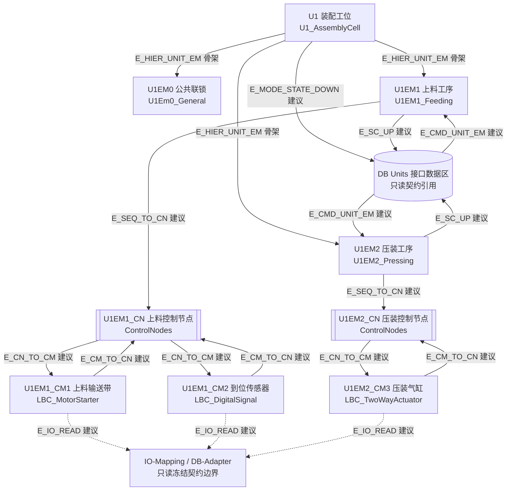
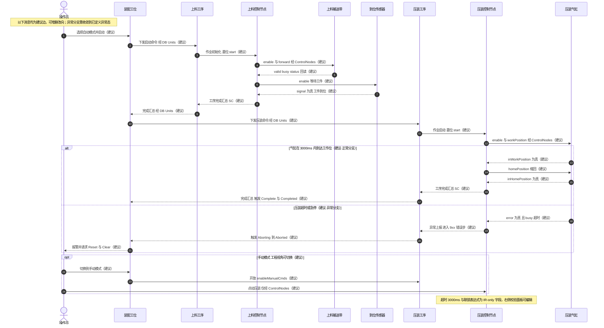
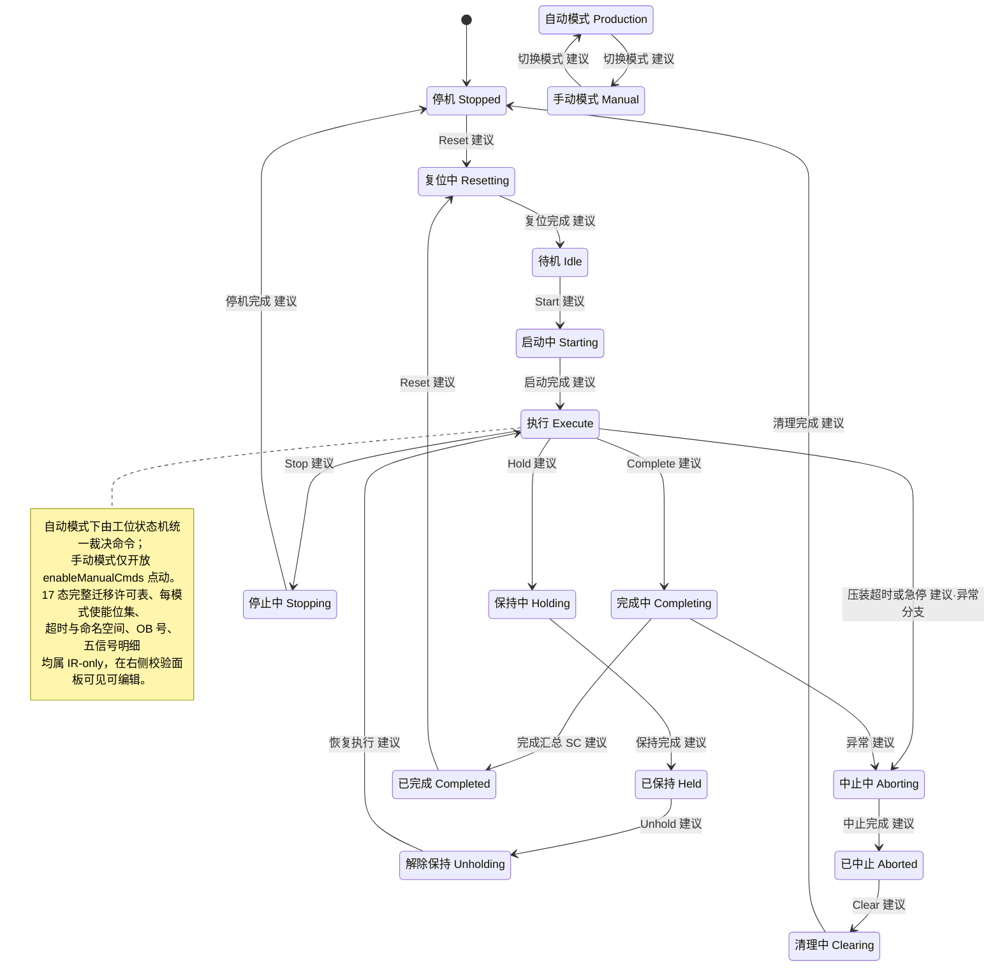

# 03 · 首版三视图 Mermaid（供用户手动连线确认）

> **交付定位**：这是 Greenfield 通道为**示例机型**生成的「首版可连线规格」。用户需在画布上**手动连线**、核对图中架构与功能，然后显式「确认图中架构与功能」→ 系统冻结 spec。
> **权威规格**：三视图文本是**强类型 IR 的投影快照**，不是规格真值。所有节点/边 ID 与 IR 共享同一命名空间；连线编辑的是 IR 的 `edges[]`，三视图联动刷新。详见 `02-architecture.md §3.1 / §3.6 / §3.7`。
> **示例机型**：**1 个 Unit（装配工位）+ 2 个 EM（上料工序 / 压装工序）+ 3 个 CM（输送带 / 到位传感器 / 压装气缸）**，含**自动 / 手动两种模式**与**一条异常分支（压装超时或急停 → 中止）**。
> **文案口径（R7）**：默认业务化同义文案（工位 / 工序 / 设备 / 自动 / 手动 / 生产模式）；括号内为工程视角标识，可在界面「工程视角」开关切换显示。**不出现**「AF / 软件单元 / Unit / EM / CM」于默认用户可见文案。

---

## 0. 示例机型与 ID 对照表

| 业务称呼（默认可见） | 工程视角（可切换） | IR `id` | 层级 / 类型 |
|---|---|---|---|
| 装配工位 | `U1_AssemblyCell` | `U1` | Unit（层级根） |
| 公共联锁 | `U1Em0_General` | `U1EM0` | EM0（Unit 级辅助） |
| 上料工序 | `U1EM1_Feeding` | `U1EM1` | EM 1 |
| 压装工序 | `U1EM2_Pressing` | `U1EM2` | EM 2 |
| 上料输送带 | `LBC_MotorStarter` | `U1EM1_CM1` | CM（电机类） |
| 到位传感器 | `LBC_DigitalSignal` | `U1EM1_CM2` | CM（数字信号类） |
| 压装气缸 | `LBC_TwoWayActuator` | `U1EM2_CM3` | CM（双向执行器类） |
| 上料控制节点 | `ControlNodes` | `U1EM1_CN` | 序列↔设备唯一中枢 |
| 压装控制节点 | `ControlNodes` | `U1EM2_CN` | 序列↔设备唯一中枢 |
| 接口数据区 | `DB Units` 接口 DB 族 | `DB_UNITS` | 只读契约引用 / 命令与反馈枢纽 |
| 信号适配层 | `IO-Mapping / DB-Adapter` | `IOMAP` | 只读冻结契约边界 |
| 自动模式 | `Production` | `MODE_AUTO` | PackML 模式 |
| 手动模式 | `Manual` | `MODE_MANUAL` | PackML 模式 |

**OB 编号（IR-only，不上图，右侧校验面板可见）**：`U1` = 1000/1001/1002；`U1EM0` = 1005/1006/1007；`U1EM1` = 1010/1011/1012；`U1EM2` = 1020/1021/1022（按 `af_numbering` 公式派生，**冻结契约已占号段回避**）。

---

## 1. 视图一 · 层级与数据流（flowchart）

> **读法**：实线 = 数据流 / 层级边；虚线 = 只读契约边界。
> **`建议`** = 系统给出的建议边，用户**可删除、可改向、可保留**；**`骨架`** = 系统层级边（`immutable=true`），不可删除（ISA-88 层级唯一父铁律）。
> 未画出的连线位见 §4「留给用户手动连线」。



---

## 2. 视图二 · 步序、消息与异常分支（sequenceDiagram）

> **读法**：所有消息均为**建议边**（`E_MSG_STEP`），用户可增删改向。`alt / else` = 正常路径与**异常分支**；`opt` = 手动模式可选段。
> 参与方别名即 IR `id`，显示名为业务化文案；「经 ControlNodes」「经 DB Units」是白名单约束的显式标注。
> `Note` 仅为**提示锚点**，超时数值等权威值留在 IR，在右侧校验面板可见可编辑。



---

## 3. 视图三 · PackML 模式状态与迁移（stateDiagram-v2）

> **读法**：状态节点 = PackML 17 态子集（本示例画出 14 态，`Suspending / Suspended / Unsuspending` 保留在 IR）；迁移边均为**建议边**，且必须落在 `PACKML_TRANSITIONS` 许可表内（非法迁移实时拦截）。
> 模式节点 `自动 / 手动` 只与彼此建立切换边；模式使能位集（`enabled_states` / `enable_hold` / `enable_complete`）为 IR-only，在校验面板编辑。



---

## 4. 建议边 / 留白位 / IR-only 标注（**连线前必读**）

### 4.1 建议边清单（系统首版给出，用户可删除 / 改向 / 保留）

| 边类型 | 出现视图 | 数量 | 性质 | 可否删除 / 改向 |
|---|---|---|---|---|
| `E_HIER_UNIT_EM` | flowchart | 3 | **系统骨架**（`immutable=true`） | ❌ 不可删（层级唯一父铁律）；仅可新增同级 EM |
| `E_MODE_STATE_DOWN` | flowchart / state | 1 | 建议边 | ✅ |
| `E_CMD_UNIT_EM` | flowchart / sequence | 2 | 建议边 | ✅ 但目标必须为 EM，不得直连 CM |
| `E_SC_UP` | flowchart / sequence | 2 | 建议边 | ✅ 方向恒为 EM → 接口数据区（单向） |
| `E_SEQ_TO_CN` | flowchart / sequence | 2 | 建议边 | ✅ 但序列↔设备**必须**经控制节点 |
| `E_CN_TO_CM` / `E_CM_TO_CN` | flowchart / sequence | 6 | 建议边 | ✅ 但设备必须 PLCOpen 五信号齐备 |
| `E_IO_READ` | flowchart（虚线） | 3 | 建议边 | ✅ **方向恒只读**，不得改为写向 |
| `E_MSG_STEP` | sequence | 约 26 | 建议边 | ✅ 参与方须在白名单内 |
| `E_BRANCH_ALT_OPT` | sequence / state | 2 | 建议边 | ✅ `else` 臂必须收敛到 `Aborting/Aborted` 或 `Holding/Held` |
| `E_PACKML_TRANSITION` | state | 17 | 建议边 | ✅ 但必须落在 `PACKML_TRANSITIONS` 许可表 |
| `E_MODE_SWITCH` | state | 2 | 建议边 | ✅ 仅 `MODE_AUTO ↔ MODE_MANUAL` |

> **统一图例**：Mermaid 文本中边标签带 `建议` 字样的都是建议边；`骨架` 为系统层级边。三视图**共享同一边 ID**，任一视图的改动在另两视图同步联动。

### 4.2 留给用户手动连线的位置（首版**故意不预置**）

| 留白位 | 期望连线 | 白名单约束 | 若违规 |
|---|---|---|---|
| **A · 跨工序联锁** | `U1EM1_CM2`（到位传感器）→ `U1EM2_CN`（压装控制节点），表示「上料到位才允许压装」 | **必须经 `DB Relations` 接口数据区**，禁止 CM → CN 跨 EM 直连；推荐连法 `U1EM1_CM2 → DB_UNITS → U1EM2_CN`（`E_SC_UP` + `E_CMD_UNIT_EM`） | 直连 → `GF_EDGE_CROSS_EM` / `GF_EDGE_BYPASS_CN` 拦截 |
| **B · 手动点动** | `MODE_MANUAL` → `U1EM2_CN`，表示「手动模式下允许点动压装」 | 模式节点只能与 `ControlNodes` 建立 `enableManualCmds` 语义边，**不得**直连 `U1EM2_CM3` 设备 | 直连设备 → `GF_EDGE_CROSS_LAYER_CM` 拦截 |
| **C · 工序交接** | `U1EM1` → `U1EM2`，表示「上料完成信号交接给压装」 | 工序间交换**只经 `DB Relations`**，禁止 EM → EM 直连 | 直连 → `GF_EDGE_CROSS_EM` 拦截 |

> 用户也可在 **白名单内自由新增**其它连线；右栏「连线白名单」以可拖拽项呈现，拖到画布即时校验 ✔ 合法 / ✘ 拦截（含原因 + 定位到具体视图与节点）。用户**不需要**接触 Mermaid 源码。

### 4.3 只在 IR、不上图的信息（右侧校验面板可见可编辑）

| # | 不上图信息 | 面板位置 | 可编辑性 |
|---|---|---|---|
| 1 | 冻结契约：IO 绝对地址 `%I0.0` / `%Q0.1`、DB 结构·偏移·初值·`scl_body`、符号名、OB 编号与调用顺序、F/安全块 | 「只读冻结契约清单」 | **灰锁只读**（六类物理不可变） |
| 2 | 命名空间前缀全串、块号、`af_profile = SIEMENS_AF_BASIC_FOLDER_V19`、OB 号 | 「工程视角」属性面板 | 只读（由编号公式派生） |
| 3 | PLCOpen 五信号逐字段方向与 UDT 结构（`enable / valid / busy / error / status`） | 设备属性表单 | 可编辑（缺一不得建控制节点边） |
| 4 | 联锁表达式（`releaseWork` / `releaseHome`）、`GFStep.actions`、`transition_condition`、`timeout_ms = 3000`、9xx 错误步链 | 步序 / 联锁属性表单 | 可编辑 |
| 5 | `GFJob.start_condition` / `single_cycle_job`、超时与监控参数 | 作业属性表单 | 可编辑 |
| 6 | PackML 17 态**完整**迁移许可矩阵、每模式 `enabled_states` / `enabled_transitions` / `enable_hold` / `enable_complete`、状态时间统计 | 模式属性表单 | 可编辑（改动同步触发迁移校验） |
| 7 | `ControlNodes.commands/status` 字段路径 `#controlNodes.<设备>.*` | 控制节点属性表单 | 只读（结构约束） |
| 8 | `IO-Mapping / DB-Adapter` 具体映射条目（哪个设备字段绑哪个契约条目） | 「信号映射」表单 | 可编辑，**方向恒只读** |
| 9 | 解析回执明细、`contract_sha`、spec 版本 / 哈希 / 时间戳 / 操作者 | 回执 / 冻结面板 | 只读 |
| 10 | 三视图布局坐标（纯 UI） | 不展示 | 不进 `spec_hash` |

> **防语义损失口径**：图上不可表达的信息**不是被丢弃**，而是留在 IR 并在校验面板可见可编辑、且参与冻结 `spec_hash`。校验面板中来源标为「AI 推断」的项自动进入「待确认问题」，**未补齐不得进入确认**。

### 4.4 连线 → 确认操作顺序

```text
① 上传 IO 表 / DB → 查看解析回执 → 确认回执（契约只读冻结、灰锁）
② 描述工艺 → 得到本文三视图首版
③ 在画布上手动连线：优先补全留白 A / B / C，或增删改向任意建议边
   · 每次连线即时校验：✔ 合法 / ✘ 拦截（原因 + 视图 + 节点定位）
   · 校验面板补齐「待确认问题」与 IR-only 字段
④ 校验全部通过 → 底栏「确认图中架构与功能」按钮方可点击
⑤ 确认 → 生成冻结 spec vN + sha256:xxxxxxxx + 「已冻结」徽章 + 导出留痕
   · 确认前：生成标准项目 / 回写博途 / 写盘 全部置灰（前后端双向零副作用）
   · 冻结后编辑 → 生成 vN+1 新草稿，旧版不可变
⑥ 【本轮止】确认后才允许据图生成标准工程（Phase 2，本轮不实现）
```

---

## 5. 语法与语义自检说明

| 检查项 | 结论 |
|---|---|
| Mermaid 版本 | `mermaid@^12.2.0`（前端已装，懒加载本地打包，无 CDN） |
| flowchart | `flowchart TB`；节点形状 `[""]` / `[()]` 圆柱 / `[[]]` 子程序；实线 `-->\|label\|`、虚线 `-.->\|label\|`；`%%` 行注释不渲染 |
| sequenceDiagram | `participant X as 名称` / `actor`；消息 `->>` 与 `-->>`；`alt / else / end` 与 `opt / end` **各成对**（共 2 个 `end`）；`Note over` 作为提示锚点；`autonumber` |
| stateDiagram-v2 | `state "业务名 工程名" as ID` **先声明后引用**；迁移 `A --> B : 标签`；`note right of … / end note`；`[*] --> Stopped` 起始 |
| 一致性 | 三视图节点 ID 与 `02-architecture.md §3.1.3` 示例 IR 完全对齐；异常分支在 sequenceDiagram（`else`）与 stateDiagram（`Execute → Aborting → Aborted → Clearing → Stopped`）双向自洽；手动模式在 `opt` 与 `MODE_SWITCH` 双向自洽 |
| 白名单 | 所有首版边均落在 `02-architecture.md §3.7.1` 的 12 类合法边内；留白位均标注 §3.7.2 对应拦截码 |
| 门禁 | 本文为**确认前**产出，不含任何写盘 / 写回 / 生成动作；冻结 spec 由用户显式确认后产生 |
| **渲染实测** | 已用本地 `mermaid@^12.2.0` 的 `parse()` 对本文 3 张图 + `02-architecture.md` 4 张图 + 2 份 `.mermaid` 提取文件共 **9 张图全量校验：9 OK / 0 FAIL**（node 环境注入 DOMPurify stub 以补齐无 DOM 限制，非语法规避） |
| **既有资产兼容实测** | 视图二经既有 `plc_engine/af/mermaid_parser.py::parse_mermaid_sequence` 解析：**9 参与方 / 24 步 / 3 个分支臂（alt / else / opt 均配对）**；`plan_from_mermaid()` 成功产出 `AfProject`（1 Unit、24 步、9 CM，步号 10…930，异常分支正确落入 9xx 错误区）。证明首版文本与现有引擎语义自洽、可直接作为建议输入 |
