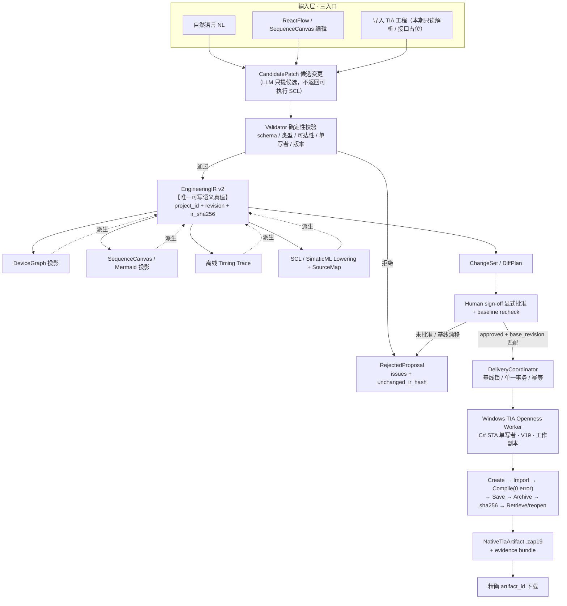
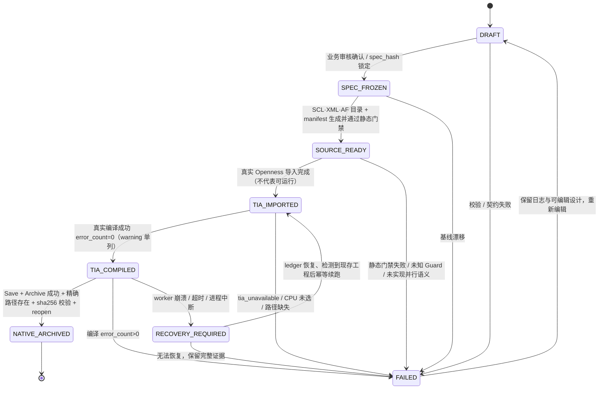

# PLC Agent V2 完全体重构 · 增量 PRD

> 文档类型：增量 PRD（简单 PRD 模式，不含竞品/市场分析）
> 撰写：许清楚（Xu）· 产品经理｜软件团队第 1 阶段产出
> 日期：2026-11-09
> 下游读者：高见远（架构师）· 由主理人齐活林中转
> 状态：范围冻结稿，待主理人/用户澄清「第 8 节待确认问题」后转系统设计

---

## 0. 项目信息

| 项 | 值 |
|---|---|
| Language | 简体中文（全文、UI 文案、诊断信息） |
| Project Name | `plc_agent_v2_full_refactor` |
| Programming Language / 技术栈基线 | **沿用仓库既有栈，本期不更换、不新增前端框架**：前端 React 19 + Vite + TypeScript + 纯 CSS（工业蓝图/制图室美学，零新增 UI 依赖）；后端 FastAPI + Python 3.13；Windows Worker C# / .NET 8 + `Siemens.Engineering` V19 Openness；持久化 SQLite WAL + 版本化 JSON IR + hash 命名 Artifact Store |
| 目标平台 | TIA Portal **V19**（AF Basic **文件夹版**），Windows 单机；纯离线层可跨平台 |
| 原始需求复述 | 在已完成基线保护的仓库上，逻辑上全量重构到 V2 完全体、物理上不删已验证内核；按 WP-00→WP-07 连续批次推进到底，最终一次性交付「统一工程工作台 + 真实 .zap19 原生归档」的完全体；主链口径由旧 4 步向导升级为 EngineeringIR 单一真值 + 双 Canvas 双向编辑；无真机结果绝不显示「交付完成」 |

> **技术栈说明**：本 PRD 不套用「Vite + React + MUI + Tailwind」默认模板。仓库 README 明确现有前端为零新增依赖的纯 CSS 实现、后端为唯一 FastAPI 网关、Worker 为 C# Openness CLI；用户拍板第 1 条要求「物理上不删除已验证内核、其余按 V2 重写」，因此沿用既有栈是硬约束，不是选型偏好。

---

## 1. 文档定位与基线

### 1.1 文档定位

本文是**增量 PRD**：不重写产品愿景，只冻结「V2 完全体」这一期到底做什么、不做什么、做到什么才算完成。它是主理人下发的设计输入，与架构蓝图、开发任务包、用户拍板结论共同构成不可推翻的约束集；架构师据此做系统设计与 WP 任务分解，QA 据此定验收矩阵。

本文**不是**：实机验收报告、代码设计文档、竞品分析、已验证结论清单。

### 1.2 工程基线（不可移动）

| 项 | 值 |
|---|---|
| 仓库 | `C:/Users/vboxuser/Desktop/Project/Code/PLC_chat`，工作目录 `plc_project/` |
| 当前分支 | `refactor/v2-full`（从 `dev/greenfield-wp` 的 HEAD `2856787` 开出） |
| 基线 tag | `baseline/pre-v2-20261109` |
| 全量备份 | `backup/pre_v2_20261109/HEAD_2856787_full.zip` |
| 历史资产 | 61 份历史 docs 已恢复，作为可追溯依据保留，不改写、不外推结论 |
| 权威网关 | `gateway/app`（`plc_gateway/` 已弃用，禁止在其上另起一套后端） |

### 1.3 输入依据（均已实际读取）

1. `docs/PLC_Agent_V2_架构设计与开发蓝图.html`（15 章：六层架构、EngineeringIR v2 领域模型、A1–A7 算法、原生 TIA 交付状态机、G0–G7 硬闸门、WP-00~07 路线、六视图交互原型）
2. `docs/PLC_Agent_V2_开发任务与验收.md`（8 条不可推翻工程原则、TASK-00A~06A、统一 v2 API 草案、AC-01/AC-02、Agent 交付模板）
3. `docs/greenfield/11-p0d-decision.md`（用户 2026-11-06 拍板「1」：**坚持 AF Basic 文件夹版、暂不切软件单元版**）
4. `plc_project/README.md`（现有能力清单、4 步主链现状、Greenfield 通道状态、测试声明值）

### 1.4 不可推翻的输入（用户 6 条拍板结论 · 摘要锚定）

| # | 结论（逐条不可推翻） |
|---|---|
| 1 | 逻辑全量重构到 V2 完全体；**物理不删已验证内核**：`industrial/tia_openness_cli` 的 C# Openness CLI、`plc_engine/af` 的 AF generator、`pcec.py` 的审批门禁；其余按 V2 重写 |
| 2 | 按 **WP-00→WP-07 连续批次推进到底**，每批可运行 + 负例测试 + 留痕，最终一次性交付完全体；不是只做 TASK-00A/00B，也不是一个巨型 PR |
| 3 | **第一版完全体 = Greenfield 全链 + G0–G4/G7 + 真实 `.zap19` 归档**；Brownfield（WP-05 / AC-02）**只留接口与 Schema，不做实机增删改** |
| 4 | 主链升级为 **「统一工程工作台 + SequenceCanvas 双向编辑」**；Mermaid / Trace / SCL 均为 EngineeringIR 的**派生物**；旧 4 步向导保留为**兼容回退入口**；HMI 后置 |
| 5 | 完全体边界见本文第 2.2 节 ✅/❌ 清单，逐条列明 |
| 6 | 允许开发期实际启动 TIA Portal / Openness 做验收；**无真机结果必须如实标注 `pending_real_machine`，绝不显示「交付完成」**；终态验收 = V19 编译零错误 + Save + Archive + hash + reopen 全链 |

同时继承《开发任务与验收》**8 条工程原则**与 `11-p0d-decision.md` 的 AF 档位结论，本文不重复论证、不重新选择技术路线。

### 1.5 仓库现状（主理人只读盘点，如实转述，不得写成已验证）

- 规模：后端 208 个 `.py`、C#/Openness 37 个 `.cs`、前端 107 个 `.ts/.tsx`、135 个 pytest 文件 + 23 个 vitest 文件。
- **README 声明**后端 1341 项 / 前端 393 项测试：**声明值，本期未复跑**，不得写成「已验证通过」。基线复跑与失败真实留痕由 WP-00 / TASK-00A 承担（见第 8 节 Q-07）。
- 环境：TIA Portal V19 已装机（`Portal V19/PublicAPI/V19/Siemens.Engineering.dll`）、Python 3.13 / Node 22 / dotnet 8。
- **历史结论（未闭环）**：`xml_package_unverified = true`、**M4 未通过 / 不可签署**、Greenfield 端到端「真实编译 → 归档 → reopen」**尚未闭环**；批次 4 的 `10/10 imports + compile errorCount=0` 与 RTM `pass=19/19` 是对应副本与 UC-04/UC-16 的证据，**不得外推为本版前端的完整原生工程交付闭环**。
- 旧主界面终态缺陷：`GreenfieldChannel.tsx` 的 `confirmSpec → generateProjectPackage → GO(4)` 在源码包一生成即进入「交付完成」，未证明已生成真实 TIA 项目 —— **本期必须拆分该状态**（见第 4 节）。

---

## 2. 产品目标与「完全体」定义

### 2.1 产品目标（3 个正交目标）

| # | 目标 | 可度量判据 |
|---|---|---|
| **G-A · 单一真值** | 建立 EngineeringIR v2 为唯一可写语义真值，NL、设备画布、步序画布、Mermaid、Trace、SCL 全部为派生物或结构化 Patch 入口 | 任一编辑后 `ir_sha256` 唯一；100 次随机 Patch 原子性；Canvas 投影不反向覆写 IR；UI Layout 不进入语义哈希 |
| **G-B · 原生可交付** | 把「源码包就绪」与「真实 TIA 原生工程归档」拆成独立状态，交付物可校验、可精确下载、可 reopen | `NATIVE_ARCHIVED` 仅在 `compile.error_count=0` + Save + Archive + `sha256` + Retrieve/reopen 全链成功后置位；下载以 `(project_id, job_id, artifact_id, sha256)` 精确绑定 |
| **G-C · 诚实可恢复** | 全链 fail-closed、单写者、可审计、可故障恢复；任何证据等级不得冒充更高等级 | 10 类故障注入下 100% 失败任务不发布 `NATIVE_ARCHIVED`；无 V19 real 结果一律 `pending_real_machine`；基线漂移 409、非法 Patch 422 正确反馈 |

### 2.2 「完全体」定义 · ✅ 含 / ❌ 不含（用户拍板第 5 条，逐条列明）

**✅ 本期含（P0 主体）**

| # | 内容 | 说明 |
|---|---|---|
| 1 | **EngineeringIR v2 + v1→v2 adapter** | `ProjectWorkspace / AFProfile / HardwareIntent / ComponentDefinition / DriverSpec / SequenceIR / SourceBinding / ChangeSet / ArtifactManifest / SourceMap / NativeTiaArtifact`；旧 `GreenfieldIR` 字段零丢失 |
| 2 | **4 类元件 DriverCatalog** | 双作用气缸、单作用执行器、DI/DO、电机启停；强类型 typed ports、状态机、超时、反馈、故障复位、手自动、模板映射；正式 LBC 与 self-contained 模式显式区分 |
| 3 | **SequenceIR / GuardAST / 离线 Trace** | SFC-like 步骤/动作/转移、强类型 Guard AST（BOOL/TIME/INT、AND/OR/NOT/比较）、BFS 可达性、Tarjan SCC、分支优先级/互斥、超时与 Fault 路径、确定性扫描周期模拟器 |
| 4 | **SCL Lowering + SourceMap** | IR → AF 角色 / UDT / FB / DB / FC / OB 的确定性降低、依赖图与导入顺序、`source_id` 注解、Canvas 节点 ↔ IR ID ↔ SCL 行 ↔ TIA 块 N:N 映射、编译错误反向定位 |
| 5 | **Workbench 双 Canvas** | 统一工程工作台 Shell + DeviceCanvas + **SequenceCanvas 双向编辑**；六视图；所有编辑统一走 `SequencePatch(base_revision)`；刷新不丢失 |
| 6 | **真实 TIA 交付全链** | `Projects.Create` 真实 `.ap19` → 导入依赖块 → 编译 `0 error` → Save → Archive → `sha256` → Retrieve/reopen → **精确 `artifact_id` 下载** `.zap19` + evidence bundle |
| 7 | **G0–G7 负例与故障注入** | 负例测试与故障注入覆盖本期适用闸门（映射见第 6.3 节）；失败不伪成功 |
| 8 | **v2 API + 兼容层** | 统一 v2 API 草案全部端点；`409 BASE_REVISION_CONFLICT`、`422 SEMANTIC_VALIDATION_FAILED`、`202 + job_id`；旧 4 步向导作为兼容回退入口 |
| 9 | **保留内核** | C# Openness CLI、AF generator、`pcec.py` 审批门禁物理保留，通过 adapter 接入，不另起第三套后端 |

**❌ 本期不含（范围外，任何优先级都不得顺手纳入）**

| # | 不含项 | 归属 |
|---|---|---|
| 1 | HMI | 后置（用户拍板第 4 条） |
| 2 | TIA **Software Unit（软件单元版）** | 用户 2026-11-06 已拍板暂不切；AF 档位锁定 `SIEMENS_AF_BASIC_FOLDER_V19` |
| 3 | **并行 Step 运行语义**（Token/Fork/Join） | 本期只做确定性串行步骤 + 优先级分支 + 异常路径；并行图可展示但实现运行语义前**必须阻止交付** |
| 4 | 在线下装 / 运行 / 停止 PLC | 安全边界，须独立风险评估与人工授权 |
| 5 | F-block / Safety 程序自动修改 | 安全边界；受保护块保留、不可随意写 |
| 6 | 更多 TIA 版本（V20/V21 等） | 目标平台仅 V19 |
| 7 | **Brownfield 实机增删改 / AC-02 实机闭环** | 用户拍板第 3 条：**只留接口与 Schema**（`SourceBinding`、最小 `DiffPlan` 数据结构、API 占位、负例拒绝），不做真机 ADD/MODIFY/DELETE |
| 8 | 自动规划全部网络/从站/GSD/IO-Link 物理组态 | 硬件仅 CPU skeleton + 逻辑占位；`io_binding = unbound`，不编造 `%I/%Q` 地址 |

> **重要区分**：上表 ❌ 清单是**范围外（Out of Scope）**，不是 P2「锦上添花」。架构师在做 WP 任务分解时，不得把其中任何一项标为「有空就做」。

### 2.3 需求池（P0 / P1 / P2）

| 优先级 | 需求 | 验收锚点 |
|---|---|---|
| **P0 · Must** | 第 2.2 节 ✅ 清单全部 9 项 | AC-01 逐条 + 本期适用 G 闸门 + 三级证据标注 |
| **P0 · Must** | 状态机拆分：`SOURCE_READY` ≠ `NATIVE_ARCHIVED`，旧 4 步「交付完成」文案口径纠正 | 交付视图与后端 job 状态一致，前端不得自行标记成功 |
| **P0 · Must** | 三级证据标注（offline / mocked / V19 real）贯穿 API 回执、报告、UI | 见第 6.4 节规则 |
| **P1 · Should** | Brownfield 接口与 Schema 完整落地（结构、负例拒绝、mocked 编排可选） | 有 schema/API/负例，`writable=requires_review`、F-block 不可写 |
| **P1 · Should** | Mermaid 作为 IR 派生物保留、双向可定位 | 单向投影，不反向覆写 IR |
| **P1 · Should** | 旧 4 步向导兼容回退入口可用、存量 fixture 零字段丢失 | 兼容回归通过 |
| **P1 · Should** | evidence bundle 完整性（编译回执、source map、hash、诊断） | 与 job 精确绑定可下载 |
| **P2 · Nice to have** | 更多 DriverCatalog 元件、性能基线、多用户部署（PostgreSQL/对象存储）、UI 细节打磨、端到端录屏报告 | 不阻塞本期「完全体」判定 |

> P2 **不包含**第 2.2 节 ❌ 清单中的任何一项。

---

## 3. 用户故事（7 条，覆盖主理人指定场景）

| # | 用户故事 | 关键验收点 |
|---|---|---|
| **US-1 · NL 建驱动** | As a 工艺工程师，I want 输入「一只双作用气缸、伸出/缩回限位、3 秒超时」即生成完整 `DriverSpec`，so that 无需手写 SCL，且物理地址保持 `unbound` 不被编造 | 结构化抽取命中 `double_acting_cylinder` / `LBC_TwoWayActuator`；typed ports 齐全；`move_timeout_ms=3000`；`io_bindings` 为 `null` 而非 `%Q0.0`；字段来源标 `user_explicit / inferred / library_default`；缺关键参数进问题队列而非猜测 |
| **US-2 · SequenceCanvas 改保持时间 1s→2s** | As a 工艺工程师，I want 在步序画布双击 S2 把 `min_duration_ms` 由 1000 改为 2000，so that 修改以 `SequencePatch(base_revision)` 落到唯一 EngineeringIR，而不是改一份图内副本 | 发出 `{"op":"set_step_parameter","step_id":"S2","field":"min_duration_ms","value":2000}`；服务端返回 `revision+1` 与 `ir_sha256`；Undo/Redo 不绕开后端 revision；图内不私建真值 |
| **US-3 · IR / Trace / SCL 三方同步** | As a 工艺工程师，I want 一次修改后 IR、离线 Trace 波形、SCL diff 同步更新且可互相定位，so that 我能确认语义一致、没有被某一派生物悄悄覆盖 | S2 保持段由 1000→2000ms 在 Trace 波形与 SCL 常量同时变化；`SourceMap` 支持点击 Trace 区间/编译错误跳到 Step 节点与 SCL 行；同冻结 IR 二次生成语义 hash 一致（时间戳移入 receipt） |
| **US-4 · 审核批准** | As a 审核工程师，I want 在变更审核视图看到 ChangeSet 的 Before/After、受影响块、依赖闭包、基线 `sha256` 与删除/安全块计数，so that 无批准绝不写实体、基线漂移自动拒绝 | `review_approved` 显式人工批准；`base_revision` 不匹配返回 409 / 拒绝批准；`FAILED` 或漂移时禁止 `start_tia_delivery`；批准前「确认前零 TIA 写入」 |
| **US-5 · 真实 TIA 交付下载** | As a 项目交付人，I want 触发交付后看到逐步日志（Create→Import→Compile→Save→Archive→Retrieve/reopen），并下载与本 job 精确绑定的 `.zap19` + evidence，so that 我拿到的是可校验的原生工程而非源码 ZIP | `POST /deliveries` → `202 {job_id}`；`NATIVE_ARCHIVED` 携带 `compile.error_count=0`、`native_artifact.sha256/size_bytes`、`evidence_id`；`GET /artifacts/{id}/download` 精确授权；**禁止目录通配扫描「找第一个 zap19」**、当前 job 不能下载别的 job 旧归档 |
| **US-6 · 版本冲突 409 恢复** | As a 协作者 / 前端，I want 当两个编辑基于同一 `base_revision` 冲突时收到 `409 BASE_REVISION_CONFLICT + current_revision`，so that 不出现静默覆盖或工程丢失 | 冲突响应含 `current_revision`；前端据此重新拉取 IR 并提示重新合并；局部乐观显示回滚；`request_id` 幂等不产生重复变更 |
| **US-7 · 失败不伪成功** | As a 用户 / QA，I want 当 CPU 未选、真实路径缺失、双线圈同时使能、删除被引用 FB、修改 F-block、基线漂移、未知 Guard、TIA 编译失败、归档缺失、真机不可用时看到明确诊断与 `pending_real_machine`，so that 界面绝不出现「交付完成」或伪造的下载按钮 | 失败保留日志与可编辑设计；`tia_unavailable` 显式失败（非 HTTP 200 / `ok=false` / 明确 error code）；warning 单列不并入 `compile_ok`；`compile_ok = error_count==0 ∧ static_gate_passed ∧ 真实回执`；`FAILED / RECOVERY_REQUIRED` 不提供伪造原生项目 |

---

## 4. 主链与状态机

### 4.1 主链（EngineeringIR 单一真值 + 受控交付）

> 关键约束：**所有修改先在工程内核完成，只有 DeliveryCoordinator 可以调用写入型 TIA 工具**；LLM 不作为自由 Agent 持有 `approve_changeset` / `start_tia_delivery`；Mermaid / Trace / SCL **均为派生物，不反向覆写 IR**（虚线仅表示可定位回溯，不表示写回）。

### 4.2 原生交付状态机（DRAFT → NATIVE_ARCHIVED）

**各状态允许表示的事实与可下载物**

| 状态 | 允许表示的事实 | 允许下载 |
|---|---|---|
| `DRAFT` | 可编辑需求 / Canvas，尚未冻结 | 草稿 JSON |
| `SPEC_FROZEN` | 业务审核确认，版本哈希锁定 | 规格文档 |
| `SOURCE_READY` | SCL/XML、AF 目录、manifest 已生成并通过静态门禁 | **源码导入包 ZIP（不是 TIA 原生工程）** |
| `TIA_IMPORTED` | 真实 Openness 导入完成，**不代表可运行** | 编译前诊断，不得称完整交付 |
| `TIA_COMPILED` | 真实编译成功、错误数为零（warning 单列） | 编译诊断、源码包 |
| `NATIVE_ARCHIVED` | Save + Archive 成功；精确归档路径存在；hash 校验通过；reopen 通过 | **真实 `.zap19` + evidence bundle** |
| `FAILED` / `RECOVERY_REQUIRED` | 失败或进程中断，保留完整证据 | 诊断报告；**不提供伪造原生项目** |

> ### ⚠️ `SOURCE_READY` ≠ `NATIVE_ARCHIVED`（本期最重要的口径纠正）
> - 源码 ZIP 只是**源码导入包**，是一个**离线 / offline 级产物**；`NATIVE_ARCHIVED` 必须是与源项目精确绑定的**真实 `.zap19`**，且经 `compile.error_count=0` + Save + Archive + `sha256` + Retrieve/reopen 全链校验。
> - 旧 4 步向导在 `generateProjectPackage` 后即进入 `GO(4)`「交付完成」，属于把 `SOURCE_READY` 冒充 `NATIVE_ARCHIVED`。本期必须在**后端 job 状态、API 回执、前端交付视图**三处同时拆分，前端**不得自行标记成功**。
> - 任何「找第一个 zap19」「扫描目录猜归档」的逻辑一律删除，改为 `(project_id, job_id, artifact_id, sha256)` 精确绑定。
> - 无 V19 real 回执时，交付视图的编译结果字段固定显示 `pending_real_machine`，归档 SHA256 显示「未生成」，**不出现「交付完成」字样、不出现可点击的原生归档下载按钮**。

---

## 5. 六视图 UI 设计稿（统一工程工作台）

### 5.0 全局框架（所有视图共用）

- **三栏布局**：左侧 `220–260px` 项目树 / 中间弹性工作区（Canvas · Code · Trace · Diff）/ 右侧 `300–380px` Inspector + AI Engineering Copilot；**底部可展开 diagnostics**（编译诊断、`source_id` 反向定位到 Canvas 节点与 SCL 行）。
- **顶部项目身份条**：`project_id`、`revision`、`AFProfile = SIEMENS_AF_BASIC_FOLDER_V19`、交付状态徽标、**证据等级徽标（offline / mocked / V19 real / pending_real_machine）**、基线锁定状态。
- **不要把所有功能做成弹窗**：用户始终能看到当前工程、当前步骤、待解决问题。前端只持**视图与选择状态**，真实数据由服务端 `revision` 主导；刷新 / 服务重启不丢失工作区。
- **统一编辑协议**：所有编辑（拖入节点、连端口、双击 Step、改 Guard/超时）一律发带 `base_revision` 的原子 Patch；`409` 冲突正确反馈并回滚局部乐观显示；`422` 校验错误标注在对应节点。
- **证据标注**：每个视图中凡涉及仿真 / 编译 / 归档结论处，必须显示证据等级；预测模型 Trace 显式标「预测，不是实机验证」；交付视图状态来自后端真实 Job，不由前端自行标记成功。

### 5.1 ① 项目总览

| 区 | 规格 |
|---|---|
| 左栏 | `PROJECT EXPLORER` 项目树：`Demo_Project` → TIA 工程骨架 → `Unit 01` → `EM01 Clamp` → `CM01 cylClamp` / `CM02 sensorHome`；Block Index；变更历史（revision 时间线） |
| 中栏 | 项目工作区首页：真实工程卡片（`.ap19` 已存在 / CPU 模板已确认 / **I/O 地址未绑定**）、生成状态卡片（CM 数 / EM 数 / 步骤数 / 待确认项）；「下一步建议」列表可跳转对应视图；基线锁定 / 未发布徽标 |
| 右栏 | Copilot：展示识别实体与待确认字段（如 TimeOut 3000ms），「生成候选变更」按钮只产出 CandidatePatch，不写 TIA |
| 底部 | 设计信息 ≠ TIA 实时状态；草稿持久化；未触发实际写入 |
| 关键 | Draft/SPEC_FROZEN 阶段入口；旧 4 步向导回退入口在顶栏可见 |

### 5.2 ② 元器件驱动（DeviceCanvas）

| 区 | 规格 |
|---|---|
| 左栏 | `DEVICE LIBRARY`：执行器（双作用气缸 / 单线圈阀 / 电机接触器）、传感器、运动轴、自定义 CM；DriverCatalog 4 类元件 |
| 中栏 | CM 端口图：`FB_cylClamp` 的 `CmdExtend / CmdRetract / SafetyPermit / SensorOut·In` → `Status / Busy / Error·ID / Q_Ext·Q_Ret`；`MANUAL/AUTO`、`TIMEOUT/FAULT`、`COMMAND INTERLOCK` 标注；端口检查通过徽标 |
| 右栏 | 属性面板：typed ports 类型、参数（`move_timeout_ms`）、`io_bindings`（**显式 `unbound`，禁止占位地址**）、字段来源标签、LBC / self-contained 模式区分 |
| 关键交互 | 节点拖入、命名端口连线、右侧属性编辑 → 原子 Patch（`base_revision`）；缺型号/反馈/超时显示待确认字段；反向线圈互斥与单写者校验失败回滚 |
| 底部 | 驱动静态检查诊断：端口类型不一致 / 命令冲突 / 缺异常路径 → 定位到具体端口 |

### 5.3 ③ 工艺步序（SequenceCanvas · 本期核心双向编辑）

| 区 | 规格 |
|---|---|
| 左栏 | `PROCESS STRUCTURE`：工作模式 Automatic、`EM01 ClampSequence`、S0 待机 / S1 伸出 / S2 保持 / S3 缩回 / S4 结束 / FAULT |
| 中栏 | **可编辑 SFC-like 画布**：自定义 Step / Transition / Action 节点、命名连接端口、Fork/Join 专用节点（本期可展示但并行运行语义阻止交付）；双击编辑动作、Guard、超时、异常、模式；示例 S2 标注 `2000 ms` |
| 右栏 | 动态 Inspector：显示当前选中节点的**源数据**（来自服务端 IR，不私建图内真值）；Guard AST 结构化编辑（BOOL/TIME/INT、AND/OR/NOT/比较），**禁止 `eval()` 与自由文本布尔表达式** |
| 关键交互 | 每次修改发 `SequencePatch(base_revision)`；服务端成功后刷新派生 SCL 预览与 Trace；**手工把 Hold 1s→2s 后 IR / Trace / SCL 三方同步**；Undo/Redo 不绕开后端 revision |
| 底部 | 不可达步骤、分支条件冲突、缺错误分支、非法 Guard 类型、未实现并行语义 → 标注于对应节点并阻止进入交付 |

### 5.4 ④ 时序预览（离线 Trace）

| 区 | 规格 |
|---|---|
| 左栏 | `TEST SCENARIOS`：正常循环、伸出不到位、缩回超时、安全许可丢失、复位后重启（5 个场景） |
| 中栏 | 波形图：`Step S1 / Q_Extend / Extended / Step S2 / Q_Retract` 随时间轴渲染；**「保持时间 2000ms」区间与 S2 对应**；点击区间可定位到 SFC 步骤与生成代码行 |
| 右栏 | `TRACE ASSERTIONS`：`Q_Extend ∧ Q_Retract` 必须为 false、异常时不得进入下一工步、场景覆盖率 |
| 关键 | 标题栏显式标 **「预测模型 Trace · 非在线 PLC 波形」「预测，不是实机验证」**；时间值由驱动参数 + 确定性场景输入计算；失败时返回**最短反例路径**，而非一行「仿真失败」；若数据来自 PLCSIM/真实 PLC 必须显式显示 `data_source` |
| 底部 | 场景输入表与 `TraceFrame`（周期、活动步骤、条件、动作、Driver 状态、输出、报警、SourceMap） |

### 5.5 ⑤ 变更审核

| 区 | 规格 |
|---|---|
| 左栏 | `PROJECT BASELINE`：基线工程、保留（硬件/IO、F/Safety 块）、修改（目标块）、新增、未改块数与 hash 状态 |
| 中栏 | 变更清单：`ADD` / `MODIFY` / `KEEP` 逐条列出目标块与依赖数；Before/After 源码 diff（`@@ FB_Clamp / Sequence S3 @@`）；原始源码旁路对比 |
| 右栏 | `REVIEW & APPROVAL`：工程基线 `sha256`、源码匹配、**删除操作 0**、**安全块更改 0**、评审结论；「批准本次变更」按钮需显式人工批准 |
| 关键 | **确认前零 TIA 写入**；基线漂移、保护块、删除依赖未解除时**禁止批准**；批准后写入 copy-on-write 副本，原件不动 |
| 本期边界 | Brownfield 只留接口与 Schema：视图需具备「拒绝写 F-block / 拒绝删被引用块 / 基线漂移拒绝」的负例反馈能力，**不做实机 ADD/MODIFY/DELETE 交付** |

### 5.6 ⑥ TIA 交付

| 区 | 规格 |
|---|---|
| 左栏 | `DELIVERY STEPS`：01 冻结规格 → 02 生成 SCL → 03 TIA 导入 → 04 Compile PLC → 05 Save Project → 06 Archive `.zap19`（逐步日志，逐步高亮） |
| 中栏 | 交付事务 / 严格阶段门禁：`IR 冻结(spec_hash)` → `导入/编译(真机回执)` → `原生归档(exact artifact)`；两类产物分列：**离线源码包「可下载 · 不是 TIA 原生项目」** / **TIA 工程归档「未就绪 · 等待编译与归档」** |
| 右栏 | `ENGINEERING RECEIPT`：规格版本 v3/frozen、目标 TIA V19、项目类型、**编译结果 `pending_real_machine`**、**归档 SHA256「未生成」**；「查看日志和建议」 |
| 关键 | 状态来自**后端真实 Job**，不由前端自行标记成功；`compile.error_count=0` + Save + Archive + `sha256` + reopen 全链成功才显示真实 `.zap19` 下载；失败保留日志与可编辑设计，**不出现伪成功下载按钮**；下载走精确 `artifact_id` |
| 底部 | 编译诊断逐条可反向定位到 `source_id` → IR 节点 → Canvas 红色标记；证据等级徽标常量显示 |

---

## 6. 验收口径

### 6.1 AC-01（Greenfield）逐条

| # | AC-01 条款 | 本期验收判据 | 证据等级 |
|---|---|---|---|
| 1 | `Projects.Create` 真实创建 `.ap19`，CPU 型号来自装机支持列表或已批准模板 | C# `create-project` 返回 `{ok, create:{projectPath}}`，Python **解包 `create.projectPath` 并 fail-closed**，不猜路径；CPU 前置检查，缺失显式失败 | **V19 real** |
| 2 | NL「一只双作用气缸、伸出/缩回限位、3 秒超时」生成完整 `DriverSpec`，地址仍 `unbound` | typed ports 齐全、`move_timeout_ms=3000`、`io_bindings=null`、字段来源标注；无虚构 `%I/%Q` | offline + 契约测试 |
| 3 | NL「启动→伸出→到位→保持→缩回→完成，超时故障」生成 `SequenceIR` | Guard AST 强类型、BFS 可达、Fault 路径存在、无未实现并行语义 | offline（pytest + vitest） |
| 4 | 在 Canvas 将保持 1s 改 2s，看到 IR Patch / Trace / SCL diff | `SequencePatch(base_revision)` → `revision+1`；Trace 波形与 SCL 常量同步由 1000→2000；SourceMap 可互定位；刷新不丢失 | offline + 前端 vitest（UI 层 mocked 后端契约） |
| 5 | 用户批准，TIA V19 真实导入、编译 `error_count=0`、Save、Archive、Retrieve/reopen 成功 | `CompilerResult.State=Success / ErrorCount=0`（warning 单列）；Save 后 Archive 返回**精确路径**；`sha256` 校验；Retrieve + reopen 成功 | **V19 real（强制）** |
| 6 | 用户可下载关联 job 的 `.zap19` 和完整 evidence | `(project_id, job_id, artifact_id, sha256)` 精确绑定；当前 job 不能下载其他 job 旧归档；重复请求幂等 | **V19 real** |

> **AC-02（Brownfield）本期不作为实机验收**：仅验收「接口与 Schema 存在 + 负例拒绝」（F-block 不可写、删被引用块被拒、基线漂移被拒、原件不动），不做真机 ADD/MODIFY/DELETE。见第 8 节 Q-04。

### 6.2 负例清单（必须全部拒绝「交付完成」，对应 US-7）

工程路径缺失 · CPU 未选 · 两个线圈同时使能 · 删除被引用 FB · 修改 F-block · `base_revision` 版本漂移 · 未知/非法 Guard · 未实现并行语义 · TIA 编译失败 · 归档缺失 · `tia_unavailable` · worker 崩溃 · 坏 XML/ZIP · 重复非幂等请求。任一命中 → `FAILED / RECOVERY_REQUIRED`，保留日志与证据，**不发布 `NATIVE_ARCHIVED`**。

### 6.3 G0–G7 本期适用闸门映射

| Gate | 蓝图定义 | 本期适用性 | 本期验收方式 |
|---|---|---|---|
| **G0 · 契约** | 版本、TiaCapabilityManifest、CPU 模板、AFProfile | ✅ **全量适用** | Schema + Windows status 实机探针；`AFProfile` 锁定 `SIEMENS_AF_BASIC_FOLDER_V19` |
| **G1 · IR** | 完整序列化、Patch 原子性、Canvas 投影不反向覆写 | ✅ **全量适用** | pytest 纯函数 + vitest；100 次随机 Patch、409 / 422、旧 fixture 零字段丢失 |
| **G2 · 驱动** | 必需端口、超时、反向互斥、单写者 | ✅ **全量适用** | 属性测试 + 正反例单测；4 类元件 |
| **G3 · 工艺** | 可达性 / 异常转移 / 优先级 / 无未实现并行语义 | ✅ **全量适用** | Guard AST + 图算法 + 5 场景 Trace + 负例 |
| **G4 · SCL** | 确定性产物 + SourceMap + 依赖排序 + 静态检查 | ✅ **全量适用** | golden files + compiler precheck；二次生成语义 hash 一致 |
| **G5 · TIA** | 真实 V19 导入、编译、Save、Archive、重新打开 | ⚠️ **Greenfield 半链适用**：以用户拍板第 3 条「真实 `.zap19` 归档」形式落到 AC-01 第 5–6 步；**Brownfield 副本链不做** | **Windows TIA V19 单机集成测试，不是 mock** |
| **G6 · Brownfield** | 原件不动、只改批准对象、删除无悬空引用、其他块保真 | ❌ **本期不适用**：只留接口与 Schema（`SourceBinding`、最小 `DiffPlan` 结构、API 占位、负例拒绝）；**无实机增删改** | 仅 schema / mocked 负例；不得标 V19 real |
| **G7 · 故障恢复** | 超时 / 编译失败 / 重复请求 / worker 崩溃 / 基线漂移不造成错项目写入 | ✅ **全量适用**（≥10 类故障注入） | fault injection + transaction recovery；100% 失败任务不发布 `NATIVE_ARCHIVED` |

> 用户拍板第 3 条字面为「G0–G4/G7 + 真实 `.zap19` 归档」，第 5 条为「真实 TIA 创建→导入→编译 0 error→Save→Archive→精确 artifact 下载、G0–G7 负例与故障注入」。上表按「**G0–G4 / G7 全量 + G5 的 Greenfield 交付链 + G6 仅接口与 Schema**」表述；**G5 是否单独计入本期闸门编号，列为待确认问题 Q-01，请主理人/用户澄清，本 PRD 不自行拍板**。

### 6.4 三级证据标注规则（offline / mocked / V19 real）

| 等级 | 定义 | 允许写入的结论 | 禁止 |
|---|---|---|---|
| **offline** | 纯函数、schema、静态检查、golden file、离线 Trace；不连 TIA、不依赖真实 Openness 回执 | 「静态检查通过」「语义 hash 一致」「Trace 与 SCL 一致」「负例被拒绝」 | 禁止写「编译零错误」「L2 通过」「交付完成」 |
| **mocked** | 用 mock 的 Openness 响应 / fake worker / 契约测试验证**编排与接口** | 「编排逻辑正确」「API 契约符合」「状态机迁移正确」 | **禁止把 mock 编译 / mock 归档写成真机成功**；不得据此置 `NATIVE_ARCHIVED` |
| **V19 real** | 真实 TIA Portal V19 + `Siemens.Engineering.dll` 实机返回：`create.projectPath`、`CompilerResult State/ErrorCount/WarningCount`、Save/Archive 精确路径、`sha256`、Retrieve/reopen 回执 | 「真实创建成功」「编译 `error_count=0`」「归档存在且校验通过」「原生工程可 reopen」 | 不得由更低等级证据外推；不得把历史副本/其他 UC 的 real 结果外推到本版前端全链 |

**强制规则**

1. **向上不外推、不互相代替**：可达性、静态规则、离线 Trace、TIA 编译、运行行为等价、安全符合性是不同级别证据，任一通过**不得自动代替其余级别**。
2. **`compile_ok` 定义**：`error_count == 0 ∧ static_gate_passed ∧ 存在真实回执`；`warning_count` **单列，禁止并入成功**。
3. **`pending_real_machine`**：无 V19 real 结果时，API 回执、报告、UI 交付视图一律标注 `pending_real_machine`；归档 SHA256 显示「未生成」；**绝不显示「交付完成」**。`tia_unavailable` 为显式失败（非 HTTP 200、`ok=false`、明确 error code），与「真机未跑」严格区分。
4. **留痕**：每批 WP 的 Agent 交付模板须填 `Real TIA V19 tested? yes/no (raw evidence path)`；所有验证结论区分 offline / mocked / V19 real；`evidence/` 台账由主 agent 收口统一更新。
5. **历史结论不迁移**：`xml_package_unverified=true`、M4 未通过、Greenfield 端到端真实编译→归档→reopen 未闭环 —— 本期未取得新的 V19 real 全链证据前**不得改口径**；README 声明的 1341/393 测试为声明值、未复跑，不得写成已验证。

---

## 7. 非功能与工业安全边界

| # | 边界 | 具体要求 |
|---|---|---|
| 1 | **不碰 F-block / Safety** | 任何 Safety/F-block、受保护程序的自动修改须走独立风险评估、权限设计与人工授权；不可解析/受保护/F-block 仍保留且 `writable=requires_review`；本期自动化范围仅限离线工程设计 + 真实 TIA 的**离线**编辑/编译/归档 |
| 2 | **不在线下装 / 运行 / 停止** | 禁止未批准的 `download` / `run` / `stop`；`start_tia_delivery` 仅做 Create/Open → Import → Compile → Save → Archive |
| 3 | **SafetyPermit 仅为软件联锁** | 可表达「安全许可丢失时普通工艺禁止新动作」的软件接口；**不得冒充安全完整性等级相关的急停/光幕/安全回路**；急停等安全功能由合适的安全控制系统 + 风险评估承担；普通 SCL 联锁不作安全完整性声明 |
| 4 | **单写者** | 一个写入事务、一条 C# STA 执行队列、**每项目独占锁**；禁止两个 Agent 并发打开同一工作副本同时写入；`arbitrate_single_writer` 对所有物理输出与符号映射做单写者/互斥约束；反向线圈不得同时置位 |
| 5 | **最小披露** | LLM 上下文只取最小需要的块索引、设备定义、当前步骤，**不一次塞入整个 TIA 项目**；不上传私有工程到外部 LLM（除非用户明确配置并接受数据范围）；路径白名单；**不接受浏览器提供的任意文件路径用于下载** |
| 6 | **fail-closed** | `unknown == fail`（不可解析、类型未知、Guard 非法、并行语义未实现、CPU 未选、路径缺失一律拒绝代码生成/交付）；「no findings」只表示这些检查通过，**不等于机器安全被证明** |
| 7 | **保真 / 原件不动** | 旧工程默认只修改 copy-on-write 副本；未修改对象采用适合该对象的语义/字节级比较策略校验并保存异常说明；`hardware_hash` 与 `safety_block_hash` 不变；不静默重排 DB 偏移/硬件地址 |
| 8 | **确定性 / 可复现** | 同一冻结 IR + AFProfile + `template_sha256` 重复编译两次应得相同语义文件及 manifest hash；可变时间戳移到独立 receipt；扫描周期顺序固定且与编译 SCL / 模拟器一致 |
| 9 | **不编造地址** | `io_binding` 物理地址 `null` 与「假默认地址 `%Q0.0`」含义完全不同；源码生成不得偷偷使用占位符地址；真实 CPU skeleton + 逻辑占位，不自动规划网络/从站/GSD/IO-Link |
| 10 | **幂等 / 可恢复 / 可审计** | 作业阶段写持久 ledger；`idempotency_key` 防重复生成；进程中断后检测现存工程与实际成果，**不盲目重发非幂等写入**；全部变更 `change_id` / `source_id` 贯穿 UI→编译→账本；`SourceMap` N:N，不靠 DB 命名反推 FB 名 |
| 11 | **版本锁定** | 生成/编译期 `AFProfile` 版本一致；`af_profile_id + library_version + template_sha256` 固定；不得用「最新版本」替换已选基线；不把 AF V1.2 / AF Basic V2.2 / AF V3.0 文档与库接口默认为同一版本 |
| 12 | **兼容不破坏** | 不删除 `industrial/tia_openness_cli`、`plc_engine/af`、`pcec.py` 能力；不复制 `plc_gateway/` 另起后端；不同时维护三份可任意写入的模型；旧 4 步入口与存量 fixture 保持可用或有明确适配层 |

---

## 8. 待确认问题（编号项，不自行拍板）

> 以下均为**范围/口径澄清**，不涉及推翻用户 6 条拍板结论、8 条工程原则或 AF 档位决策。请主理人转呈用户或授权架构师确认后再冻结系统设计。

- **Q-01 · G5 闸门编号归属**：用户拍板第 3 条写「G0–G4/G7 + 真实 `.zap19` 归档」，第 5 条写「真实 TIA 创建→导入→编译 0 error→Save→Archive + G0–G7 负例」。本期「真实 `.zap19` 归档」是否等同 G5 的 **Greenfield 半链**？验收矩阵中是否单独列 `G5（Greenfield-only）`，还是统一并入「真实 `.zap19` 归档」条目？本文第 6.3 节暂按后者表述，待确认。
- **Q-02 · WP-05~07 本期最小可交付定义**：拍板第 2 条要求 WP-00→07 连续批次推进到底、每批可运行 + 负例 + 留痕、最终一次性交付；第 3 条又要求 Brownfield 只留接口与 Schema。请确认 WP-05（Brownfield）、WP-06（质量/恢复）、WP-07（统一验收发布）在「完全体」中的完成判据：是「接口 + Schema + 负例注入 + 文档留痕」即算该批完成，还是其中某批仍需实机闭环？「最终一次性交付」是否指整体验收发布（而非单个巨型 PR）？
- **Q-03 · 旧 4 步向导兼容回退入口的形态与文案**：入口采用顶栏开关 / 独立路由 / feature flag 哪种？旧向导第 4 步「工程包已就绪 + 交付完成」与本期「失败不伪成功 / `SOURCE_READY` ≠ `NATIVE_ARCHIVED`」冲突，是否纳入本期改为「源码包就绪（非原生工程）」？请确认改动范围与是否允许动前端完成页文案。
- **Q-04 · Brownfield「只留接口与 Schema」的验收粒度**：是仅 `SourceBinding` / 最小 `DiffPlan` 数据结构 + API 占位 + 负例拒绝（F-block 不可写、删被引用块被拒、基线漂移被拒）即可，还是允许一个 **mocked** 的 DiffPlan 编排演示？是否明确**不允许任何 V19 real 实机增删改证据**？
- **Q-05 · 真实交付的 CPU 模板来源**：AC-01 第 1 条要求「CPU 型号来自装机支持列表或已批准模板」。请确认是由用户/主理人在开发前**指定一个已批准 CPU skeleton**，还是由架构师在 G0 阶段探测后写入 `TiaCapabilityManifest` 供选择？该选择是否影响 G0 验收判据。
- **Q-06 · Retrieve/reopen 是否为 `NATIVE_ARCHIVED` 强制条件**：AC-01 第 5 步与蓝图 G5 均含「重新打开」，但蓝图正文也曾将 Retrieve/reopen 表述为「增强验收」。请确认本期是**强制通过**才置 `NATIVE_ARCHIVED`，还是作为增强项单列、不影响状态置位。
- **Q-07 · 基线测试复跑与失败处置**：README 的 1341 / 393 为声明值、未复跑。请确认 WP-00 / TASK-00A 是否将「实际运行 pytest / vitest / dotnet test + 记录真实失败列表」列为**强制验收**；若复跑出现既有基线失败，在「物理不删内核、不破坏存量能力」前提下如何处置（隔离标记 / 已知失败清单 / 修复）？是否允许把任何 mock 结果计入基线通过？

---

## 9. 给架构师（高见远）的交接要点

1. **硬约束集（不可推翻）**：用户 6 条拍板结论 + 《开发任务与验收》8 条工程原则 + `11-p0d-decision.md` 的 AF Basic 文件夹版结论。系统设计不得重新论证或改选技术路线；本文第 1.4 / 1.3 节为索引。
2. **范围冻结**：完全体 ✅/❌ 清单见第 2.2 节。**❌ 清单是范围外，不是 P2**；尤其 HMI、Software Unit、并行 Step 运行语义、在线下装/运行停止、F-block、更多 TIA 版本、Brownfield 实机增删改、物理组态自动规划，均不得进入 WP 任务分解。
3. **物理不删内核**：`industrial/tia_openness_cli`（C# Openness CLI）、`plc_engine/af`（AF generator）、`pcec.py`（审批门禁）**保留**，通过 adapter 接入；其余按 V2 重写；**禁止复制 `plc_gateway/` 建第三套后端**、禁止同时维护 `GreenfieldIR / CanvasState / ProjectIR` 三份可任意写入的模型。迁移顺序：扩展原模块 → 适配旧接口 → 提取共享服务。
4. **主链口径**：EngineeringIR v2 是唯一可写真值；Mermaid / Trace / SCL / DeviceGraph 均为**派生物**（单向投影，不反向覆写）；主链为「统一工程工作台 + SequenceCanvas 双向编辑」，所有编辑统一走带 `base_revision` 的 Patch API；旧 4 步向导仅作兼容回退入口。
5. **必须在三处同时落地的状态拆分**：`SOURCE_READY` ≠ `NATIVE_ARCHIVED`，落到**后端 job 状态机 / API 回执 / 前端交付视图**；前端不得自行标记成功；`artifact_id` 精确绑定下载，删除任何「目录通配找 zap19」逻辑；`409 / 422 / 202` 契约按第 4.2 / 3 节与统一 v2 API 草案。
6. **三级证据标注必须成为一等公民**：offline / mocked / V19 real 贯穿 API 回执、报告、UI；无 V19 real 一律 `pending_real_machine`；`compile_ok` 只认真实 `error_count=0`；warning 单列；历史 `xml_package_unverified=true` / M4 未通过 / 端到端未闭环口径在新证据取得前不得改。
7. **闸门映射与未决项**：按第 6.3 节 G0–G4/G7 全量 + G5 Greenfield 交付链 + G6 仅接口与 Schema 做验收矩阵；**Q-01 / Q-02 / Q-06 需先由主理人澄清后再冻结任务分解**，不要在未澄清时自行给 G5 编号或给 WP-05~07 下实机判据。
8. **批次与并行约束**：WP-00→WP-07 连续批次、每批可运行 + 负例测试 + 留痕、非巨型 PR；TIA 真机连接必须**串行**安排；可并行的仅限互不争用的文件；IR schema 变更由单一角色独占。建议沿用蓝图第 13 章的角色/模块所有权与并行冲突表。
9. **UI 契约**：第 5 节六视图 + 三栏布局 + 底部 diagnostics 为产品侧规格；布局数值（左 220–260 / 右 300–380）为建议区间，架构师可在不破坏「始终可见工程/步骤/待解决问题」前提下微调；技术栈沿用既有 React 19 + Vite + TS + 纯 CSS，不引入 MUI/Tailwind。
10. **交付给下游的产物建议**：系统设计文档（六层职责与边界）、EngineeringIR v2 schema 与 v1→v2 adapter 契约、v2 API 与错误码契约、WP-00~07 任务分解与每批负例清单、G0–G7 验收矩阵（含三级证据列）、以及第 8 节 7 个待确认问题的处理结论。

---

> 本文为范围冻结稿。所有「真机」「编译零错误」「归档完成」相关表述均为**目标验收条件**，不是已发生事实；截至本稿，Greenfield 端到端真实编译→归档→reopen 仍未闭环，`xml_package_unverified = true`、M4 未通过，README 测试计数为未复跑的声明值。任何实现与验收须按第 6.4 节三级证据规则留痕。
