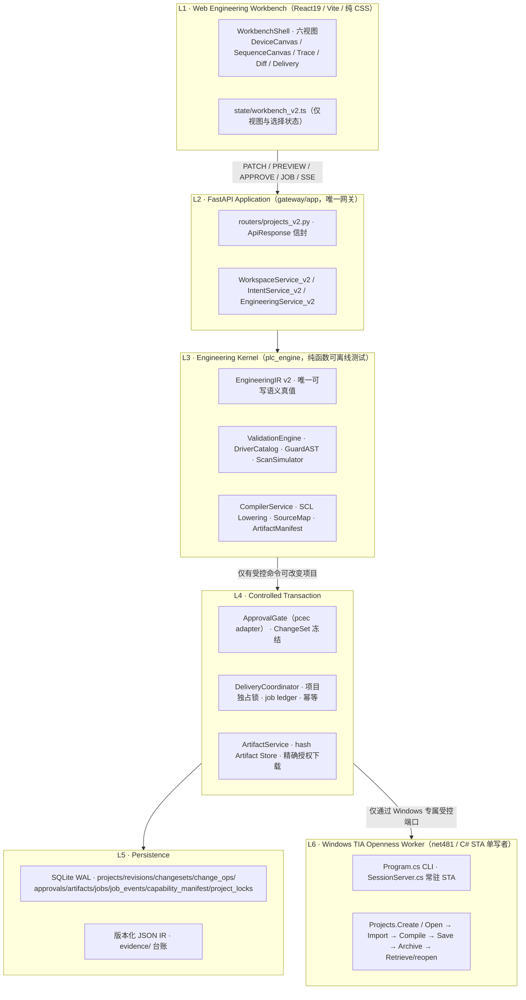
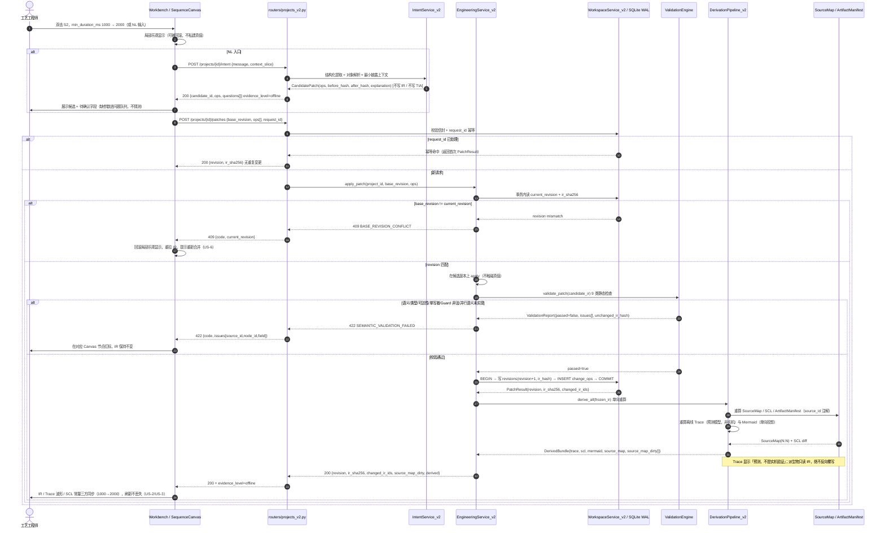
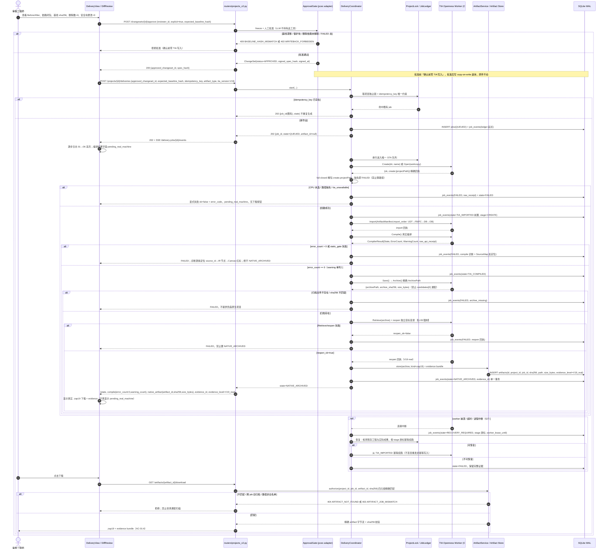
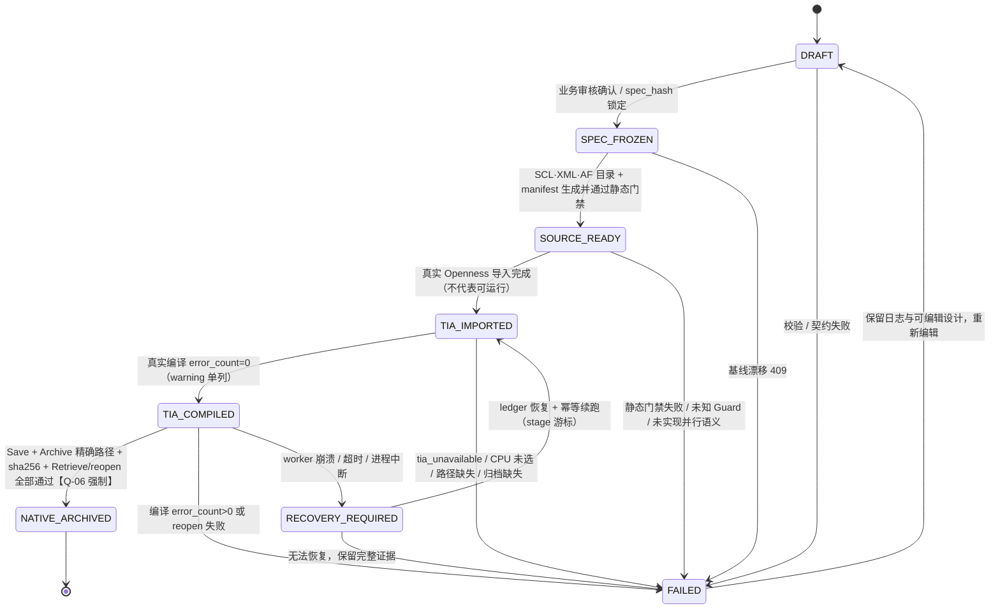
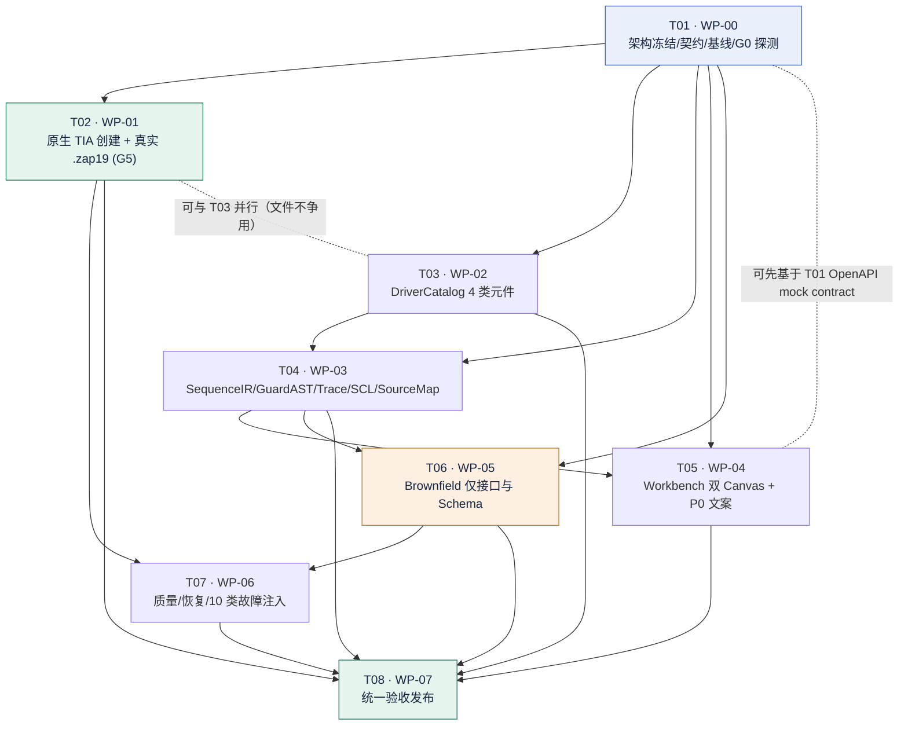

# PLC Agent V2 完全体 · 系统架构设计与任务分解

> 文档类型：系统设计（System Design）+ 可执行任务分解（Work Package Breakdown）
> 撰写：高见远（Gao）· 架构师｜软件团队第 2 阶段产出
> 日期：2026-11-09
> 上游输入：`docs/v2/01-增量PRD.md`（范围冻结稿）、`docs/PLC_Agent_V2_架构设计与开发蓝图.html`（15 章）、`docs/PLC_Agent_V2_开发任务与验收.md`（8 原则 / TASK-00A~06A / API 草案 / AC-01·AC-02）、`README.md`、`AGENTS.md`、主理人 7 条正式裁定
> 下游读者：寇豆码（工程师）· 由主理人齐活林中转
> 状态：**设计冻结稿**。7 条待确认问题已由主理人裁定生效，本文据此冻结，不再列为待确认。
> 证据口径：本文所有「真机」「编译零错误」「归档完成」相关表述均为**目标验收条件，不是已发生事实**；截至本稿，Greenfield 端到端真实编译→归档→reopen 仍未闭环，`xml_package_unverified=true`、M4 未通过，README 的 1341 / 393 为未复跑声明值。全部结论按 offline / mocked / V19 real / `pending_real_machine` 四级留痕。

---

## 0. 执行摘要

### 0.1 本文做什么、不做什么

本文把「V2 完全体」冻结范围转换成**可施工的六层架构、精确文件路径、数据契约、API 契约、持久化状态机与 WP-00→WP-07 连续批次任务**。本文**不写实现代码、不改业务逻辑、不重新选择技术路线**；用户 6 条拍板结论、《开发任务与验收》8 条工程原则、`11-p0d-decision.md` 的 AF Basic 文件夹版结论为不可推翻约束集，只做落地，不做论证。

### 0.2 主理人 7 条裁定 → 设计落地映射（已冻结）

| 裁定 | 设计落地位置 | 冻结结论 |
|---|---|---|
| **Q-01** | §4.3 状态机、§6.4 闸门矩阵、T02 / T08 | **单独列 G5（Greenfield-only）**作为真实 `.zap19` 归档链的验收闸门；G6 降级为「仅接口与 Schema」。G0–G4 / G7 全量适用。 |
| **Q-02** | §8 任务列表 T06 / T07 / T08 完成判据 | WP-05/06/07 完成判据 = 接口 + Schema + 可运行负例注入 + 文档留痕 + 可回归；**WP-05 不做实机闭环**；WP-07 是整体验收发布，非单个巨型 PR；「最终一次性交付」= 全部批次完成后的统一验收交付。 |
| **Q-03** | §2.8 前端文件清单、§5.5 兼容策略、T05 | 旧 4 步向导保留为**独立路由 + 顶栏开关**（feature flag 前端常量，默认新工作台）；第 4 步文案改「源码包就绪（非原生工程）」、删除「交付完成」字样，纳入本期 **P0**。 |
| **Q-04** | §2.4 changeplan、§3 类图、T06 | Brownfield 仅 `SourceBinding` / 最小 `DiffPlan` 数据结构 + API 占位 + 负例拒绝（F-block 不可写、删被引用块被拒、基线漂移被拒、原件不动）；允许 mocked 编排演示但必须显式标注 `mocked`；**不允许任何 V19 real 增删改证据**。 |
| **Q-05** | §2.10 capability manifest、§5.3 GET /capability、T01 | G0 阶段**实机探测**本机装机支持的 CPU 列表，写入 `TiaCapabilityManifest`；由主理人在验收前指定一个已批准 CPU skeleton，未指定时取 manifest 中已验证可 `CreateWithItem` 的第一项并留痕。**G0 验收判据必须含真实探测回执，不能只写文档。** |
| **Q-06** | §4.2 时序图②、§4.3 状态机、T02 | `Retrieve/reopen` **强制通过**才允许置 `NATIVE_ARCHIVED`（按 AC-01 第 5 步与 G5 严口径），不接受「增强项」降级。 |
| **Q-07** | §0.4 基线实况、§8 T01 / T08、§9 共享知识 | **强制实跑** pytest / vitest / dotnet test 并记录真实失败列表；既有基线失败单列 `pre-existing failure` 清单隔离标记、不删内核、不掩盖、不用 mock 顶替；新增代码不得引入新失败；禁止把任何 mock 计入基线通过。设计中已预留 `backup/pre_v2_20261109/baseline_audit.log` 及配套日志作为输入。 |

### 0.3 真实仓库勘察结论（本文最重要的事实校正）

已实际勘察仓库（工作目录 `plc_project/`）。以下为**真实存在的路径**，本文所有文件路径均以此为准；蓝图 §11「重构目录映射」中若干路径为示意/过时，已在此修正。

| 蓝图/PRD 提及 | 真实路径（已核实） | 结论 |
|---|---|---|
| `plc_engine/af/greenfield_ir.py` | `plc_engine/af/greenfield_ir.py`（1586 行） | ✅ 真实；v1 主类 `GreenfieldIR` 在 **af/ 子包内**，不是 `plc_engine/` 根。 |
| `plc_engine/canvas_model.py` / `pcec.py` | 同名，位于 `plc_engine/` 根 | ✅ 真实，保留内核。 |
| `gateway/app/services/plc/` | 真实，含 40+ 服务；**`tia_delivery.py`(2288 行)、`changesets.py`、`canvas_import.py`、`project_store.py`、`greenfield_session.py`、`compile_jobs.py`、`job_store.py`、`workspace.py`、`device_cards.py`** | ✅ 真实。`device_cards.py` / `changesets.py` / `af_import.py` 在 **gateway 侧**，不在 `plc_engine/`（蓝图 §11 有误）。 |
| `gateway/app/routers/` | 仅 `greenfield.py`（prefix `/api/v1/plc/canvas/greenfield`）、`plc.py`（prefix `/api/v1/plc`） | ✅ 真实；`projects_v2.py` 需新建；`main.py:51-52` 为唯一注册点。 |
| `gateway/app/schemas/` | `common.py` / `llm.py` / `plc.py` | ✅ 真实，v2 schema 落此目录。 |
| `industrial/tia_openness_cli/src/TiaOpenness.Server/` | 真实，含 `ProjectService.cs`(1061) / `SessionServer.cs`(350) / `Program.cs` / `BlockService.cs` / `OpennessMutate.cs` 等 | ✅ **注意：`SessionServer.cs` 不在 `tia_openness_cli` 根目录**，在 `src/TiaOpenness.Server/` 下。 |
| `industrial/tia_openness_cli/tests/` | `TiaOpenness.Tests/`（4 个 `*Tests.cs` + `.csproj`） | ✅ 真实，C# 测试增量点。 |
| `frontend/src/shell/` | 真实；`shell/steps/` 含 `StepDescribe/StepLink/StepConfirm/StepDeliver.tsx` + `stepMachine.ts` + 3 个测试 | ✅ 真实。 |
| `frontend/src/state/greenfield.ts` | 真实（1637 行）；`GF_API`、`FORBIDDEN_ENDPOINTS`、导出签名冻结 | ✅ 真实，v2 不得改动其导出签名。 |
| `frontend/src/canvas/` | **真实存在**（`PlcInteractiveCanvas.tsx` 等存量画布） | ⚠️ 蓝图 §13 写「`frontend/src/canvas/*` 新增」会与存量冲突。本文规定**新双 Canvas 放 `frontend/src/workbench/canvas/`**，存量 `frontend/src/canvas/` 保持不动。 |
| `frontend/src/workbench/` | **不存在** | 需新建。 |
| `plc_engine/engineering_ir/`、`components/`、`process/`、`changeplan/` | **均不存在** | 需新建。 |
| `tests/unit/` | 真实（135+ pytest 文件） | ✅ 新增 `test_*_v2.py` 落此；`tests/contracts/`、`tests/snapshots/v2/` 需新建。 |
| `docs/v2/` | 真实，当前仅 `01-增量PRD.md` | ✅ 本文落此目录（不另建 `docs/system_design.md`，避免多份设计文档分叉）。 |

**关键现状缺陷定位（T02 / T05 必须修，且是本期硬价值）**

| # | 缺陷 | 真实位置 | 违反的约束 | 修复任务 |
|---|---|---|---|---|
| D-1 | C# 回执为 `{ok, create:{...}}`，`CreateProjectResult.ProjectPath` 经 `JsonDefaults`（`PropertyNamingPolicy=CamelCase`，见 `TiaOpenness.Models/Models.cs:11`）序列化为 **`create.projectPath`**；但 Python **未解包 `create`**，用 `created.get("path") or created.get("project") or project_dir / f"{name}.ap19"` 兜底猜路径 | `gateway/app/services/plc/tia_delivery.py:1189`；C# `Program.cs:664`、`ProjectService.cs:221` | PRD §6.1 AC-01-1「解包 `create.projectPath` 并 fail-closed，不猜路径」 | T02 |
| D-2 | `ArchiveProject` 在 `File.Exists(archivePath)` 失败时用 `Directory.GetFiles` 候选并取 `candidates[0]` | `industrial/tia_openness_cli/src/TiaOpenness.Server/ProjectService.cs:830` | PRD §4.2「删除任何目录通配找第一个 zap19 逻辑」 | T02 |
| D-3 | 旧 4 步向导第 4 步展示「工程包已就绪」+「本轮交付完成」，把 `SOURCE_READY` 冒充 `NATIVE_ARCHIVED` | `frontend/src/shell/steps/StepDeliver.tsx:47,50`；`stepMachine.ts:215` | Q-03 裁定、PRD §4.2 口径纠正（P0） | T05 |
| D-4 | C# Worker 目标框架为 **`net481`**，且 csproj 注释明确「Siemens.Engineering is .NET Framework 4.8 (Remoting). Must not run on net8+」 | `industrial/tia_openness_cli/src/TiaOpenness.Server/TiaOpenness.Server.csproj:6`、tests csproj:4 | 与任务书「C# .NET 8」表述有差异 | T01 如实记录：本期**保持 net481 不变**（用户硬约束 1「保持公共行为」），.NET 8 理解为构建 SDK/工具链版本，**不迁移 TargetFramework** |

**其他真实契约锚点**：`agents/plc/tia/openness_cli.py:475` 为 `openness_cli` 封装定义；`SessionServer.cs:159-161` 为常驻 STA 会话的 `/open`、`/compile-plc`、`/compile-hmi` 端点；`Program.cs:650/530/645` 为 `create-project` / `archive-project` / `retrieve-project` CLI 命令；`plc_engine/pcec.py` 提供 `new_change / transition / project_baseline / baseline_matches / put_change / get_change`（审批门禁内核，只读复用）。

### 0.4 基线审计实况（Q-07 输入已实际读取）

来源：`backup/pre_v2_20261109/baseline_audit.log`（2026-11-09T21:07:23+08:00）、`baseline_pytest.log`、`baseline_dotnet.log`。

| 项 | 真实结果 | 处置 |
|---|---|---|
| `uv` | 0.9.17 | 记录版本 |
| pytest（tests/） | **`PYTEST_EXIT=1`**，摘要含 **3 个 `F`** + 1 个 `x`（xfail），末尾触发宿主 `SAFE_DELETE_BULK_CONFIRM_REQUIRED`（pytest 临时目录清理拦截） | 3 个 `F` 为 **pre-existing failure**；日志仅给摘要、未列具体测试名 → T01 必须复跑并生成 `docs/v2/pre_existing_failures.md` 明细清单，隔离标记，不删内核、不掩盖、不用 mock 顶替 |
| vitest | 日志段**为空**（未产出结果） | T01 必须实跑 `npm run test -- --pool=threads` 并记录真实 pass/fail |
| dotnet | 日志为 **`dotnet build`**（`DOTNET_EXIT=0`，20 warning / 0 error），**未执行 `dotnet test`** | T01 必须补跑 `dotnet test` 并留痕；20 条 CS86xx 可空引用警告列为既有基线，不改内核 |
| 前端依赖 | React 19.0 / Vite 6 / TS 5.7 / @xyflow/react 12 / mermaid 12 / elkjs / react-markdown / @fontsource/albert-sans；**无 MUI、无 Tailwind** | 印证「零新增 UI 依赖」硬约束 |

> 历史结论（`xml_package_unverified=true`、M4 未通过、Greenfield 端到端未闭环）在新 V19 real 全链证据取得前**不得改口径**；README 1341 / 393 为声明值，不得写成「已验证通过」。

---

# Part A · 系统设计

## 1. 实现方案与框架选型

### 1.1 核心技术难点

| # | 难点 | 设计对策 |
|---|---|---|
| N-1 | **单一真值**：NL / 设备画布 / 步序画布 / Mermaid / Trace / SCL 六处都可能「悄悄」变成第二份可写模型 | `EngineeringIR v2` 为唯一可写语义真值；其余一律为**单向投影**（`derive(ir)` 纯函数）；所有编辑统一走 `POST /api/v2/projects/{id}/patches` 带 `base_revision` 的原子 Patch；前端只持视图/选择状态 |
| N-2 | **状态口径纠正**：`SOURCE_READY` ≠ `NATIVE_ARCHIVED`，且必须后端 job / API 回执 / 前端交付视图三处同时落地 | 后端 `jobs.state` 状态机为唯一权威；API 回执 `state` + `evidence_level` + `native_artifact`；前端交付视图只读后端 Job，禁止本地置成功；`Retrieve/reopen` 强制（Q-06） |
| N-3 | **真实 .zap19 精确绑定**：现状存在猜路径与目录通配（D-1/D-2） | C# 回执精确 `projectPath` / `archivePath`；Python fail-closed 解包；`(project_id, job_id, artifact_id, sha256)` 四元组唯一绑定；下载端禁止目录扫描、禁止浏览器提供任意路径 |
| N-4 | **确定性派生**：同冻结 IR + AFProfile + `template_sha256` 二次生成语义 hash 必须一致 | 语义哈希排除 `views.layout`、时间戳、冻结元数据（沿用 v1 `_canonical_payload()` 策略）；时间戳统一移入 `receipt`；SCL Lowering 用固定扫描顺序 + 稳定 ID + 编号分配器 |
| N-5 | **fail-closed 与单写者**：未知 Guard、并行语义未实现、CPU 未选、双线圈、F-block、基线漂移都不得进入交付 | `unknown == fail`；`ValidationEngine` 9 类静态检查（蓝图 A4）；每项目独占锁 + 一条 C# STA 执行队列；`approve_changeset` / `start_tia_delivery` 不暴露给 LLM |
| N-6 | **崩溃可恢复 + 幂等**：worker 崩溃/超时不能盲目重发非幂等写入 | append-only `job_events` ledger + stage 游标 + `idempotency_key` 唯一约束 + `RECOVERY_REQUIRED` 状态；恢复时先检测现存工程与实际成果再幂等续跑 |
| N-7 | **零字段丢失兼容**：v1 `GreenfieldIR` 20 个顶层字段 + 存量 fixture 必须零丢失，且不得改公共行为 | `V1ToV2Adapter` 单向适配 + `legacy_raw` 不透明旁路袋；golden roundtrip 测试；旧 4 步向导独立路由保留（Q-03） |
| N-8 | **证据不越级**：offline / mocked / V19 real 不得互相外推 | `EvidenceLevel` 为 API 回执、job event、artifact、UI 徽标的一等公民；`compile_ok = error_count==0 ∧ static_gate_passed ∧ 存在真实回执`；`warning_count` 单列 |

### 1.2 技术栈沿用与「不引入新依赖」的理由

| 层 | 沿用栈（真实版本） | 为何不引入新依赖 |
|---|---|---|
| 前端 | React 19 + Vite 6 + TypeScript 5.7 + `@xyflow/react` 12 + `mermaid` 12 + `elkjs` + **纯 CSS**（工业蓝图/制图室） | 用户硬约束 1「物理不删内核、其余按 V2 重写」+ PRD §0「零新增 UI 依赖」。引入 MUI/Tailwind 会同时破坏既有 `greenfield.css` / `steps.css` 视觉体系、20+ 既有 vitest 契约测试与「零新增依赖」基线声明；`@xyflow/react` 已足以实现双 Canvas 自定义节点/命名端口 |
| 后端 | FastAPI（pydantic 2.9+）+ Python 3.13（pyproject `requires-python>=3.11`）、`uv` 0.9.17、SQLite WAL（标准库 `sqlite3`，无新 ORM） | 唯一网关 `gateway/app` 已成熟；引入 SQLAlchemy/新 ORM 会增加迁移成本且无收益；`httpx` / `pytest` / `pytest-asyncio` / `ruff` 已在 dev 依赖 |
| Worker | C# / **net481** + `Siemens.Engineering` V19 Openness（常驻 STA 会话 `SessionServer.cs`） | 见 D-4：Siemens.Engineering 依赖 .NET Framework 4.8 Remoting，**迁移 net8 会破坏内核公共行为**，与用户硬约束 1 直接冲突；本期只做增量点，**不换框架、不换 TargetFramework** |
| 存储 | SQLite WAL + 版本化 JSON IR 文件 + hash 命名 Artifact Store | 蓝图 §10 明确本地实施优先；PostgreSQL/对象存储属 P2（多用户部署），本期不阻塞 V19 原生交付闭环 |
| 测试 | pytest 8.3+ / vitest 5 / `dotnet test`（net481 测试项目） | 与基线一致，保证 Q-07 可比对的真实失败列表 |

**明令禁止**：复制 `plc_gateway/` 建第三套后端；同时维护 `GreenfieldIR / CanvasState / ProjectIR` 三份可任意写入的模型；新增前端 UI 框架依赖；把 mock/offline 设计成真机等价。

### 1.3 迁移顺序（蓝图 §11，用户硬约束 1）

严格按 **「扩展原模块 → adapter 兼容 → 提取共享服务」** 三步，禁止推倒重写：

1. **扩展原模块**：在 `plc_engine/engineering_ir/` 定义 v2 模型（新文件），`plc_engine/components/`、`process/`、`changeplan/` 同样新建；`gateway/app/services/plc/*_v2.py` 与 `routers/projects_v2.py` 为新增文件。
2. **adapter 兼容**：`V1ToV2Adapter` 包装 `plc_engine/af/greenfield_ir.py`（只读）；`PcecApprovalAdapter` 包装 `plc_engine/pcec.py`（只读）；`AfLoweringAdapter` 包装 `plc_engine/af/af_generator.py`（只读）；`OpennessCliAdapter` 包装 `agents/plc/tia/openness_cli.py` 与 `gateway/app/services/plc/tia_delivery.py`（只读）；`CanvasImportAdapter` 包装 `gateway/app/services/plc/canvas_import.py`。
3. **提取共享服务**：把跨 v1/v2 的持久化/哈希/证据标注抽到 `gateway/app/services/plc/workspace_v2.py` 与 `evidence_v2.py`，v1 路由保持公共行为不变，通过同一应用服务读取（不复制）。

### 1.4 六层架构与写入边界



**写入权限矩阵（不可越权）**

| 能力 | L1 前端 | L2 Intent/LLM | L3 内核 | L4 Coordinator | L6 Worker |
|---|---|---|---|---|---|
| 读写 EngineeringIR | ❌（只发 Patch） | ❌（只产 CandidatePatch） | ✅ 唯一原子写 | 读 | ❌ |
| 写派生物（Trace/SCL/Mermaid） | ❌ | ❌ | ✅ 单向派生 | 读 | ❌ |
| 批准 ChangeSet | ❌ | ❌ | ❌ | ✅ 显式人工（`explicit=True`） | ❌ |
| 调用写入型 TIA 工具 | ❌ | ❌ | ❌ | ✅ **唯一入口** | ✅ 被调度 |
| 置 `NATIVE_ARCHIVED` | ❌ | ❌ | ❌ | ✅ 全链成功后 | ❌ |

### 1.5 单一真值与派生物原则

- `EngineeringIR v2` 是**唯一可写语义真值**；DeviceGraph / SequenceCanvas / Mermaid / Trace / SCL / SourceMap / ChangeSet 全部为 `derive(ir)` 的**单向投影**，虚线只表示可定位回溯（SourceMap 反查），**不表示写回**。
- 语义哈希（`ir_sha256`）**排除 UI layout**（步骤位置、缩放、颜色）、时间戳、冻结元数据；这些字段变动不触发 SCL 重新生成。
- `compile_ok = error_count == 0 ∧ static_gate_passed ∧ 存在真实回执`；`warning_count` 单列，禁止并入成功。

---

## 2. 六层文件清单（精确相对路径 · 基于 `plc_project/`）

> 约定：新增 Python 模块统一 `*_v2.py`；新增测试统一 `test_*_v2.py`；新增前端集中在 `frontend/src/workbench/`。**「所有权」列标注该 WP 独占写，其他 WP 只读或禁止改**，用于避免并行冲突。

### 2.1 `plc_engine/engineering_ir/`（新目录 · IR 单一真值）

| 文件 | 职责 | 复用/接入 | 所有权 |
|---|---|---|---|
| `__init__.py` | 导出 `ProjectWorkspace` / `EngineeringIRV2` 等 | — | WP-00 独占 |
| `contracts.py` | schema 版本常量 `engineering-ir/2.0`、`EvidenceLevel`、`AF_PROFILE_ID`、ID 规则、错误码枚举 | 蓝图 §13 WP-00 | WP-00 独占 |
| `models.py` | `ProjectWorkspace` / `AFProfile` / `HardwareIntent` / `EngineeringIRV2` / `ImportedSnapshot` 数据类 | 沿用 v1 `canonical_dumps` / `sha256_prefixed`（`greenfield_ir.py:178-192`） | WP-00 独占 |
| `v1_adapter.py` | `V1ToV2Adapter.to_v2()` / `to_v1_view()`；`legacy_raw` 零丢失旁路 | 只读 `plc_engine/af/greenfield_ir.py`（`GreenfieldIR.to_dict/from_dict/ir_sha256`）、`canvas_model.py` | WP-00 独占 |
| `patch.py` | `CandidatePatch` / `SequencePatch` / `ChangeOp` / `PatchResult`；原子 apply、`base_revision` 校验、`request_id` 幂等 | 只读 v1 `IRPatch` / `CanvasPatch` / `PatchResult`（`greenfield_ir.py:644/755/795`） | WP-00 独占 |
| `hashing.py` | `semantic_hash()` / `ir_sha256()` / `spec_hash()`；排除 layout/时间戳；稳定 ID 校验 | 复用 v1 `_canonical_payload()` 策略 | WP-00 独占 |
| `validation.py` | schema/类型/未知引用/单写者/版本 的确定性校验入口 | 复用 `plc_engine/af/greenfield_validator.py`（只读） | WP-00 定义、WP-02/03 扩展（同文件按 WP 顺序串行，不并行改） |
| `evidence.py` | `EvidenceLevel` 枚举 + `EvidenceTag`（`offline` / `mocked` / `V19_real` / `pending_real_machine`） | 全层共用 | WP-00 独占 |

### 2.2 `plc_engine/components/`（新目录 · 4 类元件 DriverCatalog）

| 文件 | 职责 | 复用/接入 | 所有权 |
|---|---|---|---|
| `__init__.py` / `catalog.py` | `DriverCatalog` 注册表；`component_type → DriverSpec 模板` | 只读 `plc_engine/af/af_model.py`、`gateway/app/services/plc/device_cards.py` | WP-02 独占 |
| `driver_spec.py` | `ComponentDefinition` / `DriverSpec` / `TypedPort`；字段来源 `user_explicit/inferred/imported/library_default` | — | WP-02 独占 |
| `driver_fsm.py` | `IDLE→EXTENDING→EXTENDED→RETRACTING→RETRACTED` + `FAULT`；手自动仲裁、SafetyPermit | — | WP-02 独占 |
| `driver_compiler.py` | `DriverCompiler`：DriverSpec → AF CM 控制节点 / UDT / FB 接口 | 只读 `plc_engine/af/af_generator.py` / `af_mapper.py`，经 `AfLoweringAdapter` | WP-02 独占 |
| `driver_validation.py` | 必需端口、超时、反馈、反向互斥、单写者、`io_bindings=null` 校验（蓝图 A2） | — | WP-02 独占 |
| `templates/*.json` | 4 类模板：`double_acting_cylinder` / `single_acting_actuator` / `di_do` / `motor_starter`；正式 LBC 与 self-contained 显式区分 | 复用 `af/greenfield_ports.py`（只读） | WP-02 独占 |

### 2.3 `plc_engine/process/`（新目录 · SequenceIR / GuardAST / Trace / SCL Lowering）

| 文件 | 职责 | 复用/接入 | 所有权 |
|---|---|---|---|
| `__init__.py` / `guard_ast.py` | 强类型 `GuardAST`（BOOL/TIME/INT、AND/OR/NOT/比较）；**禁止 eval / 自由文本** | — | WP-03 独占 |
| `sequence_ir.py` | `SequenceIR` / `Step` / `Transition` / `Action` / `Exception` / `Mode`；`parallel_groups` 仅可展示 | — | WP-03 独占 |
| `graph_validation.py` | BFS 可达性、Tarjan SCC、分支优先级/互斥、Fault 路径、命令资源冲突、未实现并行语义 fail-closed（蓝图 A3/A4） | 复用 `plc_engine/dependency_closure.py`（只读） | WP-03 独占 |
| `scan_simulator.py` | 确定性扫描周期模拟器；`Scenario → TraceFrame[]`；失败返回最短反例路径（蓝图 A5） | 与 SCL Lowering 共享语义规则 | WP-03 独占 |
| `scl_lowering.py` | IR → AF 角色/UDT/FB/DB/FC/OB 确定性降低；`source_id` 注解；依赖图与导入顺序（蓝图 A6） | 经 `AfLoweringAdapter` 只读 `plc_engine/af/*`；复用 `scl_precheck.py` | WP-03 独占 |
| `source_map.py` | `SourceMap` N:N：Canvas 节点 ↔ IR ID ↔ SCL 行 ↔ TIA 块；编译错误反向定位 | 复用 `plc_engine/af/compat_adapter.py`（只读） | WP-03 独占 |
| `artifact_manifest.py` | `ArtifactManifest{files, sha256, import_order, dependencies}` | — | WP-03 独占 |
| `af_adapter_v2.py` | `AfLoweringAdapter`（af 内核只读包装） | **禁止直接改 `af_generator.py` 主体** | WP-03 独占 |

### 2.4 `plc_engine/changeplan/`（新目录 · Brownfield **仅接口与 Schema**，Q-04）

| 文件 | 职责 | 复用/接入 | 所有权 |
|---|---|---|---|
| `__init__.py` / `source_binding.py` | `SourceBinding`：`source_block_id / original_hash / source_span / ir_ids / writable=requires_review / referenced_by / fidelity` | 只读 `gateway/app/services/plc/canvas_import.py`、`af_import.py` | WP-05 独占 |
| `diff_plan.py` | **最小 `DiffPlan` 数据结构**（ADD/MODIFY/KEEP/DELETE 声明 + 依赖闭包 + 基线哈希），**不含实机执行体** | — | WP-05 独占 |
| `impact_closure.py` | 反向引用闭包接口（仅数据结构与查询，不写 TIA） | 只读 `plc_engine/dependency_closure.py` | WP-05 独占 |
| `brownfield_guard.py` | 4 类负例拒绝：F-block 不可写 / 删被引用块被拒 / 基线漂移被拒 / 原件不动 | 只读 `pcec.baseline_matches`（经 adapter） | WP-05 独占 |
| `mocked_orchestrator.py` | 可选 mocked 编排演示，**响应强制 `evidence_level=mocked`** | 绝不调用真实 Openness 写入 | WP-05 独占 |

### 2.5 `gateway/app/services/plc/*_v2.py`（新增服务，不改既有服务公共行为）

| 文件 | 职责 | 复用/接入 | 所有权 |
|---|---|---|---|
| `workspace_v2.py` | `WorkspaceService_v2`：SQLite WAL CRUD、revision 分配、IR 版本化 JSON 存取、项目锁 | 只读 `project_store.py` / `greenfield_session.py` / `workspace.py` | WP-00 定义、WP-01/06 串行扩展 |
| `engineering_service_v2.py` | `EngineeringService_v2`：候选副本原子 apply Patch、validate、freeze、changeset | `engineering_ir/*` | WP-00 定义、WP-03 扩展 |
| `intent_service_v2.py` | `IntentService_v2`：NL → 结构化意图 → 对象引用 → CandidatePatch（**不写 IR、不写 TIA**） | 只读 `greenfield_draft_llm.py` / `chat_intents.py` / `greenfield_chat.py` | WP-02 独占 |
| `validation_v2.py` | 服务层校验编排（调用内核 `validation.py`） | — | WP-00 独占 |
| `derivation_v2.py` | 派生物重算编排：DeviceGraph / Mermaid / Trace / SCL / SourceMap；`source_map_dirty` 标记 | `plc_engine/process/*` | WP-03 独占 |
| `approval_v2.py` | `PcecApprovalAdapter`：**只读包装 `plc_engine/pcec.py`**，显式人工批准 + 基线复查 | 禁止改 `pcec.py` 公共行为 | WP-01 独占 |
| `tia_delivery_v2.py` | `TiaOpennessCliAdapter`：精确解包 `create.projectPath` / `archivePath`，fail-closed；封装 Create/Open→Import→Compile→Save→Archive→Retrieve/reopen | 只读 `tia_delivery.py`、`agents/plc/tia/openness_cli.py` | WP-01 独占（**不删 `tia_delivery.py`**） |
| `native_artifact_v2.py` | `NativeTiaArtifact` 构建、sha256、evidence bundle、四元组绑定 | — | WP-01 独占 |
| `delivery_jobs_v2.py` | `DeliveryCoordinator`：状态机、项目独占锁、`idempotency_key`、`202+job_id` | 只读 `compile_jobs.py` / `job_store.py` | WP-01 定义、WP-06 扩展 |
| `artifact_store_v2.py` | hash 命名 Artifact Store、路径白名单、精确授权下载 | — | WP-01 独占 |
| `job_ledger_v2.py` | append-only `job_events`、stage 游标、崩溃恢复、`RECOVERY_REQUIRED` | — | WP-06 独占 |
| `project_lock_v2.py` | 每项目独占锁、worker lease、STA 队列串行 | — | WP-06 独占 |
| `recovery_v2.py` | 检测现存工程/实际成果后幂等续跑 | — | WP-06 独占 |
| `path_whitelist_v2.py` | 路径白名单、拒绝浏览器任意路径（`download` 不接受路径参数） | 复用 `gateway/app/services/plc/paths.py`（只读） | WP-06 独占 |
| `evidence_v2.py` | 证据等级标注、receipt 生成、`pending_real_machine` 强制注入 | — | WP-00 定义、WP-06 收口 |
| `brownfield_v2.py` | Brownfield API 占位 + 负例拒绝（**无实机增删改**） | `changeplan/*` | WP-05 独占 |
| `capability_v2.py` | `TiaCapabilityManifest` 生成与读取（G0 实机探测回执） | C# `status` 探针 | WP-00 独占 |

### 2.6 `gateway/app/routers/` 与 `gateway/app/schemas/`

| 文件 | 职责 | 复用/接入 | 所有权 |
|---|---|---|---|
| `routers/projects_v2.py`（新建） | 全部 `/api/v2/*` 端点；`ApiResponse` 信封；`409/422/202/503` | `gateway/app/main.py:51-52` 注册（**唯一增量点**） | WP-00 定义骨架，WP-01/03/05 按端点串行扩展 |
| `schemas/v2_common.py`（新建） | 公共请求/响应模型、错误码、`EvidenceTag` | `schemas/common.py`（只读） | WP-00 独占 |
| `schemas/v2_ir.py` / `v2_delivery.py` / `v2_brownfield.py`（新建） | 分组请求/响应 schema | — | WP-00 / WP-01 / WP-05 |
| `routers/greenfield.py` / `plc.py` | **v1 兼容路由，公共行为不变** | — | 禁止改公共行为；仅 `main.py` 增加一行 include |

### 2.7 `industrial/tia_openness_cli/` 增量点（**只做增量，保持公共行为**）

| 文件 | 增量内容 | 所有权 |
|---|---|---|
| `src/TiaOpenness.Server/ProjectService.cs` | 删除 `ArchiveProject` 中 `candidates[0]` 目录通配（第 830 行）；`ArchiveProjectResult` 只返回**精确 `ArchivePath`**（`Path.Combine(dir,name)`），文件不存在即 `archive_missing` 失败；补 `archive_sha256` 回执 | WP-01 |
| `src/TiaOpenness.Server/Program.cs` | `create-project` 回执固定 `{ok, create:{projectPath}}`（已符合，加契约 golden test）；`archive-project` / `retrieve-project` 回执固定精确路径 + `sha256` + `reopen_ok` | WP-01 |
| `src/TiaOpenness.Server/SessionServer.cs` | 新增 `/delivery-chain` 受控端点（Create/Open → Import → Compile → Save → Archive 单事务），保持既有 `/open` `/compile-plc` 行为；STA 单队列 + 项目独占 | WP-01 |
| `src/TiaOpenness.Models/Models.cs` | 新增 `DeliveryChainReceipt` / `ExactArchiveResult` DTO（**CamelCase 命名策略不变**） | WP-01 |
| `tests/TiaOpenness.Tests/ArchiveContractTests.cs`（新建） | 精确路径、无通配、`create.projectPath` 契约、`archive_missing` 负例 | WP-01 |
| `README.md` | 记录 V19 真机命令与回执样例 | WP-01 |
| **其余 `.cs`** | `BlockService.cs` / `OpennessMutate.cs` / `ExportSurface.cs` / `HmiCompile.cs` 等**保持公共行为** | 禁止改 |

> ⚠️ `SessionServer.cs` 位于 `industrial/tia_openness_cli/src/TiaOpenness.Server/`，**不在 `tia_openness_cli/` 根目录**。TargetFramework 保持 `net481`（D-4）。

### 2.8 `frontend/src/workbench/`（新目录 · 六视图 + 兼容回退）

| 文件 | 职责 | 复用/接入 | 所有权 |
|---|---|---|---|
| `WorkbenchShell.tsx` / `workbench.css` | 三栏布局（左 240 / 中弹性 / 右 340）+ 顶部身份条 + 底部 diagnostics | 纯 CSS，沿用 `index.css` 变量 | WP-04 |
| `ProjectTree.tsx` | ① 项目总览 / 项目树 / 变更历史 | — | WP-04 |
| `canvas/DeviceCanvas.tsx` | ② 元器件驱动：typed ports、属性面板、`io_bindings=unbound` | `@xyflow/react` 已有 | WP-04 |
| `canvas/SequenceCanvas.tsx` + `canvas/SequenceEditor.tsx` | ③ **双 Canvas 双向编辑核心**：Step/Transition/Action 自定义节点、命名端口、双击编辑、Fork/Join 可展示但阻止交付 | `@xyflow/react` | WP-04 |
| `canvas/nodes/*.tsx` | StepNode / TransitionNode / ActionNode / FaultNode | — | WP-04 |
| `TraceView.tsx` | ④ 离线 Trace 波形 + 5 场景 + 「预测，不是实机验证」标题 + 最短反例路径 + Trace 区间点击定位 | `mermaid`/纯 SVG | WP-04 |
| `DiffReview.tsx` | ⑤ 变更审核：Before/After、依赖闭包、基线 sha256、删除/安全块计数、显式人工批准 | — | WP-04 |
| `DeliveryView.tsx` | ⑥ TIA 交付：6 步日志、两类产物分列、交付状态**只读后端 Job**、`pending_real_machine`、无真机不显示下载按钮 | — | WP-04 |
| `Inspector.tsx` / `DiagnosticsPane.tsx` / `EvidenceBadge.tsx` / `GuardAstEditor.tsx` | 右侧 Inspector（源数据来自服务端 IR）、底部诊断反定位、证据等级徽标常量、Guard AST 结构化编辑（禁自由文本） | — | WP-04 |
| `featureFlags.ts` | `V2_WORKBENCH_DEFAULT = true`；顶栏开关（独立路由） | Q-03 裁定 | WP-04 |
| `../state/workbench_v2.ts`（`frontend/src/state/`） | v2 API Facade（沿用 `gfRequest` 解信封逻辑，**不改 `greenfield.ts` 导出签名**） | 只读 `state/greenfield.ts` 的 `gfRequest` / `GFRequestError` | WP-04 |
| `App.tsx` | **增量 1 行级**：注册 workbench 路由 + 顶栏开关 | 既有 `App.tsx` | WP-04 |
| `../shell/steps/StepDeliver.tsx`、`../shell/steps/stepMachine.ts` | **P0 文案纠正**：`工程包已就绪` → `源码包就绪（非原生工程）`；删除 `本轮交付完成` | Q-03 裁定、D-3 | WP-04 |
| `*.test.tsx`（workbench 内） | 409 冲突恢复、422 节点标注、刷新不丢失、无真机无下载按钮、旧向导 fixture 零字段丢失 | vitest | WP-04 |

> **禁止**：改 `frontend/src/state/greenfield.ts` 的导出签名与 `FORBIDDEN_ENDPOINTS`；改存量 `frontend/src/canvas/**`；让前端持有工程真值或自行标记交付成功。

### 2.9 测试与文档

| 路径 | 内容 | 所有权 |
|---|---|---|
| `tests/contracts/`（新建） | `test_api_v2_contract.py`、`test_ir_v2_schema.py`、`test_create_projectpath_contract.py`、golden JSON | WP-00 |
| `tests/unit/test_engineering_ir_v2.py`、`test_v1_adapter_v2.py`、`test_patch_atomic_v2.py` | IR roundtrip / 零字段丢失 / 100 次随机 Patch / 409 / 422 | WP-00 |
| `tests/unit/test_driver_*_v2.py` | 4 类元件属性测试 + 负例 | WP-02 |
| `tests/unit/test_guard_ast_v2.py`、`test_sequence_graph_v2.py`、`test_scan_trace_v2.py`、`test_scl_lowering_v2.py`、`test_source_map_v2.py` | 图算法 / 5 场景 / golden / N:N 映射 | WP-03 |
| `tests/snapshots/v2/`（新建） | SCL golden files、Trace 波形快照 | WP-03 |
| `tests/unit/test_native_delivery_v2.py`、`test_artifact_binding_v2.py`、`test_retrieve_reopen_v2.py` | 精确路径 / 四元组 / Q-06 强制 reopen | WP-01 |
| `tests/unit/test_source_binding_v2.py`、`test_brownfield_negative_v2.py` | Schema + 4 类负例拒绝 | WP-05 |
| `tests/unit/test_fault_injection_v2.py`、`test_idempotency_v2.py`、`test_recovery_v2.py` | ≥10 类故障注入 | WP-06 |
| `tests/unit/test_acceptance_v2.py` | 整体验收编排回归 | WP-07 |
| `docs/v2/02-架构设计与任务分解.md`（本文）、`class-diagram.mermaid`、`sequence-diagram.mermaid` | 系统设计 | 本阶段 |
| `docs/v2/contracts/`（新建） | `engineering_ir_v2.schema.json`、`af_profile.json`、`tia_capability_manifest.json`、`api_v2.openapi.json` | WP-00 |
| `docs/v2/baseline-report.md`、`pre_existing_failures.md`、`brownfield-interface-contract.md`、`fault-injection-matrix.md`、`g0-g7-matrix.md`、`03-验收矩阵.md`、`04-交付报告.md` | 各批留痕 | WP-00 / 05 / 06 / 07 |
| `evidence/v2/`（新建，由主 agent 收口） | 每批真实回执台账；**历史 `evidence/*.json` 不改写** | 全部 WP |

### 2.10 文件所有权与并行冲突矩阵

| WP | 独占写（不得被其他 WP 同时改） | 只读复用 | 禁止改 |
|---|---|---|---|
| WP-00 | `engineering_ir/**`、`contracts/**`、`schemas/v2_*`、`capability_v2.py`、`workspace_v2.py`(骨架)、`docs/v2/contracts/**`、`tests/contracts/**`、`test_*_ir_v2.py` | `greenfield_ir.py`、`canvas_model.py`、`pcec.py`、`project_store.py` | 内核公共行为、v1 路由 |
| WP-01 | `tia_delivery_v2.py`、`native_artifact_v2.py`、`delivery_jobs_v2.py`、`artifact_store_v2.py`、`approval_v2.py`、`routers/projects_v2.py`(delivery 部分)、C# 4 个增量文件 + `ArchiveContractTests.cs` | `tia_delivery.py`、`agents/plc/tia/openness_cli.py`、`compile_jobs.py`、`job_store.py` | `tia_delivery.py` 公共行为、C# 其余 `.cs`、`plc_gateway/**` |
| WP-02 | `components/**`、`intent_service_v2.py`、`test_driver_*_v2.py` | `af_model.py`、`af_generator.py`、`device_cards.py`、`greenfield_draft_llm.py` | `af_generator.py` 主体 |
| WP-03 | `process/**`、`derivation_v2.py`、`test_*_process_v2.py`、`snapshots/v2/**` | `af/**`（经 adapter）、`dependency_closure.py`、`scl_precheck.py` | `af_generator.py` 主体、UI |
| WP-04 | `frontend/src/workbench/**`、`state/workbench_v2.ts`、`App.tsx`(增量)、`StepDeliver.tsx`/`stepMachine.ts`(文案) | `state/greenfield.ts`（`gfRequest`）、`canvas/**` | `greenfield.ts` 导出签名、`canvas/**` |
| WP-05 | `changeplan/**`、`brownfield_v2.py`、`routers/projects_v2.py`(占位部分)、`test_brownfield_*_v2.py` | `canvas_import.py`、`af_import.py`、`pcec.py` | 任何真实 Openness 写入路径 |
| WP-06 | `job_ledger_v2.py`、`project_lock_v2.py`、`recovery_v2.py`、`path_whitelist_v2.py`、`evidence_v2.py`(收口)、`test_fault_*_v2.py` | `delivery_jobs_v2.py`（串行扩展） | 他人独占文件 |
| WP-07 | `docs/v2/03,04`、`g0-g7-matrix.md`、`evidence/v2/**`、`test_acceptance_v2.py`、README 增量 | 全部 | 历史 `evidence/*.json`、61 份历史 docs |

**并行规则**：WP-01（TIA/C# 链）与 WP-02（Driver 内核）文件不争用，可并行；WP-03 依赖 WP-02 的命令端口契约；WP-04 可基于 WP-00 的 OpenAPI schema 先行 mock contract；**TIA 真机连接全程串行**（项目独占锁 + 一条 STA 队列）；**IR schema 变更由 WP-00 单一角色独占**，其余 WP 只读。

### 2.11 明令禁止创建/修改的路径

`plc_gateway/**`（禁止第三套后端）· `plc_engine/af/greenfield_ir.py`（`to_dict/from_dict/ir_sha256` 语义）· `plc_engine/pcec.py` · `plc_engine/af/af_generator.py` 主体 · `frontend/src/state/greenfield.ts` 导出签名与 `FORBIDDEN_ENDPOINTS` · `frontend/src/canvas/**` · `industrial/tia_openness_cli/src/TiaOpenness.Server/*.cs` 中除 §2.7 列出的增量点 · `evidence/*.json` 历史台账 · `docs/` 下 61 份历史文档。

---

## 3. 数据结构与接口（Mermaid 类图）

> 完整可渲染版本另存 `docs/v2/class-diagram.mermaid`。

```mermaid
classDiagram
    class ProjectWorkspace {
        +str project_id
        +str origin
        +str tia_version
        +str baseline_hash
        +int current_revision
        +str state
        +str evidence_level
        +list~str~ artifact_ids
        +read_ir() EngineeringIRV2
        +commit_patch(patch) PatchResult
    }
    class AFProfile {
        +str profile_id
        +str library_id
        +str library_version
        +str template_sha256
        +str number_policy
        +str folder_tree
    }
    class HardwareIntent {
        +str cpu_template
        +str io_binding
        +str device_type_identifier
        +str capability_receipt_id
    }
    class ImportedSnapshot {
        +str snapshot_id
        +str original_archive_hash
        +dict block_index
        +str hardware_hash
        +str safety_block_hash
    }
    class EngineeringIRV2 {
        +str schema_version
        +str project_id
        +int revision
        +str ir_sha256
        +dict legacy_raw
        +semantic_hash() str
        +derive_all() DerivedBundle
    }
    class ComponentDefinition {
        +str id
        +str name
        +str component_type
        +str driver_template
        +str source
        +dict io_bindings
    }
    class DriverSpec {
        +str id
        +str component_type
        +dict typed_ports
        +dict parameters
        +list~str~ states
        +list~dict~ transitions
        +str failure_policy
        +str compile_mode
        +bool safety_permit_required
    }
    class SequenceIR {
        +str id
        +str mode
        +str initial_step
        +list~Step~ steps
        +list~Transition~ transitions
        +list~Exception~ exceptions
        +list~dict~ parallel_groups
    }
    class Step {
        +str id
        +list~Action~ entry_actions
        +list~Action~ cyclic_actions
        +int min_duration_ms
        +int max_duration_ms
        +str failure_target
    }
    class Transition {
        +str id
        +str from_step
        +str to_step
        +GuardAST guard_ast
        +int priority
        +str edge_type
    }
    class GuardAST {
        +str node_type
        +str value_type
        +str signal
        +list~GuardAST~ children
        +evaluate(snapshot) bool
        +validate_types() list~str~
    }
    class SourceBinding {
        +str source_id
        +str tia_path
        +str block_type
        +int block_number
        +str original_xml_sha256
        +list~str~ referenced_by
        +list~str~ ir_entities
        +str writable
        +str fidelity
    }
    class DiffPlan {
        +str plan_id
        +list~dict~ ops
        +list~str~ impact_closure
        +str baseline_hash
        +bool executable
    }
    class CandidatePatch {
        +str candidate_id
        +int base_revision
        +str before_hash
        +str after_hash
        +list~ChangeOp~ ops
        +str explanation
    }
    class ChangeOp {
        +str op
        +str target_source_id
        +str ir_id
        +dict payload
    }
    class ChangeSet {
        +str id
        +str project_id
        +int base_revision
        +str before_hash
        +str after_hash
        +str spec_hash
        +str status
        +list~ChangeOp~ ops
        +dict impacts
        +ValidationReport validation
    }
    class ArtifactManifest {
        +str manifest_id
        +list~dict~ files
        +list~str~ import_order
        +dict dependencies
        +str sha256
        +str af_profile_id
    }
    class SourceMap {
        +str map_id
        +list~dict~ mappings
        +locate(tia_block, line) IRRef
        +reverse_locate(ir_id) list~SclRef~
    }
    class NativeTiaArtifact {
        +str artifact_id
        +str job_id
        +str project_id
        +str project_path
        +str archive_path
        +str archive_sha256
        +int size_bytes
        +str kind
        +CompileReceipt compile
        +str evidence_id
        +str evidence_level
        +bool reopen_ok
    }
    class CompileReceipt {
        +str state
        +int error_count
        +int warning_count
        +str raw_api_receipt
        +bool static_gate_passed
        +bool compile_ok
    }
    class ValidationReport {
        +bool passed
        +list~dict~ issues
        +str unchanged_ir_hash
    }
    class PatchResult {
        +int revision
        +str ir_sha256
        +list~str~ changed_ir_ids
        +list~str~ source_map_dirty
        +list~str~ warnings
    }
    class V1ToV2Adapter {
        +to_v2(v1_ir) EngineeringIRV2
        +to_v1_view(v2_ir) dict
        +assert_zero_field_loss(v1_ir, v2_ir) bool
    }
    class ValidationEngine {
        +validate(ir) ValidationReport
        +validate_patch(ir, patch) ValidationReport
    }
    class CompilerService {
        +lower(ir, profile) ArtifactManifest
        +build_source_map(ir, manifest) SourceMap
    }
    class ScanSimulator {
        +run(ir, scenario) list~TraceFrame~
        +shortest_counterexample(ir) list~str~
    }
    class ApprovalGate {
        +freeze(changeset) ChangeSet
        +approve(id, reviewer, explicit) bool
        +recheck_baseline(hash) bool
    }
    class DeliveryCoordinator {
        +start(approved_id, baseline_hash, idem_key) str
        +run_chain(job_id) bool
        +recover(job_id) bool
    }
    class ArtifactService {
        +store(path, kind) str
        +authorize(project_id, job_id, artifact_id, sha256) bool
        +download(artifact_id) bytes
    }
    class TiaOpennessWorker {
        +create_project(dir, name) dict
        +open_project(path) dict
        +import_blocks(order) dict
        +compile() CompileReceipt
        +save() dict
        +archive() dict
        +retrieve_reopen(archive) dict
    }
    class WorkspaceServiceV2 {
        +get_ir(project_id) EngineeringIRV2
        +commit(project_id, patch) PatchResult
        +next_revision(project_id) int
    }
    class EvidenceTag {
        <<enumeration>>
        OFFLINE
        MOCKED
        V19_REAL
        PENDING_REAL_MACHINE
    }

    ProjectWorkspace "1" *-- "1" AFProfile : owns(pinned)
    ProjectWorkspace "1" *-- "1" HardwareIntent : owns
    ProjectWorkspace "1" o-- "0..1" ImportedSnapshot : brownfield_only
    ProjectWorkspace "1" *-- "1" EngineeringIRV2 : authoritative
    EngineeringIRV2 "1" *-- "0..*" ComponentDefinition : components
    EngineeringIRV2 "1" *-- "1" SequenceIR : process
    EngineeringIRV2 "1" *-- "0..*" SourceBinding : source_bindings
    ComponentDefinition "1" *-- "1" DriverSpec : driven_by
    SequenceIR "1" *-- "1..*" Step : steps
    SequenceIR "1" *-- "0..*" Transition : transitions
    Transition "1" *-- "1" GuardAST : guard
    CandidatePatch "1" *-- "1..*" ChangeOp : ops
    ChangeSet "1" *-- "1..*" ChangeOp : ops
    ChangeSet ..> EngineeringIRV2 : base_revision / before_hash
    SourceBinding ..> DiffPlan : feeds(interface_only)
    DiffPlan ..> SourceBinding : references
    V1ToV2Adapter ..> EngineeringIRV2 : produces
    V1ToV2Adapter ..> ProjectWorkspace : legacy_raw
    ValidationEngine ..> ValidationReport : produces
    WorkspaceServiceV2 ..> ValidationEngine : calls
    WorkspaceServiceV2 ..> PatchResult : returns
    CompilerService ..> ArtifactManifest : produces
    CompilerService ..> SourceMap : produces
    CompilerService ..> EngineeringIRV2 : reads(never_writes)
    ScanSimulator ..> SequenceIR : reads
    SourceMap ..> ArtifactManifest : N:N mapping
    ApprovalGate ..> ChangeSet : freezes / approves
    ApprovalGate ..> SourceBinding : writable check
    DeliveryCoordinator ..> ApprovalGate : requires(explicit)
    DeliveryCoordinator ..> ArtifactManifest : consumes
    DeliveryCoordinator ..> TiaOpennessWorker : single_writer(STA)
    DeliveryCoordinator ..> NativeTiaArtifact : produces
    NativeTiaArtifact "1" *-- "1" CompileReceipt : compile
    NativeTiaArtifact ..> ArtifactService : registered_by(4-tuple)
    ArtifactService ..> ProjectWorkspace : artifact_ids
    EvidenceTag ..> NativeTiaArtifact : stamps
    EvidenceTag ..> ProjectWorkspace : stamps
```

### 3.1 关键字段与不变量

| 实体 | 关键字段 | 不可违反的不变量 |
|---|---|---|
| `ProjectWorkspace` | `project_id`(稳定 ID)、`origin`、`tia_version`、`baseline_hash`、`current_revision`、`state`、`evidence_level`、`artifact_ids` | 历史 revision 不可变；所有操作绑定 `project_id + revision`；旧工程副本独立于原件；`state` 只能由后端 Job 推进 |
| `AFProfile` | `profile_id=SIEMENS_AF_BASIC_FOLDER_V19`、`library_id`、`library_version`、`template_sha256`、`number_policy` | 生成/编译期版本一致；**不得用「最新版本」替换已选基线**；不得把 AF V1.2 / Basic V2.2 / V3.0 混为同一版本 |
| `HardwareIntent` | `cpu_template`、`io_binding="unbound"`、`device_type_identifier`、`capability_receipt_id` | 物理地址 `null` ≠ 假默认 `%Q0.0`；CPU 必须来自 G0 实机探测 manifest 或已批准 skeleton；不自动规划网络/从站/GSD/IO-Link |
| `EngineeringIRV2` | `schema_version="engineering-ir/2.0"`、`project_id`、`revision`、`ir_sha256`、`legacy_raw` + 全部 v2 语义字段 | 唯一可写语义真值；UI layout 不进语义哈希；`legacy_raw` 保证 v1 零字段丢失 |
| `ComponentDefinition` / `DriverSpec` | `id`(不可变) / `name`(可改)、`typed_ports`、`parameters{move_timeout_ms}`、`io_bindings=null`、`states`、`failure_policy`、`compile_mode`(LBC/self-contained)、`source` | 对象 ID 与名称分离；驱动输出**写者唯一**；命令/反馈类型一致；必须有超时与异常约束；正式 LBC 与 self-contained 显式区分 |
| `SequenceIR` / `GuardAST` | `steps/transitions/exceptions/modes/parallel_groups`；GuardAST 强类型 BOOL/TIME/INT + AND/OR/NOT/比较 | 入口明确；分支有优先级或互斥证明；Fault 路径存在；**禁止 `eval()` 与自由文本布尔表达式**；并行图可展示但运行语义未实现 → fail-closed 阻止交付 |
| `SourceBinding` | `source_id`、`tia_path`、`block_type/number`、`original_xml_sha256`、`referenced_by`、`ir_entities`、`writable="requires_review"`、`fidelity` | 不可解析/受保护/F-block 仍保留且不可写；不凭块名猜可写范围；`hardware_hash` / `safety_block_hash` 不变 |
| `ChangeSet` / `DiffPlan` | `base_revision`、`before_hash/after_hash`、`spec_hash`、`ops`、`impacts`、`review`、`validation`；`DiffPlan.executable=false`（本期） | 无 `review_approved` 不写实体；基线漂移拒绝/重新差异合并；删除操作 0 / 安全块更改 0 才可批准 |
| `ArtifactManifest` / `SourceMap` | `files{sha256}`、`import_order`、`dependencies`；`mappings` N:N | 依赖顺序 UDT → FB/FC → instance DB → call OB；`source_id` 注解；不靠 DB 命名反推 FB 名；同冻结 IR 二次生成语义 hash 一致 |
| `NativeTiaArtifact` / `CompileReceipt` | `artifact_id`、`job_id`、`project_id`、`project_path`、`archive_path`、`archive_sha256`、`size_bytes`、`evidence_id`、`evidence_level`、`reopen_ok`；`state/error_count/warning_count/raw_api_receipt/static_gate_passed/compile_ok` | 归档来自同一 `(project_id, job_id)`；**精确路径，非目录扫描**；`compile_ok` 只认真实 `error_count=0`；warning 单列；`reopen_ok=true` 才允许 `NATIVE_ARCHIVED`（Q-06） |

### 3.2 v1 → v2 adapter 零字段丢失策略（基于真实 `GreenfieldIR`）

经实际读取 `plc_engine/af/greenfield_ir.py:837-906`，v1 `GreenfieldIR` 有 **20 个顶层字段**：

```
project, ir_version, units, ems, cms, control_nodes, jobs, steps, modes,
interlocks, io_bindings, compat_refs, edges, views, spec_meta,
project_id, baseline_version, hw_nodes, hw_links, cm_mounts, var_bindings
```

（另含 `IRPatch` / `CanvasPatch` / `PatchResult` / `GFViews` / `GFSpecMeta` 等 18 个 `_GFEntity` 子类；`canonical_dumps` / `sha256_prefixed` / `_canonical_payload` 为哈希工具。）

**零丢失策略（WP-00 golden test 必须覆盖）**：

1. **旁路袋**：`V1ToV2Adapter.to_v2()` 把 `v1_ir.to_dict()` 的**完整原始 dict** 原样放入 `EngineeringIRV2.legacy_raw`（不透明、不解释、不丢弃），并计算 `legacy_raw_sha256` 存入 receipt。
2. **语义投影**：把 v1 实体按稳定 ID 映射为 v2 语义对象：`GFCm → ComponentDefinition + DriverSpec`、`GFStep/GFJob/GFMode → SequenceIR/Step/Transition`、`GFEdge → DeviceGraph`、`GFViews → 纯 UI layout（不进哈希）`、`GFSpecMeta → ChangeSet.spec_hash 与 receipt`、`GFIoBinding → io_bindings(null)`；映射表写入 `docs/v2/contracts/v1_to_v2_map.json`。
3. **稳定 ID**：直接沿用 v1 的 `id`（如 `U1EM1_CM1`、`U1EM1_S10`），**不重新生成**；`name` 可改、`id` 不可改；`node_index()` 的虚拟节点按常量确定性注册。
4. **不变量断言**：`assert_zero_field_loss(v1, v2)` 对 20 个顶层字段 + 每个子实体的全部字段做逐键比对；`to_v1_view(v2)` 只用于兼容回退的只读展示，**不反向写回**。
5. **roundtrip**：`GreenfieldIR.from_dict(v1.to_dict())` 与 `EngineeringIRV2` 双向 golden；存量 `tests/fixtures/` 与 `tests/snapshots/` 全部 fixture 零字段丢失。
6. **禁止**：改 `GreenfieldIR.to_dict()/from_dict()/ir_sha256()/_canonical_payload()` 的公共行为；改 `IR_VERSION` / `AF_PROFILE` 常量语义。

### 3.3 哈希 / revision / 稳定 ID 规则

| 规则 | 定义 |
|---|---|
| `ir_sha256` | `sha256:<64hex>`，对 `canonical_json()`（`sort_keys=True`、紧凑分隔）计算；**排除** `views.layout`、`spec_meta.{spec_hash,frozen_at,frozen_by,created_at}`、`edges[].created_at`、任何 UI 坐标/缩放/颜色、任何时间戳 |
| `spec_hash` | 冻结规格哈希 = 冻结时刻的 `ir_sha256`；`AFProfile` + `template_sha256` 一并锁入 receipt |
| `base_revision` | 客户端发 Patch 时携带；服务端在事务内 `SELECT current_revision FOR UPDATE` 比对，不等即 `409 BASE_REVISION_CONFLICT{current_revision}` |
| `expected_baseline_hash` | 交付请求携带；写前再次比对 `pcec.baseline_matches`，漂移即 `409 BASELINE_HASH_MISMATCH` → `FAILED` |
| 稳定 ID | `id` 不可变、`name` 可改；`source_id` 贯穿 UI→SCL→TIA→账本；`request_id` 幂等去重；`idempotency_key` 全库唯一 |
| 时间戳 | 全部 ISO 8601 UTC；可变时间戳**只写 receipt / job_events**，不进语义产物 |
| 排除 UI layout | 改变步骤位置/缩放/颜色 **不得**导致 SCL 重新生成或 `ir_sha256` 变化（G1 / US-3 判据） |

---

## 4. 程序调用流程（Mermaid 时序图）

> 完整可渲染版本另存 `docs/v2/sequence-diagram.mermaid`。

### 4.1 流程① NL / Canvas 编辑 → CandidatePatch → validate → IR 原子更新 → 派生物重算



**失败分支小结**：`409` → 回滚乐观显示 + 重拉 IR；`422` → 节点级标注，IR 与 revision 不变；派生物重算失败 → IR 事务已提交不回滚，但 `source_map_dirty` 标记并阻止进入 `SOURCE_READY`。

### 4.2 流程② approve → DeliveryCoordinator → STA 单写者 → 全链 → artifact_id 精确下载



### 4.3 交付状态机（DRAFT → NATIVE_ARCHIVED / FAILED / RECOVERY_REQUIRED）



**各状态允许表示的事实、可下载物与证据等级**

| 状态 | 允许表示的事实 | 允许下载 | 证据等级 |
|---|---|---|---|
| `DRAFT` | 可编辑需求 / Canvas，尚未冻结 | 草稿 JSON | offline |
| `SPEC_FROZEN` | 业务审核确认，版本哈希锁定 | 规格文档 | offline |
| `SOURCE_READY` | SCL/XML、AF 目录、manifest 已生成并过静态门禁 | **源码导入包 ZIP（不是 TIA 原生工程）** | offline |
| `TIA_IMPORTED` | 真实 Openness 导入完成，**不代表可运行** | 编译前诊断，不得称完整交付 | V19 real（仅导入回执） |
| `TIA_COMPILED` | 真实编译成功 `error_count=0`（warning 单列） | 编译诊断、源码包 | V19 real（仅编译回执） |
| `NATIVE_ARCHIVED` | Save + Archive 精确路径存在 + `sha256` 校验 + **Retrieve/reopen 通过** | **真实 `.zap19` + evidence bundle** | V19 real（全链） |
| `FAILED` / `RECOVERY_REQUIRED` | 失败或进程中断，保留完整证据 | 诊断报告；**不提供伪造原生项目** | offline / mocked / V19 real（失败回执） |
| 无 V19 real 回执 | 交付视图编译结果固定 `pending_real_machine`、归档 SHA256「未生成」 | **无原生归档下载按钮；不出现「交付完成」字样** | `pending_real_machine` |

> `tia_unavailable` 为**显式失败**（非 HTTP 200、`ok=false`、明确 error code），与「真机未跑」`pending_real_machine` 严格区分。

### 4.4 失败分支与状态回退矩阵

| 触发 | 回退目标 | 保留证据 | 是否发布 NATIVE_ARCHIVED |
|---|---|---|---|
| `base_revision` 漂移 | IR 不变，前端重拉 | `409` 响应 + 日志 | 否 |
| 非法 Patch / 未知 Guard / 并行语义 | IR 不变，`422` 节点标注 | `ValidationReport` | 否 |
| 基线漂移（批准/交付前） | `SPEC_FROZEN → FAILED` | `409` + `pcec.baseline_matches` 回执 | 否 |
| CPU 未选 / 路径缺失 / `tia_unavailable` | `TIA_IMPORTED → FAILED` | 显式 error code + pending 标注 | 否 |
| 编译 `error_count>0` | `TIA_COMPILED → FAILED` | 编译诊断 + SourceMap 反定位 | 否 |
| 归档缺失 / sha256 不符 | `FAILED` | `archive_missing` 回执 | 否 |
| Retrieve/reopen 失败 | `FAILED`（Q-06） | reopen 回执 | **否** |
| worker 崩溃 / 超时 | `RECOVERY_REQUIRED` → 幂等续跑或 `FAILED` | ledger + stage 游标 | 否 |
| 坏 XML / ZIP、重复非幂等请求 | `FAILED` / 幂等返回既有 job | 拒绝回执 | 否 |

---

## 5. v2 API 契约

### 5.1 端点全表（PRD §4.2 + 任务包 §三 14 个端点 + 3 个本期裁定新增辅助端点）

统一前缀 **`/api/v2`**；v1 前缀 `/api/v1/plc` 与 `/api/v1/plc/canvas/greenfield` **保持注册、公共行为不变**。

| # | 方法 / 路径 | 用途 | 成功 | 主要错误 |
|---|---|---|---|---|
| 1 | `POST /api/v2/projects` | 创建/导入 Workspace | 201 `{project_id, revision:0, ir_sha256, af_profile, evidence_level}` | 422 |
| 2 | `GET /api/v2/projects/{id}` | 元数据 + capability + 状态 + 证据等级 | 200 | 404 |
| 3 | `GET /api/v2/projects/{id}/ir` | 读权威 EngineeringIR v2 | 200 `{project_id, revision, ir_sha256, ir, derived_dirty}` | 404 |
| 4 | `GET /api/v2/projects/{id}/blocks` | v1 兼容只读块索引 / 引用 | 200 | 404 |
| 5 | `POST /api/v2/projects/{id}/intent` | NL → CandidatePatch（**不写 IR / 不写 TIA**） | 200 `{candidate_id, ops, questions[], evidence_level:offline}` | 422 |
| 6 | `POST /api/v2/projects/{id}/patches` | 原子语义 Patch | 200 `{revision, ir_sha256, changed_ir_ids, source_map_dirty, warnings}` | **409 / 422** |
| 7 | `POST /api/v2/projects/{id}/validate` | 全量静态校验 | 200 `ValidationReport` | 422 |
| 8 | `POST /api/v2/projects/{id}/simulate` | 场景 → 离线 Trace | 200 `{trace[], shortest_counterexample, evidence_level:offline, notice:预测模型}` | 422 |
| 9 | `POST /api/v2/projects/{id}/preview` | IR → 生成物 / SCL diff / SourceMap | 200 `{artifact_manifest, source_map, evidence_level:offline}` | 422 |
| 10 | `POST /api/v2/projects/{id}/changesets` | 冻结 diff + review pack | 201 `{changeset_id, before_hash, after_hash, spec_hash, impacts}` | 409 / 422 |
| 11 | `POST /api/v2/changesets/{id}/approve` | **显式人工批准** | 200 `{approved_changeset_id, signed_spec_hash, signed_at}` | 403 / 409 |
| 12 | `POST /api/v2/projects/{id}/deliveries` | 从已批准冻结规格启动 job | **202 `{job_id, state:QUEUED, artifact_id:null}`** | 403 / 409 / 503 |
| 13 | `GET /api/v2/delivery-jobs/{id}` | 持久 job 状态 | 200 `{state, compile{}, native_artifact{}, evidence_id, evidence_level}` | 404 |
| 14 | `GET /api/v2/delivery-jobs/{id}/events` | SSE 逐步诊断 | 200 `text/event-stream` | 404 |
| 15 | `GET /api/v2/artifacts/{id}/download` | **精确授权**下载 | 200 字节流 + `sha256` | 403 / 404 |
| A-1 | `GET /api/v2/capability` | G0 `TiaCapabilityManifest`（实机探测回执） | 200 `{tia_version, cpu_templates[], probe_receipt_id, probed_at, evidence_level:V19_real}` | 503 |
| A-2 | `GET /api/v2/projects/{id}/source-package` | `SOURCE_READY` 源码导入包 ZIP（**明确「非原生工程」**） | 200 ZIP | 409（状态未达） |
| A-3 | `POST /api/v2/projects/{id}/brownfield/diffplan` | Brownfield **占位**（Q-04：仅 schema + 负例） | 200 `{plan_id, executable:false, evidence_level:mocked}` | 403（4 类负例） |

> A-1/A-2/A-3 为实现 Q-05 / Q-03 / Q-04 裁定所必需的辅助端点，不替换、不推翻任务包 §三 的 14 个端点。

### 5.2 公共字段与响应信封

- **v2 沿用 v1 `ApiResponse{code, data, message}` 信封**（前端 `gfRequest` 已实现解包，避免再造一套），扩展 `evidence_level` 与 `request_id` 两个字段。
- **所有变更请求**必须携带：`project_id`、`base_revision`、`request_id`（幂等）。
- **正式交付**必须额外携带：`approved_changeset_id`、`expected_baseline_hash`、`idempotency_key`、`artifact_type`、`tia_version="V19"`。
- **下载**：仅接受 `artifact_id`，**不接受任何文件路径参数**；服务端以 `(project_id, job_id, artifact_id, sha256)` 四元组精确授权。
- `evidence_level` 枚举：`offline | mocked | V19_real | pending_real_machine`；所有含仿真/编译/归档结论的响应必带。

### 5.3 关键端点请求/响应字段

```text
POST /api/v2/projects/{id}/patches
{ "project_id":"prj_001", "base_revision":7, "request_id":"req_abc",
  "ops":[ {"op":"set_step_parameter","step_id":"S2","field":"min_duration_ms","value":2000},
          {"op":"add_transition","id":"tr_new","from":"S3","to":"FAULT",
           "guard":{"signal":"cm_clamp.error"}} ] }
200 { "code":0, "data":{ "revision":8, "ir_sha256":"sha256:...",
       "changed_ir_ids":["S2","tr_new"], "source_map_dirty":["FB_Sequence"],
       "warnings":[], "evidence_level":"offline" }, "message":"ok", "request_id":"req_abc" }
409 { "code":409, "data":{"code":"BASE_REVISION_CONFLICT","current_revision":9}, "message":"..." }
422 { "code":422, "data":{"code":"SEMANTIC_VALIDATION_FAILED",
       "issues":[{"source_id":"S2","node_id":"S2","field":"guard","reason":"..."}],
       "unchanged_ir_hash":"sha256:..."}, "message":"..." }

POST /api/v2/projects/{id}/deliveries
{ "project_id":"prj_001", "approved_changeset_id":"cs_024",
  "expected_baseline_hash":"sha256:...", "idempotency_key":"delivery-prj001-v7",
  "artifact_type":"native_tia_archive", "tia_version":"V19" }
202 { "code":0, "data":{"job_id":"job_167","state":"QUEUED","artifact_id":null,
       "evidence_level":"pending_real_machine"}, "message":"accepted" }

GET /api/v2/delivery-jobs/job_167
200 { "code":0, "data":{
   "state":"NATIVE_ARCHIVED",
   "compile":{"state":"Success","error_count":0,"warning_count":0,
              "static_gate_passed":true,"compile_ok":true,"raw_api_receipt":"..."},
   "native_artifact":{"artifact_id":"a_316","kind":"zap19",
              "sha256":"sha256:...","size_bytes":12345678,"reopen_ok":true},
   "evidence_id":"ev_167","evidence_level":"V19_real" }, "message":"ok" }

GET /api/v2/artifacts/a_316/download    # exact artifact ID，禁止目录通配
```

### 5.4 错误码表

| HTTP | code | 触发 | 响应必备字段 |
|---|---|---|---|
| 409 | `BASE_REVISION_CONFLICT` | `base_revision` 与 `current_revision` 不等 | `current_revision` |
| 409 | `BASELINE_HASH_MISMATCH` | 批准/交付前基线漂移 | `expected_baseline_hash`, `actual_baseline_hash` |
| 409 | `IDEMPOTENCY_CONFLICT` | `idempotency_key` 对应不同参数 | `existing_job_id` |
| 422 | `SEMANTIC_VALIDATION_FAILED` | schema/类型/可达性/单写者/Guard/并行语义 | `issues[]`(含 `source_id`), `unchanged_ir_hash` |
| 422 | `UNSUPPORTED_PARALLEL_SEMANTICS` | Fork/Join 运行语义未实现却请求交付 | `node_ids[]` |
| 403 | `WRITEBACK_FORBIDDEN` | F-block 可写请求 / 删被引用块 / 未批准交付 / 受保护块 | `source_id`, `reason` |
| 403 | `ARTIFACT_JOB_MISMATCH` | 当前 job 下载其他 job 旧归档 | `job_id`, `artifact_id` |
| 404 | `ARTIFACT_NOT_FOUND` | `artifact_id` 不存在或状态未达 | — |
| 404 | `ARCHIVE_MISSING` | Archive 精确路径文件不存在（禁止通配） | `archive_path` |
| 503 | `TIA_UNAVAILABLE` | 真机不可用（**显式失败，非 200、`ok=false`**） | `error_code`, `pending_real_machine:true` |
| 202 | — | 交付已受理 | `job_id`, `state=QUEUED`, `artifact_id=null` |

### 5.5 v1 兼容策略（Q-03 落地，P0）

1. `routers/greenfield.py` / `plc.py` 保持注册于 `main.py:51-52`，公共行为与 `ApiResponse` 信封不变；`plc_gateway/` 保持弃用。
2. 旧 4 步向导保留为**独立路由 + 顶栏开关**；feature flag 常量 `V2_WORKBENCH_DEFAULT = true`（`frontend/src/workbench/featureFlags.ts`），默认进入新工作台，开关可回退旧向导。
3. **P0 文案纠正**：`frontend/src/shell/steps/StepDeliver.tsx:47,50` 与 `stepMachine.ts:215` 的「工程包已就绪」→「**源码包就绪（非原生工程）**」，删除「本轮交付完成」及一切「交付完成」字样；旧向导第 4 步不得出现原生归档下载按钮。
4. `frontend/src/state/greenfield.ts` 导出签名与 `FORBIDDEN_ENDPOINTS` 冻结；v2 新建 `state/workbench_v2.ts`，复用 `gfRequest` / `GFRequestError` 解包逻辑。
5. `V1ToV2Adapter` 提供 `to_v1_view()` 只读兼容视图；存量 `tests/fixtures/` fixture 零字段丢失（G1 回归）。
6. Mermaid 作为 IR 派生物保留、双向可定位，但**单向投影，不反向覆写 IR**。

---

## 6. 持久化与状态机

### 6.1 SQLite WAL 表结构（蓝图 §10 + 本期裁定补充）

```sql
-- 开启 WAL；单服务实例按项目锁串行写
PRAGMA journal_mode=WAL; PRAGMA foreign_keys=ON;

CREATE TABLE projects (
  id TEXT PRIMARY KEY, origin TEXT NOT NULL, tia_version TEXT NOT NULL DEFAULT 'V19',
  af_profile TEXT NOT NULL, library_version TEXT NOT NULL, template_sha256 TEXT NOT NULL,
  current_revision INTEGER NOT NULL DEFAULT 0, baseline_hash TEXT,
  base_artifact_id TEXT, state TEXT NOT NULL DEFAULT 'DRAFT',
  evidence_level TEXT NOT NULL DEFAULT 'pending_real_machine',
  created_at TEXT NOT NULL, updated_at TEXT NOT NULL
);
CREATE TABLE revisions (
  project_id TEXT NOT NULL, revision INTEGER NOT NULL, ir_hash TEXT NOT NULL,
  ir_artifact_id TEXT NOT NULL, author TEXT, request_id TEXT,
  created_at TEXT NOT NULL,
  PRIMARY KEY (project_id, revision),
  FOREIGN KEY (project_id) REFERENCES projects(id)
);
CREATE TABLE changesets (
  id TEXT PRIMARY KEY, project_id TEXT NOT NULL, base_revision INTEGER NOT NULL,
  before_hash TEXT NOT NULL, after_hash TEXT NOT NULL, spec_hash TEXT NOT NULL,
  status TEXT NOT NULL, created_at TEXT NOT NULL,
  FOREIGN KEY (project_id) REFERENCES projects(id)
);
CREATE TABLE change_ops (
  changeset_id TEXT NOT NULL, seq INTEGER NOT NULL,
  op_type TEXT NOT NULL, target_source_id TEXT, ir_id TEXT,
  payload_json TEXT NOT NULL, source_id TEXT,
  PRIMARY KEY (changeset_id, seq),
  FOREIGN KEY (changeset_id) REFERENCES changesets(id)
);
CREATE TABLE approvals (
  changeset_id TEXT PRIMARY KEY, reviewer TEXT NOT NULL,
  signed_spec_hash TEXT NOT NULL, signed_baseline_hash TEXT NOT NULL,
  explicit INTEGER NOT NULL DEFAULT 1, signed_at TEXT NOT NULL
);
CREATE TABLE artifacts (
  id TEXT PRIMARY KEY, project_id TEXT NOT NULL, job_id TEXT NOT NULL,
  kind TEXT NOT NULL, sha256 TEXT NOT NULL, path TEXT NOT NULL,
  size_bytes INTEGER NOT NULL, evidence_level TEXT NOT NULL,
  created_at TEXT NOT NULL,
  UNIQUE (project_id, job_id, id, sha256)      -- 四元组精确绑定
);
CREATE TABLE jobs (
  id TEXT PRIMARY KEY, project_id TEXT NOT NULL, changeset_id TEXT NOT NULL,
  state TEXT NOT NULL, idempotency_key TEXT NOT NULL UNIQUE,
  expected_baseline_hash TEXT NOT NULL, stage_cursor TEXT,
  worker_lease_until TEXT, created_at TEXT NOT NULL, updated_at TEXT NOT NULL
);
CREATE TABLE job_events (               -- append-only ledger
  job_id TEXT NOT NULL, seq INTEGER NOT NULL, state TEXT NOT NULL,
  stage TEXT, raw_api_receipt TEXT, evidence_level TEXT NOT NULL,
  timestamp TEXT NOT NULL,
  PRIMARY KEY (job_id, seq)
);
CREATE TABLE capability_manifest (       -- G0 实机探测回执（Q-05）
  probe_receipt_id TEXT PRIMARY KEY, tia_version TEXT NOT NULL,
  cpu_templates_json TEXT NOT NULL, probed_at TEXT NOT NULL,
  raw_probe_receipt TEXT NOT NULL, evidence_level TEXT NOT NULL DEFAULT 'V19_real'
);
CREATE TABLE project_locks (
  project_id TEXT PRIMARY KEY, owner_job_id TEXT, lease_until TEXT
);
CREATE INDEX idx_revisions_project ON revisions(project_id, revision DESC);
CREATE INDEX idx_job_events_job ON job_events(job_id, seq);
CREATE INDEX idx_artifacts_job ON artifacts(project_id, job_id);
```

### 6.2 版本化 JSON IR 与 hash 命名 Artifact Store

- **IR**：每个 `(project_id, revision)` 存一个不可变 JSON 文件 `ir_store/<project_id>/<revision>-<ir_sha256[8:16]>.json`，内容 = `EngineeringIRV2.to_dict()`（含 `legacy_raw`）；`revisions.ir_artifact_id` 指向它。历史 revision **永不覆盖**。
- **Artifact Store**：`artifact_store/<sha256[0:2]>/<sha256[2:]>.<ext>`，文件名即内容哈希；`artifacts.path` 只存**服务端白名单内的相对路径**，绝不接受浏览器提供的任意路径。
- **evidence bundle**：与 `(project_id, job_id, artifact_id)` 精确绑定，含编译回执、SourceMap、hash、`job_events` 快照、诊断、`Real TIA V19 tested? yes/no (raw evidence path)`。
- **receipt**：所有可变时间戳、耗时、TIA 版本、项目路径写入独立 receipt，不进语义产物（保证二次生成语义 hash 一致）。

### 6.3 Job Ledger 与崩溃恢复

- 每个阶段（CREATE / IMPORT / COMPILE / SAVE / ARCHIVE / HASH / RETRIEVE_REOPEN）**先写 append-only `job_events` 再执行**，记录 `state`、`stage`、`raw_api_receipt`、`evidence_level`、ISO 8601 UTC 时间戳。
- `jobs.stage_cursor` 记录已完成阶段；`project_locks.lease_until` + `jobs.worker_lease_until` 实现租约。
- 服务重启扫描 `state ∈ {TIA_IMPORTED, TIA_COMPILED, RECOVERY_REQUIRED}` 且租约过期的 job → 置 `RECOVERY_REQUIRED` → **先检测现存工程与实际成果**（C# `status` / 精确路径是否存在 / sha256）→ 按 `stage_cursor` 幂等续跑；**不盲目重发非幂等写入**。
- `idempotency_key` 全库唯一；重复交付请求返回既有 `job_id` 与状态，不重复生成变更。
- 全部变更 `change_id` / `source_id` 贯穿 UI → 编译 → 账本。

### 6.4 状态机与下载授权矩阵

| 状态 | 允许下载 | 授权键 | 证据等级 |
|---|---|---|---|
| `DRAFT` / `SPEC_FROZEN` | 草稿 JSON / 规格文档 | `project_id + revision` | offline |
| `SOURCE_READY` | **源码导入包 ZIP（明确「非 TIA 原生项目」）** | `project_id + revision` | offline |
| `TIA_IMPORTED` / `TIA_COMPILED` | 编译诊断、源码包 | `project_id + job_id` | V19 real（局部回执） |
| `NATIVE_ARCHIVED` | **真实 `.zap19` + evidence bundle** | **`(project_id, job_id, artifact_id, sha256)` 四元组** | V19 real（全链） |
| `FAILED` / `RECOVERY_REQUIRED` | 仅诊断报告 | `project_id + job_id` | 失败回执 |
| 任何无 V19 real 状态 | **无原生归档下载按钮** | — | `pending_real_machine` |

**G0–G7 本期适用闸门矩阵（Q-01 冻结）**

| Gate | 本期适用性 | 验收方式 | 证据等级 |
|---|---|---|---|
| G0 契约 | ✅ 全量（**含实机 CPU 探测回执**） | Schema + Windows status 实机探针 + `TiaCapabilityManifest` | V19 real（探测） |
| G1 IR | ✅ 全量 | pytest + vitest；100 次随机 Patch、409/422、旧 fixture 零字段丢失 | offline |
| G2 驱动 | ✅ 全量 | 属性测试 + 正反例（4 类元件） | offline |
| G3 工艺 | ✅ 全量 | Guard AST + 图算法 + 5 场景 Trace + 负例 | offline |
| G4 SCL | ✅ 全量 | golden files + compiler precheck + 二次生成语义 hash 一致 | offline |
| **G5（Greenfield-only）** | ✅ **单独列为真实 `.zap19` 归档链闸门** | **Windows TIA V19 单机集成测试，不是 mock**；AC-01 第 1/5/6 步 | **V19 real（强制）** |
| G6 Brownfield | ⚠️ **仅接口与 Schema** | schema / mocked 负例；**不得标 V19 real，不做实机增删改** | mocked（显式标注） |
| G7 故障恢复 | ✅ 全量（≥10 类故障注入） | fault injection + transaction recovery | offline / mocked |

---

# Part B · 任务分解

## 7. 依赖包清单

**本期零新增第三方依赖**（用户硬约束 1 + PRD §0）。以下为沿用并需在 WP-00 契约中锁版本的既有依赖：

```
# 后端（pyproject.toml，requires-python>=3.11，实机 Python 3.13）
- fastapi>=0.115.0        : v2 路由 / ApiResponse 信封
- pydantic>=2.9.0         : schemas/v2_* 请求响应模型
- uvicorn[standard]>=0.32 : 网关 :8000
- httpx>=0.27.0           : Openness CLI / Worker 调用与契约测试
- defusedxml>=0.7.1       : 坏 XML 拒绝（G7）
- pytest>=8.3.0 / pytest-asyncio>=0.24 / pytest-cov>=6 / ruff>=0.8 : 基线复跑与负例
- sqlite3 (Python 标准库) : WAL 持久化，不引入 ORM
- uv 0.9.17               : 依赖与运行（基线审计实测）

# 前端（frontend/package.json，零新增 UI 依赖）
- react@^19.0.0 / react-dom@^19.0.0 : 六视图 Workbench
- @xyflow/react@^12.12.0            : DeviceCanvas / SequenceCanvas 自定义节点与命名端口
- mermaid@^12.2.0 / elkjs@^0.12.0   : Mermaid 派生物与布局（单向投影）
- react-markdown@^10.1.0            : Copilot 说明
- @fontsource/albert-sans@^5.3.0    : 工业蓝图美学（自托管字体）
- typescript@~5.7.2 / vite@^6.0.0 / vitest@^5.0.4 / @vitejs/plugin-react@^4.3.4 : 构建与测试

# Windows Worker（保持 net481，不迁移）
- Siemens.Engineering V19 (Portal V19/PublicAPI/V19/Siemens.Engineering.dll)
- .NET Framework 4.8 (net481) + dotnet SDK 8 构建工具链
- System.Text.Json (JsonDefaults, CamelCase 命名策略不变)
- dotnet test (TiaOpenness.Tests, net481)
```

> 明确**不引入**：MUI / Tailwind / 任何新 UI 框架、SQLAlchemy/新 ORM、PostgreSQL/对象存储（P2 多用户部署，范围外）、任何新的后端服务框架。

## 8. 有序任务列表（WP-00 → WP-07，给工程师寇豆码执行）

> **粒度说明**：按用户拍板第 2 条「WP-00→WP-07 连续批次推进到底，每批可运行 + 负例测试 + 留痕」与主理人第 2 阶段交付要求，采用 **8 个连续批次**；每批 ≥3 个相关文件、按功能层次分组（非单文件任务），配置/契约/schema/入口全部集中在 T01（基础设施先行）。TIA 真机连接**全程串行**；WP-01 与 WP-02 文件不争用可并行；IR schema 变更由 T01 独占。
> **每批交付模板**（任务包 §五）必填：`Task ID / Base commit SHA / Changed files / New-changed API & schema / Why not a parallel implementation / Tests executed(exact commands + pass/fail) / Real TIA V19 tested? yes/no (raw evidence path) / Existing behavior compatibility / Unresolved risks / PR URL / Next task unblocker`。
> 证据留痕写入 `evidence/v2/`，**历史 `evidence/*.json` 不改写**；`evidence/` 台账由主 agent 收口。

---

### T01 · WP-00 架构冻结 / 契约 / 基线审计（项目基础设施）

| 项 | 内容 |
|---|---|
| **任务 ID** | T01（= WP-00） |
| **优先级** | **P0**，必须最先完成 |
| **前置依赖** | 无 |
| **文件范围** | `docs/v2/contracts/`（`engineering_ir_v2.schema.json`、`af_profile.json`、`tia_capability_manifest.json`、`api_v2.openapi.json`、`v1_to_v2_map.json`）；`plc_engine/engineering_ir/`（§2.1 全部 8 个文件）；`gateway/app/services/plc/workspace_v2.py`(骨架)、`engineering_service_v2.py`(骨架)、`validation_v2.py`、`capability_v2.py`、`evidence_v2.py`(定义)；`gateway/app/routers/projects_v2.py`(骨架)；`gateway/app/schemas/v2_common.py`、`v2_ir.py`；`gateway/app/main.py`(仅增加一行 `include_router` 骨架，默认不启用)；`tests/contracts/`（新建 3 个契约测试 + golden）；`tests/unit/test_engineering_ir_v2.py`、`test_v1_adapter_v2.py`、`test_patch_atomic_v2.py`；`docs/v2/baseline-report.md`、`pre_existing_failures.md`；`docs/v2/02-架构设计与任务分解.md`（本文归档） |
| **实现要点** | ① 冻结 `engineering-ir/2.0` schema 与 `EvidenceLevel`；② `V1ToV2Adapter` 零字段丢失（§3.2，20 个顶层字段 + `legacy_raw`）；③ 原子 Patch / `base_revision` / `request_id` 幂等 / 语义哈希排除 UI layout；④ `AFProfile` 锁定 `SIEMENS_AF_BASIC_FOLDER_V19`；⑤ **G0 实机 CPU 探测**：调用 C# `status` 探针，把本机装机支持 CPU 列表 + 原始回执写入 `capability_manifest`（Q-05，未指定 CPU skeleton 时取 manifest 中已验证可 `CreateWithItem` 的第一项并留痕）；⑥ 如实记录 `TargetFramework=net481`（D-4），**不迁移**；⑦ 生成 `pre_existing_failures.md` 明细清单 |
| **验收命令（真实可执行）** | `python -m pytest tests/unit -q`（全量基线复跑，记录真实失败列表）<br/>`python -m pytest tests/contracts tests/unit/test_engineering_ir_v2.py tests/unit/test_v1_adapter_v2.py tests/unit/test_patch_atomic_v2.py -q`<br/>`cd frontend && npm run test -- --pool=threads`<br/>`cd frontend && npm run build`<br/>`dotnet test industrial/tia_openness_cli/TiaOpenness.sln -c Release`（补基线未跑的 dotnet test）<br/>`python -c "from gateway.app.services.plc.capability_v2 import probe; print(probe())"`（G0 实机回执） |
| **负例要求** | schema 拒绝未知字段；`base_revision` 冲突 409；非法字段 422；100 次随机 Patch 原子性；v1 fixture 零字段丢失；`io_bindings=null` 不得被填 `%Q0.0`；UI layout 变更不改 `ir_sha256`；CPU 未选显式失败；**任何 mock 不得计入基线通过** |
| **允许真机** | ✅ **允许且必须**：G0 实机探测（只读 status，不创建/不写 TIA 工程） |
| **完成判据** | 无业务改动时现有 Greenfield/Legacy/Openness 测试与构建仍通过；契约 schema 可被 TS 与 Python 解析；`baseline-report.md` 含提交 SHA、三套测试真实 pass/fail、`pre-existing failure` 隔离清单；`TiaCapabilityManifest` 含**真实探测回执**（非仅文档） |

---

### T02 · WP-01 原生 TIA 工程创建与真实 `.zap19` 交付链（G5）

| 项 | 内容 |
|---|---|
| **任务 ID** | T02（= WP-01） |
| **优先级** | **P0**（决定整个产品真实验收边界） |
| **前置依赖** | T01 |
| **文件范围** | `gateway/app/services/plc/tia_delivery_v2.py`、`native_artifact_v2.py`、`delivery_jobs_v2.py`、`artifact_store_v2.py`、`approval_v2.py`；`gateway/app/routers/projects_v2.py`(delivery 端点 12/13/14/15 + A-2)；`gateway/app/schemas/v2_delivery.py`；`industrial/tia_openness_cli/src/TiaOpenness.Server/ProjectService.cs`、`Program.cs`、`SessionServer.cs`；`industrial/tia_openness_cli/src/TiaOpenness.Models/Models.cs`；`industrial/tia_openness_cli/tests/TiaOpenness.Tests/ArchiveContractTests.cs`；`industrial/tia_openness_cli/README.md`；`tests/contracts/test_create_projectpath_contract.py`；`tests/unit/test_native_delivery_v2.py`、`test_artifact_binding_v2.py`、`test_retrieve_reopen_v2.py`；`evidence/v2/wp01/` |
| **实现要点** | ① **修 D-1**：Python 严格 `created["create"]["projectPath"]` fail-closed 解包，删除 `tia_delivery.py:1189` 的猜路径兜底（通过新 adapter，不改旧文件公共行为）；② **修 D-2**：删除 `ProjectService.cs:830` 的 `candidates[0]` 通配，`ArchiveProjectResult` 只返回精确 `ArchivePath` + `archive_sha256`；③ 固定 C#→Python 回执契约 golden（CamelCase `projectPath` / `archivePath` / `reopen_ok`）；④ `DeliveryCoordinator` 单事务：Create/Open → Import(`ArtifactManifest.import_order`) → Compile → Save → Archive → sha256 → **Retrieve/reopen 强制通过（Q-06）**；⑤ `SOURCE_READY` 与 `NATIVE_ARCHIVED` 在 **后端 job 状态 / API 回执 / 前端交付视图** 三处同时拆分；⑥ `(project_id, job_id, artifact_id, sha256)` 四元组精确绑定，下载端禁止目录扫描；⑦ `202 + job_id`、SSE 逐步日志、evidence bundle；⑧ STA 单写者 + 项目独占锁；⑨ `tia_unavailable` 显式失败，`pending_real_machine` 绝不显示「交付完成」 |
| **验收命令** | `python -m pytest tests/contracts/test_create_projectpath_contract.py tests/unit/test_native_delivery_v2.py tests/unit/test_artifact_binding_v2.py tests/unit/test_retrieve_reopen_v2.py -q`<br/>`dotnet test industrial/tia_openness_cli/tests/TiaOpenness.Tests/TiaOpenness.Tests.csproj -c Release`<br/>`python -m pytest tests/unit -q`（全量回归，确认无新增失败）<br/>真机：`POST /api/v2/projects/{id}/deliveries` → `GET /api/v2/delivery-jobs/{id}` → `GET /api/v2/artifacts/{id}/download` |
| **负例要求** | 工程路径缺失、CPU 未选、`tia_unavailable`、TIA 编译 `error_count>0`、归档缺失 / sha256 不符、Retrieve/reopen 失败（**必须拒绝置位**）、重复非幂等请求、跨 job 下载其他 job 旧归档、`archive_missing`、坏 XML/ZIP、worker 崩溃 → **全部不得发布 `NATIVE_ARCHIVED`** |
| **允许真机** | ✅ **允许且必须**：AC-01 第 1/5/6 步（真实 `.ap19` 创建、编译 `error_count=0`、Save、Archive、`.zap19`、`Retrieve/reopen`、精确下载），V19 real 原始回执路径写入 `evidence/v2/wp01/`；无真机结果一律 `pending_real_machine` |
| **完成判据** | 真实项目创建→生成→编译 0 error→Save→Archive→Retrieve/reopen 全链成功且可精确下载；失败时绝不展示完成；`G5（Greenfield-only）` 闸门通过（Q-01） |

---

### T03 · WP-02 Component / Driver 引擎（4 类元件）

| 项 | 内容 |
|---|---|
| **任务 ID** | T03（= WP-02） |
| **优先级** | P0 |
| **前置依赖** | T01（可与 T02 并行，文件不争用） |
| **文件范围** | `plc_engine/components/`（§2.2 全部 7 类文件 + `templates/*.json` 4 个）；`gateway/app/services/plc/intent_service_v2.py`；`tests/unit/test_driver_catalog_v2.py`、`test_driver_spec_v2.py`、`test_driver_validation_v2.py`；`docs/v2/driver-catalog.md`；`evidence/v2/wp02/` |
| **实现要点** | ① 4 类元件：`double_acting_cylinder` / `single_acting_actuator` / `di_do` / `motor_starter`；② typed ports（必需/可选）、状态机（IDLE→EXTENDING→EXTENDED→RETRACTING→RETRACTED + FAULT）、`move_timeout_ms`、反馈、故障复位、手自动、SafetyPermit 软件联锁；③ 正式 LBC 与 self-contained 编译模式**显式区分**（`compile_mode` 字段）；④ 字段来源标 `user_explicit/inferred/imported/library_default`，缺关键参数进问题队列不猜测；⑤ `io_bindings=null`，**禁止编造 `%I/%Q`**；⑥ NL→结构化意图→CandidatePatch（不写 TIA）；⑦ 经 `AfLoweringAdapter` 只读复用 `af_generator.py` |
| **验收命令** | `python -m pytest tests/unit/test_driver_catalog_v2.py tests/unit/test_driver_spec_v2.py tests/unit/test_driver_validation_v2.py -q`<br/>`python -m pytest tests/unit -q`（全量回归） |
| **负例要求** | 双线圈同时使能、缺超时、缺反馈、虚构 `%Q0.0` 地址、端口类型不一致、命令/反馈混用、单写者冲突、未知元件类型（`custom_pending` 而非猜测）、同一驱动模板复用两套不同工艺 |
| **允许真机** | ❌ 不需要（offline；SCL 交 T02 真机编译） |
| **完成判据** | US-1 通过：NL「一只双作用气缸、伸出/缩回限位、3 秒超时」生成完整 `DriverSpec`，`move_timeout_ms=3000`、`io_bindings=null`、typed ports 齐全；G2 全量通过 |

---

### T04 · WP-03 SequenceIR / GuardAST / Trace / SCL Lowering / SourceMap

| 项 | 内容 |
|---|---|
| **任务 ID** | T04（= WP-03） |
| **优先级** | P0（核心算法） |
| **前置依赖** | T01、T03（依赖 DriverSpec 命令端口契约） |
| **文件范围** | `plc_engine/process/`（§2.3 全部 9 个文件）；`gateway/app/services/plc/derivation_v2.py`；`gateway/app/routers/projects_v2.py`(端点 7/8/9)；`tests/unit/test_guard_ast_v2.py`、`test_sequence_graph_v2.py`、`test_scan_trace_v2.py`、`test_scl_lowering_v2.py`、`test_source_map_v2.py`；`tests/snapshots/v2/`（golden）；`docs/v2/process-algorithms.md`；`evidence/v2/wp03/` |
| **实现要点** | ① SFC-like `Step/Transition/Action/Exception/Mode`；② 强类型 `GuardAST`（BOOL/TIME/INT、AND/OR/NOT/比较），**禁止 `eval()` 与自由文本**；③ BFS 可达性、Tarjan SCC、分支优先级/互斥、超时与 Fault 路径、命令资源冲突、`arbitrate_single_writer`；④ **未实现并行运行语义 → fail-closed 阻止交付**（Fork/Join 仅可展示）；⑤ 确定性扫描周期模拟器（固定扫描顺序，与编译 SCL 一致），5 场景（正常循环/伸出不到位/缩回超时/安全许可丢失/复位后重启），失败返回**最短反例路径**；⑥ IR → AF 角色/UDT/FB/DB/FC/OB 确定性降低 + 依赖图与导入顺序 + `source_id` 注解；⑦ `SourceMap` N:N（Canvas 节点 ↔ IR ID ↔ SCL 行 ↔ TIA 块），编译错误反向定位；⑧ `ArtifactManifest` + 二次生成语义 hash 一致（时间戳移入 receipt） |
| **验收命令** | `python -m pytest tests/unit/test_guard_ast_v2.py tests/unit/test_sequence_graph_v2.py tests/unit/test_scan_trace_v2.py tests/unit/test_scl_lowering_v2.py tests/unit/test_source_map_v2.py -q`<br/>`python -m pytest tests/unit -q`（全量回归）<br/>`cd frontend && npm run test -- --pool=threads`（SourceMap 契约的前端回归） |
| **负例要求** | 不可达步骤、SCC 无出口、分支条件冲突无优先级、非法/未知 Guard 类型、缺错误分支、未实现并行语义、`eval()` 注入、二次生成语义 hash 不一致、SCL 与 Trace 语义不一致、UI layout 变更触发重生成 |
| **允许真机** | ❌ 不需要（offline）；生成的 SCL 由 T02 在 V19 真机编译验证 |
| **完成判据** | US-3 通过：S2 保持 1000→2000ms 在 IR / Trace 波形 / SCL 常量三方同步且可互定位；5 场景 Trace 与预期一致；同冻结 IR 二次生成语义 hash 一致；G3 / G4 全量通过 |

---

### T05 · WP-04 统一工程工作台 + 双 Canvas + 兼容回退（含 P0 文案纠正）

| 项 | 内容 |
|---|---|
| **任务 ID** | T05（= WP-04） |
| **优先级** | **P0**（六视图 + Q-03 文案纠正均为 P0） |
| **前置依赖** | T01（OpenAPI/schema，可先基于 mock contract 实现）、T04（SequenceCanvas 双向编辑契约） |
| **文件范围** | `frontend/src/workbench/`（§2.8 全部文件 + `canvas/nodes/*`）；`frontend/src/state/workbench_v2.ts`；`frontend/src/App.tsx`（增量：路由 + 顶栏开关）；**`frontend/src/shell/steps/StepDeliver.tsx`、`stepMachine.ts`（P0 文案纠正）**；`frontend/src/workbench/*.test.tsx`；`frontend/src/workbench/workbench.css`；`docs/v2/workbench-ui-contract.md`；`evidence/v2/wp04/` |
| **实现要点** | ① 三栏布局（左 240 / 中弹性 / 右 340）+ 顶部身份条（`project_id/revision/AFProfile/交付状态/证据等级/基线锁定`）+ 底部 diagnostics；② 六视图（总览/驱动/步序/时序/审核/交付）；③ **SequenceCanvas 双向编辑**：Step/Transition/Action 自定义节点、命名端口、双击编辑动作/Guard/超时/异常/模式，每次修改发 `SequencePatch(base_revision)`；④ 所有编辑统一走 Patch API；`409` 回滚局部乐观显示、`422` 节点级标注；⑤ Undo/Redo 不绕开后端 revision；刷新/服务重启不丢失（前端只持视图与选择状态）；⑥ `EvidenceBadge` 常量显示；Trace 标题「预测模型 Trace · 非在线 PLC 波形 / 预测，不是实机验证」；⑦ **交付视图状态只读后端 Job**，`pending_real_machine` 时无原生下载按钮、无「交付完成」字样；⑧ **Q-03 P0**：独立路由 + 顶栏开关（`V2_WORKBENCH_DEFAULT=true`），旧第 4 步改「源码包就绪（非原生工程）」并删除「本轮交付完成」；⑨ 不改 `greenfield.ts` 导出签名 / `FORBIDDEN_ENDPOINTS` / 存量 `canvas/**` |
| **验收命令** | `cd frontend && npm run test -- --pool=threads`<br/>`cd frontend && npm run build`<br/>`python -m pytest tests/contracts/test_api_v2_contract.py -q`（前后端契约对齐） |
| **负例要求** | `409` 版本冲突恢复、`422` 节点标注、非法 Guard/缺异常分支在节点显示错误、并行语义阻止交付、**无 V19 real 时无下载按钮/无「交付完成」**、mock 执行结果不得标真机成功、旧 4 步向导 fixture 零字段丢失、刷新不丢失、跨页面同一 `project_id` |
| **允许真机** | ❌ 不需要（UI 层以 mocked 后端契约验证，响应显式标注 `mocked`，不得计入基线通过） |
| **完成判据** | US-2/US-4/US-6/US-7 前端契约通过；鼠标把 Hold 1s 改 2s 后 IR/Trace/SCL 三方同步；G1 前端回归通过；Q-03 文案与开关落地 |

---

### T06 · WP-05 Brownfield 接口与 Schema（**不做实机增删改**，Q-02 / Q-04）

| 项 | 内容 |
|---|---|
| **任务 ID** | T06（= WP-05） |
| **优先级** | P1（结构、负例拒绝、mocked 编排可选） |
| **前置依赖** | T01、T04 |
| **文件范围** | `plc_engine/changeplan/`（§2.4 全部 5 个文件）；`gateway/app/services/plc/brownfield_v2.py`；`gateway/app/routers/projects_v2.py`(A-3 占位端点)；`gateway/app/schemas/v2_brownfield.py`；`tests/unit/test_source_binding_v2.py`、`test_brownfield_negative_v2.py`；`docs/v2/brownfield-interface-contract.md`；`evidence/v2/wp05/` |
| **实现要点** | ① 仅 `SourceBinding`（`source_id / original_hash / source_span / ir_ids / writable=requires_review / referenced_by / fidelity`）+ **最小 `DiffPlan` 数据结构**（`executable=false`）+ API 占位；② 反向引用闭包接口、`hardware_hash` / `safety_block_hash` 不变；③ **4 类负例拒绝**：F-block 不可写、删被引用块被拒、基线漂移被拒、原件不动；④ 允许 mocked 编排演示但**响应强制 `evidence_level=mocked` 且 UI 显式标注**；⑤ 只读复用 `canvas_import.py` / `af_import.py` / `pcec.baseline_matches`；⑥ **绝不调用任何真实 Openness 写入 API** |
| **验收命令** | `python -m pytest tests/unit/test_source_binding_v2.py tests/unit/test_brownfield_negative_v2.py -q`<br/>`python -m pytest tests/unit -q`（全量回归） |
| **负例要求** | F-block 写请求 → 403；删被引用 FB → 403；基线漂移 → 409；原件被改动 → 拒绝；不可解析/受保护块仍保留且 `writable=requires_review`；`DiffPlan.executable` 必须为 `false` |
| **允许真机** | ❌ **禁止**（Q-04：不允许任何 V19 real 增删改证据；G6 仅接口与 Schema） |
| **完成判据（Q-02）** | 接口 + Schema + 可运行负例注入 + 文档留痕 + 可回归 = 本批完成；**不做实机闭环**；AC-02 本期不作为实机验收 |

---

### T07 · WP-06 工程级质量 / 安全 / 故障恢复（≥10 类故障注入）

| 项 | 内容 |
|---|---|
| **任务 ID** | T07（= WP-06） |
| **优先级** | P0（上线前必须） |
| **前置依赖** | T02、T06（接口级；`delivery_jobs_v2.py` 串行扩展不与 T02 并行改同一文件） |
| **文件范围** | `gateway/app/services/plc/job_ledger_v2.py`、`project_lock_v2.py`、`recovery_v2.py`、`path_whitelist_v2.py`、`evidence_v2.py`(收口)、`delivery_jobs_v2.py`(扩展)；`tests/unit/test_fault_injection_v2.py`、`test_idempotency_v2.py`、`test_recovery_v2.py`；`docs/v2/fault-injection-matrix.md`；CI 配置增量；`evidence/v2/wp06/` |
| **实现要点** | ① append-only `job_events` ledger + `stage_cursor` + worker lease；② 项目独占锁 + 单 STA 队列；③ 崩溃恢复：检测现存工程与实际成果后按 stage 幂等续跑，不盲目重发非幂等写入；④ `idempotency_key` 全库唯一、重复请求不重复导入；⑤ 路径白名单、拒绝浏览器任意路径、坏 XML/ZIP 拒绝（用 `defusedxml`）；⑥ 上下文最小披露、审计日志；⑦ `evidence_v2` 统一注入 `offline/mocked/V19_real/pending_real_machine`；⑧ **10 类故障注入**：路径缺失 / CPU 未选 / 双线圈 / 删被引用 FB / 改 F-block / 基线漂移 / 未知 Guard / 并行语义 / 编译失败 / 归档缺失 / `tia_unavailable` / worker 崩溃 / 坏 XML / 重复非幂等 |
| **验收命令** | `python -m pytest tests/unit/test_fault_injection_v2.py tests/unit/test_idempotency_v2.py tests/unit/test_recovery_v2.py -q`<br/>`python -m pytest tests/unit -q`（全量回归，确认无新增失败）<br/>`dotnet test industrial/tia_openness_cli/TiaOpenness.sln -c Release` |
| **负例要求** | **100% 失败任务不发布 `NATIVE_ARCHIVED`**；≥10 类故障注入全覆盖；导出物与请求工程一致；重复请求不重复生成；`RECOVERY_REQUIRED` 可幂等续跑或保留完整证据转 `FAILED`；任何 mock 不计入基线通过 |
| **允许真机** | ⚠️ 允许但不必需（故障注入使用 fake worker / mocked 回执，**显式标注 `mocked`**；如需真机故障复现须串行安排） |
| **完成判据（Q-02）** | 接口 + Schema + 可运行负例注入 + 文档留痕 + 可回归；G7 全量通过；`fault-injection-matrix.md` 含 10+ 类真实执行结果 |

---

### T08 · WP-07 统一产品验收与发布（整体验收，非巨型 PR）

| 项 | 内容 |
|---|---|
| **任务 ID** | T08（= WP-07） |
| **优先级** | P0（最终一次性交付） |
| **前置依赖** | T01 ~ T07 全部完成 |
| **文件范围** | `docs/v2/03-验收矩阵.md`、`docs/v2/g0-g7-matrix.md`、`docs/v2/04-交付报告.md`；`evidence/v2/acceptance/`（台账，由主 agent 收口）；`tests/unit/test_acceptance_v2.py`；`frontend/src/workbench/acceptance.test.tsx`；`README.md`（增量、如实更新，**不得写「已验证通过」**） |
| **实现要点** | ① 汇总 G0–G4 / G7 全量 + **G5（Greenfield-only）单独列** + **G6 仅接口与 Schema**（Q-01）；② AC-01 逐条 6 项 + 三级证据列 + `pending_real_machine` 台账；③ `pre_existing_failures.md` 隔离清单复核（Q-07：不删内核、不掩盖、不用 mock 顶替，新增代码无新失败）；④ 旧工程兼容套件 / 旧 4 步向导回退回归 / fixture 零字段丢失；⑤ 全链 V19 real 证据复核：真实 `.ap19` → 编译 `error_count=0` → Save → Archive → sha256 → Retrieve/reopen → 精确下载；⑥ **「最终一次性交付」= 全部批次完成后的统一验收交付**；⑦ 无 V19 real 全链证据时整体验收**如实标注 `pending_real_machine`，绝不显示「交付完成」**；⑧ HMI / Software Unit / 并行 Step 运行语义 / 在线下装 / F-block / 更多 TIA 版本 / Brownfield 实机增删改 **明确列为范围外，不纳入本批** |
| **验收命令** | `python -m pytest tests/unit -q`（全量，记录真实失败列表并与基线对比）<br/>`cd frontend && npm run test -- --pool=threads`<br/>`cd frontend && npm run build`<br/>`dotnet test industrial/tia_openness_cli/TiaOpenness.sln -c Release`<br/>真机：AC-01 第 5/6 步复核 + `evidence/v2/acceptance/` 原始回执归档 |
| **负例要求** | 全量负例清单（PRD §6.2）回归；任一命中 → `FAILED / RECOVERY_REQUIRED`，不发布 `NATIVE_ARCHIVED`；确认无 mock 被计为真机成功、无「交付完成」伪状态、无跨 job 旧归档下载 |
| **允许真机** | ✅ **允许且必须**（G5 真机验收串行安排）；无真机则整体 `pending_real_machine` |
| **完成判据** | 验收矩阵有实机证据且无「mock=real」状态混淆；历史 `xml_package_unverified=true` / M4 未通过 / 端到端未闭环口径在新 V19 real 全链证据取得前不得改；发布报告区分 offline / mocked / V19 real / `pending_real_machine` |

---

### 8.1 任务依赖图



> **真机串行约束**：T01（G0 探测）、T02（G5 交付链）、T08（验收复核）涉及 TIA Portal/Openness 的连接必须**串行**安排，由 `project_lock_v2` + 单 STA 队列保证；T06 **全程禁止真机写入**。

## 9. 共享知识（跨文件约定 · 工程师必读）

1. **API 信封**：v2 沿用 `ApiResponse{code, data, message}`，扩展 `evidence_level` / `request_id`；错误码严格按 §5.4；`409 BASE_REVISION_CONFLICT` 必带 `current_revision`，`422 SEMANTIC_VALIDATION_FAILED` 必带 `issues[]`（含 `source_id`）与 `unchanged_ir_hash`，交付受理为 `202 + job_id`。
2. **必带字段**：所有变更请求 `project_id / base_revision / request_id`；交付额外 `approved_changeset_id / expected_baseline_hash / idempotency_key`；下载仅 `artifact_id`（**绝不接受路径参数**）。
3. **四级证据**：`offline | mocked | V19_real | pending_real_machine` 贯穿 API 回执、job event、artifact、报告、UI 徽标。`compile_ok = error_count==0 ∧ static_gate_passed ∧ 存在真实回执`；`warning_count` 单列；无 V19 real 一律 `pending_real_machine`，**绝不显示「交付完成」**；`tia_unavailable` 为显式失败（`ok=false`、非 200、明确 error code）。
4. **证据不越级**：可达性 / 静态规则 / 离线 Trace / TIA 编译 / 运行行为等价 / 安全符合性是不同级别证据，任一通过不得自动代替其余；禁止把 mock 编译/归档写成真机成功；禁止把历史副本或 UC-04/UC-16 的 real 结果外推到本版前端全链。
5. **单一真值**：`EngineeringIR v2` 唯一可写；Mermaid / Trace / SCL / DeviceGraph / SourceMap 为**单向派生**，不反向覆写；前端只持视图与选择状态，刷新/服务重启不丢失。
6. **哈希与 ID**：`ir_sha256 = sha256:<64hex>`，排除 `views.layout` / 时间戳 / 冻结元数据（时间戳移入 receipt）；`id` 不可变、`name` 可改；`source_id` 贯穿 UI→SCL→TIA→账本；`request_id` 幂等；`idempotency_key` 全库唯一；时间统一 **ISO 8601 UTC**。
7. **不编造地址**：`io_binding=null` 与假默认 `%Q0.0` 含义不同；源码生成不得使用占位地址；不自动规划网络/从站/GSD/IO-Link。
8. **AF 版本锁定**：`af_profile_id=SIEMENS_AF_BASIC_FOLDER_V19` + `library_version` + `template_sha256` 固定；不得用「最新版本」替换已选基线；不切换 Software Unit。
9. **单写者 / fail-closed**：每项目独占锁 + 一条 C# STA 队列；`unknown == fail`（不可解析、类型未知、Guard 非法、并行语义未实现、CPU 未选、路径缺失一律拒绝）；`no findings` ≠ 机器安全被证明；`approve_changeset` / `start_tia_delivery` 不暴露给 LLM。
10. **安全边界**：不碰 F-block / Safety（保留且 `writable=requires_review`）；不在线下装/运行/停止 PLC；`SafetyPermit` 仅软件联锁，不冒充安全完整性等级；`start_tia_delivery` 只做 Create/Open → Import → Compile → Save → Archive → Retrieve/reopen。
11. **精确 artifact**：`(project_id, job_id, artifact_id, sha256)` 四元组绑定；**禁止任何目录通配找「第一个 zap19」**（D-2）；当前 job 不能下载其他 job 旧归档；下载端路径白名单。
12. **保真 / 原件不动**：旧工程默认只改 copy-on-write 副本；`hardware_hash` / `safety_block_hash` 不变；不静默重排 DB 偏移/硬件地址；批准后写入副本，原件不动。
13. **命名与所有权**：新增 Python `*_v2.py`、测试 `test_*_v2.py`、前端集中 `frontend/src/workbench/`；C# 增量点仅 §2.7 列出的 4 个文件 + 1 个新测试；**禁止改** §2.11 列出的内核/签名/历史证据路径；IR schema 由 T01 独占。
14. **框架事实**：C# Worker 目标框架 **net481**（Siemens.Engineering 依赖 .NET Framework 4.8 Remoting），本期**不迁移 net8**；`JsonDefaults` 使用 CamelCase，`create.projectPath` / `archivePath` 契约以此为准。
15. **基线失败处置（Q-07）**：`pre_existing_failures.md` 中的既有基线失败单独隔离标记，不删内核、不掩盖、不用 mock 顶替；本期新增代码不得引入新失败；**禁止把任何 mock 计入基线通过**；README 1341 / 393 为未复跑声明值，不得写成已验证。
16. **每批交付模板**：按任务包 §五填写，必含 `Real TIA V19 tested? yes/no (raw evidence path)`；`evidence/` 台账由主 agent 收口统一更新，历史 `evidence/*.json` 不改写。
17. **范围外（不是 P2）**：HMI、Software Unit、并行 Step 运行语义、在线下装/运行停止、F-block、更多 TIA 版本、Brownfield 实机增删改、物理组态自动规划 —— 任何 WP 都不得「顺手纳入」。

## 10. 待明确事项（编号，均不推翻上述裁定）

> 以下为**运行期输入 / 实现细节 / 资源排期**，不是范围或口径未决项；7 个 Q 已全部裁定冻结，不再列为待确认。

- **U-01 · 基线失败明细补全**：`backup/pre_v2_20261109/baseline_audit.log` 的 pytest 段仅给摘要（3 个 `F` + 1 `x`，`PYTEST_EXIT=1`），未列具体测试名；vitest 段为空、dotnet 段为 `build` 而非 `test`。T01 必须复跑三套命令并产出 `pre_existing_failures.md` 明细；若主理人后台审计补充日志转来，以补充日志为准合并，不覆盖隔离标记原则。
- **U-02 · CPU skeleton 运行期指定**：按 Q-05 裁定，G0 探测写入 `TiaCapabilityManifest` 后，由主理人在 T02/T08 验收前指定一个已批准 CPU skeleton；未指定时取 manifest 中已验证可 `CreateWithItem` 的第一项并留痕。此为**执行动作**，架构不代选型号。
- **U-03 · net481 与「.NET 8」表述差异知悉**：主理人任务书描述 C# 为 .NET 8，仓库真实 `TargetFramework=net481` 且 csproj 明确禁止 net8+（D-4）。本文按用户硬约束 1「保持内核公共行为」冻结为**不迁移**，.NET 8 视为构建 SDK/工具链。若主理人另有明确变更指示，须作为独立风险评估任务，不纳入本期 WP。
- **U-04 · 真机排期**：TIA Portal V19 单机为独占资源，T01 探测 / T02 交付链 / T08 验收复核的**具体时间窗口**由主理人串行调度；架构侧仅以 `project_lock_v2` + 单 STA 队列保证互斥，不假设并发。
- **U-05 · evidence 台账收口人**：`evidence/v2/` 由主 agent 收口统一更新（PRD §6.4 规则 4）；架构侧只定义目录与 schema，不代为改写历史 `evidence/*.json` 中的 `xml_package_unverified=true` / M4 未通过 / `pending_real_machine.json` 结论。

---

> 本文为**设计冻结稿**。所有「真机」「编译零错误」「归档完成」均为目标验收条件，不是已发生事实。任何实现与验收须按 §9 共享知识第 3/4 条三级证据规则留痕；无 V19 real 全链证据前，不得改口径、不得显示「交付完成」。
